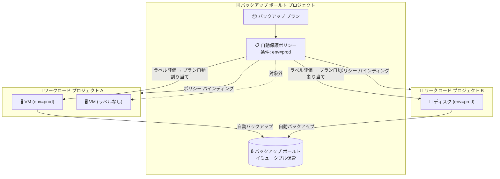

# Backup and DR: Compute Engine インスタンス・ディスクの自動保護 (Auto-protection) が GA

**リリース日**: 2026-11-17

**サービス**: Backup and DR Service

**機能**: 自動保護ポリシー (Auto-protection policies) による Compute Engine リソースの大規模保護自動化

**ステータス**: GA (一般提供)

📊 [このアップデートのインフォグラフィックを見る](https://takech9203.github.io/google-cloud-news-summary/20261117-backup-dr-auto-protection-compute-engine.html)

## 概要

Backup and DR Service において、Compute Engine インスタンスおよびディスクのリソース保護を大規模に自動化する機能が一般提供 (GA) になりました。自動保護ポリシー (Auto-protection policies) とリソースラベルを使用することで、ユーザー定義のラベルに基づいて複数プロジェクトにまたがる対象リソースを自動的に識別し、バックアップ プランを自動割り当てできます。

従来のように個々のリソースを手動で選択して保護する代わりに、自動保護ポリシーがリソースラベル (例: `env=prod`) を評価して適格なリソースを検出し、指定されたバックアップ プランを自動的に関連付けます。ポリシー作成後、マッチングと保護のスケジューリングは通常 2 時間以内 (最大 8 時間) に完了し、以降は新しく作成・ラベル付けされたリソースも自動的に保護対象に含まれます。

大量の VM やディスクを複数プロジェクトで運用する組織のバックアップ管理者にとって、「保護漏れ」を防ぎながらバックアップ運用をポリシーベースで統制できる、ガバナンス強化に直結するアップデートです。

**アップデート前の課題**

- バックアップ プランの割り当てはリソース単位で手動 (個別の関連付け作成) で行う必要があり、大量のリソースを扱う環境では運用負荷が高かった
- 新規に作成された VM やディスクへのバックアップ プラン適用が漏れると、保護されていないリソースが発生するリスクがあった
- 複数プロジェクトにまたがるリソースの保護状況を、ラベルなどの属性ベースで一括管理する仕組みがなかった
- 本機能は Preview として提供されていたが、Pre-GA 提供条件の下にあり本番環境での利用には制約があった

**アップデート後の改善**

- ラベル (key-value ペア) ベースの自動保護ポリシーにより、条件に合致するリソースへバックアップ プランが自動的に割り当てられるようになった
- 同一組織内の複数のワークロード プロジェクトを 1 つのポリシーに紐付け (ポリシー バインディング) でき、プロジェクト横断の保護を一元管理できるようになった
- GA に伴い `gcloud backup-dr auto-protection-policies` コマンドが beta なしの GA トラックで利用可能になり、本番環境で SLA の対象として利用できるようになった
- マッチングしたリソース数・保護済みリソース数・保護失敗リソース数をコンソールで可視化でき、保護状況の監査が容易になった

## アーキテクチャ図



バックアップ ボールト プロジェクトで定義した自動保護ポリシーが、バインディングされた複数のワークロード プロジェクト内のリソースをラベルで評価し、合致するリソースにバックアップ プランを自動割り当てしてボールトへバックアップします。

## サービスアップデートの詳細

### 主要機能

1. **ラベルベースの自動マッチング**
   - リソースラベル (例: `env=prod`) を条件 (criteria) として指定し、合致する Compute Engine インスタンスまたはディスクを自動検出
   - ポリシー作成後、マッチングと保護スケジューリングは通常 2 時間以内 (最大 8 時間) に完了
   - 以降に作成・ラベル付けされたリソースも継続的に評価され、自動で保護対象に追加される

2. **クロスプロジェクト保護 (ポリシー バインディング)**
   - 同一組織内の複数のワークロード プロジェクトを 1 つのポリシーにバインド可能 (デフォルトで 1 ポリシーあたり最大 50 プロジェクト)
   - ワークロード プロジェクト側でも「適用されたポリシー」を参照でき、バックアップ管理者とワークロード管理者の責務分担が可能

3. **保護状況の可視化**
   - ポリシーごとに「マッチングしたリソース数」「保護済みリソース数」「保護に失敗したリソース数」をコンソールで確認可能
   - gcloud CLI (`binding-matching-resources list` など) や API でも照会可能

4. **既存のバックアップ プラン関連付けとの統合**
   - 手動で作成済みの関連付けを持つリソースがポリシーに合致した場合、同じボールトを使うプランであれば自動保護が関連付けを引き継ぎ、必要に応じてポリシーのプランへ更新
   - 異なるボールトのプランの場合は既存の関連付けを削除し、ポリシーのプランで置き換える (事前にサービス エージェントへの権限付与が必要)

## 技術仕様

### 自動保護ポリシーの仕様

| 項目 | 詳細 |
|------|------|
| 対応リソース | Compute Engine インスタンス、ディスクのみ |
| ポリシー数の上限 | デフォルトでプロジェクト・リージョンあたり最大 10 ポリシー |
| バインド可能プロジェクト数 | 1 ポリシーあたり最大 50 ワークロード プロジェクト |
| リソース評価数 | 1 回の調整 (reconciliation) でワークロード プロジェクトあたり最大 1,000 リソースを評価 (超過分は保護失敗として報告) |
| リージョン スコープ | 1 ポリシーは単一リージョンのリソースを保護 (マルチリージョンは複数ポリシーで対応) |
| ラベル制約 | 同一ワークロード プロジェクト内では、同じリソースタイプのポリシーは同じラベルキーを使用し、各ポリシーは異なるラベル値を使用する必要あり |
| 管理インターフェース | Google Cloud コンソール、gcloud CLI、API (Terraform は将来対応予定) |
| 利用可能リージョン | northamerica-northeast1 と asia-southeast3 を除くすべての Backup and DR リージョン |
| 初回保護までの時間 | 通常 2 時間以内、最大 8 時間 |

### 必要な IAM ロール

| 対象プロジェクト | 操作 | 必要なロール |
|------|------|------|
| バックアップ ボールト プロジェクト | ポリシー・バインディングの作成/編集/削除 | `roles/backupdr.admin` または `roles/backupdr.editor` |
| バックアップ ボールト プロジェクト | ポリシー・マッチングリソースの閲覧 | `roles/backupdr.viewer` |
| ワークロード プロジェクト | ポリシー適用の承認・バインディング管理 | `roles/backupdr.admin` または `roles/backupdr.editor` |
| ワークロード プロジェクト (クロスプロジェクト時) | バックアップ操作の実行 (サービス エージェントへ付与) | `roles/backupdr.computeEngineOperator` (VM) / `roles/backupdr.diskOperator` (ディスク) |

## 設定方法

### 前提条件

1. バックアップ ボールトとバックアップ プランが作成済みであること (プランはリソースと同一リージョン)
2. 上記の IAM ロールが付与されていること (クロスプロジェクト構成の場合はサービス エージェントへのオペレーター ロール付与も必要)
3. 保護対象のリソースにラベルが付与されていること

### 手順

#### ステップ 1: 保護対象リソースにラベルを付与

```bash
# VM インスタンスにラベルを付与
gcloud compute instances add-labels INSTANCE_NAME \
  --labels=env=prod \
  --zone=ZONE

# ディスクにラベルを付与
gcloud compute disks add-labels DISK_NAME \
  --labels=env=prod \
  --zone=ZONE
```

保護したい Compute Engine リソースに、ポリシーの条件となる key-value ラベルを付与します。

#### ステップ 2: 自動保護ポリシーを作成

```bash
gcloud backup-dr auto-protection-policies create POLICY_NAME \
  --location=LOCATION \
  --criteria=key=env,values=prod \
  --backup-plan-details="resource-type=compute.googleapis.com/Instance,backup-plan=projects/BACKUP_VAULT_PROJECT/locations/LOCATION/backupPlans/BACKUP_PLAN" \
  --description="Production VM auto-protection"
```

バックアップ ボールト プロジェクトで、ラベル条件と適用するバックアップ プランを指定してポリシーを作成します。ディスクを保護する場合は `resource-type=compute.googleapis.com/Disk` を指定します。

#### ステップ 3: ワークロード プロジェクトをポリシーにバインド

```bash
gcloud backup-dr auto-protection-bindings create BINDING_NAME \
  --auto-protection-policy=POLICY_NAME \
  --location=LOCATION \
  --scope=projects/WORKLOAD_PROJECT_ID
```

保護対象のワークロード プロジェクトごとにポリシー バインディングを作成します。作成後、ポリシーが自動的にマッチングを行い、バックアップ プランの関連付けをスケジュールします。

#### ステップ 4: 保護状況を確認

```bash
# ポリシーの一覧と詳細
gcloud backup-dr auto-protection-policies list --location=LOCATION
gcloud backup-dr auto-protection-policies describe POLICY_NAME --location=LOCATION

# バインディングにマッチしたリソースの一覧
gcloud backup-dr binding-matching-resources list \
  --auto-protection-policy-binding=BINDING_NAME \
  --auto-protection-policy=POLICY_NAME \
  --location=LOCATION
```

コンソールの「Auto-protection policies」ページでは、マッチング数・保護済み数・保護失敗数をポリシー単位で確認できます。

## メリット

### ビジネス面

- **保護漏れリスクの低減**: 新規作成リソースもラベル付与のみで自動的に保護対象となるため、バックアップ未設定によるデータ損失・コンプライアンス違反のリスクを軽減できる
- **運用コストの削減**: リソース単位の手動割り当て作業が不要になり、大規模環境でのバックアップ運用工数を削減できる
- **ガバナンスの一元化**: バックアップ ボールト プロジェクト側でポリシーを集中管理し、ワークロード側は閲覧のみとする責務分離が可能

### 技術面

- **ラベル駆動の宣言的管理**: 既存のラベル運用 (環境区分、重要度区分など) をそのままバックアップ ポリシーに転用できる
- **クロスプロジェクト対応**: 1 ポリシーで最大 50 プロジェクトをカバーでき、組織全体の保護を少数のポリシーで統制できる
- **GA 品質**: gcloud の GA トラックで利用可能になり、本番環境へ安心して導入できる

## デメリット・制約事項

### 制限事項

- 対応リソースは Compute Engine インスタンスとディスクのみ (Cloud SQL、Filestore などは対象外)
- 1 ポリシーは単一リージョンのみを保護対象とする (マルチリージョン環境ではリージョンごとにポリシーが必要)
- 同一ワークロード プロジェクト内では、同じリソースタイプのポリシーは同じラベルキーを使い、ポリシーごとに異なるラベル値を指定する必要がある
- ワークロード プロジェクトは、特定リージョンにつき単一のバックアップ ボールト プロジェクトのポリシーにのみ追加可能
- 1 回の調整で評価されるのはワークロード プロジェクトあたり最大 1,000 リソースで、超過分は保護失敗として報告される
- Terraform でのポリシー管理は未対応 (将来のリリースで対応予定)
- northamerica-northeast1 と asia-southeast3 リージョンでは利用不可

### 考慮すべき点

- 自動保護が管理する関連付けは直接更新・削除できず、ポリシーに合致するリソースに別のバックアップ プランを手動で関連付けることもできない (オンデマンド バックアップは引き続き可能)
- 既存の手動関連付けが異なるボールトのプランを使用している場合、自動保護により関連付けが置き換えられる。事前に新しいボールトのサービス エージェントへオペレーター ロールを付与しないと保護が失われるため注意
- 初回のマッチングと保護開始まで最大 8 時間かかる場合があるため、即時の保護が必要な場合は手動関連付けを検討する
- ラベル付与の運用規律が前提となるため、ラベルの命名規則・付与ルールの整備 (組織ポリシーによるラベル強制など) と併せて導入するのが望ましい

## ユースケース

### ユースケース 1: 本番環境 VM の全社的な保護の標準化

**シナリオ**: 数十のプロジェクトに分散した本番 VM に対し、情報システム部門が統一されたバックアップ基準 (日次バックアップ・30 日保持など) を適用したい。

**実装例**:
```bash
# 本番 VM 用ポリシーを作成し、各ワークロード プロジェクトをバインド
gcloud backup-dr auto-protection-policies create prod-vm-policy \
  --location=asia-northeast1 \
  --criteria=key=env,values=prod \
  --backup-plan-details="resource-type=compute.googleapis.com/Instance,backup-plan=projects/central-vault-prj/locations/asia-northeast1/backupPlans/daily-30d"
```

**効果**: 各チームは VM 作成時に `env=prod` ラベルを付けるだけで統一基準のバックアップが自動適用され、中央管理チームは保護状況をポリシー単位で監査できる。

### ユースケース 2: 環境ごとに異なるバックアップ基準の適用

**シナリオ**: 同一プロジェクト内で、本番 (`env=prod`) は長期保持プラン、検証 (`env=test`) は短期保持プランと、環境に応じてバックアップ基準を変えたい。

**効果**: 同じラベルキー `env` に対して値ごとに別ポリシー・別バックアップ プランを割り当てることで、環境区分に応じたコスト最適なバックアップ運用をラベルだけで実現できる。

## 料金

自動保護ポリシー機能自体の追加料金に関する記載は確認できませんでした。保護されたリソースのバックアップには、Backup and DR Service の通常料金 (バックアップ ボールト ストレージなどの使用量ベースの月額課金) が適用されます。また、Backup and DR には 30 日間の導入トライアルがあり、対象プロジェクトでバックアップ管理料金とボールト ストレージ料金なしで機能を評価できます。

詳細は [Backup and DR の料金ページ](https://cloud.google.com/backup-disaster-recovery/pricing) を参照してください。

## 利用可能リージョン

northamerica-northeast1 および asia-southeast3 を除く、Backup and DR が利用可能なすべてのリージョンで利用できます。

## 関連サービス・機能

- **Compute Engine**: 保護対象となる VM インスタンスとディスク。リソースラベルがポリシーのマッチング条件として使用される
- **バックアップ ボールト (Backup Vault)**: バックアップの保管先。イミュータブル・削除不能なバックアップを Google 管理の分離環境に保管
- **バックアップ プラン (Backup Plan)**: バックアップの頻度・保持期間・保管先を定義するポリシー。自動保護ポリシーが対象リソースに自動割り当てする
- **IAM**: バックアップ ボールト プロジェクトとワークロード プロジェクトでのロールベースのアクセス制御、およびクロスプロジェクト保護時のサービス エージェントへの権限付与
- **Cloud Logging / Cloud Monitoring**: バックアップ運用の監査証跡の記録、運用メトリクスの監視とアラート

## 参考リンク

- 📊 [インフォグラフィック](https://takech9203.github.io/google-cloud-news-summary/20261117-backup-dr-auto-protection-compute-engine.html)
- [公式リリースノート](https://docs.cloud.google.com/release-notes#November_17_2026)
- [ドキュメント: Automate resource protection](https://docs.cloud.google.com/backup-disaster-recovery/docs/protect/automate-protection)
- [ドキュメント: Backup and DR の概要](https://docs.cloud.google.com/backup-disaster-recovery/docs/concepts/backup-dr)
- [gcloud リファレンス: backup-dr auto-protection-policies](https://docs.cloud.google.com/sdk/gcloud/reference/backup-dr/auto-protection-policies)
- [料金ページ](https://cloud.google.com/backup-disaster-recovery/pricing)

## まとめ

Compute Engine リソースの自動保護が GA となり、ラベルベースのポリシーでプロジェクト横断のバックアップ適用を自動化できるようになりました。大規模環境でバックアップの適用漏れに課題を抱えている組織は、ラベル運用ルールの整備と併せて自動保護ポリシーの導入を検討することを推奨します。まずは検証環境のプロジェクトでポリシーを作成し、マッチング・保護状況の可視化を確認した上で本番展開するのが良いでしょう。

---

**タグ**: #BackupAndDR #ComputeEngine #AutoProtection #バックアップ #GA #DR #データ保護
