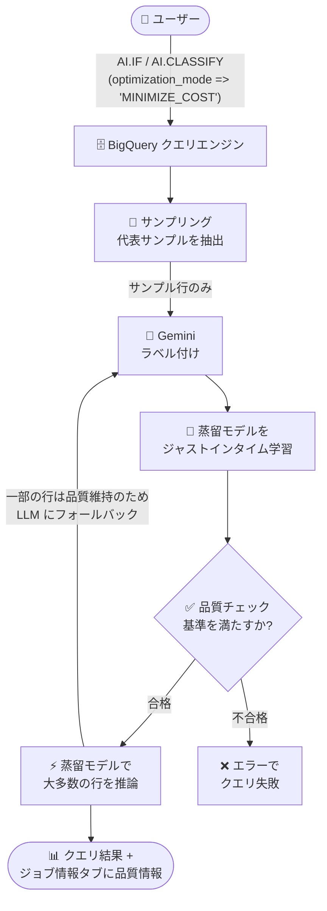

# BigQuery: 管理型 AI 関数の最適化モードと AI.SEARCH の rerank オプションが GA

**リリース日**: 2026-11-17

**サービス**: BigQuery

**機能**: 管理型 AI 関数 (AI.IF / AI.CLASSIFY) の最適化モード GA、AI.SEARCH 関数の rerank オプション GA

**ステータス**: GA (一般提供)

📊 [このアップデートのインフォグラフィックを見る](https://takech9203.github.io/google-cloud-news-summary/20261117-bigquery-ai-functions-optimized-mode-rerank.html)

## 概要

BigQuery の AI 関数に関する 2 つの機能が一般提供 (GA) になりました。1 つ目は、管理型 AI 関数 (Managed AI Functions) である `AI.IF` と `AI.CLASSIFY` の**最適化モード (optimized mode)** です。大規模データセットを処理する際の LLM トークン消費量とクエリレイテンシを大幅に削減します。GA に伴い、最適化モードの対象となるクエリタイプが拡大し、`AI.CLASSIFY` でのマルチラベル分類 (multi-label classification) にも対応しました。さらに、クエリ結果ペインの「ジョブ情報」タブで、最適化されたクエリ結果の相対的な品質情報を確認できるようになりました。

2 つ目は、`AI.SEARCH` 関数の **rerank オプション**の GA です。検索対象カラムのテキストが検索クエリにどれだけ適切に回答しているかに基づいて、検索結果をセマンティックに並べ替えることができます。ベクトル検索やハイブリッド検索で取得した候補を Ranking API でスコアリングし、関連性の高い順に再ランク付けします。

これらの機能は、数千行から数十億行規模のデータに対して SQL だけで生成 AI による分類・フィルタリング・セマンティック検索を行いたいデータアナリスト、データエンジニアにとって、コスト効率と検索品質の両面で大きな価値を提供します。なお、同日に GA となった `AI.RANK` 関数については別レポート ([2026-11-17-bigquery-ai-rank-ga.md](./2026-11-17-bigquery-ai-rank-ga.md)) を参照してください。

**アップデート前の課題**

- `AI.IF` や `AI.CLASSIFY` は通常、データセットの行ごとにリモート LLM (Gemini) を呼び出すため、数百万〜数十億行の大規模データセットではトークン消費量とコストが膨大になり、クエリレイテンシも長くなっていた
- 最適化モード (Preview 時点) では対象となるクエリタイプが限定されており、`AI.CLASSIFY` のマルチラベル分類には対応していなかった
- 最適化されたクエリの結果品質を確認する手段が提供されておらず、蒸留モデルによる推論結果の信頼性を把握しにくかった
- `AI.SEARCH` のベクトル検索・ハイブリッド検索はエンベディングの距離に基づく順序付けのみで、検索クエリへの「回答としての適切さ」で結果を並べ替えるには別途処理を組む必要があった

**アップデート後の改善**

- 最適化モードが GA となり、本番ワークロードで安心して利用可能に。蒸留モデルによる推論で LLM 呼び出し回数を大幅に削減し、トークン消費量とレイテンシを低減できる
- より多くのクエリタイプが最適化モードの対象となり、`AI.CLASSIFY` の `output_mode => 'multi'` によるマルチラベル分類でも最適化が適用可能になった
- クエリ結果ペインの「ジョブ情報」タブで、最適化されたクエリ結果の相対品質情報を確認できるようになり、コスト削減と品質のトレードオフを可視化できる
- `AI.SEARCH` に `rerank => TRUE` を指定するだけで、Ranking API によるセマンティック再ランク付けが実行され、`rerank_score` 付きでより関連性の高い検索結果を得られる

## アーキテクチャ図



最適化モードでは、BigQuery がデータの代表サンプルのみを Gemini でラベル付けし、エンベディングを特徴量として軽量な蒸留モデルをクエリ実行中に学習します。品質チェックに合格すると、大多数の行は蒸留モデルで推論されるため、Gemini の呼び出し回数 (= トークン消費) が大幅に削減されます。

## サービスアップデートの詳細

### 主要機能

1. **管理型 AI 関数の最適化モード (GA)**
   - `AI.IF` と `AI.CLASSIFY` で `optimization_mode => 'MINIMIZE_COST'` を指定 (エンベディングを提供した場合はデフォルトで有効) すると、行ごとの LLM 呼び出しの代わりに蒸留モデルによる推論を実行
   - 動作フロー: (1) サンプリングとラベル付け → (2) 蒸留モデルのジャストインタイム学習 → (3) LLM 結果に対する品質チェック → (4) 蒸留モデルによる推論 (品質維持のため一部行は LLM にフォールバック)
   - エンベディングは `AI.EMBED` による手動生成、または BigQuery の自律的エンベディング生成 (autonomous embedding generation) を利用可能

2. **最適化モードの対象拡大とマルチラベル分類対応**
   - GA に伴い、より多くのクエリタイプが最適化モードの対象に
   - `AI.CLASSIFY` のマルチラベル分類 (1 つの入力に複数カテゴリを付与) でも最適化モードを利用可能に

3. **ジョブ情報タブでの品質情報の表示**
   - Google Cloud コンソールのクエリ結果ペインの「ジョブ情報」タブに、最適化されたクエリ結果の相対的な品質情報を表示
   - 蒸留モデルの結果が LLM の結果とどの程度一致するかを把握し、コストと品質のバランスを判断できる

4. **AI.SEARCH の rerank オプション (GA)**
   - `rerank => TRUE` を指定すると、ベクトル検索 / ハイブリッド検索で取得した候補を Ranking API (Agent Search) でスコアリングし、検索クエリへの関連性で再ランク付け
   - 結果には `rerank_score` カラムが付与され、関連性の高い順に並べ替えられる
   - `options` の `reranker` オブジェクトで候補数 (`num_candidates`、デフォルトは `top_k * 5`、最大 10,000,000 行) やランキングモデル (`model`、デフォルトは `semantic-ranker-default@latest`) を調整可能

## 技術仕様

### 最適化モード (AI.IF / AI.CLASSIFY)

| 項目 | 詳細 |
|------|------|
| 対象関数 | `AI.IF`、`AI.CLASSIFY` のみ |
| 有効化方法 | `optimization_mode => 'MINIMIZE_COST'` (エンベディング提供時はデフォルト) |
| 必要な入力 | 対象カラムのエンベディング (同一モデル・同一次元で生成されたもの) |
| 最小行数 | 約 3,000 行 (蒸留モデルの学習に必要) |
| 推奨エンベディングモデル | `text-embedding-005`、Gemini エンベディング (マルチモーダルは `gemini-embedding-2`) |
| 非対応 | `max_error_ratio` 引数は最適化モードでは未サポート |
| 品質保証 | 蒸留モデルが品質しきい値を満たさない場合はクエリがエラーで失敗 |

### AI.SEARCH の rerank オプション

| 項目 | 詳細 |
|------|------|
| 構文 | `AI.SEARCH(..., rerank => TRUE [, options => '{"reranker": {...}}'])` |
| `column_to_search` の要件 | `STRING` 型のみ (NULL / 空文字の行は再ランク前に除外) |
| `query_value` の要件 | 空でない `STRING` リテラルまたはクエリパラメータ (ObjectRef は非対応) |
| `num_candidates` | 再ランク対象の候補数。デフォルトは `top_k * 5`、上限 10,000,000 行 |
| ランキングモデル | デフォルトは `semantic-ranker-default@latest` (省略推奨) |
| 必要な API / 権限 | Discovery Engine API の有効化、`discoveryengine.rankingConfigs.rank` 権限 (`roles/discoveryengine.viewer` に含まれる) |
| 認証 | エンドユーザー認証情報で Ranking API を呼び出し |

## 設定方法

### 前提条件

1. 管理型 AI 関数を実行するための権限を設定する ([生成 AI 関数の権限設定](https://docs.cloud.google.com/bigquery/docs/permissions-for-ai-functions))
2. 最適化モードを使う場合: 対象カラムのエンベディングを用意する (自律的エンベディング生成または `AI.EMBED`)
3. rerank を使う場合: クエリ実行プロジェクトで Discovery Engine API (`discoveryengine.googleapis.com`) を有効化し、`roles/discoveryengine.viewer` 相当の権限を付与する

### 手順

#### ステップ 1: エンベディング付きテーブルを作成する (最適化モード)

```sql
-- 自律的エンベディング生成を使用したテーブルの作成
CREATE TABLE my_dataset.bbc_news (
  title STRING,
  body STRING,
  body_embedding STRUCT<result ARRAY<FLOAT64>, status STRING>
    GENERATED ALWAYS AS (
      AI.EMBED(
        body,
        connection_id => '<my_connection_id>',
        task_type => 'CLASSIFICATION',
        endpoint => 'text-embedding-005')
    ) STORED
    OPTIONS(asynchronous = TRUE)
);

INSERT INTO my_dataset.bbc_news (title, body)
SELECT title, body FROM `bigquery-public-data.bbc_news.fulltext`;
```

自律的エンベディング生成を有効にすると、`AI.IF` / `AI.CLASSIFY` の呼び出し時に BigQuery が自動的にエンベディングを利用します。

#### ステップ 2: 最適化モードで AI.CLASSIFY を実行する

```sql
SELECT
  title,
  body,
  AI.CLASSIFY(
    body,
    categories => ['tech', 'sport', 'business', 'other'],
    embeddings => body_embedding,
    optimization_mode => 'MINIMIZE_COST'  -- エンベディング提供時はデフォルトのため省略可
  ) AS category
FROM my_dataset.bbc_news;
```

実行後、コンソールのクエリ結果ペインの「ジョブ情報」タブで最適化結果の相対品質情報を確認できます。

#### ステップ 3: AI.SEARCH で rerank を有効化する

```sql
SELECT base.name, base.description, distance, rerank_score
FROM AI.SEARCH(
  TABLE mydataset.products,
  'description',
  "A really fun toy",
  rerank => TRUE,
  options => '{"reranker": {"num_candidates": 50}}'
);
```

ベクトル検索の候補が Ranking API で再スコアリングされ、`rerank_score` の高い順 (検索クエリへの回答としての適切さの順) に結果が返されます。

## メリット

### ビジネス面

- **大規模データでの AI 活用コストを大幅削減**: 行ごとの Gemini 呼び出しを蒸留モデルで置き換えることで、数十億行規模の分類・フィルタリングでもトークンコストを抑制できる
- **検索体験の品質向上**: rerank により、単なるベクトル距離ではなく「クエリへの回答としての適切さ」で結果を提示でき、社内検索や RAG パイプラインの精度が向上する
- **GA による本番適用**: 両機能とも GA となり、SLA の対象として本番ワークロードに安心して導入できる

### 技術面

- **SQL のみで完結**: 蒸留モデルの学習・品質チェック・フォールバックはすべて BigQuery が自動管理し、ML パイプラインの構築が不要
- **品質の可視化**: ジョブ情報タブの相対品質情報により、コスト最適化と結果品質のトレードオフをデータに基づいて判断できる
- **柔軟な再ランク制御**: `num_candidates` やランキングモデルの指定により、精度とコストのバランスを調整できる

## デメリット・制約事項

### 制限事項

- 最適化モードは `AI.IF` と `AI.CLASSIFY` のみ対応 (他の管理型 AI 関数は対象外)
- 最適化モードには約 3,000 行以上の入力が必要 (蒸留モデルの学習に十分なデータが必要)
- 蒸留モデルが品質しきい値を満たさない場合、クエリはエラーで失敗する (カテゴリのサンプル不足、true/false の偏りなどが原因になりうる)
- エンベディングは全行で同一モデル・同一次元である必要がある
- 最適化モードでは `max_error_ratio` 引数は使用できない
- rerank では `column_to_search` が `STRING` 型である必要があり、ObjectRef (マルチモーダル) の検索クエリは非対応
- rerank 対象テキストがランキングモデルのトークン上限を超える場合、超過分は切り捨てられる

### 考慮すべき点

- 最適化モードは蒸留モデルによる近似推論であり、LLM の行ごと推論と結果が完全一致するわけではない。品質情報を確認した上で用途に応じて使い分ける
- rerank は Ranking API の呼び出しが追加で課金され、プロジェクトの Agent Search ランキング API クォータを消費する
- エンベディングはオンザフライ生成も可能だが、再利用のためマテリアライズ (事前計算・保存) が推奨される

## ユースケース

### ユースケース 1: 数十億行のログ・記事データの低コスト分類

**シナリオ**: ニュース記事やサポートチケットなど数百万〜数十億行のテキストを、トピックごとに分類して集計したい。行ごとに LLM を呼ぶとコストが膨大になる。

**実装例**:
```sql
SELECT
  title,
  AI.CLASSIFY(
    body,
    categories => ['tech', 'sport', 'business', 'other'],
    embeddings => body_embedding
  ) AS category
FROM my_dataset.bbc_news;
```

**効果**: 代表サンプルのみ Gemini でラベル付けし、残りは蒸留モデルで推論するため、トークン消費とレイテンシを大幅に削減しながら大規模分類を実現できる。

### ユースケース 2: マルチラベル分類によるコンテンツタグ付け

**シナリオ**: 1 つの記事が「テクノロジー」と「スポーツ」の両方に該当するなど、複数カテゴリへのタグ付けを大規模に行いたい。

**効果**: GA で最適化モードがマルチラベル分類 (`output_mode => 'multi'`) に対応したため、複数タグの自動付与もコスト効率よく実行できる。

### ユースケース 3: 社内ナレッジ検索・RAG の検索精度向上

**シナリオ**: 製品ドキュメントや FAQ を `AI.SEARCH` で検索しているが、ベクトル距離だけでは質問への回答として最適な文書が上位に来ないことがある。

**実装例**:
```sql
SELECT base.doc_title, base.content, rerank_score
FROM AI.SEARCH(
  TABLE knowledge.docs,
  'content',
  "請求書の支払い期限を変更する方法",
  top_k => 10,
  rerank => TRUE
);
```

**効果**: Ranking API が質問文と候補文書を突き合わせてスコアリングするため、RAG やチャットボットに渡すコンテキストの関連性が向上する。

## 料金

- **管理型 AI 関数 (AI.IF / AI.CLASSIFY)**: BigQuery のコンピューティング料金に加え、Gemini のトークン消費に基づく課金が発生します。最適化モードは LLM 呼び出し回数を削減することでトークン消費を抑えます。事前のトークン見積もりには `AI.COUNT_TOKENS` 関数が利用できます
- **AI.SEARCH**: ベクトル検索 / ハイブリッド検索には BigQuery のコンピューティング料金が適用されます。`rerank => TRUE` の場合は、追加で Ranking API の料金が適用されます

詳細は以下の料金ページを参照してください。

- [BigQuery の料金](https://cloud.google.com/bigquery/pricing)
- [Ranking API の料金](https://cloud.google.com/generative-ai-app-builder/pricing#ranking-api-pricing)

## 利用可能リージョン

`AI.SEARCH` は、Gemini Enterprise Agent Platform のエンベディングモデルをサポートするすべてのロケーション、および US / EU マルチリージョンで実行できます。最適化モードの利用可能ロケーションは [公式ドキュメント](https://docs.cloud.google.com/bigquery/docs/optimize-ai-functions) を参照してください。

## 関連サービス・機能

- **AI.RANK 関数 (同日 GA)**: 任意のテーブルやクエリ結果を検索クエリへの適合度で並べ替える関数。`VECTOR_SEARCH` の結果の再ランクや、`column_to_search` 以外のカラムのランク付けに使用する。詳細は別レポート ([2026-11-17-bigquery-ai-rank-ga.md](./2026-11-17-bigquery-ai-rank-ga.md)) を参照
- **AI.EMBED / 自律的エンベディング生成**: 最適化モードに必要なエンベディングを生成する機能。自律的生成を使うとテーブルへの挿入時に自動でエンベディングが計算される
- **ベクトルインデックス (CREATE VECTOR INDEX)**: `AI.SEARCH` の近似最近傍検索を高速化。rerank と組み合わせることで速度と精度を両立できる
- **Ranking API (Agent Search)**: rerank オプションのバックエンド。セマンティックランキングモデルで候補を再スコアリングする
- **AI.COUNT_TOKENS 関数**: クエリ実行前にトークン使用量を見積もり、コストを予測できる

## 参考リンク

- 📊 [インフォグラフィック](https://takech9203.github.io/google-cloud-news-summary/20261117-bigquery-ai-functions-optimized-mode-rerank.html)
- [公式リリースノート (2026 年 11 月 17 日)](https://docs.cloud.google.com/release-notes#November_17_2026)
- [最適化モードのドキュメント (Optimize AI function costs)](https://docs.cloud.google.com/bigquery/docs/optimize-ai-functions)
- [AI.CLASSIFY 関数リファレンス](https://docs.cloud.google.com/bigquery/docs/reference/standard-sql/bigqueryml-syntax-ai-classify)
- [AI.IF 関数リファレンス](https://docs.cloud.google.com/bigquery/docs/reference/standard-sql/bigqueryml-syntax-ai-if)
- [AI.SEARCH 関数リファレンス](https://docs.cloud.google.com/bigquery/docs/reference/standard-sql/bigqueryml-syntax-ai-search)
- [生成 AI 機能の概要 (管理型 AI 関数)](https://docs.cloud.google.com/bigquery/docs/generative-ai-overview)
- [BigQuery の料金](https://cloud.google.com/bigquery/pricing)

## まとめ

BigQuery の管理型 AI 関数の最適化モードと `AI.SEARCH` の rerank オプションが GA となり、大規模データに対する生成 AI 処理のコスト効率と検索品質が SQL だけで大きく改善できるようになりました。大量データの分類・フィルタリングに `AI.IF` / `AI.CLASSIFY` を使っている場合はエンベディングを整備して最適化モードを有効化し、ジョブ情報タブで品質を確認しながら運用することを推奨します。セマンティック検索や RAG パイプラインでは `rerank => TRUE` を試し、Ranking API の追加コストと精度向上のバランスを評価してください。

---

**タグ**: BigQuery, AI.IF, AI.CLASSIFY, AI.SEARCH, 最適化モード, モデル蒸留, rerank, セマンティック検索, 生成AI, GA
