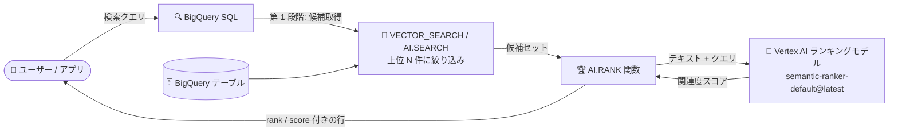

# BigQuery: AI.RANK 関数が一般提供 (GA) に

**リリース日**: 2026-11-17

**サービス**: BigQuery

**機能**: AI.RANK 関数によるセマンティックリランキング

**ステータス**: GA (一般提供)

📊 [このアップデートのインフォグラフィックを見る](https://takech9203.github.io/google-cloud-news-summary/20261117-bigquery-ai-rank-ga.html)

## 概要

BigQuery の `AI.RANK` 関数が一般提供 (GA) になりました。`AI.RANK` は、指定した列のテキストが検索クエリにどれだけ適切に回答しているかに基づいて、テーブルの行を並べ替える (リランキングする) 関数です。内部的には Vertex AI のセマンティックランキングモデル (デフォルト: `semantic-ranker-default@latest`) を呼び出し、クエリとテキストを「組み合わせて」評価するため、キーワード検索やベクトル検索のようにクエリと文書を独立に評価する方式よりも高精度な関連度判定が可能です。

典型的な使い方は 2 段階検索 (two-stage retrieval) です。まず `VECTOR_SEARCH` や `AI.SEARCH` で候補となる行を高速に絞り込み、その候補セットを `AI.RANK` で再ランキングして最終的な上位結果を得ることで、検索品質を大きく向上できます。RAG (検索拡張生成) パイプラインの検索精度改善や、社内ドキュメント検索・サポートチケット検索の品質向上に取り組むデータエンジニア、アプリケーション開発者が主な対象ユーザーです。

GA 昇格により、本番ワークロードでの利用が公式にサポートされ、SLA の対象となります。SQL だけで完結するため、外部のリランキングサービスを呼び出すカスタムコードを書く必要がありません。

**アップデート前の課題**

- セマンティックリランキングを行うには、BigQuery からデータを取り出して Vertex AI の Ranking API (Discovery Engine API) を直接呼び出すカスタムコード (Python など) を実装する必要があった
- `VECTOR_SEARCH` によるベクトル検索だけでは、クエリと文書を独立に埋め込みへ変換して距離を比較するため、「クエリに対する回答としての適切さ」を直接評価できなかった
- `AI.RANK` は Preview 段階では本番利用時のサポートや安定性に制約があった

**アップデート後の改善**

- SQL クエリ内の 1 関数呼び出しだけで、テーブルの行を検索クエリへの関連度順に並べ替えられるようになった
- `rank` (順位) と `score` (関連度スコア) に加えて入力テーブルの全列がそのまま出力されるため、結果を元テーブルと JOIN し直す必要がない
- GA となり、本番環境のワークロードで安心して利用できるようになった

## アーキテクチャ図



ベクトル検索で高速に候補を絞り込んだ後、`AI.RANK` が Vertex AI のセマンティックランキングモデルを呼び出して候補を再評価し、関連度順に並べ替えた行を返す 2 段階検索のデータフローです。

## サービスアップデートの詳細

### 主要機能

1. **セマンティックリランキング**
   - 指定した STRING 列のテキストが検索クエリにどれだけ適切に回答しているかを評価し、行を関連度順に並べ替える
   - クエリとテキストを組み合わせて評価するため、キーワード一致やベクトル距離よりも「回答としての適切さ」を直接測定できる

2. **シンプルな SQL 構文**
   - テーブル名 (`TABLE table_name`) またはサブクエリ (`query_statement`) を入力として指定可能
   - `top_n` 引数で返却する上位行数を制限でき、コストと結果サイズを制御できる
   - モデルはデフォルトで `semantic-ranker-default@latest` が使用され、常に最新のランキングモデルを指す (明示指定は不要・非推奨)

3. **使いやすい出力形式**
   - 出力テーブルには `rank` (INT64、1 始まりの順位) と `score` (FLOAT64、0.0〜1.0 の関連度) が付与される
   - 入力テーブルの全列がパススルーで出力されるため、追加の JOIN が不要

### 構文

```googlesql
AI.RANK(
  { TABLE table_name | (query_statement) },
  column_to_rank,
  query
  [, model => 'model' ]
  [, top_n => top_n ]
)
```

## 技術仕様

### 引数と出力

| 項目 | 詳細 |
|------|------|
| 入力 | `TABLE table_name` または `(query_statement)` (サブクエリ) |
| `column_to_rank` | ランキング対象のテキスト列名 (STRING 型であること) |
| `query` | 検索クエリ (STRING、空文字は不可) |
| `model` | 省略可。デフォルトは `semantic-ranker-default@latest` (省略が推奨) |
| `top_n` | 省略可。返却する上位行数 (正の INT64)。省略時は全行を返却 |
| 出力: `rank` | INT64。1 始まりの順位 (昇順ソート) |
| 出力: `score` | FLOAT64。0.0〜1.0 の関連度 (高いほど関連が高い) |
| 出力: その他 | 入力の全列をパススルー |

### 動作上の注意

- 入力に `rank` または `score` という名前の列 (大文字小文字の組み合わせを問わず) を含めることはできない
- テキストが NULL または空の行は、エラーにならずランキング前に除外される
- スコアはクエリ間でキャリブレーションされていないため、固定のしきい値によるフィルタリングは信頼できない。`top_n` または `rank` によるフィルタリングを推奨
- モデルのトークン上限を超えるテキストは切り捨てられる

## 設定方法

### 前提条件

1. Discovery Engine API を有効化する (`serviceusage.services.enable` 権限が必要)
2. クエリ実行者に Discovery Engine Viewer ロール (`roles/discoveryengine.viewer`) を付与する (`discoveryengine.rankingConfigs.rank` 権限が含まれる)

### 手順

#### ステップ 1: Discovery Engine API の有効化と権限付与

```bash
# Discovery Engine API を有効化
gcloud services enable discoveryengine.googleapis.com --project=PROJECT_ID

# クエリ実行ユーザーに Discovery Engine Viewer ロールを付与
gcloud projects add-iam-policy-binding PROJECT_ID \
  --member="user:USER_EMAIL" \
  --role="roles/discoveryengine.viewer"
```

`AI.RANK` はクエリを実行するプロジェクトの認証情報で Ranking API を呼び出します。

#### ステップ 2: AI.RANK クエリの実行

```googlesql
SELECT rank, score, title
FROM AI.RANK(
  TABLE `bigquery-public-data.bbc_news.fulltext`,
  'title',
  'downward trends in the housing market',
  top_n => 5
);
```

ニュース記事の `title` 列を検索クエリへの関連度順に並べ替え、上位 5 件を返します。

## メリット

### ビジネス面

- **検索品質の向上**: ベクトル検索の結果をセマンティックリランキングで再評価することで、RAG やエンタープライズ検索の回答精度を改善できる
- **開発コストの削減**: 外部 API を呼び出すカスタムコードが不要になり、SQL だけでリランキングパイプラインを構築・運用できる
- **本番利用の安心感**: GA 昇格により本番ワークロードでの利用が公式にサポートされる

### 技術面

- **データ移動が不要**: BigQuery 内のデータをエクスポートせずに、その場でリランキングを実行できる
- **JOIN 不要の出力**: 入力列がすべてパススルーされるため、ランキング結果と元データの突き合わせが不要
- **既存の検索機能との組み合わせ**: `VECTOR_SEARCH` / `AI.SEARCH` / `SEARCH` と組み合わせた 2 段階検索を SQL のみで実装できる

## デメリット・制約事項

### 制限事項

- インデックスを使用しないため、キーワード検索やベクトル検索のようにはスケールしない。大規模テーブル全体への適用ではなく、絞り込んだ候補セットのリランキングに使うことが推奨される
- 入力に `rank` / `score` という列名を含められない
- モデルのトークン上限を超えるテキストは切り捨てられる
- Ranking API のクォータ (プロジェクトあたり毎分 500 リクエストなど) の対象となる

### 考慮すべき点

- スコアはクエリ間で比較可能なようにキャリブレーションされていないため、静的なスコアしきい値での判定は避ける。スコア 0.0 は「無関係」と「未ランク」のどちらの可能性もある
- コストはランキングする行数に応じて増加するため、`WHERE` 句やベクトル検索で事前に候補を絞り込むことがコスト管理上重要
- Vertex AI (Agent Search) の Ranking API をユーザー認証情報で呼び出すため、BigQuery とは別に Ranking API の料金が発生する

## ユースケース

### ユースケース 1: ベクトル検索結果のリランキング (2 段階検索)

**シナリオ**: RAG パイプラインで、ベクトル検索により取得した候補ドキュメントの精度が不十分で、LLM に渡すコンテキストの品質を上げたい。

**実装例**:
```googlesql
SELECT rank, score, title
FROM AI.RANK(
  (
    SELECT title, body
    FROM `bigquery-public-data.bbc_news.fulltext`
    WHERE category = 'business'
  ),
  'body',
  'executives who resigned after an accounting scandal',
  top_n => 3
);
```

公式ドキュメントでは、`VECTOR_SEARCH` で 50 件の候補を取得してから `AI.RANK` で上位 5 件に再ランキングする 2 段階検索の例も示されています。

**効果**: ベクトル検索単体よりも「クエリへの回答としての適切さ」に基づいた高精度な上位結果が得られ、RAG の回答品質が向上する。

### ユースケース 2: サポートチケット・ナレッジベースの検索品質向上

**シナリオ**: BigQuery に蓄積した過去のサポートチケットや FAQ から、問い合わせ内容に最も関連する過去事例を抽出したい。

**効果**: カテゴリや日付などで事前フィルタリングした候補セットに `AI.RANK` を適用することで、問い合わせへの回答として最適な事例を上位に提示でき、サポート業務の効率が向上する。

## 料金

`AI.RANK` は、クエリを実行するプロジェクトの認証情報を使用して Vertex AI (Agent Search) の Ranking API を呼び出し、Ranking API の料金体系で課金されます。コストはランキングする行数に応じて増加するため、事前のフィルタリングによる入力行数の制御が推奨されます。具体的な単価は公式料金ページを参照してください。

- [Agent Search (Ranking API) 料金ページ](https://cloud.google.com/generative-ai-app-builder/pricing#ranking-api)

このほか、BigQuery のクエリ処理自体には通常の BigQuery 料金 (オンデマンドまたはエディション) が適用されます。

## 利用可能リージョン

公式ドキュメントにリージョンの明示的な記載はありません。最新情報は [AI.RANK 関数のドキュメント](https://docs.cloud.google.com/bigquery/docs/reference/standard-sql/bigqueryml-syntax-ai-rank) を参照してください。

## 関連サービス・機能

- **VECTOR_SEARCH / ベクトルインデックス**: 埋め込みベースの近傍検索で候補を高速に絞り込み、`AI.RANK` でリランキングする 2 段階検索を構成できる
- **AI.SEARCH**: 自律的埋め込み生成を利用したセマンティック検索関数。`AI.RANK` と組み合わせて検索品質を向上できる
- **AI.GENERATE / AI.GENERATE_TEXT**: Gemini モデルによるテキスト生成関数。`AI.RANK` で絞り込んだコンテキストを入力とする RAG パターンを SQL で構築できる
- **AI.CLASSIFY / AI.SCORE / AI.IF**: マネージド AI 関数群。分類・評価・フィルタリングと組み合わせたパイプラインを構成できる
- **Vertex AI Ranking API (Discovery Engine)**: `AI.RANK` が内部で呼び出すセマンティックランキングサービス。API の有効化と IAM 権限が前提条件となる

## 参考リンク

- 📊 [インフォグラフィック](https://takech9203.github.io/google-cloud-news-summary/20261117-bigquery-ai-rank-ga.html)
- [公式リリースノート](https://docs.cloud.google.com/release-notes#November_17_2026)
- [AI.RANK 関数ドキュメント](https://docs.cloud.google.com/bigquery/docs/reference/standard-sql/bigqueryml-syntax-ai-rank)
- [生成 AI 関数の概要](https://docs.cloud.google.com/bigquery/docs/generative-ai-overview)
- [Ranking API ドキュメント](https://docs.cloud.google.com/generative-ai-app-builder/docs/ranking)
- [料金ページ (Agent Search / Ranking API)](https://cloud.google.com/generative-ai-app-builder/pricing#ranking-api)

## まとめ

`AI.RANK` の GA により、BigQuery 内で完結するセマンティックリランキングが本番ワークロードで利用可能になりました。RAG やエンタープライズ検索の品質改善に取り組むチームは、まず Discovery Engine API を有効化し、`VECTOR_SEARCH` と `AI.RANK` を組み合わせた 2 段階検索を既存の検索パイプラインで評価することを推奨します。コスト管理のため、事前フィルタリングと `top_n` による入力行数の制御を忘れずに行ってください。

---

**タグ**: BigQuery, AI.RANK, セマンティック検索, リランキング, RAG, ベクトル検索, 生成AI, GA
