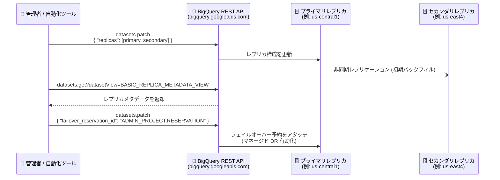

# BigQuery: クロスリージョンレプリケーションとマネージド災害復旧の REST API サポート (GA)

**リリース日**: 2026-11-17

**サービス**: BigQuery

**機能**: REST API によるクロスリージョンデータセットレプリケーションの構成・モニタリングとフェイルオーバー予約の管理

**ステータス**: 一般提供 (GA)

📊 [このアップデートのインフォグラフィックを見る](https://takech9203.github.io/google-cloud-news-summary/20261117-bigquery-cross-region-replication-rest-api.html)

## 概要

BigQuery の REST API (`datasets.insert`、`datasets.patch`、`datasets.update`、`datasets.get`) を使用して、クロスリージョンデータセットレプリケーション (CRR) の構成とモニタリング、およびマネージド災害復旧 (DR) 用のフェイルオーバー予約のアタッチ / デタッチが可能になりました。本機能は一般提供 (GA) となっています。

クロスリージョンレプリケーションは、データセットのセカンダリレプリカを別リージョンに作成して地理的冗長性を確保する機能です。さらにフェイルオーバー予約 (Enterprise Plus エディション) をデータセットにアタッチすると、プライマリリージョンの障害時にもフェイルオーバーできるマネージド災害復旧が利用できます。今回のアップデートにより、これらの DR 構成を標準的な Dataset リソースの API 操作として扱えるようになり、Infrastructure as Code (IaC) や自動化パイプラインへの組み込みが容易になりました。

対象ユーザーは、BigQuery の DR 構成を多数のデータセットに対して一括適用・管理したいデータプラットフォーム管理者や、レプリケーション状態をプログラムから監視したい SRE / 運用チームです。

**アップデート前の課題**

- クロスリージョンレプリケーションとフェイルオーバー予約の構成は、Google Cloud コンソールまたは SQL DDL ステートメント (`ALTER SCHEMA ADD REPLICA`、`ALTER SCHEMA SET OPTIONS (failover_reservation = ...)`) でのみ管理可能で、公式ドキュメントにも「CLI、クライアントライブラリ、API、Terraform はサポートされない」と明記されていた
- 多数のデータセットへの DR 構成の適用には、DDL クエリジョブの発行をスクリプト化する必要があり、API ベースの構成管理ツールと統合しにくかった
- レプリカの作成状態やレプリケーション構成の確認には、コンソールまたは `INFORMATION_SCHEMA.SCHEMATA_REPLICAS` へのクエリ実行が必要だった

**アップデート後の改善**

- `datasets.insert` でデータセット作成時に `replicas` フィールドを指定し、最初からレプリカ付きでプロビジョニングできるようになった
- `datasets.patch` / `datasets.update` で既存データセットへのレプリカ追加・削除、および `failover_reservation_id` によるフェイルオーバー予約のアタッチ / デタッチが可能になった
- `datasets.get` の `datasetView` パラメータ (`BASIC_REPLICA_METADATA_VIEW` など) でレプリカのメタデータを取得し、プログラムからレプリケーション構成をモニタリングできるようになった

## アーキテクチャ図



管理者や自動化ツールが REST API 経由でレプリカの追加・監視・フェイルオーバー予約のアタッチを行うフローです。セカンダリレプリカへのバックフィル完了後にフェイルオーバー予約をアタッチできます。

## サービスアップデートの詳細

### 主要機能

1. **データセット作成時のレプリカ指定 (`datasets.insert`)**
   - データセット作成リクエストの `replicas` フィールドにレプリカの `id` と `location` を指定して、最初からレプリケーション構成済みのデータセットを作成できる
   - プライマリレプリカも `replicas` フィールドに含める必要がある

2. **既存データセットへのレプリカ追加・削除 (`datasets.patch` / `datasets.update`)**
   - `replicas` フィールドを更新してセカンダリレプリカを追加できる
   - レプリカを削除する場合は、残すレプリカのみを含めたリクエストを送信する (プライマリレプリカは必ず含める)

3. **フェイルオーバー予約のアタッチ / デタッチ**
   - `failover_reservation_id` フィールド (`ADMIN_PROJECT.FAILOVER_RESERVATION` 形式) を設定して、マネージド災害復旧用の Enterprise Plus フェイルオーバー予約をデータセットにアタッチできる
   - セカンダリレプリカのバックフィル完了後にのみ設定可能

4. **レプリケーション構成のモニタリング (`datasets.get`)**
   - `datasetView` クエリパラメータ (`BASIC`、`BASIC_REPLICA_METADATA_VIEW`、`FULL`) でレプリカメタデータを取得できる
   - `sync_status` などクロスリージョンリクエストを要するフィールドはビューに含まれないため、詳細な同期状態は `INFORMATION_SCHEMA.SCHEMATA_REPLICAS` ビューや Cloud Monitoring 指標と併用する

## 技術仕様

### API メソッドと用途

| メソッド | エンドポイント | 用途 |
|------|------|------|
| `datasets.insert` | `POST /bigquery/v2/projects/{PROJECT_ID}/datasets` | レプリカ付きデータセットの作成 |
| `datasets.patch` | `PATCH /bigquery/v2/projects/{PROJECT_ID}/datasets/{DATASET_ID}` | レプリカの追加・削除、フェイルオーバー予約のアタッチ / デタッチ |
| `datasets.update` | `PUT /bigquery/v2/projects/{PROJECT_ID}/datasets/{DATASET_ID}` | `patch` と同様の更新操作 |
| `datasets.get` | `GET /bigquery/v2/projects/{PROJECT_ID}/datasets/{DATASET_ID}?datasetView=...` | レプリカメタデータの取得・モニタリング |

### リクエストボディの例 (レプリカ付きデータセットの作成)

```json
{
  "datasetReference": {
    "datasetId": "DATASET_ID",
    "projectId": "PROJECT_ID"
  },
  "location": "us",
  "replicas": [
    { "id": "us-replica", "location": "us" },
    { "id": "eu-replica", "location": "eu" }
  ]
}
```

### フェイルオーバー予約のアタッチ (patch)

```json
{
  "failover_reservation_id": "ADMIN_PROJECT.FAILOVER_RESERVATION"
}
```

## 設定方法

### 前提条件

1. レプリカを管理するための `bigquery.datasets.update` 権限を持っていること
2. マネージド災害復旧を使用する場合は、Enterprise Plus エディションの予約で `secondary_location` を設定したフェイルオーバー予約を作成済みであること
3. フェイルオーバー予約をアタッチする場合は、セカンダリレプリカの初期バックフィルが完了していること

### 手順

#### ステップ 1: 既存データセットにセカンダリレプリカを追加

```bash
curl -X PATCH \
  -H "Authorization: Bearer $(gcloud auth print-access-token)" \
  -H "Content-Type: application/json" \
  "https://bigquery.googleapis.com/bigquery/v2/projects/PROJECT_ID/datasets/DATASET_ID" \
  -d '{
    "replicas": [
      { "id": "us-replica", "location": "us" },
      { "id": "eu-replica", "location": "eu" }
    ]
  }'
```

レプリカの追加・削除時は、プライマリレプリカを必ず `replicas` フィールドに含めます。

#### ステップ 2: レプリカの作成状態を確認

```bash
curl -H "Authorization: Bearer $(gcloud auth print-access-token)" \
  "https://bigquery.googleapis.com/bigquery/v2/projects/PROJECT_ID/datasets/DATASET_ID?datasetView=BASIC_REPLICA_METADATA_VIEW"
```

初期コピーの完了は `INFORMATION_SCHEMA.SCHEMATA_REPLICAS` ビューの `creation_complete` 列でも確認できます。

#### ステップ 3: フェイルオーバー予約をアタッチ (マネージド DR)

```bash
curl -X PATCH \
  -H "Authorization: Bearer $(gcloud auth print-access-token)" \
  -H "Content-Type: application/json" \
  "https://bigquery.googleapis.com/bigquery/v2/projects/PROJECT_ID/datasets/DATASET_ID" \
  -d '{ "failover_reservation_id": "ADMIN_PROJECT.FAILOVER_RESERVATION" }'
```

セカンダリレプリカのバックフィル完了後にのみ設定可能です。

## メリット

### ビジネス面

- **DR 構成の標準化と大規模展開**: 多数のデータセットに対する DR 構成を API 経由で一括適用でき、組織全体の事業継続計画 (BCP) 対応を効率化できる
- **運用コストの削減**: コンソール操作や DDL クエリジョブのスクリプト化が不要になり、構成変更にかかる手作業と人的ミスを削減できる

### 技術面

- **IaC / 自動化との統合**: Dataset リソースの標準的な API 操作としてレプリケーションを扱えるため、構成管理ツールや CI/CD パイプラインに組み込みやすい
- **プログラムによるモニタリング**: `datasets.get` の `datasetView` パラメータでレプリカメタデータを取得でき、独自の監視・監査の仕組みを構築できる
- **DDL と API の使い分け**: 既存の SQL DDL (`ALTER SCHEMA ADD REPLICA` など) やコンソール操作と併用でき、チームのワークフローに合わせて選択できる

## デメリット・制約事項

### 制限事項

- プライマリレプリカの昇格 (プライマリ切り替え) は API では実行できず、引き続き `ALTER SCHEMA SET OPTIONS` DDL ステートメントまたはコンソールが必要
- `datasets.get` のビューには `sync_status` などクロスリージョンリクエストを要するフィールドは含まれない (詳細な同期状態は `INFORMATION_SCHEMA.SCHEMATA_REPLICAS` を使用)
- プライマリ切り替え中は `datasets.get` の呼び出しが旧プライマリにルーティングされ、`replicas` フィールドが古い情報を返す可能性がある
- フェイルオーバー予約は Enterprise Plus エディションが必要で、セカンダリレプリカのバックフィル完了後にのみアタッチ可能
- レプリカはリージョン / マルチリージョンごとに 1 つまで、レプリケーション対象はテーブル数 100,000 未満のデータセットに限定されるなど、クロスリージョンレプリケーション自体の制限が適用される

### 考慮すべき点

- レプリカの追加・削除時はプライマリレプリカを必ず `replicas` フィールドに含める必要があり、省略すると意図しない構成変更になる可能性がある
- DML 操作が頻繁なテーブルはファイル単位で再レプリケーションされるため、データ転送コストが増大しやすい (DML の多いテーブルはレプリケーション対象外のデータセットに分離することが推奨される)
- マネージド DR (フェイルオーバー予約アタッチ後) では、書き込みは Enterprise Plus 予約のジョブのみに制限される

## ユースケース

### ユースケース 1: Terraform / 自動化パイプラインによる DR 構成の一括管理

**シナリオ**: 金融系企業が、コンプライアンス要件として全業務データセットにクロスリージョンレプリカと DR 構成を適用する必要がある。従来は DDL スクリプトを順次実行していた。

**実装例**:
```
1. datasets.insert で新規データセットを replicas 付きで作成
2. 既存データセットには datasets.patch で replicas を追加
3. バックフィル完了を datasets.get / INFORMATION_SCHEMA で確認
4. datasets.patch で failover_reservation_id をアタッチ
```

**効果**: データセットのプロビジョニングと DR 構成を単一の API ワークフローに統合し、構成漂流 (drift) の検出や監査も API で自動化できる。

### ユースケース 2: レプリケーション構成の自動監査・モニタリング

**シナリオ**: SRE チームが、全プロジェクトのデータセットについて「レプリカが構成されているか」「どのリージョンにあるか」を定期的に棚卸ししたい。

**効果**: `datasets.get?datasetView=BASIC_REPLICA_METADATA_VIEW` を定期実行することで、クエリジョブを発行せずにレプリカ構成を取得でき、Cloud Monitoring のレプリケーション遅延指標 (`dataset_staleness`) と組み合わせて RPO の監視体制を構築できる。

## 料金

今回の API サポート自体に追加料金はありません。クロスリージョンレプリケーションとマネージド災害復旧の利用には、従来どおり以下の料金が発生します。

- **ストレージ**: セカンダリリージョンのストレージバイトは、別のコピーとしてセカンダリリージョンの料金で課金される
- **データレプリケーション**: リージョン間のデータ転送量に応じて課金される (スロットリソースは消費しない)。マネージド DR はターボレプリケーションを使用し、物理 GiB 単位で課金される
- **コンピューティング**: マネージド DR には Enterprise Plus エディションが必要。プライマリリージョンの容量のみ課金され、セカンダリの容量 (予約ベースライン分) は追加料金なしで利用できる

詳細は [BigQuery の料金ページ](https://cloud.google.com/bigquery/pricing#data_replication) を参照してください。

## 利用可能リージョン

クロスリージョンレプリケーションは BigQuery のリージョン / マルチリージョン間で利用できます。ただし、マネージド災害復旧では `us-central1` - `us` マルチリージョンなど一部のリージョンペアは構成できません。詳細は [データレプリケーションのドキュメント](https://docs.cloud.google.com/bigquery/docs/data-replication) を参照してください。

## 関連サービス・機能

- **BigQuery Reservations (Enterprise Plus)**: マネージド DR のフェイルオーバー予約を提供。Reservation API には予約のフェイルオーバーを実行する `failoverReservation` メソッドがある
- **Cloud Monitoring**: レプリケーション遅延 (`bigquery.googleapis.com/storage/replication/dataset_staleness`) やネットワーク下り (外向き) バイト数の指標で、RPO やデータ転送量を監視できる
- **INFORMATION_SCHEMA.SCHEMATA_REPLICAS**: レプリカの作成完了状態 (`creation_complete`) や同期状態 (`sync_status`) を SQL で確認できるビュー

## 参考リンク

- 📊 [インフォグラフィック](https://takech9203.github.io/google-cloud-news-summary/20261117-bigquery-cross-region-replication-rest-api.html)
- [公式リリースノート](https://docs.cloud.google.com/release-notes#November_17_2026)
- [クロスリージョンデータセットレプリケーション](https://docs.cloud.google.com/bigquery/docs/data-replication)
- [マネージド災害復旧](https://docs.cloud.google.com/bigquery/docs/managed-disaster-recovery)
- [Datasets REST API リファレンス](https://docs.cloud.google.com/bigquery/docs/reference/rest/v2/datasets)
- [料金ページ](https://cloud.google.com/bigquery/pricing#data_replication)

## まとめ

BigQuery のクロスリージョンレプリケーションとマネージド災害復旧が REST API から構成・監視できるようになり、これまでコンソール / SQL DDL に限定されていた DR 構成を IaC や自動化パイプラインに組み込めるようになりました。多数のデータセットを運用する組織は、API ベースでの DR 構成の標準化と自動監査の導入を検討する価値があります。なお、プライマリレプリカの昇格は引き続き DDL / コンソールでの操作が必要な点に注意してください。

---

**タグ**: BigQuery, クロスリージョンレプリケーション, 災害復旧, DR, REST API, GA
