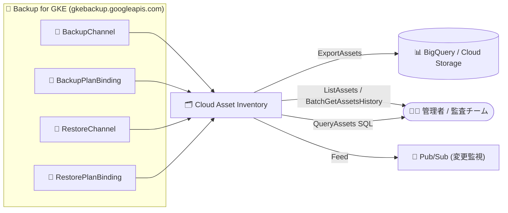

# Cloud Asset Inventory: Backup for GKE の 4 つのリソースタイプを新たにサポート

**リリース日**: 2026-11-17

**サービス**: Cloud Asset Inventory

**機能**: Backup for GKE リソースタイプ (BackupChannel / BackupPlanBinding / RestoreChannel / RestorePlanBinding) のサポート

**ステータス**: Feature (一般公開)

📊 [このアップデートのインフォグラフィックを見る](https://takech9203.github.io/google-cloud-news-summary/20261117-cloud-asset-inventory-backup-for-gke-resource-types.html)

## 概要

Cloud Asset Inventory で、Backup for GKE の以下 4 つのリソースタイプが新たにパブリックに利用可能になりました。これらは `ExportAssets`、`ListAssets`、`BatchGetAssetsHistory`、`QueryAssets`、および Feed の各 API を通じて取得・監視できます。

- `gkebackup.googleapis.com/BackupChannel`
- `gkebackup.googleapis.com/BackupPlanBinding`
- `gkebackup.googleapis.com/RestoreChannel`
- `gkebackup.googleapis.com/RestorePlanBinding`

BackupChannel / RestoreChannel は、Backup for GKE のクロスプロジェクト バックアップ・リストア構成で使用されるリソースで、クラスタプロジェクトとバックアッププロジェクトをまたぐバックアップ/リストアの境界を定義します。BackupPlanBinding / RestorePlanBinding は、チャネルに紐づくバックアッププラン / リストアプランの関連付けを表します。今回のアップデートにより、これらのリソースも組織・フォルダ・プロジェクト単位で一元的に棚卸し、変更履歴の追跡、SQL クエリ、Pub/Sub によるリアルタイム変更監視の対象になりました。

このアップデートは、組織全体の GKE バックアップ体制をガバナンス・コンプライアンスの観点から可視化したいクラウド管理者、セキュリティチーム、SRE にとって有用です。

**アップデート前の課題**

- Cloud Asset Inventory では Backup for GKE の Backup、BackupPlan、Restore、RestorePlan などは取得できたものの、クロスプロジェクト構成を担う BackupChannel / RestoreChannel とそのバインディングは棚卸しの対象外だった
- クロスプロジェクトのバックアップ・リストア構成の全体像を把握するには、プロジェクトごとに `gcloud container backup-restore backup-channels list` などの gkebackup API を個別に呼び出して集計する必要があった
- チャネルやバインディングの作成・変更・削除を組織横断でリアルタイムに検知する仕組みがなかった

**アップデート後の改善**

- 4 つのリソースタイプが Export (BigQuery / Cloud Storage へのエクスポート)、List、変更履歴 (BatchGetAssetsHistory)、SQL クエリ (QueryAssets)、Feed (Pub/Sub 監視) の対象になった
- 組織・フォルダ・プロジェクト単位でクロスプロジェクト バックアップ構成を一括で棚卸しできるようになった
- Feed API により、バックアップチャネルやバインディングの構成変更を Pub/Sub 経由でリアルタイムに検知し、自動対応やアラートにつなげられるようになった

## アーキテクチャ図



Backup for GKE の 4 つのリソースタイプのメタデータが Cloud Asset Inventory に取り込まれ、エクスポート・一覧・履歴・SQL クエリ・リアルタイム変更監視の各 API から利用できるようになった構成を示しています。

## サービスアップデートの詳細

### 主要機能

1. **新たにサポートされた 4 つのリソースタイプ**
   - `gkebackup.googleapis.com/BackupChannel`: クラスタプロジェクト側に作成され、クロスプロジェクト バックアップの対象を定義するリソース
   - `gkebackup.googleapis.com/BackupPlanBinding`: バックアップチャネルに紐づくバックアッププランの関連付け
   - `gkebackup.googleapis.com/RestoreChannel`: バックアッププロジェクト側に作成され、クロスプロジェクト リストアの対象を定義するリソース
   - `gkebackup.googleapis.com/RestorePlanBinding`: リストアチャネルに紐づくリストアプランの関連付け

2. **利用可能な Cloud Asset Inventory API**
   - `ExportAssets`: BigQuery や Cloud Storage へのアセットの一括エクスポート
   - `ListAssets`: プロジェクト・フォルダ・組織配下のアセット一覧取得
   - `BatchGetAssetsHistory`: 指定期間のアセット変更履歴の取得
   - `QueryAssets`: BigQuery 標準 SQL によるアセットのアドホック分析
   - Feed: Pub/Sub トピックへのアセット変更のリアルタイム配信

3. **既存の Backup for GKE リソースタイプとの統合**
   - 既にサポートされていた `Backup`、`BackupPlan`、`Restore`、`RestorePlan`、`VolumeBackup`、`VolumeRestore` と合わせて、Backup for GKE の主要リソースを Cloud Asset Inventory で網羅的に可視化できるようになった

## 技術仕様

### サポートされる API と制限

| 項目 | 詳細 |
|------|------|
| 対象リソースタイプ | BackupChannel、BackupPlanBinding、RestoreChannel、RestorePlanBinding |
| 利用可能な API | ExportAssets、ListAssets、BatchGetAssetsHistory、QueryAssets、Feed |
| 検索 API (SearchAllResources 等) | 非対応 (公式ドキュメントに「Not available in the analysis and search APIs」と記載) |
| 分析 API (AnalyzeIamPolicy 等) | 非対応 |
| 実効タグ (Effective tags) | 非対応 |
| API ソース | gkebackup.googleapis.com (gkebackup/v1 API) |

### アセット取得の例 (ListAssets)

```bash
gcloud asset list \
  --project=PROJECT_ID \
  --asset-types="gkebackup.googleapis.com/BackupChannel,gkebackup.googleapis.com/BackupPlanBinding" \
  --content-type=resource
```

## 設定方法

### 前提条件

1. Cloud Asset API (`cloudasset.googleapis.com`) が有効化されていること
2. 取得対象のスコープ (プロジェクト・フォルダ・組織) に対する `cloudasset.assets.listResource` などの権限 (例: `roles/cloudasset.viewer`)
3. Backup for GKE でバックアップチャネル / リストアチャネルを使用していること (クロスプロジェクト バックアップ・リストア構成)

### 手順

#### ステップ 1: 新リソースタイプの一覧取得

```bash
gcloud asset list \
  --organization=ORGANIZATION_ID \
  --asset-types="gkebackup.googleapis.com/BackupChannel,gkebackup.googleapis.com/RestoreChannel,gkebackup.googleapis.com/BackupPlanBinding,gkebackup.googleapis.com/RestorePlanBinding" \
  --content-type=resource
```

組織配下のすべてのバックアップ/リストアチャネルとバインディングを一覧表示します。

#### ステップ 2: BigQuery へのエクスポート

```bash
gcloud asset export \
  --organization=ORGANIZATION_ID \
  --asset-types="gkebackup.googleapis.com/BackupChannel,gkebackup.googleapis.com/RestoreChannel" \
  --content-type=resource \
  --bigquery-table="projects/PROJECT_ID/datasets/DATASET_ID/tables/TABLE_NAME" \
  --output-bigquery-force
```

BigQuery にエクスポートすることで、SQL による詳細分析やダッシュボード化が可能になります。

#### ステップ 3: Feed によるリアルタイム変更監視

```bash
gcloud asset feeds create gke-backup-channel-feed \
  --organization=ORGANIZATION_ID \
  --asset-types="gkebackup.googleapis.com/BackupChannel,gkebackup.googleapis.com/BackupPlanBinding" \
  --content-type=resource \
  --pubsub-topic="projects/PROJECT_ID/topics/TOPIC_ID"
```

バックアップチャネルやバインディングの作成・更新・削除を Pub/Sub 経由でリアルタイムに検知できます。

## メリット

### ビジネス面

- **ガバナンス・コンプライアンスの強化**: クロスプロジェクトのバックアップ構成を組織横断で棚卸しでき、監査証跡として変更履歴も取得できる
- **運用コストの削減**: プロジェクトごとに gkebackup API を呼び出して集計するスクリプトが不要になり、Cloud Asset Inventory の標準機能で一元管理できる

### 技術面

- **リアルタイム変更検知**: Feed API により、チャネルやバインディングの意図しない変更・削除を Pub/Sub 経由で即座に検知し、Cloud Functions 等での自動対応につなげられる
- **SQL によるアドホック分析**: QueryAssets や BigQuery エクスポートにより、バックアップ保護されていないクラスタの特定などの分析を SQL で実行できる
- **変更履歴の追跡**: BatchGetAssetsHistory で過去の構成変更をポイントインタイムで確認でき、インシデント調査に活用できる

## デメリット・制約事項

### 制限事項

- 4 つの新リソースタイプは検索 API (`SearchAllResources` / `SearchAllIamPolicies`) では利用できない
- 分析 API (IAM ポリシー分析など) でも利用できない
- 実効タグ (Effective tags) はサポートされない

### 考慮すべき点

- 全リソースタイプを対象にした Feed を既に運用している場合、新リソースタイプの変更イベントが追加で配信される可能性があるため、下流の処理への影響を確認する
- Backup for GKE のチャネル機能自体を使用していない環境では、今回の新リソースタイプのアセットは存在しない

## ユースケース

### ユースケース 1: 組織全体のクロスプロジェクト バックアップ構成の棚卸し

**シナリオ**: 複数チームが各自のプロジェクトで GKE クラスタを運用し、中央のバックアッププロジェクトにクロスプロジェクト バックアップを集約している。セキュリティチームが構成の全体像を定期的に監査したい。

**実装例**:
```bash
gcloud asset export \
  --organization=123456789012 \
  --asset-types="gkebackup.googleapis.com/BackupChannel,gkebackup.googleapis.com/BackupPlanBinding,gkebackup.googleapis.com/RestoreChannel,gkebackup.googleapis.com/RestorePlanBinding" \
  --content-type=resource \
  --bigquery-table="projects/audit-project/datasets/asset_audit/tables/gke_backup_channels" \
  --output-bigquery-force
```

**効果**: どのクラスタプロジェクトがどのバックアッププロジェクトにバックアップを送っているかを BigQuery 上で一覧化・可視化でき、監査レポート作成の工数を削減できる。

### ユースケース 2: バックアップ構成の意図しない変更の検知

**シナリオ**: 本番環境のバックアップチャネルやバインディングが誤って削除・変更されると、バックアップが取得されなくなるリスクがある。変更を即座に検知してアラートを上げたい。

**効果**: Feed API で変更イベントを Pub/Sub に配信し、Cloud Functions で Slack 通知やチケット起票を自動化することで、バックアップ保護の空白期間を最小化できる。

## 料金

Cloud Asset Inventory の Export、List、Feed などの基本機能は追加料金なしで利用できます。ただし、エクスポート先の BigQuery / Cloud Storage のストレージ料金、Feed 配信先の Pub/Sub 料金、QueryAssets の背後で実行される処理に関連する料金は別途発生する場合があります。詳細は料金ページを参照してください。

- [Cloud Asset Inventory の料金](https://cloud.google.com/asset-inventory/pricing)

## 利用可能リージョン

Cloud Asset Inventory はグローバルサービスとして提供されます。Backup for GKE のチャネルリソース自体は、Backup for GKE が利用可能なリージョンに作成されます。詳細は各サービスのドキュメントを参照してください。

## 関連サービス・機能

- **Backup for GKE**: 今回サポートされた 4 リソースタイプの提供元。GKE クラスタのワークロードと永続ボリュームのバックアップ・リストアを行うアドオンサービス
- **BigQuery**: ExportAssets / QueryAssets の分析基盤として、アセットデータの SQL 分析やダッシュボード化に利用
- **Pub/Sub**: Feed API によるアセット変更のリアルタイム配信先
- **Cloud Storage**: アセットのエクスポート先として利用可能
- **Security Command Center**: Cloud Asset Inventory のデータを活用した組織全体のセキュリティ態勢の可視化

## 参考リンク

- 📊 [インフォグラフィック](https://takech9203.github.io/google-cloud-news-summary/20261117-cloud-asset-inventory-backup-for-gke-resource-types.html)
- [公式リリースノート](https://docs.cloud.google.com/release-notes#November_17_2026)
- [Cloud Asset Inventory でサポートされるアセットタイプ](https://docs.cloud.google.com/asset-inventory/docs/asset-types)
- [Backup for GKE: クロスプロジェクト バックアップ](https://docs.cloud.google.com/kubernetes-engine/docs/add-on/backup-for-gke/how-to/cross-project-backups)
- [Backup for GKE: クロスプロジェクト リストア](https://docs.cloud.google.com/kubernetes-engine/docs/add-on/backup-for-gke/how-to/cross-project-restores)
- [料金ページ](https://cloud.google.com/asset-inventory/pricing)

## まとめ

Backup for GKE のクロスプロジェクト バックアップ・リストア構成を担うチャネルとバインディングが Cloud Asset Inventory で取得可能になり、組織横断でのバックアップ体制の棚卸し・変更監視が標準機能で実現できるようになりました。クロスプロジェクト バックアップを運用している組織は、既存のアセットエクスポートや Feed にこれら 4 つのリソースタイプを追加し、バックアップ構成のガバナンスを強化することを推奨します。

---

**タグ**: Cloud Asset Inventory, Backup for GKE, GKE, バックアップ, ガバナンス, アセット管理, Feature
