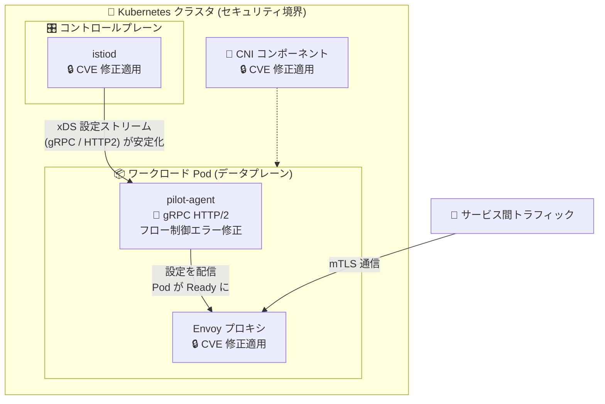

# Cloud Service Mesh: セキュリティパッチリリース (1.31.3-asm.13 / 1.30.7-asm.13 / 1.29.10-asm.8)

**リリース日**: 2026-11-17

**サービス**: Cloud Service Mesh

**機能**: in-cluster Cloud Service Mesh のセキュリティパッチと xDS 接続問題の修正

**ステータス**: リリース済み (Announcement + Fixed)

📊 [このアップデートのインフォグラフィックを見る](https://takech9203.github.io/google-cloud-news-summary/20261117-cloud-service-mesh-security-patches.html)

## 概要

in-cluster Cloud Service Mesh のサポート対象 3 系統すべてに対して、新しいパッチリリースが公開されました。対象バージョンは 1.31.3-asm.13 (Envoy v1.39.7-dev)、1.30.7-asm.13 (Envoy v1.38.10-dev)、1.29.10-asm.8 (Envoy v1.37.10-dev) の 3 つです。

今回のパッチには 2 つの重要な修正が含まれています。1 つ目は、直前のパッチリリースで混入した不具合の修正です。pilot-agent における gRPC HTTP/2 フロー制御エラーにより xDS 設定ストリームが切断され、プロキシ Pod が Ready 状態にならない事象が発生する可能性がありました。2 つ目は、プラットフォーム CVE (CVE-2026-118131 および CVE-2026-128085) の修正です。

in-cluster Cloud Service Mesh を運用しているプラットフォームチーム・SRE は、直前のパッチ (1.31.3-asm.9 / 1.30.7-asm.9 / 1.29.10-asm.4 系) を適用済みの環境で Pod の起動不良が発生するリスクがあるため、本パッチへの早期アップグレードが推奨されます。

**アップデート前の課題**

- 直前のパッチリリースでは、pilot-agent の gRPC HTTP/2 フロー制御エラーによって istiod からの xDS 設定ストリームが切断されることがあった
- xDS ストリームが切断されると、サイドカープロキシが設定を受信できず、プロキシ Pod が Ready 状態にならない (ワークロードのデプロイ・再起動・スケールアウトが進まない) 可能性があった
- コントロールプレーン / CNI / プロキシの各コンポーネントに CVE-2026-118131、CVE-2026-128085 が未修正のまま残っていた

**アップデート後の改善**

- 3 系統 (1.31.x / 1.30.x / 1.29.x) すべてで pilot-agent の gRPC HTTP/2 フロー制御エラーが修正され、xDS 設定ストリームが安定して維持されるようになった
- プロキシ Pod が正常に Ready 状態へ遷移するようになり、デプロイやスケーリングのブロッキング要因が解消された
- CVE-2026-118131、CVE-2026-128085 に対するセキュリティ修正が各コンポーネントイメージ (Control Plane / Proxy / Distroless / CNI) に適用された

## アーキテクチャ図



今回のパッチが対象とするセキュリティ境界を示した図です。istiod から pilot-agent への xDS 設定ストリームの切断問題が修正されるとともに、コントロールプレーン・プロキシ・CNI の各コンポーネントイメージに CVE 修正が適用されます。

## サービスアップデートの詳細

### 主要機能

1. **3 系統同時のパッチリリース**
   - 1.31.3-asm.13 (Envoy v1.39.7-dev)、1.30.7-asm.13 (Envoy v1.38.10-dev)、1.29.10-asm.8 (Envoy v1.37.10-dev) が in-cluster Cloud Service Mesh 向けに公開
   - サポート対象の全マイナーバージョン系統で同一の不具合修正・セキュリティ修正を提供

2. **xDS 設定ストリーム切断問題の修正 (Fixed)**
   - 直前のパッチで混入した、pilot-agent の gRPC HTTP/2 フロー制御エラーを修正
   - このエラーにより xDS 設定ストリームが切断され、プロキシ Pod が Ready にならない事象が発生し得たが、本パッチで解消

3. **プラットフォーム CVE の修正**
   - CVE-2026-118131: Medium (リリースノートの表ではスコア 9.8 と記載)。影響コンポーネント (Control Plane / CNI) はバージョン系統により異なる
   - CVE-2026-128085: Medium (5.3)。1.31.3 系と 1.29.10 系で Proxy / Control Plane / Distroless / CNI に影響

## 技術仕様

### パッチバージョンと Envoy バージョン

| 系統 | 新パッチバージョン | Envoy バージョン | 修正内容 |
|------|-------------------|------------------|----------|
| 1.31.x | 1.31.3-asm.13 | v1.39.7-dev | xDS 切断問題修正 + CVE-2026-118131 / CVE-2026-128085 |
| 1.30.x | 1.30.7-asm.13 | v1.38.10-dev | xDS 切断問題修正 + CVE-2026-118131 |
| 1.29.x | 1.29.10-asm.8 | v1.37.10-dev | xDS 切断問題修正 + CVE-2026-118131 / CVE-2026-128085 |

### 修正 CVE の影響コンポーネント

| CVE | 深刻度 (スコア) | 影響コンポーネント | 対象系統 |
|-----|----------------|--------------------|----------|
| CVE-2026-118131 | Medium (表では 9.8 と記載) | Control Plane / CNI (バージョンにより異なる) | 1.31.x / 1.30.x / 1.29.x |
| CVE-2026-128085 | Medium (5.3) | Proxy / Control Plane / Distroless / CNI | 1.31.3 系 / 1.29.10 系 |

CVE ごとの正確な影響範囲 (どのイメージが対象か) は、[Cloud Service Mesh リリースノート](https://docs.cloud.google.com/service-mesh/docs/release-notes)の各バージョンの表を参照してください。

## 設定方法

### 前提条件

1. in-cluster Cloud Service Mesh (1.29.x / 1.30.x / 1.31.x 系) を利用していること
2. `asmcli` を実行できる環境と、対象クラスタへの管理者権限があること
3. マルチクラスタメッシュで Cloud Service Mesh 証明書認証局 (Mesh CA) を使用している場合は、各クラスタのアップグレード前に `asmcli create-mesh` を実行してフリート Workload Identity を信頼するよう構成しておくこと

### 手順

#### ステップ 1: asmcli でコントロールプレーンをアップグレード

```bash
./asmcli install \
  --project_id PROJECT_ID \
  --cluster_name CLUSTER_NAME \
  --cluster_location CLUSTER_LOCATION \
  --fleet_id FLEET_PROJECT_ID \
  --output_dir DIR_PATH \
  --enable_all \
  --ca mesh_ca
```

公式の [Upgrade Cloud Service Mesh](https://docs.cloud.google.com/service-mesh/docs/upgrade/upgrade) の手順に従い、新しいパッチバージョンのコントロールプレーンをインストールします。`--output_dir` を指定すると `istioctl` やサンプルマニフェストの場所を把握しやすくなります。

#### ステップ 2: ワークロードを再デプロイしてプロキシを更新

```bash
# 新しいリビジョンにネームスペースを切り替えてワークロードを再起動
kubectl rollout restart deployment -n NAMESPACE

# プロキシ Pod が Ready になることを確認
kubectl get pods -n NAMESPACE
```

データプレーン (サイドカープロキシ) に修正を反映するには、ワークロードの再デプロイが必要です。再起動後、プロキシ Pod が正常に Ready 状態へ遷移することを確認します。

## メリット

### ビジネス面

- **セキュリティリスクの低減**: コントロールプレーン・プロキシ・CNI に存在した CVE が修正され、コンプライアンス要件への対応が容易になる
- **サービス可用性の回復**: Pod が Ready にならない不具合が解消され、デプロイ・スケールアウトの停滞による障害リスクを排除できる

### 技術面

- **xDS ストリームの安定化**: pilot-agent の gRPC HTTP/2 フロー制御エラーが修正され、設定配信の信頼性が向上
- **全系統での同時提供**: 1.29.x〜1.31.x のどの系統を使用していても、系統内のパッチ適用のみで修正を取り込める (メジャー/マイナーアップグレード不要)

## デメリット・制約事項

### 制限事項

- データプレーンへの修正反映にはワークロードの再起動 (プロキシの再注入) が必要
- GKE 上での ISTIOD コントロールプレーンを使用した in-cluster Cloud Service Mesh は非推奨 (deprecated) となっており、Google Distributed Cloud (ソフトウェアのみ) での利用が引き続きサポート対象。GKE 利用者はマネージド Cloud Service Mesh への移行を検討する必要がある

### 考慮すべき点

- 直前のパッチ (1.31.3-asm.9 / 1.30.7-asm.9 / 1.29.10-asm.4 系) を適用済みの環境は、xDS 切断問題の影響を受ける可能性があるため優先的なアップグレードを推奨
- CVE の影響コンポーネントはバージョン系統ごとに異なるため、自環境の系統に対応するリリースノートの表で確認が必要
- アップグレード時に証明書認証局 (CA) を変更するとダウンタイムが発生するため、既存と同じ CA 設定を維持すること

## ユースケース

### ユースケース 1: Pod 起動不良が発生している環境の復旧

**シナリオ**: 直前のパッチを適用後、新規デプロイした Pod のサイドカープロキシが Ready にならず、ローリングアップデートが途中で停止している。

**実装例**:
```bash
# 新パッチでコントロールプレーンをアップグレード後、対象ワークロードを再起動
kubectl rollout restart deployment my-app -n production
kubectl rollout status deployment my-app -n production
```

**効果**: pilot-agent の修正により xDS ストリームが安定し、プロキシ Pod が正常に Ready となってデプロイが完了する。

### ユースケース 2: 脆弱性管理ポリシーに基づく定期パッチ適用

**シナリオ**: セキュリティチームのポリシーで、メッシュコンポーネントの CVE は検出から一定期間内に修正適用が義務付けられている。

**効果**: 系統内のパッチ適用 (例: 1.30.7-asm.9 → 1.30.7-asm.13) のみで CVE-2026-118131 等への対応が完了し、互換性リスクを最小限に抑えながら脆弱性管理の SLA を満たせる。

## 料金

パッチ適用自体に追加料金は発生しません。Cloud Service Mesh の料金体系の詳細は[料金ページ](https://cloud.google.com/service-mesh/pricing)を参照してください。

## 利用可能リージョン

in-cluster Cloud Service Mesh はクラスタ内にインストールされるため、リージョンの制約はクラスタの稼働環境に準じます。詳細は[サポートされるプラットフォーム](https://docs.cloud.google.com/service-mesh/docs/supported-platforms)を参照してください。

## 関連サービス・機能

- **GKE (Google Kubernetes Engine)**: Cloud Service Mesh が稼働する基盤。GKE 上の in-cluster ISTIOD コントロールプレーンは非推奨のため、マネージド Cloud Service Mesh への移行が推奨される
- **Google Distributed Cloud (ソフトウェアのみ)**: in-cluster コントロールプレーンが引き続きサポートされるプラットフォーム
- **Certificate Authority Service / Mesh CA**: メッシュ内 mTLS の証明書発行基盤。アップグレード時は既存の CA 設定を維持する必要がある
- **GKE Enterprise / フリート**: `asmcli` によるアップグレードではフリートへのクラスタ登録と Workload Identity の構成が前提となる

## 参考リンク

- 📊 [インフォグラフィック](https://takech9203.github.io/google-cloud-news-summary/20261117-cloud-service-mesh-security-patches.html)
- [公式リリースノート](https://docs.cloud.google.com/release-notes#November_17_2026)
- [Cloud Service Mesh リリースノート](https://docs.cloud.google.com/service-mesh/docs/release-notes)
- [Cloud Service Mesh のアップグレード](https://docs.cloud.google.com/service-mesh/docs/upgrade/upgrade)
- [Cloud Service Mesh セキュリティ情報](https://docs.cloud.google.com/service-mesh/docs/security-bulletins)
- [料金ページ](https://cloud.google.com/service-mesh/pricing)

## まとめ

in-cluster Cloud Service Mesh の全サポート系統に、xDS 設定ストリーム切断の不具合修正と CVE 修正を含むパッチが公開されました。特に直前のパッチを適用済みの環境では、プロキシ Pod が Ready にならない問題の影響を受ける可能性があるため、1.31.3-asm.13 / 1.30.7-asm.13 / 1.29.10-asm.8 への早期アップグレードとワークロードの再デプロイを推奨します。

---

**タグ**: Cloud Service Mesh, Istio, Envoy, セキュリティパッチ, CVE, xDS, GKE, サービスメッシュ
