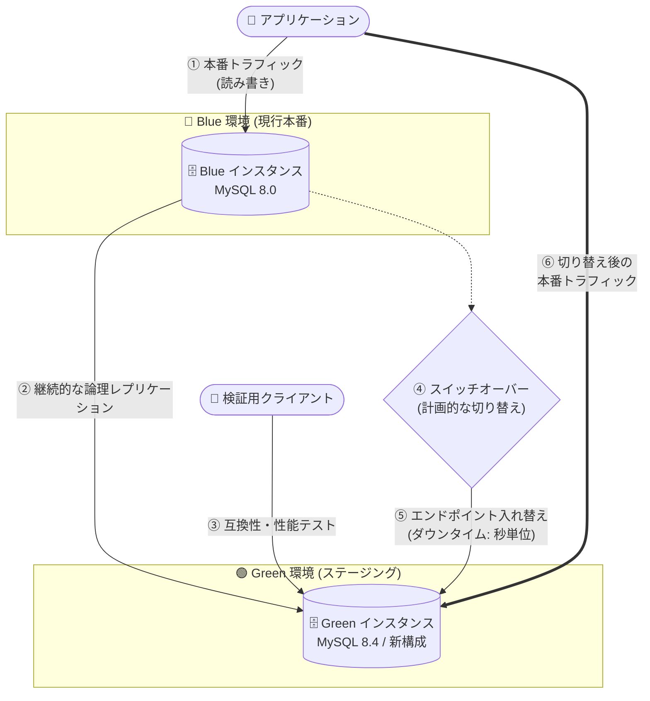

# Cloud SQL for MySQL: Blue-Green デプロイメントが GA

**リリース日**: 2026-11-17

**サービス**: Cloud SQL for MySQL

**機能**: Blue-Green デプロイメント (一般提供開始)

**ステータス**: GA (一般提供)

📊 [このアップデートのインフォグラフィックを見る](https://takech9203.github.io/google-cloud-news-summary/20261117-cloud-sql-mysql-blue-green-deployments-ga.html)

## 概要

Cloud SQL for MySQL の Blue-Green デプロイメントが一般提供 (GA) になりました。Blue-Green デプロイメントは、MySQL 8.0 から 8.4 へのメジャーバージョンアップグレードや、ハードウェア・構成変更のステージングといったデータベースの更新作業を、ダウンタイムを最小限に抑えながら実行できる機能です。

Cloud SQL が本番環境 (Blue) のクローンとして一時的なステージング環境 (Green) を自動作成し、Blue から Green への継続的な論理レプリケーションを維持します。Green 環境で本番トラフィックに影響を与えることなくアプリケーションの互換性やクエリ性能を検証し、準備が整ったタイミングで高速なスイッチオーバー (接続エンドポイントの切り替え) を実行できます。スイッチオーバー時のダウンタイムは、Enterprise Plus エディションでは通常サブ秒、Enterprise エディションでは通常 60 秒未満です。

Blue-Green デプロイメントは Google Cloud コンソール、gcloud CLI、Cloud SQL Admin API、Terraform から作成・管理できます。同日の Cloud SDK 594.0.0 では `gcloud sql blue-green-deployments` コマンドグループも GA に昇格しています。

**アップデート前の課題**

- メジャーバージョンアップグレード (例: MySQL 8.0 → 8.4) を本番インスタンスに対して直接実行すると、相対的に長いダウンタイムやアップグレード失敗のリスクを伴った
- 新バージョンや構成変更を本番相当の環境で検証するには、クローンやレプリカの作成、レプリケーション設定、エンドポイント切り替えなどを手動で構築・運用する必要があった
- マシンタイプ変更やデータベースフラグの変更といった構成変更の影響を、本番トラフィックに影響を与えずに事前検証する標準的な仕組みがなかった

**アップデート後の改善**

- Green ステージング環境の作成、変更の適用、継続的な論理レプリケーションの維持までを Cloud SQL が自動化するワークフローとして GA 品質で利用できるようになった
- スイッチオーバーは接続エンドポイントを入れ替える計画的な操作として実行され、ダウンタイムは Enterprise Plus で通常サブ秒、Enterprise で通常 60 秒未満に抑えられる
- メジャーバージョンアップグレード時は、Green インスタンス作成前にアップグレード事前チェック API が自動実行され、互換性の問題を事前に検出できる
- コンソール、gcloud CLI、Admin API、Terraform のいずれからも宣言的・プログラマブルに管理できるようになった

## アーキテクチャ図



Cloud SQL が本番環境 (Blue) のクローンとして Green ステージング環境を作成し、継続的レプリケーションで同期しながら検証を行い、スイッチオーバーで接続エンドポイントを入れ替えて Green を新しい本番インスタンスに昇格させる流れを示しています。

## サービスアップデートの詳細

### 主要機能

1. **メジャーバージョンアップグレードのステージング**
   - デプロイメント作成時にターゲットデータベースバージョン (例: `MYSQL_8_4`) を指定すると、Green 環境を新バージョンで作成
   - Green インスタンス作成前に、メジャーバージョンアップグレードの事前チェック API が自動実行され、アップグレードを阻害する互換性の問題を事前検証

2. **ハードウェア・構成変更のステージング**
   - ターゲットバージョンを指定しない場合、現行バージョンのまま Green 環境を作成
   - マシンタイプの変更 (CPU / RAM のスケーリング)、データベースフラグのテスト、ストレージ変更の評価などに利用可能

3. **高速スイッチオーバー**
   - ユーザーが開始する計画的な操作として、安全性の事前チェック後に接続エンドポイントを入れ替え
   - Enterprise Plus エディションでは通常サブ秒、Enterprise エディションでは通常 60 秒未満のダウンタイム
   - スイッチオーバー後、旧 Blue インスタンスはスタンドアロンの読み書きインスタンスとして保持され、問題発生時の参照や性能比較に利用可能

4. **マルチインターフェース対応**
   - Google Cloud コンソール、gcloud CLI (`gcloud sql blue-green-deployments`、GA 昇格)、Cloud SQL Admin API (`blueGreenDeployments` リソース)、Terraform (`google_sql_database_instance` の `blue_green_deployment` ブロック) で作成・管理が可能

### デプロイメントのライフサイクル

| 状態 | 説明 |
|------|------|
| `PROVISIONING` | Green 環境の作成、変更の適用、論理レプリケーションのセットアップ中 (メジャーバージョンアップグレード時は事前チェックも実行) |
| `SWITCHOVER_READY` | 初期レプリケーション完了。検証・テスト・スイッチオーバーが可能 |
| `SWITCHOVER_NOT_READY` | レプリケーションの破損・停止などによりスイッチオーバー不可 |
| `SWITCHOVER_IN_PROGRESS` | スイッチオーバー実行中 (エンドポイント入れ替え中) |
| `SWITCHOVER_COMPLETED` | スイッチオーバー完了。Green が本番、Blue はスタンドアロンとして保持 |
| `DELETING` | デプロイメント削除中 (スイッチオーバー前なら Green を削除、後ならメタデータを削除し、オプションで旧 Blue も削除) |

## 技術仕様

### サポート範囲と要件

| 項目 | 詳細 |
|------|------|
| 対象エンジン | Cloud SQL for MySQL のみ (PostgreSQL / SQL Server は非対応) |
| 対象バージョン | MySQL 5.7 以降 (ハードウェア・構成変更)。メジャーバージョンアップグレードは MySQL 8.0 → 8.4。MySQL 8.0.18 は非対応 |
| 対象エディション | Cloud SQL Enterprise / Enterprise Plus |
| スイッチオーバーのダウンタイム | Enterprise Plus: 通常サブ秒 / Enterprise: 通常 60 秒未満 (ワークロードとレプリケーションラグに依存) |
| 必須構成 | 自動バックアップとバイナリログの有効化 (継続的な論理レプリケーションに必要)、新ネットワークアーキテクチャの使用、Blue インスタンスが最新メンテナンスバージョンであること |
| Green インスタンス名 | `BLUE_INSTANCE_NAME-green-UNIQUE_ID` の形式で自動生成 (Blue 名は最大 48 文字に切り詰め、UNIQUE_ID は 16 進数 8 文字) |

## 設定方法

### 前提条件

1. Cloud SQL for MySQL インスタンス (Enterprise または Enterprise Plus エディション、MySQL 5.7 以降) が新ネットワークアーキテクチャ上で稼働していること
2. 自動バックアップとバイナリログが有効であること
3. Blue インスタンスが最新のメンテナンスバージョンを実行していること
4. リードレプリカが構成されていないこと (リードレプリカ付きインスタンスは非対応)

### 手順

#### ステップ 1: Blue-Green デプロイメントの作成

```bash
# メジャーバージョンアップグレード (MySQL 8.0 → 8.4) をステージングする場合
gcloud sql blue-green-deployments create DEPLOYMENT_NAME \
  --source-instance=SOURCE_INSTANCE_ID \
  --target-database-version=MYSQL_8_4 \
  --region=REGION \
  --async

# ハードウェア・構成変更のみをステージングする場合 (--target-database-version を省略)
gcloud sql blue-green-deployments create DEPLOYMENT_NAME \
  --source-instance=SOURCE_INSTANCE_ID \
  --region=REGION \
  --async
```

Cloud SQL が Green インスタンスをプロビジョニングし、要求された変更を適用した上で、Blue から Green への継続的な論理レプリケーションを開始します。メジャーバージョンアップグレードを含む場合は数分以上かかることがあります。

#### ステップ 2: ステータス確認と検証

```bash
# デプロイメントの状態と Green インスタンスの接続情報を確認
gcloud sql blue-green-deployments describe DEPLOYMENT_NAME \
  --region=REGION
```

`state` が `SWITCHOVER_READY` になったら、Green インスタンスに接続してアプリケーションの互換性テストやクエリ性能の検証を実施します。この間も Blue は本番トラフィックを処理し続けます。

#### ステップ 3: スイッチオーバーの実行と後片付け

検証完了後、スイッチオーバーを実行すると、Cloud SQL が安全性の事前チェックを行い、接続エンドポイントを入れ替えて Green を本番の読み書きインスタンスに昇格させます。動作確認後、デプロイメントを削除してクリーンアップします。旧 Blue インスタンスはデフォルトで保持されるため、不要であれば `--delete-old-source` フラグ (Terraform では `delete_old_source_on_destroy = true`) で削除し、課金を停止できます。

## メリット

### ビジネス面

- **ダウンタイムの最小化**: メジャーバージョンアップグレードに伴うサービス停止を秒単位に抑えられ、SLA への影響やビジネス機会の損失を低減できる
- **アップグレードリスクの低減**: 本番と同期された環境で事前検証してから切り替えるため、アップグレード起因の障害や手戻りのリスクを大幅に減らせる

### 技術面

- **運用の自動化**: クローン作成、レプリケーション設定、エンドポイント切り替えという従来手動だった一連の作業が、マネージドなワークフローとして自動化される
- **事前チェックの組み込み**: メジャーバージョンアップグレード時に事前チェック API が自動実行され、互換性の問題を Green 作成前に検出できる
- **IaC 対応**: Terraform の `blue_green_deployment` ブロックにより、作成・検証・スイッチオーバー・クリーンアップのライフサイクル全体を宣言的に管理できる
- **切り戻しの容易さ**: スイッチオーバー後も旧 Blue インスタンスがスタンドアロンとして保持されるため、履歴の可観測性データの参照や性能比較が可能

## デメリット・制約事項

### 制限事項

- Cloud SQL for PostgreSQL および SQL Server は非対応 (MySQL のみ)
- リードレプリカを持つインスタンスは非対応
- Private Service Connect のアウトバウンド構成は非対応
- MySQL の IAM グループ認証とは互換性がなく、スイッチオーバー失敗の原因となる可能性がある
- 旧ネットワークアーキテクチャのインスタンスは非対応 (新ネットワークアーキテクチャへの移行が必要)
- メジャーバージョンアップグレードは MySQL 8.0 → 8.4 のみサポート。MySQL 8.0.18 は非対応

### 考慮すべき点

- スイッチオーバーは厳密に計画的な操作であり、Blue インスタンスが正常 (RUNNING) であることが前提。Green インスタンスは計画外の障害時のフェイルオーバー先としては使用できないため、自動復旧には高可用性 (HA) 構成や DR レプリカを併用する
- Green インスタンスのプロビジョニングや、スイッチオーバー後の旧 Blue のスタンドアロン化は、選択したリージョン / ゾーンのコンピュートリソースの空き状況に影響を受ける可能性がある
- 可観測性や Query Insights のデータは Blue / Green で独立して記録され、履歴データはスイッチオーバー時に引き継がれない。切り替え前後の性能比較には旧 Blue インスタンスを一定期間保持する
- Terraform で管理する場合、`blue_green_deployment` ブロックを定義せずにコンソールや gcloud でデプロイメントを作成すると、`terraform apply` 実行時にデプロイメントと Green インスタンスが削除されるため注意が必要

## ユースケース

### ユースケース 1: MySQL 8.0 から 8.4 へのメジャーバージョンアップグレード

**シナリオ**: 本番の EC サイトが Cloud SQL for MySQL 8.0 を使用しており、MySQL 8.4 へのアップグレードが必要だが、長時間のメンテナンスウィンドウを確保できない。

**実装例**:
```bash
gcloud sql blue-green-deployments create ec-mysql84-upgrade \
  --source-instance=ec-prod-mysql \
  --target-database-version=MYSQL_8_4 \
  --region=asia-northeast1 \
  --async
```

**効果**: 事前チェックで互換性の問題を検出した上で、MySQL 8.4 の Green 環境でアプリケーションを十分に検証し、秒単位のダウンタイムで本番を切り替えられる。問題があればスイッチオーバー前にデプロイメントを削除するだけで、本番 (Blue) に影響なく中止できる。

### ユースケース 2: マシンタイプ変更・データベースフラグの事前検証

**シナリオ**: ピークトラフィック増加に備えてマシンタイプのスケールアップと複数のデータベースフラグの変更を計画しているが、本番への影響を事前に確認したい。

**効果**: ターゲットバージョンを指定せずにデプロイメントを作成し、Green 環境で新しいハードウェア構成やフラグ設定の性能を実トラフィック相当のデータで検証できる。検証に合格した構成のみを、最小限のダウンタイムで本番に反映できる。

## 料金

Blue-Green デプロイメント期間中は、Blue と Green の 2 つのインスタンスが稼働するため、Green インスタンス分の料金が追加で発生します。また、スイッチオーバー後も旧 Blue インスタンスはデフォルトで保持されるため、不要になった時点で削除しないと課金が継続します。詳細は Cloud SQL の料金ページを参照してください。

- [Cloud SQL 料金ページ](https://cloud.google.com/sql/pricing)

## 利用可能リージョン

リージョンごとの提供状況は公式ドキュメントを参照してください。Green インスタンスのプロビジョニングは、選択したリージョン / ゾーンのリソース空き状況の影響を受ける場合があります。

- [Cloud SQL インスタンスのロケーション](https://cloud.google.com/sql/docs/instance-locations)

## 関連サービス・機能

- **Cloud SQL 高可用性 (HA)**: Blue-Green デプロイメントは計画的な変更管理用であり、計画外の障害への自動対応には HA 構成を併用する
- **Cloud SQL Enterprise Plus エディション**: スイッチオーバーのダウンタイムが通常サブ秒となり、よりミッションクリティカルなワークロードに適する
- **Query Insights**: Blue / Green それぞれで独立してメトリクスを記録し、切り替え前後のワークロード性能比較に活用できる
- **Terraform (google_sql_database_instance)**: `blue_green_deployment` ブロックでデプロイメントのライフサイクル全体を IaC として管理できる
- **Cloud SQL Admin API**: `blueGreenDeployments` リソース (REST v1 / v1beta4) によるプログラマブルな作成・監視・削除が可能

## 参考リンク

- 📊 [インフォグラフィック](https://takech9203.github.io/google-cloud-news-summary/20261117-cloud-sql-mysql-blue-green-deployments-ga.html)
- [公式リリースノート](https://docs.cloud.google.com/release-notes#November_17_2026)
- [About blue-green deployments in Cloud SQL](https://docs.cloud.google.com/sql/docs/mysql/about-blue-green-deployments)
- [Create a blue-green deployment](https://docs.cloud.google.com/sql/docs/mysql/create-blue-green-deployment)
- [gcloud sql blue-green-deployments create リファレンス](https://docs.cloud.google.com/sdk/gcloud/reference/sql/blue-green-deployments/create)
- [料金ページ](https://cloud.google.com/sql/pricing)

## まとめ

Cloud SQL for MySQL の Blue-Green デプロイメントの GA により、これまで高リスク・長時間ダウンタイムを伴いがちだったメジャーバージョンアップグレードや構成変更を、検証済みの状態から秒単位のダウンタイムで本番適用できるようになりました。MySQL 8.0 を利用中のチームは、8.4 へのアップグレード計画にこの機能の採用を検討し、まずリードレプリカの有無やネットワークアーキテクチャなどの前提条件を確認することを推奨します。

---

**タグ**: #CloudSQL #MySQL #BlueGreenDeployment #GA #メジャーバージョンアップグレード #ダウンタイム最小化 #データベース
