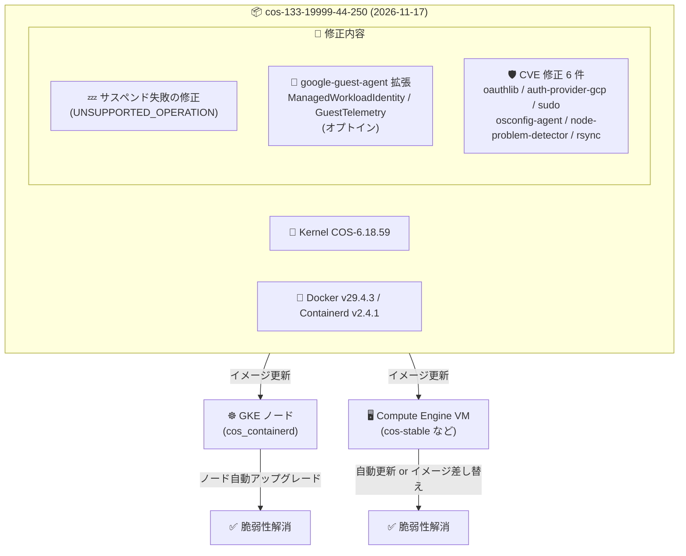

# Container-Optimized OS: cos-133-19999-44-250 リリース (サスペンド修正・guest-agent 拡張・CVE 6 件修正)

**リリース日**: 2026-11-17

**サービス**: Container-Optimized OS

**機能**: cos-133-19999-44-250 リリース (LTS Milestone 133)

**ステータス**: GA (LTS リリース)

📊 [このアップデートのインフォグラフィックを見る](https://takech9203.github.io/google-cloud-news-summary/20261117-container-optimized-os-cos-133-19999-44-250.html)

## 概要

2026 年 11 月 17 日、Container-Optimized OS (COS) の LTS Milestone 133 系の新リリース `cos-133-19999-44-250` が公開されました。本リリースは Kernel COS-6.18.59、Docker v29.4.3、Containerd v2.4.1 で構成され、サスペンド失敗の不具合修正、google-guest-agent への 2 つの拡張機能 (ManagedWorkloadIdentity / GuestTelemetry) のオプトインサポート追加、および 6 件の CVE 修正を含みます。

Container-Optimized OS は Google Kubernetes Engine (GKE) のノードイメージ (`cos_containerd`) や Compute Engine のコンテナワークロードで使用される、コンテナ実行に最適化されたセキュリティ重視の OS です。GKE Autopilot クラスタは常にこのイメージを使用するため、COS のセキュリティ修正は GKE 利用者全体に影響する重要なアップデートです。

今回の修正対象には、OS の基本コンポーネント (sudo、rsync、oauthlib) に加えて、Google Cloud 固有のエージェント類 (auth-provider-gcp、google-osconfig-agent、node-problem-detector) が含まれており、COS イメージの構成要素全体にわたる定期的なセキュリティメンテナンスが実施されています。

**アップデート前の課題**

- 以前のリリースでは、インスタンスのサスペンド操作が `UNSUPPORTED_OPERATION` エラーで失敗する不具合があった
- google-guest-agent が ManagedWorkloadIdentity および GuestTelemetry 拡張に対応しておらず、COS 上でこれらの機能をオプトイン利用できなかった
- oauthlib、auth-provider-gcp、sudo、google-osconfig-agent、node-problem-detector (Prometheus ライブラリ)、rsync に既知の脆弱性 (CVE 6 件) が残存していた

**アップデート後の改善**

- サスペンド操作が `UNSUPPORTED_OPERATION` で失敗する問題が修正された
- google-guest-agent で ManagedWorkloadIdentity 拡張と GuestTelemetry 拡張がオプトインで利用可能になった
- CVE-2026-118669 (oauthlib)、CVE-2026-33814 (auth-provider-gcp)、CVE-2026-35535 (sudo)、CVE-2026-78663 (google-osconfig-agent)、CVE-2026-42154 (node-problem-detector)、CVE-2026-119741 (rsync) の 6 件の脆弱性が修正された

## アーキテクチャ図



本リリースの構成要素と修正内容、および GKE ノード / Compute Engine VM への適用経路を示しています。GKE では COS の自動更新ではなくノード自動アップグレード機能によってイメージが更新されます。

## サービスアップデートの詳細

### 主要機能

1. **コンポーネントバージョン (cos-133-19999-44-250)**
   - Kernel: COS-6.18.59 (11 月 11 日リリースの cos-133-19999-44-197 では COS-6.18.55)
   - Docker: v29.4.3、Containerd: v2.4.1 (前リリースから変更なし)
   - GPU ドライバ: リリースごとのドライバ一覧 (gpu_driver_versions.textproto) で公開

2. **サスペンド失敗の修正 (Fixed)**
   - インスタンスのサスペンド操作が `UNSUPPORTED_OPERATION` エラーで失敗する問題を修正
   - Compute Engine のサスペンド/レジューム機能を COS インスタンスで利用するユーザーに影響する修正

3. **google-guest-agent の拡張サポート追加 (Fixed)**
   - **ManagedWorkloadIdentity 拡張**: Compute Engine の Managed Workload Identity (SPIFFE 準拠の X.509 証明書による VM 間 mTLS 認証) に関連する拡張。ゲストエージェントは証明書の自動プロビジョニングとローテーションを担い、認証情報は `/var/run/secrets/workload-spiffe-credentials` に配置される
   - **GuestTelemetry 拡張**: ゲスト OS のテレメトリに関する拡張
   - いずれも **オプトイン** (明示的に有効化した場合のみ動作) として追加

4. **セキュリティ修正 (CVE 6 件)**
   - 詳細は下記の技術仕様を参照

## 技術仕様

### リリース構成

| 項目 | 詳細 |
|------|------|
| リリース名 | cos-133-19999-44-250 |
| マイルストーン | 133 (LTS) |
| Kernel | COS-6.18.59 |
| Docker | v29.4.3 |
| Containerd | v2.4.1 |
| GPU ドライバ | [See List](https://storage.googleapis.com/cos-tools/19999.44.250/lakitu/gpu_driver_versions.textproto) |

### セキュリティ修正の一覧

| CVE | 対象コンポーネント | 修正方法 |
|-----|-------------------|---------|
| CVE-2026-118669 | dev-python/oauthlib | 修正適用 |
| CVE-2026-33814 | auth-provider-gcp | 修正適用 |
| CVE-2026-35535 | app-admin/sudo | 修正適用 |
| CVE-2026-78663 | google-osconfig-agent | 修正適用 |
| CVE-2026-42154 | node-problem-detector | github.com/prometheus/prometheus を v0.305.3 にアップグレード |
| CVE-2026-119741 | net-misc/rsync | rsync を v3.5.2 にアップグレード |

対象は OS 基盤パッケージ (sudo、rsync)、Python ライブラリ (oauthlib)、Google Cloud エージェント (auth-provider-gcp、google-osconfig-agent、node-problem-detector) と多岐にわたります。なお、CVE-2026-78663 は前日リリースの cos-133-19999-44-242 (11/16) でも cos-extensions 側で修正されており、今回は google-osconfig-agent 側の修正です。

## 設定方法

### 前提条件

1. Container-Optimized OS を GKE ノードイメージまたは Compute Engine VM イメージとして使用していること
2. LTS Milestone 133 系 (cos-133) のイメージを利用していること

### 手順

#### ステップ 1: 現在のイメージバージョンの確認

```bash
# Compute Engine インスタンスの OS バージョン確認 (インスタンス内で実行)
cat /etc/os-release

# GKE ノードプールのノードイメージ確認
gcloud container node-pools describe NODE_POOL_NAME \
  --cluster=CLUSTER_NAME \
  --location=LOCATION \
  --format="value(config.imageType)"
```

#### ステップ 2: 新リリースの適用

```bash
# Compute Engine: 新しい COS イメージでインスタンスを再作成する場合
gcloud compute images list --project cos-cloud --filter="family:cos-133-lts"

# Compute Engine: 自動更新を有効化する場合 (Milestone 117 以降はデフォルト無効)
gcloud compute instances add-metadata INSTANCE_NAME \
  --metadata cos-update-strategy=update_enabled
```

COS の自動更新はアクティブ/パッシブのルートパーティション方式で OS イメージ全体を更新します。更新はパッシブパーティションにインストールされ、再起動後に有効になります。GKE ノードでは COS の自動更新機能は無効化されており、GKE のノード自動アップグレード機能で更新されます。GKE パッチバージョンと COS ノードイメージの対応は [マッピング JSON](https://www.gstatic.com/gke-image-maps/gke-to-cos.json) で公開されています。

## メリット

### ビジネス面

- **セキュリティリスクの低減**: sudo や rsync といった基盤コンポーネントを含む 6 件の CVE が修正され、コンテナ実行基盤の脆弱性リスクが低減される
- **コンプライアンス対応**: 定期的な脆弱性修正の適用により、脆弱性管理ポリシーやセキュリティ監査への対応が容易になる

### 技術面

- **サスペンド機能の信頼性向上**: `UNSUPPORTED_OPERATION` で失敗していたサスペンド操作が修正され、コスト削減目的のインスタンスサスペンド運用が安定する
- **Managed Workload Identity への布石**: guest-agent の ManagedWorkloadIdentity 拡張 (オプトイン) により、SPIFFE 準拠の X.509 証明書を用いた VM 間 mTLS 認証との統合パスが COS でも整備される
- **エージェントの脆弱性修正**: node-problem-detector や google-osconfig-agent など、ノード運用に常駐するエージェントの依存ライブラリが更新される

## デメリット・制約事項

### 制限事項

- ManagedWorkloadIdentity / GuestTelemetry 拡張はオプトインであり、デフォルトでは有効化されない
- COS の自動更新は再起動するまで有効にならない (自動更新機能は強制再起動を行わない)
- UEFI Secure Boot が有効な COS VM および Arm ベースイメージではインプレース更新がサポートされない

### 考慮すべき点

- Milestone 117 以降、COS イメージの自動更新機能はデフォルトで無効のため、スタンドアロン利用時は `cos-update-strategy` メタデータの設定またはイメージの差し替えが必要
- GKE ノードは GKE のノード自動アップグレードで更新されるため、新リリースが反映されるタイミングは GKE のリリースチャネルに依存する
- カーネルが COS-6.18.55 から COS-6.18.59 に更新されているため、カーネルアップグレードに敏感な本番ワークロードでは事前検証を推奨

## ユースケース

### ユースケース 1: GKE ノードの脆弱性管理

**シナリオ**: セキュリティポリシーで既知 CVE の修正適用期限が定められている組織で、GKE ノード (cos_containerd) の脆弱性を解消したい。

**実装例**:
```bash
# GKE → COS イメージのマッピングを確認し、
# cos-133-19999-44-250 を含む GKE パッチバージョンへアップグレード
gcloud container clusters upgrade CLUSTER_NAME \
  --location=LOCATION \
  --node-pool=NODE_POOL_NAME \
  --cluster-version=GKE_PATCH_VERSION
```

**効果**: sudo、rsync、node-problem-detector などノード上のコンポーネントの CVE 6 件が解消され、脆弱性スキャンの指摘事項を低減できる。

### ユースケース 2: COS インスタンスのサスペンド運用

**シナリオ**: 開発環境の Compute Engine 上の COS インスタンスを夜間サスペンドしてコストを削減したいが、サスペンドが `UNSUPPORTED_OPERATION` で失敗していた。

**効果**: 本リリースの適用によりサスペンド失敗が修正され、サスペンド/レジュームを使った運用が可能になる。

## 料金

Container-Optimized OS 自体のイメージ更新に伴う追加料金はありません。料金は実行する Compute Engine / GKE のリソースに依存します。

- [Compute Engine 料金](https://cloud.google.com/compute/pricing)
- [GKE 料金](https://cloud.google.com/kubernetes-engine/pricing)

## 関連サービス・機能

- **Google Kubernetes Engine (GKE)**: COS は GKE のデフォルトノードイメージ (`cos_containerd`)。Autopilot クラスタは常にこのイメージを使用し、ノード自動アップグレードで新リリースが適用される
- **Compute Engine**: コンテナ実行用 VM イメージとして COS を利用可能。サスペンド/レジューム機能や guest-agent (ゲスト環境) が本リリースの修正対象
- **Managed Workload Identity**: SPIFFE 準拠の X.509 証明書で VM 間 mTLS 認証を実現する機能。guest-agent が証明書の自動ローテーションを担う。本リリースで COS の guest-agent にオプトイン拡張が追加された
- **OS Config (google-osconfig-agent)**: VM のパッチ・構成管理エージェント。本リリースで CVE-2026-78663 が修正された

## 参考リンク

- 📊 [インフォグラフィック](https://takech9203.github.io/google-cloud-news-summary/20261117-container-optimized-os-cos-133-19999-44-250.html)
- [公式リリースノート (Google Cloud)](https://docs.cloud.google.com/release-notes#November_17_2026)
- [COS Milestone 133 リリースノート](https://docs.cloud.google.com/container-optimized-os/docs/release-notes/m133)
- [Container-Optimized OS ドキュメント](https://docs.cloud.google.com/container-optimized-os/docs)
- [COS 自動更新の仕組み](https://docs.cloud.google.com/container-optimized-os/docs/concepts/auto-update)
- [Managed Workload Identity (mTLS 認証)](https://docs.cloud.google.com/compute/docs/access/authenticate-workloads-over-mtls)
- [GKE ノードイメージ](https://docs.cloud.google.com/kubernetes-engine/docs/concepts/node-images)

## まとめ

cos-133-19999-44-250 は、サスペンド不具合の修正、guest-agent への ManagedWorkloadIdentity / GuestTelemetry 拡張のオプトイン追加、6 件の CVE 修正を含む LTS Milestone 133 の定期リリースです。GKE ノードや COS ベースの VM を運用している場合は、ノード自動アップグレードやイメージ更新を通じて本リリースを適用し、脆弱性を解消することを推奨します。

---

**タグ**: Container-Optimized OS, GKE, Compute Engine, セキュリティ, CVE, guest-agent, LTS
