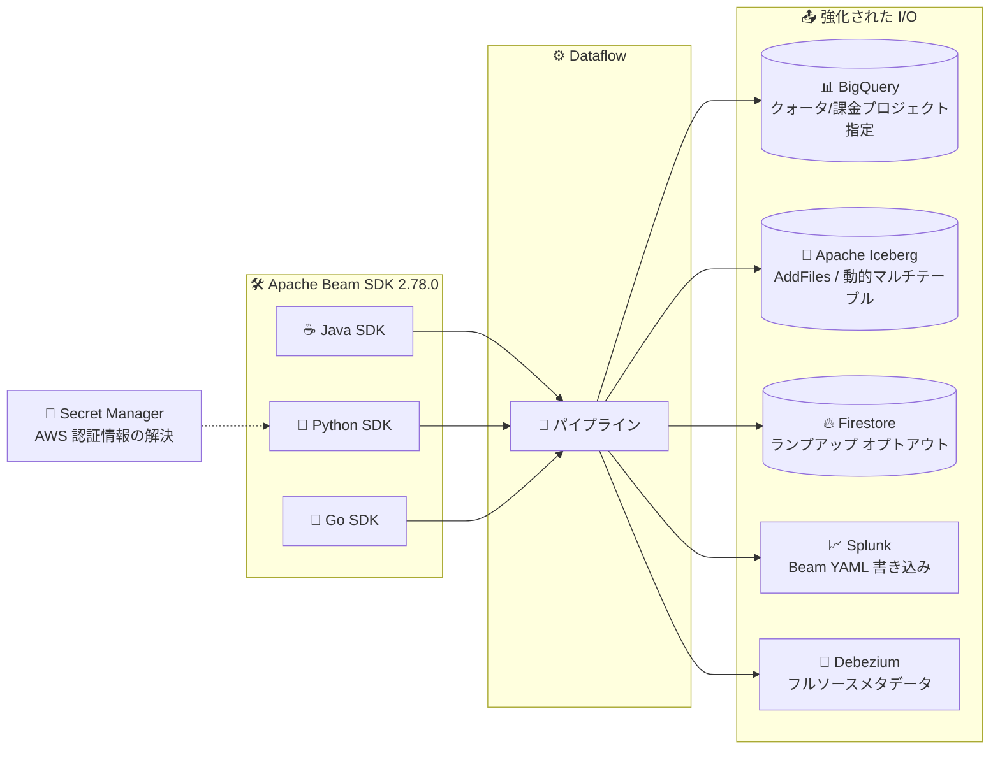

# Dataflow: Apache Beam SDK 2.78.0 サポート開始

**リリース日**: 2026-11-17

**サービス**: Dataflow

**機能**: Apache Beam SDK 2.78.0 (Java / Python / Go) のサポート

**ステータス**: Feature (新バージョンサポート)

📊 [このアップデートのインフォグラフィックを見る](https://takech9203.github.io/google-cloud-news-summary/20261117-dataflow-apache-beam-sdk-2-78-0.html)

## 概要

Dataflow が Apache Beam SDK バージョン 2.78.0 (Java / Python / Go) をサポートしました。2.78.0 は 2026 年 11 月 17 日にリリースされた Apache Beam の最新安定版で、Google Cloud サービスとの連携強化を中心に多数の新機能が追加されています。

今回のバージョンで特に注目すべきは、(1) Java / Python / Go の全 SDK で BigQuery API のクォータ・課金を任意のプロジェクトに付け替えられる attribution 機能、(2) Managed I/O における Apache Iceberg の AddFiles サポート (Java / Python) と Java での複数テーブルへの動的ファイル登録、(3) Python パイプラインでの AWS 認証情報の Secret Manager 解決、の 3 点です。マルチクラウド構成やデータレイクハウス (Iceberg) 構成で Dataflow を利用するユーザーにとって、運用面・セキュリティ面の改善が大きいリリースです。

このほか、Java FirestoreIO の書き込みランプアップスロットリングのオプトアウト、Beam YAML での SplunkIO 書き込みサポート (`WriteToSplunk`)、DebeziumIO のソースメタデータ完全サポートなど、I/O コネクタの改善が多く含まれます。

**アップデート前の課題**

- BigQuery API の読み書きに伴うクォータ消費と課金が、パイプライン実行プロジェクトまたはデータ所在プロジェクトに紐付き、別プロジェクトへ明示的に付け替える手段がなかった
- Iceberg テーブルへ既存のデータファイルをそのまま登録する AddFiles 操作が Managed I/O で利用できず、複数テーブルへのファイル登録は個別の変換を組む必要があった
- Java FirestoreIO では 500/50/5 ルールに基づく書き込みランプアップスロットリングが常に有効で、プロビジョニング済み環境でも初期スループットが抑制された
- Beam YAML から Splunk への書き込みを直接定義できなかった
- DebeziumIO の `readAsJson()` では `op` や MySQL の `file`/`pos`、PostgreSQL の `lsn`/`txId` などのソースメタデータを取得できなかった
- Python パイプラインで AWS サービス (S3 など) に接続する際、認証情報をプレーンテキストのパイプラインオプションとして渡す必要があった

**アップデート後の改善**

- Java (`--bigQueryQuotaProjectId`)、Python (`quota_project_id`)、Go (`bigqueryio.WithQuotaProject`) で BigQuery API のクォータ・課金プロジェクトを指定可能になった
- Managed I/O の `ICEBERG_ADD_FILES` により、Java / Python で Iceberg テーブルへのファイル登録が可能になり、Java では `path_pattern` の glob と `{name}` プレースホルダーで複数テーブルへ動的に登録できるようになった
- `RpcQosOptions.Builder.withRampupThrottlingDisabled()` で FirestoreIO の書き込みランプアップをオプトアウトできるようになった
- Beam YAML に `WriteToSplunk` が追加され、YAML 定義だけで Splunk への書き込みパイプラインを構築できるようになった
- DebeziumIO でフルメタデータフラグを有効にすると、`op` と残りの `source` フィールドをメタデータとして取得できるようになった
- Python の `--aws_credentials_secret_manager` オプションにより、AWS 認証情報を Secret Manager のシークレットとして解決できるようになった

## アーキテクチャ図



Beam SDK 2.78.0 で強化された I/O コネクタと新機能のマップです。3 言語の SDK から Dataflow パイプラインを構築し、BigQuery・Iceberg・Firestore・Splunk・Debezium との連携が改善され、Python では AWS 認証情報を Secret Manager から解決できます。

## サービスアップデートの詳細

### 主要機能

1. **BigQuery API のクォータ・課金プロジェクト attribution (Java / Python / Go)**
   - BigQuery API 呼び出しのクォータ消費と課金を、任意の Google Cloud プロジェクトに帰属させることが可能
   - Python: `ReadFromBigQuery` の `quota_project_id` パラメータ、`WriteToBigQuery` はファイルロードとストリーミング挿入に対応 (Storage Write API は Java バックエンドのため未対応)
   - Java: `--bigQueryQuotaProjectId` パイプラインオプション
   - Go: `bigqueryio.WithQuotaProject`

2. **Managed I/O: Apache Iceberg AddFiles (Java / Python)**
   - `Managed.ICEBERG_ADD_FILES` により、既存のデータファイルを書き直さずに Iceberg テーブルのメタデータに登録可能
   - Java では `path_pattern` の glob と `{name}` プレースホルダーにより、1 つの変換で複数テーブルへ動的にファイルを登録可能 (競合するテーブルは個別に拒否され、他のテーブルへの登録は継続)
   - 注意: Java の Iceberg AddFiles はコーダー変更のためストリーミングパイプラインの更新互換性に影響あり

3. **FirestoreIO の書き込みランプアップスロットリング オプトアウト (Java)**
   - `RpcQosOptions.Builder.withRampupThrottlingDisabled()` で 500/50/5 ルールに基づくランプアップを無効化可能
   - DatastoreIO と同等の挙動が FirestoreIO でも選択可能に

4. **SplunkIO の Beam YAML サポートと DebeziumIO のメタデータ強化**
   - Beam YAML に `WriteToSplunk` (SchemaTransform) が追加され、YAML 定義でパイプラインを記述可能
   - SplunkIO の書き込みエラーがステータスコード・メッセージ・ペイロードを保持するよう修正
   - DebeziumIO の `readAsJson()` にフルメタデータフラグ (デフォルト無効) が追加され、`op` や `source` の残りフィールド (MySQL `file`/`pos`、PostgreSQL `lsn`/`txId` など) を取得可能

5. **AWS 認証情報の Secret Manager 解決 (Python)**
   - 新しい `--aws_credentials_secret_manager` オプションで、AWS 認証情報をプレーンテキストではなくシークレット仕様として解決
   - `AwsSecret` による AWS Secrets Manager サポートと、全 AWS クライアントのデフォルトを設定する `AwsOptions` (`--aws_*`) も追加

### その他の変更点 (Beam 2.78.0)

- Flink ランナーのソースメトリクス転送が最大 1 秒 1 回に抑制され、読み取り時の CPU オーバーヘッドを削減
- Java の `GcsUtil` がデフォルトで java-storage クライアント (V2) を使用 (`--experiments=disable_gcsutil_v2` で旧動作に戻せる)
- 全 SDK に `--dataflow_container_base_repository` オプションが追加され、カスタムコンテナイメージリポジトリを指定可能
- **破壊的変更**: JmsIO が `jakarta.jms` (JMS 3.1) へ移行 (Java 17 必須)、Beam SQL の Data Catalog テーブルプロバイダ削除、Python の GCS ステージングバケット所有権チェックの厳格化など
- **非推奨/削除**: Python 3.10 サポート削除、Twister2 ランナー削除

## 技術仕様

### SDK サポートステータス

| 項目 | 詳細 |
|------|------|
| サポート対象 SDK | Apache Beam SDK 2.78.0 (Java / Python / Go) |
| Beam 2.78.0 リリース日 | 2026-11-17 |
| サポートポリシー | リリース日から非推奨 (deprecation) 日までサポート。非推奨後も動作するが、将来的に廃止 (decommission) の可能性あり |
| 参考 (前バージョン) | 2.77.0 は 2027-10-07 に非推奨予定 |
| Python サポート | Python 3.10 のサポートは 2.78.0 で削除 |

### BigQuery クォータプロジェクト指定の例 (Python)

```python
import apache_beam as beam
from apache_beam.io.gcp.bigquery import ReadFromBigQuery

with beam.Pipeline(options=pipeline_options) as p:
    rows = p | ReadFromBigQuery(
        table="data-project:dataset.table",
        # クォータ消費と課金を別プロジェクトに帰属させる
        quota_project_id="billing-attribution-project",
    )
```

## 設定方法

### 前提条件

1. Dataflow API が有効な Google Cloud プロジェクト
2. Java 17 以降 (JmsIO 利用時は必須)、Python 3.11 以降、または対応バージョンの Go

### 手順

#### ステップ 1: SDK のアップグレード

```bash
# Python
pip install --upgrade "apache-beam[gcp]==2.78.0"
```

```xml
<!-- Java (Maven) -->
<dependency>
  <groupId>org.apache.beam</groupId>
  <artifactId>beam-sdks-java-core</artifactId>
  <version>2.78.0</version>
</dependency>
```

#### ステップ 2: 破壊的変更の確認とパイプラインの更新

```bash
# 例: Java で旧 GcsUtil 動作に戻す場合
--experiments=disable_gcsutil_v2
```

JmsIO の `javax.jms.*` から `jakarta.jms.*` へのインポート変更、Python の GCS ステージングバケット所有権チェック厳格化、Go の `int16`/`uint16` 行コーダー変更 (ストリーミング更新非互換) などを確認のうえアップグレードします。

## メリット

### ビジネス面

- **コスト帰属の明確化**: BigQuery API のクォータ・課金を任意のプロジェクトに付け替えられるため、チーム・部門単位のコスト配賦やチャージバックが容易になる
- **レイクハウス移行の加速**: Iceberg AddFiles により既存ファイルを書き直さずテーブルに取り込めるため、移行時の処理コストと時間を削減できる

### 技術面

- **セキュリティ向上**: Python パイプラインの AWS 認証情報を Secret Manager で管理でき、プレーンテキストでの受け渡しを排除できる
- **I/O の柔軟性向上**: Firestore 書き込みのランプアップ制御、Beam YAML からの Splunk 書き込み、Debezium の CDC メタデータ取得など、コネクタの制御粒度が向上

## デメリット・制約事項

### 制限事項

- Python の BigQuery クォータプロジェクト指定は Storage Write API (Java バックエンド) には未対応
- DebeziumIO のフルメタデータはデフォルト無効で、明示的なフラグ指定が必要
- Java の Iceberg AddFiles のコーダー変更および Go の `int16`/`uint16` 行コーダー変更は、ストリーミングパイプラインの更新 (update) 互換性に影響する

### 考慮すべき点

- Python 3.10 サポートが削除されたため、実行環境の Python バージョン確認が必要
- JmsIO 利用者は `jakarta.jms` への移行と Java 17 ランタイムが必要
- Beam SQL の Data Catalog テーブルプロバイダは削除済み (GCP Data Catalog の廃止に伴う)
- FirestoreIO のランプアップ無効化は、Firestore 側のキャパシティを超えた書き込みスパイクを招く可能性があるため、プロビジョニング状況を確認のうえ利用する

## ユースケース

### ユースケース 1: マルチプロジェクト環境での BigQuery コスト配賦

**シナリオ**: データ基盤チームが共有データプロジェクトの BigQuery テーブルを読み取るパイプラインを複数の利用部門向けに運用しており、API クォータと課金を利用部門ごとのプロジェクトに帰属させたい。

**実装例**:
```python
ReadFromBigQuery(
    table="shared-data:warehouse.sales",
    quota_project_id="dept-a-billing",
)
```

**効果**: 部門ごとのクォータ分離とコスト可視化が実現し、共有プロジェクトのクォータ枯渇を防止できる。

### ユースケース 2: 既存 Parquet ファイル群の Iceberg レイクハウスへの登録

**シナリオ**: Cloud Storage 上に蓄積された既存の Parquet ファイルを、再書き込みせずに複数の Iceberg テーブルへ登録してレイクハウスを構築したい。

**効果**: Java の `ICEBERG_ADD_FILES` と `path_pattern` の `{name}` プレースホルダーにより、1 つの変換でテーブル別にファイルを動的登録でき、データコピーのコストと時間を削減できる。

### ユースケース 3: Secret Manager による S3 連携パイプラインの認証情報管理

**シナリオ**: AWS S3 からデータを取り込む Python パイプラインで、アクセスキーをパイプラインオプションに直接記述せず安全に管理したい。

**効果**: `--aws_credentials_secret_manager` により認証情報が Secret Manager で一元管理され、ジョブメタデータやログへの認証情報露出リスクを低減できる。

## 料金

Apache Beam SDK 自体は OSS であり追加料金はありません。Dataflow の料金 (vCPU・メモリ・ストレージの使用量ベース) は従来どおり適用されます。なお、BigQuery クォータプロジェクト指定を使うと、BigQuery API 関連の課金帰属先が指定プロジェクトに変わる点に注意してください。

- [Dataflow 料金ページ](https://cloud.google.com/dataflow/pricing)

## 利用可能リージョン

Dataflow が利用可能なすべてのリージョンで Apache Beam SDK 2.78.0 を使用できます。

## 関連サービス・機能

- **BigQuery**: クォータ・課金プロジェクト attribution の対象。BigQuery tables for Apache Iceberg へは BigQueryIO (Storage API) で書き込む
- **BigLake / Apache Iceberg**: Managed I/O の AddFiles により既存ファイルのテーブル登録が可能になり、レイクハウス構築の選択肢が拡大
- **Firestore**: FirestoreIO のランプアップスロットリング制御の対象
- **Secret Manager**: Python パイプラインの AWS 認証情報の解決先
- **Cloud Storage**: Java `GcsUtil` が java-storage クライアント (V2) をデフォルト採用

## 参考リンク

- 📊 [インフォグラフィック](https://takech9203.github.io/google-cloud-news-summary/20261117-dataflow-apache-beam-sdk-2-78-0.html)
- [公式リリースノート](https://docs.cloud.google.com/release-notes#November_17_2026)
- [Apache Beam 2.78.0 リリースノート](https://beam.apache.org/blog/beam-2.78.0/)
- [SDK バージョンサポートステータス](https://docs.cloud.google.com/dataflow/docs/support/sdk-version-support-status)
- [Managed I/O for Apache Iceberg](https://docs.cloud.google.com/dataflow/docs/guides/managed-io-iceberg)
- [Apache Beam SDK のインストール / 更新](https://docs.cloud.google.com/dataflow/docs/guides/installing-beam-sdk)
- [料金ページ](https://cloud.google.com/dataflow/pricing)

## まとめ

Apache Beam SDK 2.78.0 の Dataflow サポートにより、BigQuery のクォータ・課金プロジェクト指定、Iceberg AddFiles、AWS 認証情報の Secret Manager 解決など、エンタープライズ運用に直結する機能が利用可能になりました。Python 3.10 サポート削除や JmsIO の jakarta 移行などの破壊的変更を確認のうえ、計画的なアップグレードを推奨します。

---

**タグ**: Dataflow, Apache Beam, SDK, BigQuery, Apache Iceberg, Managed I/O, Firestore, Splunk, Debezium, Secret Manager
