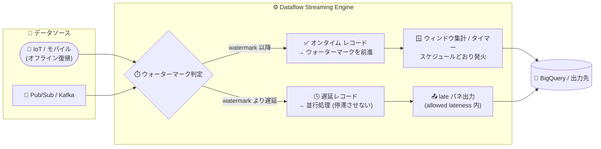

# Dataflow: Eager Watermark Advancement が GA

**リリース日**: 2026-11-17

**サービス**: Dataflow

**機能**: Eager Watermark Advancement (Streaming Engine ジョブ向け)

**ステータス**: GA (一般提供)

📊 [このアップデートのインフォグラフィックを見る](https://takech9203.github.io/google-cloud-news-summary/20261117-dataflow-eager-watermark-advancement-ga.html)

## 概要

Dataflow の Streaming Engine ジョブ向けに、Eager Watermark Advancement (積極的なウォーターマーク前進) が一般提供 (GA) になりました。この機能を有効にすると、現在のウォーターマークより遅れて到着したレコードがウォーターマークの前進を停滞させなくなり、ウィンドウ集計の結果出力やイベントタイム タイマーがスケジュールどおりに実行されます。遅延レコードが破棄されるわけではなく、オンタイムのデータと並行して処理されます。

ウォーターマークは「このウィンドウのデータはすべて到着したはず」と Dataflow が判断するしきい値であり、ウィンドウのクローズやイベントタイム タイマーの発火を駆動する重要な仕組みです。従来はウォーターマークが未処理イベントの最小タイムスタンプを追跡するため、1 件の大幅に遅延したレコードがパイプライン全体のウォーターマークを凍結させ、すべての下流ステージのウィンドウ出力やタイマーを遅延させる可能性がありました。本機能はこの課題を解消し、ストリーミング パイプラインのレイテンシを予測可能にします。

IoT デバイスやモバイルアプリのようにオフライン後の再接続でバッファ済みデータをまとめて送信するソース、過去のイベント タイムスタンプを持つ Pub/Sub メッセージや Kafka パーティションのバックログを扱うパイプラインを運用するユーザーに特に有効です。ウィンドウ集計やステートフル処理を使用するパイプラインでは、有効化の前に想定される遅延をカバーする allowed lateness (許容遅延) の設定が必要です。

**アップデート前の課題**

- 遅延レコードが 1 件でも到着すると、ウォーターマークが未処理イベントの最小タイムスタンプに固定され、パイプライン全体のウォーターマーク前進が停滞した
- ウォーターマークの停滞により、ウィンドウ集計の結果出力とイベントタイム タイマーの発火が遅延し、オンタイムのデータの結果まで待たされた
- 停滞したウォーターマークが解消された瞬間に、溜まっていたウィンドウが一斉にクローズし、ワーカー使用率のスパイクが発生した
- オフライン復帰した IoT デバイスのバッファ送信や、アイドル状態だった Kafka パーティションへのバックログ流入のたびに、出力レイテンシが予測不能になった

**アップデート後の改善**

- 遅延レコードの処理とウォーターマークの前進が分離され、オンタイムのデータに基づいてウォーターマークが前進するようになった
- ウィンドウ結果とイベントタイム タイマーがスケジュールどおりに実行され、出力レイテンシが予測可能になった
- 遅延レコードは引き続きオンタイム データと並行して処理され、allowed lateness の設定に従って late パネとして出力される
- ウィンドウの一斉クローズによるワーカー使用率のスパイクが緩和され、リソース使用が平準化された
- 全 Beam SDK (Java / Python / Go) で SDK のアップグレード不要、サービス オプションの指定のみで利用できる

## アーキテクチャ図



Eager Watermark Advancement を有効にすると、遅延レコードはウォーターマークの前進から切り離されて並行処理され、オンタイム データによるウィンドウ集計とタイマーは停滞せずにスケジュールどおり実行されます。遅延レコードは allowed lateness の範囲内であれば late パネとして出力されます。

## サービスアップデートの詳細

### 主要機能

1. **ウォーターマーク前進と遅延レコード処理の分離**
   - 従来はウォーターマークが未処理イベントの最小タイムスタンプを追跡するため、1 件の遅延レコードが全下流ステージのウォーターマークを凍結させていた
   - 有効化後は、遅延レコードはステージのウォーターマークを保持せずに処理され、ウォーターマークはオンタイム データに基づいて前進する

2. **スケジュールどおりのウィンドウ出力とタイマー発火**
   - ウィンドウ集計の結果とイベントタイム タイマーが遅延レコードの影響を受けずに予定どおり実行される
   - 溜まったウィンドウの一斉クローズによるワーカー使用率スパイクが緩和され、使用率が平準化される

3. **遅延レコードの継続処理 (破棄ではない)**
   - 遅延レコードはオンタイム データと並行して処理され、allowed lateness 内であれば late パネとして出力される
   - allowed lateness を超えたレコードはウィンドウ結果から除外されるため、事前の設定確認が重要

4. **専用モニタリング メトリクスの提供**
   - `per_stage_data_watermark_age_with_late_data`: 本機能がない場合のウォーターマーク経過時間を示し、通常のウォーターマーク経過時間との差分で削減されたレイテンシを確認できる
   - `per_stage_oldest_pending_element_age`: 遅延レコードを含む最古の未処理要素の経過時間を示し、allowed lateness に近づくとレコード破棄のリスクを察知できる

## 技術仕様

### 機能の要点

| 項目 | 詳細 |
|------|------|
| 対象ジョブ | Streaming Engine を使用するストリーミング ジョブのみ |
| 有効化方法 | サービス オプション `enable_eager_watermark_advancement` を起動時に指定 |
| SDK 要件 | Streaming Engine 上の全 Beam SDK (Java / Python / Go) で利用可、SDK アップグレード不要 |
| 遅延レコードの扱い | allowed lateness 内は late パネとして出力、超過分はウィンドウ結果から除外 |
| 実行中ジョブへの適用 | 不可。新規ジョブまたは置換ジョブ (`--update`) で設定 |
| 無効化 | オプションを外した置換ジョブを起動 (ウォーターマークは後退せず引き継がれる) |
| 有効化の確認 | ジョブログの "Eager watermark advancement is enabled for this job." またはジョブ情報パネルの Pipeline options |

### 有効化オプション

```bash
# Java
--dataflowServiceOptions=enable_eager_watermark_advancement

# Python / Go
--dataflow_service_options=enable_eager_watermark_advancement
```

### モニタリング メトリクス (Cloud Monitoring、ステージ単位・秒)

| メトリクス | 用途 |
|-----------|------|
| `dataflow.googleapis.com/job/per_stage_data_watermark_age_with_late_data` | 本機能がない場合のウォーターマーク経過時間。`per_stage_data_watermark_age` との差分が削減されたレイテンシ |
| `dataflow.googleapis.com/job/per_stage_oldest_pending_element_age` | 遅延レコードを含む最古の未処理要素の経過時間。ウォーターマーク経過時間との差が allowed lateness に近づくと破棄リスクあり |

## 設定方法

### 前提条件

1. ジョブが Streaming Engine を使用するストリーミング パイプラインであること
2. 想定される遅延をカバーする allowed lateness をウィンドウ戦略に設定すること (例: `Window.into(...).withAllowedLateness(Duration.standardMinutes(60))`)
3. トリガー、累積モード (accumulation mode)、`PaneInfo` の扱いが late パネを正しく処理できることを確認すること

### 手順

#### ステップ 1: allowed lateness の設定を確認する

```java
// Java の例: 1 時間の遅延を許容するウィンドウ設定
PCollection<KV<String, Long>> counts = input
    .apply(Window.<KV<String, Long>>into(FixedWindows.of(Duration.standardMinutes(5)))
        .withAllowedLateness(Duration.standardHours(1))
        .triggering(AfterWatermark.pastEndOfWindow()
            .withLateFirings(AfterPane.elementCountAtLeast(1)))
        .accumulatingFiredPanes())
    .apply(Count.perKey());
```

従来はウォーターマークの停滞により遅延レコードが「オンタイム」と誤分類される副次的な安全網がありましたが、有効化後はより多くのレコードが正しく late と判定されます。allowed lateness が不足していると破棄が増えるため、事前に設定を見直します。

#### ステップ 2: サービス オプションを指定してジョブを起動する

```bash
# Flex Template の例
gcloud dataflow flex-template run JOB_NAME \
    --template-file-gcs-location=TEMPLATE_LOCATION \
    --region=REGION \
    --enable-streaming-engine \
    --additional-experiments=enable_eager_watermark_advancement
```

Terraform の場合は `google_dataflow_flex_template_job` リソースで `enable_streaming_engine = true` と `additional_experiments = ["enable_eager_watermark_advancement"]` を指定します。

#### ステップ 3: 有効化と破棄率をモニタリングする

```bash
# ジョブログで有効化を確認
# "Eager watermark advancement is enabled for this job." が出力される
gcloud logging read 'resource.type="dataflow_step" AND "Eager watermark advancement"' --limit 5
```

有効化後は、ジョブ情報パネルのカスタム カウンタ `droppedDueToLateness` を監視し、遅延による破棄が許容範囲内であることを確認します。破棄が多い場合は allowed lateness を延長します。

## メリット

### ビジネス面

- **出力レイテンシの予測可能性**: ダッシュボードやアラートなどリアルタイム分析の結果が、少数の遅延データに左右されずスケジュールどおりに届く
- **SLO 達成の容易化**: イベントタイム ベースの集計結果の提供時間が安定し、下流システムとのレイテンシ SLO を立てやすくなる
- **導入コストの低さ**: SDK アップグレード不要でサービス オプションの指定のみで有効化でき、既存パイプラインへの適用障壁が低い

### 技術面

- **ウォーターマーク停滞の解消**: 1 件の遅延レコードがパイプライン全体のウィンドウ出力とタイマーを凍結させる問題が解消される
- **リソース使用の平準化**: 停滞解消時に溜まったウィンドウが一斉にクローズすることで発生していたワーカー使用率のスパイクが緩和される
- **可観測性の向上**: 専用メトリクスにより、本機能によるレイテンシ削減効果と遅延レコードの破棄リスクを定量的に把握できる

## デメリット・制約事項

### 制限事項

- Streaming Engine を使用するストリーミング ジョブ専用 (バッチジョブや Streaming Engine 無効のジョブでは利用不可)
- 実行中のジョブでオン / オフを切り替えることはできず、新規ジョブまたは置換ジョブ (`--update`) が必要
- すべてのソースが有界 (bounded) の場合、ジョブは自動的に完了しないため、手動でドレインする必要がある
- 処理の遅さ (重い計算、遅い RPC、CPU / メモリのボトルネック) に起因するウォーターマーク ラグは改善されない。あくまでウォーターマークより遅れて到着したデータの影響を分離する機能

### 考慮すべき点

- 従来はウォーターマーク停滞が遅延レコードを「オンタイム」扱いにする意図しない安全網として機能していた。有効化後はより多くのレコードが正しく late と判定されるため、allowed lateness が不足していると破棄が増える
- トリガー、累積モード、`PaneInfo` の処理が late パネを正しく扱えるか、有効化前に確認が必要
- 有効化後は `droppedDueToLateness` カウンタと `per_stage_oldest_pending_element_age` メトリクスを監視し、破棄率が許容範囲内か継続的に確認する
- 無効化する場合は、オプションを外した置換ジョブを起動する。ウォーターマークは後退しないため、新ジョブは旧ジョブのウォーターマークを引き継ぐ

## ユースケース

### ユースケース 1: IoT デバイスのオフライン復帰によるバッファ データ流入

**シナリオ**: 工場のセンサーや車載デバイスがネットワーク断から復帰し、オフライン中にバッファした数時間分の過去タイムスタンプ付きデータを一斉送信する。従来はこの古いデータがウォーターマークを引き戻し、直近のリアルタイム集計の出力まで停滞していた。

**実装例**:
```bash
gcloud dataflow flex-template run iot-aggregation \
    --template-file-gcs-location=gs://my-bucket/templates/iot-agg.json \
    --region=asia-northeast1 \
    --enable-streaming-engine \
    --additional-experiments=enable_eager_watermark_advancement
```

**効果**: リアルタイム データのウィンドウ集計はスケジュールどおり出力され、復帰デバイスの過去データは allowed lateness の範囲内で late パネとして並行処理される。ダッシュボードの更新遅延が解消される。

### ユースケース 2: アイドル状態の Kafka パーティションへのバックログ流入

**シナリオ**: イベントタイム (`CreateTime`) を使用する Kafka ソースで、長時間アイドルだったパーティションに古いイベントのバックログが流入する。従来はパイプライン全体のウォーターマークが停滞し、イベントタイム タイマーに依存するステートフル処理 (セッション管理、タイムアウト検知など) が遅延していた。

**効果**: イベントタイム タイマーが予定どおり発火し、セッション確定やタイムアウト検知のレイテンシが安定する。バックログは並行処理されるため、データの取りこぼしもない (allowed lateness 内)。

## 料金

本機能自体の追加料金に関する記載は公式ドキュメントにありません。Streaming Engine の利用には通常の Streaming Engine 料金 (リソースベース課金またはデータ処理量課金) が適用されます。詳細は料金ページを参照してください。

- [Dataflow の料金](https://cloud.google.com/dataflow/pricing)

## 利用可能リージョン

公式ドキュメントにリージョン制限の記載はありません。Streaming Engine は Dataflow がサポートされるすべてのリージョンで利用可能です。詳細は [Dataflow のロケーション](https://docs.cloud.google.com/dataflow/docs/resources/locations) を参照してください。

## 関連サービス・機能

- **Dataflow Streaming Engine**: 本機能の前提。パイプライン実行をワーカー VM から Dataflow サービス バックエンドに移し、リソース削減と柔軟なオートスケーリングを実現する
- **Pub/Sub**: 代表的なストリーミング ソース。イベント タイムスタンプ属性を使用する場合、ソース ウォーターマークより古いメッセージが本機能の対象となる
- **Cloud Monitoring**: `per_stage_data_watermark_age_with_late_data` などの専用メトリクスで本機能の効果と破棄リスクを監視できる
- **Apache Beam (windowing / triggers / allowed lateness)**: ウィンドウ戦略、トリガー、allowed lateness の設定が本機能の挙動 (late パネ出力と破棄) を決定する

## 参考リンク

- 📊 [インフォグラフィック](https://takech9203.github.io/google-cloud-news-summary/20261117-dataflow-eager-watermark-advancement-ga.html)
- [公式リリースノート](https://docs.cloud.google.com/release-notes#November_17_2026)
- [Eager watermark advancement (公式ドキュメント)](https://docs.cloud.google.com/dataflow/docs/guides/eager-watermark-advancement)
- [ストリーミング パイプライン (ウォーターマークとウィンドウ)](https://docs.cloud.google.com/dataflow/docs/concepts/streaming-pipelines)
- [Streaming Engine の使用](https://docs.cloud.google.com/dataflow/docs/streaming-engine)
- [料金ページ](https://cloud.google.com/dataflow/pricing)

## まとめ

Eager Watermark Advancement の GA により、少数の遅延レコードがストリーミング パイプライン全体の出力を停滞させる長年の課題が、SDK アップグレード不要のサービス オプション 1 つで解消できるようになりました。ウィンドウ集計やイベントタイム タイマーを使用する Streaming Engine ジョブを運用しているなら、まず allowed lateness が想定遅延をカバーしているかを確認した上で有効化し、`droppedDueToLateness` カウンタと専用メトリクスで破棄率とレイテンシ削減効果を検証することを推奨します。

---

**タグ**: Dataflow, Streaming Engine, Watermark, Apache Beam, GA, ストリーミング処理, イベントタイム, Windowing
