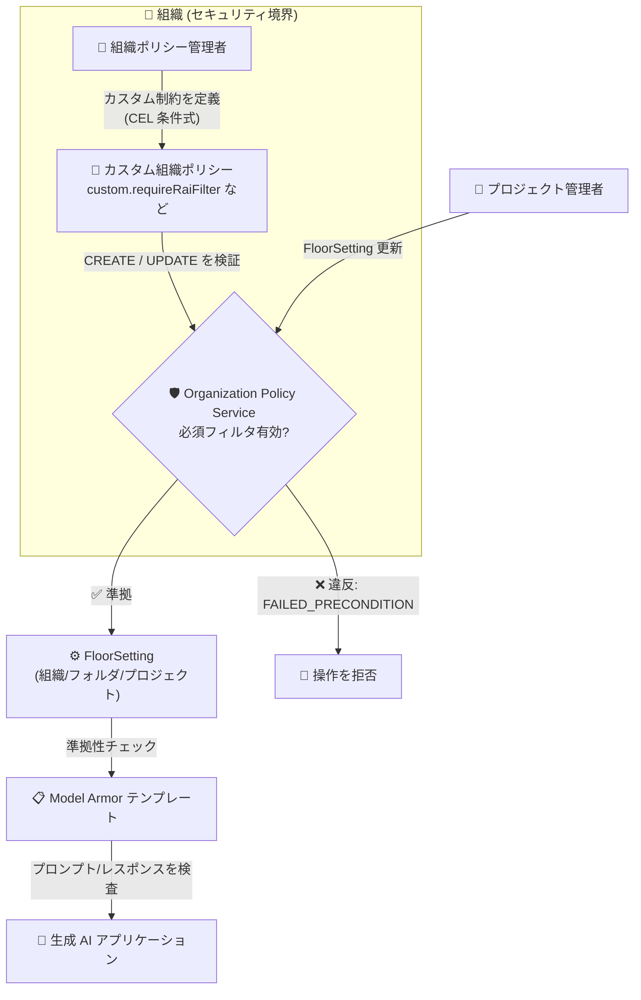

# Model Armor: FloorSetting リソースに対するカスタム組織ポリシーが GA

**リリース日**: 2026-11-17

**サービス**: Model Armor

**機能**: FloorSetting リソースに対するカスタム組織ポリシー (Custom Organization Policies)

**ステータス**: GA (一般提供)

📊 [このアップデートのインフォグラフィックを見る](https://takech9203.github.io/google-cloud-news-summary/20261117-model-armor-custom-org-policies.html)

## 概要

Model Armor の FloorSetting (フロア設定) リソースに対して、カスタム組織ポリシー (Custom Organization Policies) を適用できる機能が一般提供 (GA) になりました。カスタム組織ポリシーを使用することで、Model Armor の FloorSetting リソースが更新される際に、Responsible AI (責任ある AI) フィルタやプロンプトインジェクション・ジェイルブレイク検出などの必須フィルタが必ず有効化されていることを、組織レベルで強制できます。

Model Armor は生成 AI アプリケーションのプロンプトとレスポンスをスクリーニングするランタイムセキュリティサービスで、フロア設定は「組織・フォルダ・プロジェクト全体で下回ってはならない最低限の保護レベル」を定義する仕組みです。今回の GA により、組織ポリシー管理者は Common Expression Language (CEL) で記述したカスタム制約を `modelarmor.googleapis.com/FloorSetting` および `modelarmor.googleapis.com/Template` リソースの CREATE / UPDATE 操作に適用し、ポリシーに準拠しない変更を API レベルで拒否できるようになりました。

AI ガバナンスやコンプライアンス要件を持つ大規模組織のセキュリティ管理者・プラットフォームチームが主な対象ユーザーです。分散した各プロジェクトチームに AI 活用の自由度を与えつつ、組織全体のセキュリティ基準からの逸脱 (保護レベルの引き下げ) をプログラマティックに防止できます。

**アップデート前の課題**

- フロア設定はテンプレートの準拠性 (新規テンプレートがフロア設定より緩くならないこと) を強制できたが、フロア設定自体の更新については組織レベルで内容を強制する仕組みがなく、権限を持つ管理者がフィルタを無効化・緩和する変更を防げなかった
- Responsible AI フィルタやプロンプトインジェクション・ジェイルブレイク検出の有効化といった組織のセキュリティ標準は、運用ルールやレビューといった人手のプロセスに頼る必要があった
- 組み込みのマネージド制約では、フィルタ構成の特定フィールド単位での細かな制御ができなかった

**アップデート後の改善**

- カスタム組織ポリシーにより、FloorSetting リソースの更新時に必須フィルタ (Responsible AI、プロンプトインジェクション・ジェイルブレイク検出など) の有効化を API レベルで強制できるようになった
- CEL 条件式で `resource.filterConfig` 配下のフィールド単位 (フィルタの有効/無効、信頼度レベル、Sensitive Data Protection テンプレートなど) の細かな制御が可能になった
- 組織・フォルダ・プロジェクトの各階層でポリシーを適用でき、ポリシー違反の操作は `FAILED_PRECONDITION` エラーで自動的に拒否されるため、ガバナンスの抜け漏れを防止できる

## アーキテクチャ図



組織ポリシー管理者が定義したカスタム制約が、FloorSetting の作成・更新操作をセキュリティ境界で検証し、必須フィルタが無効化された構成変更をブロックします。準拠した FloorSetting が配下のテンプレートの最低保護レベルを保証し、生成 AI アプリケーションを保護します。

## サービスアップデートの詳細

### 主要機能

1. **FloorSetting リソースへのカスタム制約 (GA)**
   - `modelarmor.googleapis.com/FloorSetting` リソースの CREATE / UPDATE 操作に対して CEL 条件式による制約を適用可能
   - フロア設定の強制有効化 (`resource.enableFloorSettingEnforcement == true`) や、Gemini Enterprise Agent Platform 向けフロア設定での Cloud Logging 有効化などを強制できる

2. **フィルタ構成のフィールド単位の制御**
   - プロンプトインジェクション・ジェイルブレイクフィルタの有効化と信頼度レベル (`piAndJailbreakFilterSettings`)
   - Responsible AI フィルタの種類と信頼度レベル (`raiSettings.raiFilters`)
   - Sensitive Data Protection の基本/高度構成 (`sdpSettings`)、悪意のある URI フィルタ、多言語検出など

3. **階層的なポリシー適用と継承**
   - 組織・フォルダ・プロジェクトレベルでポリシーを適用でき、デフォルトで配下リソースに継承される
   - dry-run モードと Policy Simulator により、本番適用前に影響範囲をテスト可能

## 技術仕様

### カスタム制約で参照可能な主な FloorSetting フィールド

| フィールド | 制御内容 |
|------|------|
| `resource.enableFloorSettingEnforcement` | フロア設定の強制有効化 |
| `resource.filterConfig.piAndJailbreakFilterSettings.filterEnforcement` / `.confidenceLevel` | プロンプトインジェクション・ジェイルブレイクフィルタの有効化と信頼度 |
| `resource.filterConfig.raiSettings.raiFilters.filterType` / `.confidenceLevel` | Responsible AI フィルタの種類 (ヘイトスピーチ、ハラスメントなど) と信頼度 |
| `resource.filterConfig.sdpSettings.basicConfig.filterEnforcement` | Sensitive Data Protection 基本フィルタの有効化 |
| `resource.filterConfig.sdpSettings.advancedConfig.inspectTemplate` / `.deidentifyTemplate` | SDP 検査・匿名化テンプレートの指定 |
| `resource.filterConfig.maliciousUriFilterSettings.filterEnforcement` | 悪意のある URI フィルタの有効化 |
| `resource.aiPlatformFloorSetting.enableCloudLogging` / `.inspectAndBlock` / `.inspectOnly` | Gemini Enterprise Agent Platform 向けフロア設定の動作モードとロギング |
| `resource.floorSettingMetadata.multiLanguageDetection.enableMultiLanguageDetection` | 多言語検出の有効化 |

### カスタム制約の定義例 (フロア設定の強制有効化)

```yaml
name: organizations/ORGANIZATION_ID/customConstraints/custom.requireFloorSettingEnforcement
resourceTypes:
- modelarmor.googleapis.com/FloorSetting
methodTypes:
- CREATE
- UPDATE
condition: "resource.enableFloorSettingEnforcement == true"
actionType: ALLOW
displayName: Require floor settings enforcement
description: Requires that floor settings enforcement is enabled for all floor setting configurations.
```

## 設定方法

### 前提条件

1. 組織 ID を把握していること
2. 組織ポリシーの管理には組織リソースに対する Organization Policy Administrator (`roles/orgpolicy.policyAdmin`) ロールが必要
3. フロア設定の更新にはプロジェクト・フォルダ・組織リソースに対する Model Armor Admin (`roles/modelarmor.admin`) ロールが必要

### 手順

#### ステップ 1: カスタム制約を定義して適用する

```bash
# constraint.yaml を作成後、制約を適用
gcloud org-policies set-custom-constraint constraint.yaml

# 制約が作成されたことを確認
gcloud org-policies list-custom-constraints --organization=ORGANIZATION_ID
```

CEL 条件式で FloorSetting の必須フィールドを検証するカスタム制約を組織に登録します。

#### ステップ 2: 制約を参照する組織ポリシーを適用する

```bash
# policy.yaml の例:
# name: projects/PROJECT_ID/policies/custom.requireFloorSettingEnforcement
# spec:
#   rules:
#   - enforce: true

# dry-run モードで事前検証 (推奨)
gcloud org-policies set-policy policy.yaml --update-mask=dryRunSpec

# 問題なければ本番適用
gcloud org-policies set-policy policy.yaml --update-mask=spec
```

ポリシーの反映には最大 15 分程度かかります。適用後、制約に違反する FloorSetting の更新操作は HTTP 412 (`FAILED_PRECONDITION`) エラーで拒否されます。

## メリット

### ビジネス面

- **AI ガバナンスの強制力向上**: Responsible AI やプロンプトインジェクション対策などの組織標準を、運用ルールではなく技術的な制御として強制でき、コンプライアンス監査への対応が容易になる
- **分散チームの自律性と統制の両立**: 各プロジェクトチームにテンプレートやフロア設定の管理を委譲しつつ、組織のセキュリティベースラインを下回る変更を自動的に防止できる

### 技術面

- **フィールド単位の細かな制御**: CEL 条件式により、フィルタの有効/無効だけでなく信頼度レベルや SDP テンプレートの指定まで細かく制御できる
- **安全な導入プロセス**: dry-run モードと Policy Simulator により、既存ワークロードへの影響を事前に検証してから本番適用できる
- **階層的な継承**: 組織レベルで一度定義すれば配下のフォルダ・プロジェクトに自動継承され、個別設定の手間と漏れを削減できる

## デメリット・制約事項

### 制限事項

- カスタム制約の `methodTypes` は CREATE / UPDATE 操作のみが対象で、既存リソースには次回の更新時まで適用されない
- 多くのリソースタイプでは 1 リソースタイプあたり最大 20 個のカスタム制約という上限がある
- CEL 条件式は最大 1,500 文字、制約 ID は最大 70 文字 (`custom.` プレフィックスを除く) という制限がある
- カスタム制約にはバージョニングがなく、更新は既存制約の上書きとなる

### 考慮すべき点

- ポリシー適用後の反映には数分〜最大 15 分程度かかるため、適用直後の動作確認はタイミングに注意が必要
- `actionType: ALLOW` の制約は条件を満たす操作のみを許可する (条件外はすべて拒否する) 動作のため、条件式の設計を誤ると意図しない操作まで拒否される。dry-run での事前検証が推奨される
- フロア設定の UI はプロジェクトレベルのみで提供されており、組織・フォルダレベルのフロア設定自体の管理には API を使用する必要がある

## ユースケース

### ユースケース 1: 全社的なプロンプトインジェクション対策の強制

**シナリオ**: 複数の事業部がそれぞれのプロジェクトで生成 AI アプリケーションを開発している企業で、セキュリティチームはすべてのプロジェクトでプロンプトインジェクション・ジェイルブレイク検出が常に有効であることを保証したい。

**実装例**:
```yaml
name: organizations/ORGANIZATION_ID/customConstraints/custom.requirePiAndJailbreakFilter
resourceTypes:
- modelarmor.googleapis.com/Template
methodTypes:
- CREATE
- UPDATE
condition: "has(resource.filterConfig.piAndJailbreakFilterSettings.filterEnforcement) && resource.filterConfig.piAndJailbreakFilterSettings.filterEnforcement == 'ENABLED'"
actionType: ALLOW
displayName: Require prompt injection and jailbreak filter
description: All templates must have the prompt injection and jailbreak filter enabled.
```

**効果**: フィルタを無効化したテンプレートの作成・更新が API レベルで拒否され、全プロジェクトでプロンプトインジェクション対策が維持される。

### ユースケース 2: フロア設定の無効化・緩和の防止

**シナリオ**: 規制業界の企業が、Model Armor のフロア設定による保護を組織全体のベースラインとして運用している。権限を持つプロジェクト管理者による意図的・偶発的なフロア設定の無効化を防ぎたい。

**効果**: `resource.enableFloorSettingEnforcement == true` を要求するカスタム制約により、フロア設定の強制を無効化する更新が拒否され、保護レベルの後退 (ポリシーリグレッション) を防止できる。

## 料金

カスタム組織ポリシー (Organization Policy Service) 自体の利用に追加料金はかかりません。Model Armor の利用料金はトークンベースの従量課金で、以下のとおりです。

### 料金例 (Model Armor スタンドアロン / SCC Premium Pay-as-you-go)

| 使用量 | 月額料金 (概算) |
|--------|-----------------|
| 200 万トークン/月まで | 無料 |
| 200 万トークン超過分 | $0.10 / 100 万トークン |
| SCC Premium / Enterprise サブスクリプション | 30 億トークン/月まで込み (超過分 $0.10 / 100 万トークン) |

詳細は [Security Command Center 料金ページ](https://cloud.google.com/security-command-center/pricing) を参照してください。

## 利用可能リージョン

リージョンごとの提供状況は [Model Armor のロケーション](https://docs.cloud.google.com/model-armor/locations) を参照してください。

## 関連サービス・機能

- **Organization Policy Service**: カスタム制約と組織ポリシーの定義・適用を行う基盤サービス。階層評価ルールやタグによる条件付きポリシーも利用可能
- **Sensitive Data Protection**: Model Armor の SDP フィルタと連携し、PII や認証情報の漏えいを防止。カスタム制約で検査・匿名化テンプレートの使用を強制できる
- **Policy Simulator / dry-run モード**: 組織ポリシーの本番適用前に影響範囲を検証するツール
- **Gemini Enterprise Agent Platform / Google Cloud MCP サーバー**: フロア設定によるインライン強制の対象。Gemini モデルや MCP サーバーへのリクエスト/レスポンスをコード変更なしで保護
- **Security Command Center**: Model Armor が統合されている Google Cloud のセキュリティ管理基盤

## 参考リンク

- 📊 [インフォグラフィック](https://takech9203.github.io/google-cloud-news-summary/20261117-model-armor-custom-org-policies.html)
- [公式リリースノート](https://docs.cloud.google.com/release-notes#November_17_2026)
- [Use custom organization policies (Model Armor)](https://docs.cloud.google.com/model-armor/access-control/custom-constraints)
- [Model Armor フロア設定の構成](https://docs.cloud.google.com/model-armor/configure-floor-settings)
- [カスタム組織ポリシーの作成と管理](https://docs.cloud.google.com/organization-policy/create-custom-constraints)
- [料金ページ (Security Command Center)](https://cloud.google.com/security-command-center/pricing)

## まとめ

FloorSetting リソースに対するカスタム組織ポリシーの GA により、Model Armor による AI 保護のベースラインそのものを組織レベルで技術的に強制できるようになり、AI ガバナンスの「最後の抜け穴」であったフロア設定の緩和・無効化を防止できます。生成 AI を全社展開している組織は、まず dry-run モードで必須フィルタ (Responsible AI、プロンプトインジェクション・ジェイルブレイク検出) を要求するカスタム制約を検証し、段階的に本番適用することを推奨します。

---

**タグ**: Model Armor, Organization Policy, Custom Constraints, Floor Settings, AI セキュリティ, Responsible AI, プロンプトインジェクション, GA
