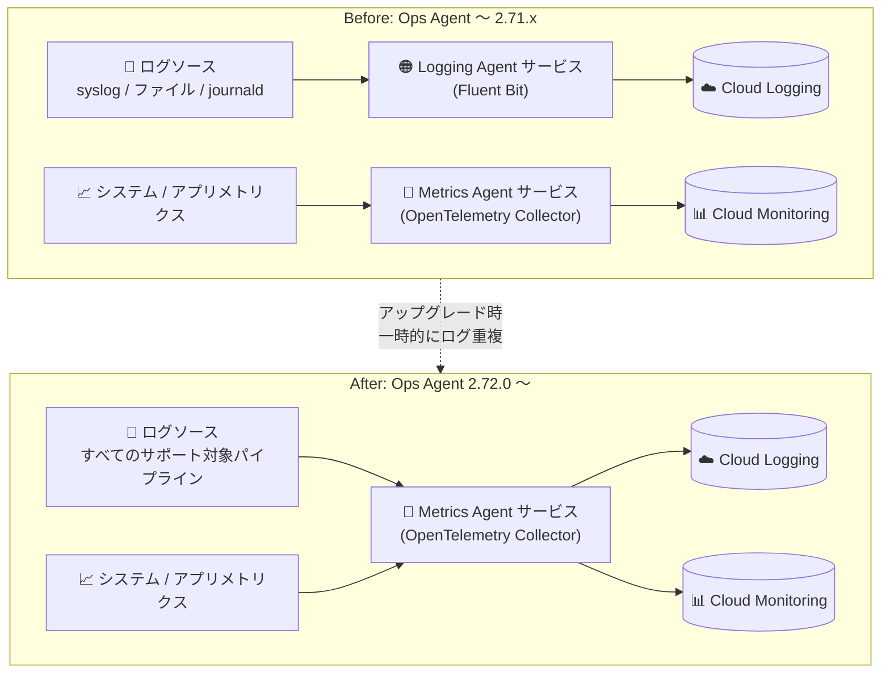

# Cloud Logging / Cloud Monitoring: Ops Agent 2.72.0 で全ロギングパイプラインが Metrics Agent サービスに移行

**リリース日**: 2026-11-17

**サービス**: Cloud Logging / Cloud Monitoring (Ops Agent)

**機能**: Ops Agent 2.72.0 ロギングパイプラインの処理主体変更

**ステータス**: 変更 (Changed)

📊 [このアップデートのインフォグラフィックを見る](https://takech9203.github.io/google-cloud-news-summary/20261117-ops-agent-2-72-0-logging-pipeline-change.html)

## 概要

Ops Agent バージョン 2.72.0 で、サポートされている**すべてのロギングパイプライン**の処理が、従来の Logging Agent サービス (Fluent Bit ベース) から Metrics Agent サービス (OpenTelemetry Collector ベース) に変更されました。Ops Agent 2.66.0 ではデフォルトのロギングパイプラインのみが Metrics Agent サービスに移行していましたが、2.72.0 でこの移行がすべてのサポート対象パイプラインに拡大された形です。この変更は Cloud Logging と Cloud Monitoring の両方のリリースノートに掲載されています。

運用上もっとも注意すべき点は、**旧バージョンから 2.72.0 以降にアップグレードすると、一定期間ログが重複して取り込まれる**ことです。Logging Agent サービスと Metrics Agent サービスはそれぞれ独立に「どのログをどこまで処理したか」の記録 (チェックポイント) を保持しているため、処理主体が切り替わると、切り替え前のサービスが処理済みのログを新しいサービスが再度処理します。これは想定された動作 (expected) であり、障害ではありません。

重複ログが問題になる場合は、設定で一時的に従来の Logging Agent サービスへ戻すことができます。ただしこの設定は将来的に削除される予定のため、恒久的な回避策としては利用できません。Compute Engine VM で Ops Agent を利用しているすべてのユーザーに影響する変更であり、アップグレード計画とログ重複期間の運用対応を事前に検討しておくことが重要です。

**アップデート前の課題**

- Ops Agent 2.65.x 以前では、ログ収集は Fluent Bit ベースの Logging Agent サービス、メトリクス収集は OpenTelemetry Collector ベースの Metrics Agent サービスという 2 系統の処理基盤が併存していた
- 2.66.0 〜 2.71.x では、デフォルトのロギングパイプラインのみ Metrics Agent サービスで処理され、それ以外のパイプラインは Logging Agent サービスが処理するという過渡的な構成だった
- ロギングとメトリクスで処理基盤が異なるため、エージェント内部のアーキテクチャが二重化していた

**アップデート後の改善**

- 2.72.0 以降、サポートされるすべてのロギングパイプラインが Metrics Agent サービス (OpenTelemetry Collector) で処理され、テレメトリー収集基盤が OpenTelemetry に統一された
- ログ・メトリクスの処理が同一サービスに集約され、エージェント内部のアーキテクチャが一本化された
- 問題が発生した場合に備え、`experimental_otel_logging: false` による一時的なロールバック手段が提供されている

## アーキテクチャ図



従来は Fluent Bit ベースの Logging Agent サービスがログを、OpenTelemetry Collector ベースの Metrics Agent サービスがメトリクスを処理する 2 系統構成でしたが、2.72.0 以降はすべてのロギングパイプラインも Metrics Agent サービスに集約されます。各サービスが独自に処理済みログの記録を持つため、切り替え時には一時的なログ重複が発生します。

## サービスアップデートの詳細

### 主要機能

1. **全ロギングパイプラインの Metrics Agent サービスへの移行**
   - 2.66.0 で始まったデフォルトパイプラインの移行が、2.72.0 ですべてのサポート対象ロギングパイプラインに拡大
   - ログ処理の実体が Fluent Bit から OpenTelemetry Collector ベースのサービスに変更
   - ユーザー側の設定ファイル (`config.yaml`) の書式変更は不要

2. **アップグレード時の一時的なログ重複 (想定された動作)**
   - Logging Agent サービスと Metrics Agent サービスは、それぞれ独立に処理済みログの記録を保持
   - 切り替え時に、旧サービスが処理済みのログを新サービスが再処理するため、一定期間ログが重複する
   - これは想定内の動作であり、エージェントの障害ではない

3. **一時的なロールバック手段の提供**
   - 重複ログが問題になる場合、設定で従来の Logging Agent サービスに戻すことが可能
   - この設定は将来的に削除される予定のため、ロールバックが必要になった場合は Cloud カスタマーケアへの報告が推奨されている
   - なお、ロールバック (逆方向の切り替え) 時にも同じ理由でログ重複が発生する

## 技術仕様

### バージョンと処理主体の変遷

| Ops Agent バージョン | ロギングパイプラインの処理主体 |
|------|------|
| 〜 2.65.x | Logging Agent サービス (Fluent Bit) がすべてのログを処理 |
| 2.66.0 〜 2.71.x | デフォルトパイプラインのみ Metrics Agent サービス、その他は Logging Agent サービス |
| 2.72.0 〜 | すべてのサポート対象パイプラインを Metrics Agent サービス (OpenTelemetry Collector) が処理 |

### 関連コンポーネント

| 項目 | 詳細 |
|------|------|
| Logging Agent サービス | Fluent Bit ベース。Linux では `google-cloud-ops-agent-fluent-bit.service` |
| Metrics Agent サービス | OpenTelemetry Collector (`otelopscol`) ベース。Linux では `google-cloud-ops-agent-opentelemetry-collector.service` |
| ログ重複の原因 | 各サービスが独自に処理済みログの記録 (チェックポイント) を保持するため |
| ロールバック設定 | `logging.service.experimental_otel_logging: false` (将来削除予定) |

### ロールバック設定例

```yaml
# /etc/google-cloud-ops-agent/config.yaml
logging:
  service:
    experimental_otel_logging: false
```

## 設定方法

### 前提条件

1. Compute Engine VM に Ops Agent がインストールされていること
2. エージェントのアップグレード・設定変更を行うための VM への SSH / RDP アクセス権限

### 手順

#### ステップ 1: アップグレード前の影響確認

アップグレード後、一定期間ログが重複することを前提に、以下を事前に確認します。

- ログベースの指標やログベースのアラートが、重複ログにより二重カウントされる可能性
- ログシンク (BigQuery / Cloud Storage へのエクスポートなど) の下流で重複が影響しないか
- ログ取り込み量の一時的な増加

#### ステップ 2: Ops Agent を 2.72.0 以降にアップグレード

```bash
# Linux: 最新バージョンへのアップグレード例
sudo bash add-google-cloud-ops-agent-repo.sh --also-install
```

アップグレード後、しばらくの間はログ重複が発生しますが、これは想定された動作です。

#### ステップ 3: (必要な場合のみ) Logging Agent サービスへの一時的なロールバック

重複ログが運用上の問題を引き起こす場合のみ、以下の設定を追加します。

```bash
# 設定ファイルにロールバック設定を追記
sudo tee -a /etc/google-cloud-ops-agent/config.yaml <<EOF
logging:
  service:
    experimental_otel_logging: false
EOF

# エージェントを再起動して設定を反映
sudo systemctl restart google-cloud-ops-agent

# コンポーネントの起動状態を確認
sudo systemctl status "google-cloud-ops-agent*"
```

この設定は将来的に削除される予定です。ロールバックが必要になった場合は、Cloud カスタマーケアに問題を報告することが公式に推奨されています。また、ロールバック時にも再度ログ重複が発生する点に注意してください。

## メリット

### ビジネス面

- **テレメトリー基盤の将来性**: 業界標準の OpenTelemetry ベースの処理基盤に統一されることで、オブザーバビリティ投資の長期的な継続性が高まる
- **運用の予見性**: ログ重複が「想定された動作」として公式に明示され、ロールバック手段も用意されているため、計画的なアップグレードが可能

### 技術面

- **アーキテクチャの統一**: ログとメトリクスの処理が同一の Metrics Agent サービス (OpenTelemetry Collector) に集約され、エージェント内部の 2 系統構成が解消される
- **設定互換性の維持**: ユーザー定義の `config.yaml` の書式はそのまま利用でき、移行はエージェント内部の処理主体の変更として透過的に行われる

## デメリット・制約事項

### 制限事項

- アップグレード時 (および Logging Agent サービスへのロールバック時) に、一定期間ログが重複して取り込まれる
- ロールバック用の `experimental_otel_logging: false` 設定は一時的な回避策であり、将来的に削除される予定
- ロールバックを恒久的に継続することはできないため、問題がある場合は Cloud カスタマーケアへの報告が必要

### 考慮すべき点

- 重複ログは Cloud Logging の取り込み量としてカウントされるため、重複期間中は取り込みコストが一時的に増加する可能性がある
- ログベースの指標・アラート、ログシンク経由の下流システム (BigQuery、Cloud Storage など) で重複データが二重カウントされる可能性があるため、重複期間中の分析・集計には注意が必要
- 大量の VM を運用している場合は、一斉アップグレードではなく段階的なロールアウトで影響範囲を限定することを推奨
- ロギングパイプラインが期待どおり動作しない場合のトラブルシューティング手順 (公式ドキュメント「Upgraded logging pipelines」) を事前に確認しておく

## ユースケース

### ユースケース 1: 大規模 VM フリートの段階的アップグレード

**シナリオ**: 数百台の Compute Engine VM で Ops Agent を運用しており、ログベースのアラートと BigQuery へのログシンクを利用している。ログ重複による誤検知や集計のずれを最小化しながら 2.72.0 へ移行したい。

**実装例**:
```bash
# 1. 検証環境の VM で先行アップグレードし、重複期間の長さと影響を確認
sudo bash add-google-cloud-ops-agent-repo.sh --also-install

# 2. 重複期間中のログ量をログエクスプローラーで確認
#    (同一内容のエントリが二重に取り込まれていないかを目視確認)

# 3. 問題がなければ本番 VM へ段階的にロールアウト
```

**効果**: 重複期間の実際の影響を小規模環境で把握したうえで本番展開でき、ログベースアラートの誤検知やコスト増加のリスクを管理できる。

### ユースケース 2: 重複ログが問題になる環境での一時的ロールバック

**シナリオ**: 監査要件によりログの重複取り込みが許容されないシステムで、アップグレード後の重複が問題となった。

**実装例**:
```yaml
logging:
  service:
    experimental_otel_logging: false
```

**効果**: 従来の Logging Agent サービスでの処理に一時的に戻しつつ、Cloud カスタマーケアに問題を報告して恒久対応を検討する時間を確保できる。ただし再切り替え時にも重複が発生するため、切り替えタイミングは慎重に計画する必要がある。

## 料金

Ops Agent 自体は無料で利用できますが、収集されたログは Cloud Logging、メトリクスは Cloud Monitoring の取り込み量に応じて課金されます。アップグレード時の重複期間中は、重複したログも取り込み量としてカウントされるため、一時的にログ取り込みコストが増加する可能性があります。

詳細は [Google Cloud Observability の料金ページ](https://cloud.google.com/stackdriver/pricing) を参照してください。

## 利用可能リージョン

Ops Agent は VM 上で動作するソフトウェアのアップデートであるため、リージョンに依存せず、Ops Agent をサポートするすべての環境に適用されます。

## 関連サービス・機能

- **Cloud Logging**: Ops Agent が収集したログの取り込み先。重複期間中はログエクスプローラーで同一内容のエントリが二重に表示される
- **Cloud Monitoring**: Metrics Agent サービス (OpenTelemetry Collector) の本来の役割であるメトリクスの取り込み先。エージェントの稼働状況は `agent.googleapis.com/agent/uptime` メトリクスで確認できる
- **Compute Engine**: Ops Agent の動作対象となる VM 基盤
- **ログベースの指標 / アラート**: 重複ログにより一時的に二重カウントが発生し得るため、重複期間中の挙動に注意が必要
- **OpenTelemetry**: 新しいロギングパイプラインの処理基盤。Ops Agent は OTLP メトリクス・トレースの収集にも対応している

## 参考リンク

- 📊 [インフォグラフィック](https://takech9203.github.io/google-cloud-news-summary/20261117-ops-agent-2-72-0-logging-pipeline-change.html)
- [公式リリースノート](https://docs.cloud.google.com/release-notes#November_17_2026)
- [Upgraded logging pipelines (トラブルシューティングドキュメント)](https://docs.cloud.google.com/stackdriver/docs/solutions/agents/ops-agent/troubleshoot-run-ingest)
- [Ops Agent 概要](https://docs.cloud.google.com/stackdriver/docs/solutions/agents/ops-agent)
- [Ops Agent の構成](https://docs.cloud.google.com/stackdriver/docs/solutions/agents/ops-agent/configuration)
- [料金ページ (Google Cloud Observability)](https://cloud.google.com/stackdriver/pricing)

## まとめ

Ops Agent 2.72.0 で、すべてのロギングパイプラインの処理が Fluent Bit ベースの Logging Agent サービスから OpenTelemetry Collector ベースの Metrics Agent サービスに統一されました。アップグレード時には想定された動作として一定期間ログが重複するため、ログベースのアラートや取り込みコストへの影響を事前に評価し、段階的なロールアウトを計画することを推奨します。重複が問題になる場合は `experimental_otel_logging: false` による一時的なロールバックが可能ですが、この設定は将来削除される予定のため、恒久対応が必要な場合は Cloud カスタマーケアへ報告してください。

---

**タグ**: Cloud Logging, Cloud Monitoring, Ops Agent, OpenTelemetry, Fluent Bit, Compute Engine, オブザーバビリティ, Changed
