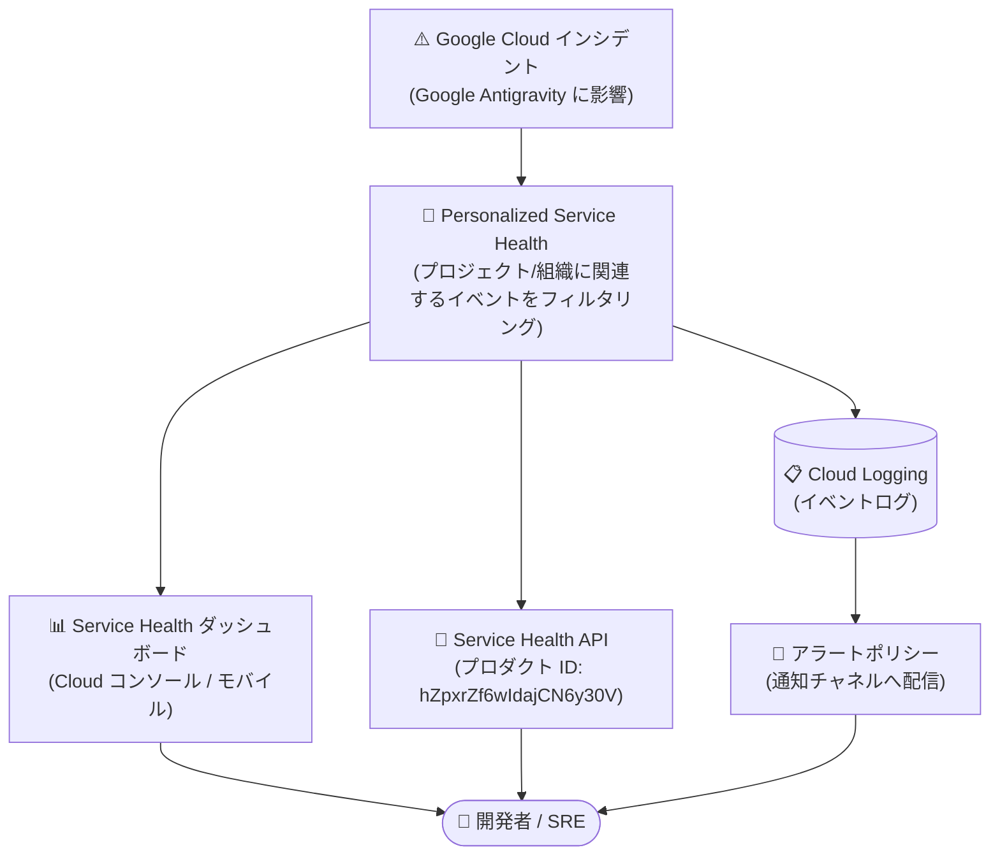

# Personalized Service Health: Google Antigravity (エンタープライズ向け) のサポートを追加

**リリース日**: 2026-11-17

**サービス**: Personalized Service Health

**機能**: Google Antigravity のインシデント可視化サポート

**ステータス**: Announcement (アナウンスメント)

📊 [このアップデートのインフォグラフィックを見る](https://takech9203.github.io/google-cloud-news-summary/20261117-personalized-service-health-google-antigravity.html)

## 概要

Personalized Service Health が、エンタープライズ向けの Google Antigravity (プロダクト ID: `hZpxrZf6wIdajCN6y30V`) をサポート対象プロダクトに追加しました。これにより、Google Antigravity に影響する障害 (インシデント) を、自組織のプロジェクトに関連する情報として Service Health ダッシュボード、Service Health API、Cloud Logging ベースのアラートで把握できるようになります。

Google Antigravity は、AI エージェントを主体的な開発ワーカーとして扱うエージェント型開発プラットフォームです。Gemini プラットフォームの AI Developer Tools の一部として提供され、デスクトップアプリ (Hub) や CLI を通じてエージェントのオーケストレーション、検証可能なアーティファクト生成、CI/CD パイプラインへの組み込みなどが可能です。エンタープライズの開発ワークフローの中核を担うツールであるため、その稼働状況を既存の監視・インシデント対応フローで追跡できることは、Antigravity を採用する企業にとって重要な改善です。

**アップデート前の課題**

- Google Antigravity は Personalized Service Health のサポート対象外であり、Antigravity に影響するインシデントを Service Health ダッシュボードや API で自組織に関連する情報として確認できなかった
- Antigravity の障害を検知するための安定したプロダクト ID が存在せず、Cloud Logging ベースのアラートポリシーを構成できなかった

**アップデート後の改善**

- Antigravity に影響するインシデントが Service Health ダッシュボードに表示され、影響を受けるプロダクト・ロケーションを確認できるようになった
- 安定したプロダクト ID `hZpxrZf6wIdajCN6y30V` を使用して、Service Health API の呼び出しやアラートポリシーの条件指定が可能になった
- 既存のインシデント対応・監視ワークフロー (ダッシュボード、API、アラート、ログエクスポート) に Antigravity の障害情報を統合できるようになった

## アーキテクチャ図

Google Antigravity に影響するインシデントが発生すると、Personalized Service Health が自組織に関連するイベントとしてフィルタリングし、ダッシュボード・API・Cloud Logging ベースのアラートの各チャネルを通じて開発者や SRE に届けます。

## サービスアップデートの詳細

### 主要機能

1. **Service Health ダッシュボードでの可視化**
   - Google Antigravity に影響するインシデントを、影響を受けるプロダクト・ロケーションとともに Google Cloud コンソールで確認可能
   - 組織ビューを使用すれば、組織内の任意のプロジェクトに影響するインシデントを集約して確認できる

2. **安定したプロダクト ID による API アクセスとアラート**
   - プロダクト ID `hZpxrZf6wIdajCN6y30V` を Service Health API の呼び出しやアラートポリシーの条件に使用可能
   - プロダクト名の変更 (リブランディング) があっても、プログラムからの参照には安定 ID を利用できる

3. **Cloud Logging 連携**
   - Service Health イベントは Cloud Logging に記録され、新規インシデントの報告時や更新時にアラートを発報するポリシーを構成できる
   - ログのエクスポートにより、外部の監視・チケッティングシステムとの統合も可能

## 技術仕様

| 項目 | 詳細 |
|------|------|
| 対象プロダクト | Google Antigravity (エンタープライズ向け) |
| プロダクト ID | `hZpxrZf6wIdajCN6y30V` |
| 提供チャネル | Service Health ダッシュボード、Service Health API、Cloud Logging / アラート |
| 対象スコープ | プロジェクト単位および組織単位 (組織ビュー) |

## メリット

### ビジネス面

- **ビジネス継続性の向上**: Antigravity を開発基盤として採用している企業が、障害の影響範囲を迅速に把握し、開発チームへの周知や代替手段への切り替えを判断しやすくなる
- **インシデント対応の一元化**: Google Cloud の他プロダクトと同じ Service Health の仕組みで Antigravity の障害情報を扱えるため、運用プロセスを統一できる

### 技術面

- **プログラマブルな障害検知**: 安定したプロダクト ID により、Service Health API やアラートポリシーで Antigravity のインシデントを自動検知できる
- **既存ワークフローへの統合**: Cloud Logging 経由のログエクスポートで、既存の監視・通知基盤に組み込める

## 考慮すべき点

- Google Antigravity はエンタープライズ向け (Gemini プラットフォーム経由) での利用が対象であり、サポートされるプロダクト・ロケーションの詳細は公式ドキュメントの「Supported products and locations」で確認が必要
- アラートを活用するには、プロジェクトまたは組織で Personalized Service Health を有効化し、アラートポリシーを構成する必要がある

## 関連サービス・機能

- **Cloud Logging**: Service Health イベントのログ記録とアラートポリシーの基盤
- **Cloud Monitoring**: アラート通知チャネルの構成に使用
- **Gemini プラットフォーム (AI Developer Tools)**: Google Antigravity の提供基盤。課金とクォータ管理のもとでエージェント型開発ワークフローを実行
- **Cloud Hub / App Hub**: アプリケーション単位でのインシデント表示に対応 (対応プロダクトの場合)

## 参考リンク

- 📊 [インフォグラフィック](https://takech9203.github.io/google-cloud-news-summary/20261117-personalized-service-health-google-antigravity.html)
- [公式リリースノート](https://docs.cloud.google.com/release-notes#November_17_2026)
- [Personalized Service Health 概要](https://docs.cloud.google.com/service-health/docs/overview)
- [サポート対象プロダクトとロケーション](https://docs.cloud.google.com/service-health/docs/supported-products-locations)
- [Google Antigravity](https://antigravity.google/)

## まとめ

Personalized Service Health のサポート対象に Google Antigravity (エンタープライズ向け) が追加され、エージェント型開発プラットフォームの障害情報を自組織の既存のインシデント対応フローで追跡できるようになりました。Antigravity を開発ワークフローに採用している組織は、プロダクト ID `hZpxrZf6wIdajCN6y30V` を使用したアラートポリシーの構成を検討することを推奨します。

---

**タグ**: Service Health, Personalized Service Health, Google Antigravity, インシデント管理, オブザーバビリティ, Announcement
