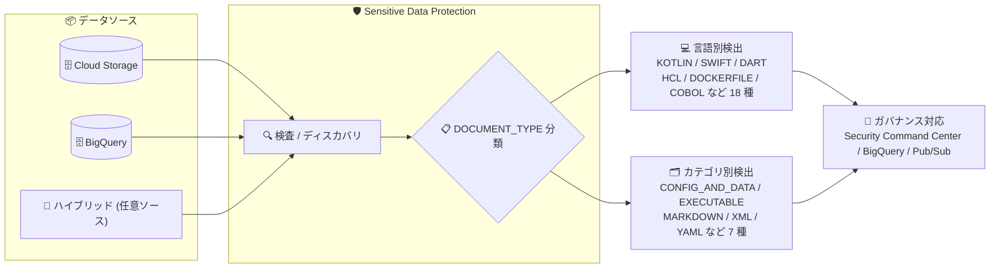

# Sensitive Data Protection: ソースコード分類用 infoType 検出器 25 種類を全リージョンで提供開始

**リリース日**: 2026-11-17

**サービス**: Sensitive Data Protection

**機能**: DOCUMENT_TYPE/R&D/SOURCE_CODE 配下の新しい infoType 検出器 (プログラミング言語・ファイルカテゴリ)

**ステータス**: 全リージョンで利用可能

📊 [このアップデートのインフォグラフィックを見る](https://takech9203.github.io/google-cloud-news-summary/20261117-sensitive-data-protection-source-code-infotypes.html)

## 概要

Google Cloud の Sensitive Data Protection (旧 Cloud DLP) に、ソースコードを言語・カテゴリ単位で分類するための新しい組み込み infoType 検出器が追加され、すべてのリージョンで利用可能になりました。今回のアップデートは同日に発表された 2 つのリリースノートエントリから構成され、合計 25 種類の `DOCUMENT_TYPE/R&D/SOURCE_CODE/*` 検出器が追加されています。

1 つ目のグループは **プログラミング言語別の検出器 (18 種類)** で、AWK、COBOL、Dart、Dockerfile、Fortran、Groovy、HCL、Kotlin、Lua、Objective-C、Perl、Protocol Buffers (PROTO)、R、Ruby、Scala、Swift、TOML、VBA のソースコードを識別します。2 つ目のグループは **ファイルカテゴリ別の検出器 (7 種類)** で、CONFIG_AND_DATA (設定・構造化データ)、DOCUMENT (ドキュメントマークアップ)、EXECUTABLE (実行可能なプログラミング言語のソースコード)、MARKDOWN、WEB_FRONTEND (Web フロントエンドコード)、XML、YAML を分類します。

DOCUMENT_TYPE 系の infoType は、ドキュメントのリスク評価とポリシー適用を支援するためにコンテンツを企業文書・機密文書・規制対象文書などのカテゴリに分類するもので、PII (個人識別情報) の検査スキャン結果と組み合わせることで特に有用になります。知的財産であるソースコードが Cloud Storage バケットや社内データ共有領域に意図せず保存されていないかを検出したいセキュリティチーム、データガバナンス担当者が主な対象ユーザーです。

**アップデート前の課題**

- 既存の `DOCUMENT_TYPE/R&D/SOURCE_CODE/*` 検出器は C、C++、C#、Go、HTML、Java、JavaScript、JSON、PHP、PowerShell、Python、Rust、Shell、SQL、TypeScript などに限られており、Kotlin、Swift、Dart といったモバイル開発言語や、COBOL、Fortran などのレガシー言語、HCL (Terraform) や Dockerfile などの IaC 関連ファイルを言語単位で識別できなかった
- Markdown、XML、YAML、設定ファイルなどを「ソースコード関連ドキュメント」としてカテゴリ分類する手段が限られていた
- 親 infoType の `DOCUMENT_TYPE/R&D/SOURCE_CODE` (汎用のソースコード検出) では、どの言語・種別のコードが漏えいリスクにさらされているかを細かく把握できなかった

**アップデート後の改善**

- 18 のプログラミング言語・フォーマット (AWK / COBOL / Dart / Dockerfile / Fortran / Groovy / HCL / Kotlin / Lua / Objective-C / Perl / Proto / R / Ruby / Scala / Swift / TOML / VBA) を言語単位で検出できるようになった
- 設定・データファイル、ドキュメントマークアップ、実行可能コード、Markdown、Web フロントエンド、XML、YAML という 7 つのカテゴリ単位の分類が可能になり、言語を網羅的に列挙しなくても広くソースコード関連ファイルを捕捉できるようになった
- すべての新検出器が全リージョン (ANY_LOCATION) で利用できるため、データレジデンシー要件のある環境でも同じ検査テンプレートを利用できる

## アーキテクチャ図



Cloud Storage や BigQuery などのデータソースを Sensitive Data Protection でスキャンすると、新しい DOCUMENT_TYPE 検出器がコンテンツを言語別・カテゴリ別に分類し、結果を Security Command Center や BigQuery、Pub/Sub へ連携してガバナンス対応につなげられます。

## サービスアップデートの詳細

### 主要機能

1. **プログラミング言語別のソースコード検出器 (18 種類)**
   - `DOCUMENT_TYPE/R&D/SOURCE_CODE/AWK` (AWK)、`COBOL`、`DART` (Dart)、`DOCKERFILE` (Dockerfile)、`FORTRAN` (Fortran)、`GROOVY` (Groovy)、`HCL` (HCL)、`KOTLIN` (Kotlin)、`LUA` (Lua)、`OBJECTIVE_C` (Objective-C)、`PERL` (Perl)、`PROTO` (Protocol Buffers)、`R` (R)、`RUBY` (Ruby)、`SCALA` (Scala)、`SWIFT` (Swift)、`TOML` (TOML)、`VBA` (VBA) の各ソースコードを検出
   - Kotlin / Swift / Dart / Objective-C というモバイルアプリ開発言語、COBOL / Fortran / VBA というレガシー・業務系言語、HCL / Dockerfile / TOML / Proto というインフラ・スキーマ定義系フォーマットまで幅広くカバー

2. **ファイルカテゴリ別のソースコード検出器 (7 種類)**
   - `CONFIG_AND_DATA`: 設定ファイルおよび構造化データソース
   - `DOCUMENT`: ドキュメントマークアップソース
   - `EXECUTABLE`: 実行可能なプログラミング言語のソースコード
   - `MARKDOWN`: Markdown 形式のテキスト
   - `WEB_FRONTEND`: Web フロントエンドのソースコード
   - `XML` / `YAML`: XML / YAML ソース
   - 個別言語を列挙しなくても、カテゴリ単位でソースコード関連ファイルを広く分類可能

3. **全リージョンでの提供**
   - すべての新検出器の Availability は ANY_LOCATION であり、リージョンを問わず利用可能
   - データレジデンシー要件により特定リージョンで検査・ディスカバリを実行する構成でも、同一の検査テンプレートを適用できる

## 技術仕様

### 新しい infoType 検出器の属性

| 項目 | 詳細 |
|------|------|
| infoType 階層 | `DOCUMENT_TYPE/R&D/SOURCE_CODE/*` (親: `DOCUMENT_TYPE/R&D/SOURCE_CODE`) |
| タイプ | DOCUMENT (ドキュメント分類) |
| ロケーション区分 | GLOBAL |
| 利用可能リージョン | ANY_LOCATION (全リージョン) |
| センシティビティスコア | SENSITIVITY_MODERATE (全 25 検出器共通) |
| 用途 | ドキュメントのリスク評価とポリシー適用のためのコンテンツ分類 |

### 追加された検出器一覧

| グループ | 検出器 |
|------|------|
| 言語別 (18 種類) | AWK, COBOL, DART, DOCKERFILE, FORTRAN, GROOVY, HCL, KOTLIN, LUA, OBJECTIVE_C, PERL, PROTO, R, RUBY, SCALA, SWIFT, TOML, VBA |
| カテゴリ別 (7 種類) | CONFIG_AND_DATA, DOCUMENT, EXECUTABLE, MARKDOWN, WEB_FRONTEND, XML, YAML |

### 検査設定の例

```json
{
  "inspectConfig": {
    "infoTypes": [
      { "name": "DOCUMENT_TYPE/R&D/SOURCE_CODE/KOTLIN" },
      { "name": "DOCUMENT_TYPE/R&D/SOURCE_CODE/SWIFT" },
      { "name": "DOCUMENT_TYPE/R&D/SOURCE_CODE/HCL" },
      { "name": "DOCUMENT_TYPE/R&D/SOURCE_CODE/CONFIG_AND_DATA" }
    ]
  }
}
```

## 設定方法

### 前提条件

1. Sensitive Data Protection (DLP API) が有効化されたプロジェクトがあること
2. 検査ジョブまたはディスカバリスキャン構成を作成・編集できる IAM 権限があること

### 手順

#### ステップ 1: 最新の組み込み infoType 一覧を確認する

```bash
# infoTypes.list メソッドで最新の組み込み infoType を取得
curl -s -H "Authorization: Bearer $(gcloud auth print-access-token)" \
  "https://dlp.googleapis.com/v2/infoTypes" | grep "SOURCE_CODE"
```

Sensitive Data Protection チームは新しい infoType 検出器を定期的にリリースしており、`infoTypes.list` メソッドで最新の一覧を取得できます。

#### ステップ 2: 検査テンプレートに新しい infoType を追加する

```bash
# 検査テンプレートを作成し、新しいソースコード検出器を指定
curl -s -X POST \
  -H "Authorization: Bearer $(gcloud auth print-access-token)" \
  -H "Content-Type: application/json" \
  "https://dlp.googleapis.com/v2/projects/PROJECT_ID/locations/global/inspectTemplates" \
  -d '{
    "inspectTemplate": {
      "displayName": "source-code-classification",
      "inspectConfig": {
        "infoTypes": [
          { "name": "DOCUMENT_TYPE/R&D/SOURCE_CODE/KOTLIN" },
          { "name": "DOCUMENT_TYPE/R&D/SOURCE_CODE/DOCKERFILE" },
          { "name": "DOCUMENT_TYPE/R&D/SOURCE_CODE/CONFIG_AND_DATA" }
        ]
      }
    }
  }'
```

検査テンプレートはディスカバリ (データプロファイリング) を含む Sensitive Data Protection の各サービスで共通して利用できます。既存のスキャン構成が使用する検査テンプレートを変更した場合、デフォルトでは変更は以降のスキャンにのみ適用されます。

## メリット

### ビジネス面

- **知的財産の漏えいリスク可視化**: ソースコードという知的財産が、本来あるべきでないストレージや共有データセットに存在していないかを言語単位で把握でき、リスク評価の精度が向上する
- **ポリシー適用の自動化**: DOCUMENT_TYPE 分類と PII 検査結果を組み合わせ、文書のカテゴリに応じたガバナンスポリシーの適用判断に活用できる

### 技術面

- **検出粒度の向上**: 汎用の SOURCE_CODE 検出だけでなく、Kotlin / Swift / HCL など言語別の検出により、どの開発チーム・システム由来のコードかの切り分けがしやすくなる
- **カテゴリ検出による網羅性**: EXECUTABLE や CONFIG_AND_DATA などカテゴリ単位の検出器を使えば、言語を個別に列挙しなくても広くソースコード関連ファイルを捕捉できる
- **全リージョン対応**: ANY_LOCATION で提供されるため、リージョン制約のある検査・ディスカバリ構成にもそのまま組み込める

## デメリット・制約事項

### 制限事項

- 組み込み infoType 検出器は完全に正確な検出方法ではなく、規制要件への準拠を保証するものではない (Google は要件を満たすことを確認するための設定テストを推奨)
- DOCUMENT_TYPE 系検出器はドキュメント分類 (DOCUMENT タイプ) であり、個々の PII 値の検出とは役割が異なる

### 考慮すべき点

- センシティビティスコアはいずれも SENSITIVITY_MODERATE であり、組織のリスク基準に応じてスコアの調整や検査テンプレートのルールセット設定を検討する
- ディスカバリ (継続的プロファイリング) と検査 (オンデマンドの詳細スキャン) のどちらで利用するかにより、コストモデルと得られる結果の粒度が異なる

## ユースケース

### ユースケース 1: Cloud Storage 上のソースコード混入検出

**シナリオ**: データレイクとして利用している Cloud Storage バケットに、開発者が誤って Kotlin のアプリコードや Terraform (HCL) ファイル、Dockerfile をアップロードしていないかを継続的に監視したい。

**実装例**:
```json
{
  "inspectConfig": {
    "infoTypes": [
      { "name": "DOCUMENT_TYPE/R&D/SOURCE_CODE/KOTLIN" },
      { "name": "DOCUMENT_TYPE/R&D/SOURCE_CODE/HCL" },
      { "name": "DOCUMENT_TYPE/R&D/SOURCE_CODE/DOCKERFILE" }
    ]
  }
}
```

**効果**: 知的財産であるソースコードや、インフラ構成情報を含む IaC ファイルの意図しない保存を早期に発見し、Security Command Center や Pub/Sub 経由の自動修復ワークフローにつなげられる。

### ユースケース 2: カテゴリ検出による設定ファイル・実行コードの棚卸し

**シナリオ**: 社内の共有データ領域に、認証情報を含み得る設定ファイルや実行可能なコードがどの程度存在するかを棚卸ししたい。利用言語が多岐にわたるため、個別言語の列挙は避けたい。

**効果**: `CONFIG_AND_DATA` と `EXECUTABLE` のカテゴリ検出器を使うことで、言語を網羅的に指定しなくてもソースコード関連ファイルを広く分類できる。シークレット系 infoType (PASSWORD、GCP_API_KEY など) と組み合わせれば、設定ファイル内の認証情報漏えいリスク評価も強化できる。

## 料金

新しい infoType 検出器自体に追加料金はなく、Sensitive Data Protection の既存の料金体系 (ディスカバリは選択した料金モード、検査・変換は処理バイト数に基づく課金) の中で利用できます。

### 料金例

| カテゴリ | 料金 (USD) |
|--------|-----------------|
| ディスカバリ (消費モード) | $0.03/GB |
| 検査・変換 (1 GB まで) | 無料 |
| Google Cloud ストレージシステムの検査 | $1/GB から (ボリュームにより低減) |
| 任意ソースの検査 (ハイブリッド検査) | $3/GB から (ボリュームにより低減) |
| インラインコンテンツの匿名化 | $2/GB から (ボリュームにより低減) |

詳細は [料金ページ](https://cloud.google.com/sensitive-data-protection/pricing) を参照してください。

## 利用可能リージョン

今回追加された 25 種類の検出器はすべて **ANY_LOCATION (全リージョン)** で利用可能です。

## 関連サービス・機能

- **Security Command Center**: ディスカバリや検査の結果を SCC に発行し、組織全体のリスク管理に統合できる。SCC Enterprise サブスクリプションにはデフォルトのディスカバリサブスクリプションが無償で含まれる
- **BigQuery**: スキャン結果 (検出結果・データプロファイル) を BigQuery に保存して分析できる
- **Pub/Sub**: 検出結果を Pub/Sub に発行し、隔離やアラートなどイベント駆動の修復ワークフローを構築できる
- **シークレット系 infoType 検出器**: PASSWORD、GCP_API_KEY、AWS_CREDENTIALS などの認証情報検出器と組み合わせることで、ソースコード・設定ファイル内の認証情報漏えい検出を強化できる

## 参考リンク

- 📊 [インフォグラフィック](https://takech9203.github.io/google-cloud-news-summary/20261117-sensitive-data-protection-source-code-infotypes.html)
- [公式リリースノート](https://docs.cloud.google.com/release-notes#November_17_2026)
- [InfoType detector reference](https://docs.cloud.google.com/sensitive-data-protection/docs/infotypes-reference)
- [InfoTypes and infoType detectors](https://docs.cloud.google.com/sensitive-data-protection/docs/concepts-infotypes)
- [料金ページ](https://cloud.google.com/sensitive-data-protection/pricing)

## まとめ

Sensitive Data Protection のソースコード分類が 25 種類の新検出器で大幅に拡充され、モバイル開発言語から IaC、レガシー言語、カテゴリ単位の分類まで全リージョンでカバーできるようになりました。ソースコードの意図しない保存は知的財産漏えいや認証情報流出の起点になり得るため、Cloud Storage や BigQuery を広く利用している組織は、検査テンプレートへの新 infoType の追加とディスカバリスキャンでの活用を検討することを推奨します。

---

**タグ**: #SensitiveDataProtection #DLP #infoType #データガバナンス #セキュリティ #ソースコード検出 #DataLossPrevention
