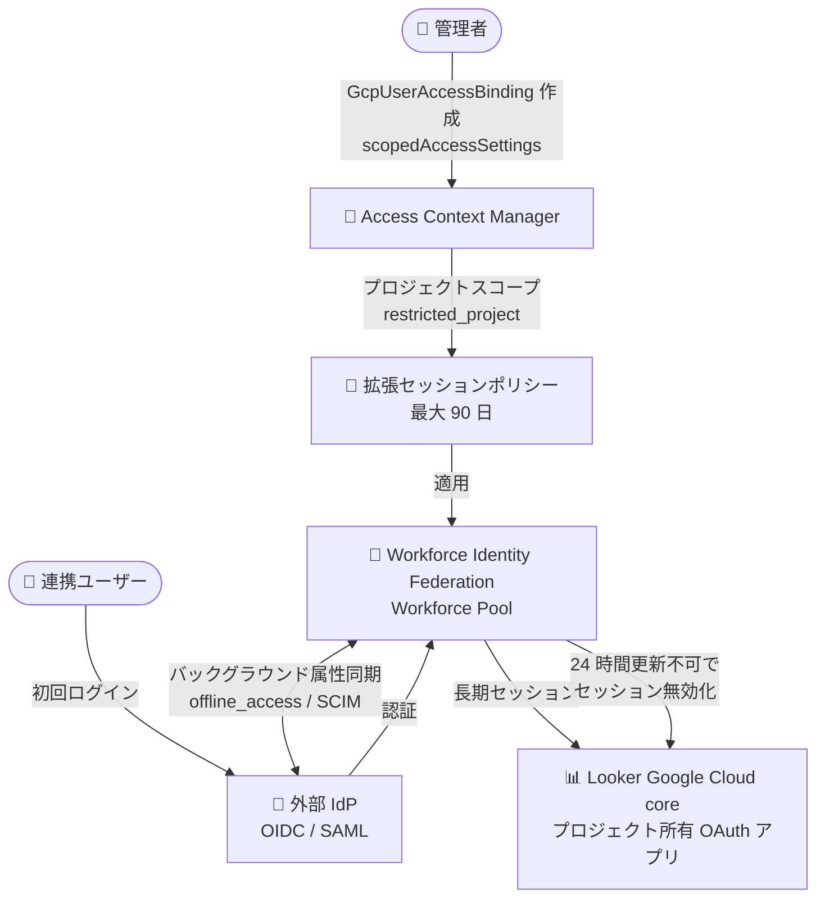

# Access Context Manager: Workforce Identity Federation の拡張セッション長が GA

**リリース日**: 2026-11-17

**サービス**: Access Context Manager (Workforce Identity Federation)

**機能**: 拡張セッション長 (Extended session length)

**ステータス**: GA (一般提供)

📊 [このアップデートのインフォグラフィックを見る](https://takech9203.github.io/google-cloud-news-summary/20261117-workforce-identity-federation-extended-session-length.html)

## 概要

Workforce Identity Federation の拡張セッション長 (Extended session length) が、Google Cloud プロジェクトが所有する OAuth アプリケーション向けに一般提供 (GA) されました。Access Context Manager のプロジェクトスコープ (`restricted_project`) を使用することで、最大 90 日間持続するセッションを構成できます。

Workforce Identity Federation は、外部 IdP (Okta、Microsoft Entra ID など) のユーザーを Google Cloud に連携させる仕組みですが、デフォルトではセッションの最大継続時間は 12 時間に制限されており、ユーザーは毎日再認証が必要でした。今回の GA により、Looker (Google Cloud core) などプロジェクトが所有するアプリケーションへの接続を、外部 IdP への日次再認証なしで最大 90 日間維持できるようになります。

セッションを長期化してもセキュリティを維持できるよう、Google Cloud はバックグラウンドで外部 IdP からユーザー属性とグループメンバーシップを定期的に同期します。24 時間以内に属性を更新できない場合 (IdP 側でユーザーが削除・無効化された場合など) はセッションが自動的に無効化されるため、IdP 側の統制が引き続き有効に機能します。

**アップデート前の課題**

- Workforce Identity Federation のセッションは最大 12 時間に制限されており、連携ユーザーは毎日外部 IdP に対する再認証が必要だった
- Looker (Google Cloud core) のダッシュボードを継続的に利用する業務や、長時間稼働するワークフローがセッション失効により中断されていた
- セッション失効のたびに発生する再ログインが、連携ユーザーの利用体験と生産性を低下させていた

**アップデート後の改善**

- プロジェクトスコープを使用して、最大 90 日間 (3,600 秒〜7,776,000 秒) のセッションを構成できるようになった
- 対象プロジェクトが所有する OAuth アプリケーション (Looker (Google Cloud core) など) への接続を、日次再認証なしで維持できるようになった
- バックグラウンドの属性同期 (OIDC リフレッシュトークンまたは SCIM) と 24 時間の属性ステイルネス保護により、長期セッション中も IdP 側のユーザー無効化が反映される

## アーキテクチャ図



管理者は Access Context Manager のアクセスバインディングでプロジェクトスコープの拡張セッションポリシーを定義し、Workforce Identity Federation がバックグラウンドで外部 IdP と属性を同期しながら最大 90 日のセッションを維持します。

## サービスアップデートの詳細

### 主要機能

1. **プロジェクトスコープによる最大 90 日のセッション構成 (GA)**
   - `GcpUserAccessBinding` の `scopedAccessSettings` 内で `restricted_project` スコープを指定し、対象プロジェクトが所有する OAuth アプリケーションに拡張セッションを適用
   - セッション長は 1 時間 (`3600s`) から 90 日 (`7776000s`) の範囲で指定可能
   - 対象プロジェクトが所有する Looker (Google Cloud core) インスタンスのみに適用され、影響範囲をプロジェクト単位で制御できる

2. **バックグラウンド属性同期**
   - OIDC プロバイダ: Authorization Code Flow + `offline_access` スコープによるリフレッシュトークン、または SCIM プロビジョニングで属性を更新
   - SAML 2.0 プロバイダ: SCIM プロビジョニングが必須
   - ユーザー属性とグループメンバーシップを IdP から定期的に取得し、長期セッション中も最新の状態を維持

3. **属性ステイルネス保護 (24 時間)**
   - 24 時間以内に IdP からユーザー属性を更新できない場合、セッションは無効化され再認証が必要になる
   - IdP 側でのユーザーのデプロビジョニングや認証情報の失効が、最大 24 時間以内にセッション終了として反映される

## 技術仕様

### セッション設定パラメータ

| 項目 | 詳細 |
|------|------|
| `session_length_enabled` | `true` に設定必須 |
| `session_length` | 必須。`3600s` (1 時間) 〜 `7776000s` (90 日) |
| `session_reauth_method` | 未設定または `LOGIN` |
| `use_oidc_max_age` | 未設定または `false` |
| `max_inactivity` | 未設定 (デフォルト `0s`)。アイドルタイムアウトは非サポート |

### 制約・構成上のポイント

| 項目 | 詳細 |
|------|------|
| スコープ指定 | `restricted_project` (`projects/{PROJECT_NUMBER}`)。OAuth クライアント ID (`clientId`) によるスコープ指定は非サポート |
| バインディング数 | フェデレーテッドプリンシパルは組織内の全 Workforce Pool に適用されるため、組織ごとに 1 つのみ。複数プロジェクトは 1 つのバインディング内に複数の `restricted_project` スコープブロックで対応 |
| アクセスレベル | `access_levels` / `dry_run_access_levels` は Workforce Pool バインディングで非サポート |
| トップレベル設定 | `sessionSettings` の直接指定は不可。`scopedAccessSettings.activeSettings.sessionSettings` 内で定義 |
| 対応 IdP | OIDC (Authorization Code Flow + `offline_access`、または SCIM)、SAML 2.0 (SCIM 必須) |

### バインディング定義例 (REST API)

```json
{
  "principal": {
    "federatedPrincipal": "principalSet://cloudresourcemanager.googleapis.com/organizations/ORG_ID/type/WorkforcePool"
  },
  "scopedAccessSettings": [
    {
      "scope": {
        "clientScope": {
          "restrictedProject": { "name": "projects/PROJECT_NUMBER" }
        }
      },
      "activeSettings": {
        "sessionSettings": {
          "sessionLength": "7776000s",
          "sessionLengthEnabled": true,
          "sessionReauthMethod": "LOGIN"
        }
      }
    }
  ]
}
```

## 設定方法

### 前提条件

1. 必要な IAM ロールの付与
   - Workforce Pool の構成: Workforce Pool 管理者 (`roles/iam.workforcePoolAdmin`)
   - アクセスバインディングの管理: Cloud Access Binding 管理者 (`roles/accesscontextmanager.gcpAccessAdmin`、組織レベル)
2. Access Context Manager API と IAM API の有効化

```bash
gcloud services enable \
  accesscontextmanager.googleapis.com \
  iam.googleapis.com
```

### 手順

#### ステップ 1: Workforce Pool プロバイダの構成 (OIDC の例)

```bash
gcloud iam workforce-pools providers update-oidc PROVIDER_ID \
  --workforce-pool=WORKFORCE_POOL_NAME \
  --location=global \
  --web-sso-additional-scopes="offline_access"
```

外部 IdP 側では Authorization Code Flow とオフラインアクセス (リフレッシュトークン発行) を有効化します。拡張セッションポリシーを意図どおり機能させるには、組織内のすべての Workforce Pool でオフラインアクセスを構成する必要があります。SAML プロバイダの場合は SCIM プロビジョニングを設定します。

#### ステップ 2: ポリシーの YAML 定義

```yaml
# esl-binding.yaml
scopedAccessSettings:
- scope:
    clientScope:
      restrictedProject:
        name: projects/PROJECT_NUMBER
  activeSettings:
    sessionSettings:
      sessionLength: 7776000s
      sessionLengthEnabled: true
      sessionReauthMethod: LOGIN
```

`PROJECT_NUMBER` には、対象の Looker (Google Cloud core) インスタンスを所有するプロジェクト番号を指定します。

#### ステップ 3: アクセスバインディングの作成

```bash
gcloud access-context-manager cloud-bindings create \
  --organization=ORG_ID \
  --federated-principal="principalSet://cloudresourcemanager.googleapis.com/organizations/ORG_ID/type/WorkforcePool" \
  --binding-file="esl-binding.yaml"
```

組織に既存のバインディングがある場合は、新規作成ではなく既存バインディングに `restricted_project` スコープを追加して更新します。

## メリット

### ビジネス面

- **ユーザー体験の向上**: 毎日の再認証が不要になり、Looker (Google Cloud core) を日常的に利用するアナリストや業務ユーザーの作業中断が解消される
- **GA による本番利用の安心感**: Preview から GA に昇格したことで、SLA の対象となり本番環境の認証基盤として採用しやすくなった

### 技術面

- **セキュリティと利便性の両立**: バックグラウンド属性同期と 24 時間のステイルネス保護により、長期セッション中も IdP 側のユーザー無効化・権限変更が反映される
- **プロジェクト単位のきめ細かな制御**: `restricted_project` スコープにより、拡張セッションの適用範囲を特定プロジェクトが所有するアプリケーションに限定できる
- **宣言的なポリシー管理**: Access Context Manager の `GcpUserAccessBinding` として組織レベルで一元管理でき、gcloud / REST API の両方で操作可能

## デメリット・制約事項

### 制限事項

- 対象アプリケーションは限定的で、プロジェクトスコープで構成できるのは Looker (Google Cloud core)。Gemini Enterprise モバイルアプリ向けのアプリケーションスコープ (`restricted_client_application`) は Preview (許可リスト制) として提供されている
- OAuth クライアント ID (`clientId`) によるスコープ指定は Workforce Identity Federation バインディングでは非サポート
- アイドルセッションタイムアウト (`max_inactivity`) は非サポート
- Workforce Pool バインディングではアクセスレベル (`access_levels`) を併用できない
- 組織ごとに全 Workforce Pool を対象とするバインディングは 1 つのみ

### 考慮すべき点

- OIDC でリフレッシュトークン方式を使う場合、組織内のすべての Workforce Pool で `offline_access` を構成しないと、一部ユーザーがポリシーで指定した期間より早くログアウトされる可能性がある
- SAML プロバイダでは SCIM プロビジョニングの構築が前提条件となるため、IdP 側の設定作業が必要
- セッションが最大 90 日継続するため、IdP 側のデプロビジョニングプロセス (退職者処理など) が確実に機能していることがより重要になる (反映まで最大 24 時間)

## ユースケース

### ユースケース 1: Looker (Google Cloud core) ダッシュボードの常時利用

**シナリオ**: 外部 IdP (Okta など) で認証する分析チームが、Looker (Google Cloud core) のダッシュボードを日常業務で常時利用している。従来は 12 時間ごとにセッションが切れ、毎朝の再ログインが定着していた。

**実装例**:
```yaml
scopedAccessSettings:
- scope:
    clientScope:
      restrictedProject:
        name: projects/987654321098   # Looker インスタンスを所有するプロジェクト
  activeSettings:
    sessionSettings:
      sessionLength: 2592000s          # 30 日
      sessionLengthEnabled: true
      sessionReauthMethod: LOGIN
```

**効果**: 分析チームは 30 日間再認証なしで Looker を利用でき、日次の再ログインによる作業中断がなくなる。IdP 側でユーザーを無効化すれば最大 24 時間以内にセッションが終了するため、ガバナンスも維持される。

### ユースケース 2: 複数の Looker プロジェクトへの段階的な適用

**シナリオ**: 組織内に部門ごとの Looker (Google Cloud core) プロジェクトが複数あり、部門の要件に応じて異なるセッション長を適用したい。

**効果**: 組織に 1 つのバインディング内で、プロジェクトごとに `restricted_project` スコープブロックを追加し、部門 A は 90 日、部門 B は 7 日といった柔軟なセッションポリシーを一元管理できる。

## 関連サービス・機能

- **Workforce Identity Federation (Cloud IAM)**: 外部 IdP のユーザーをサービスアカウントキーなしで Google Cloud に連携する基盤。本機能はこの連携セッションの長さを制御する
- **Access Context Manager**: 拡張セッションポリシーを `GcpUserAccessBinding` として定義・適用するサービス
- **Looker (Google Cloud core)**: プロジェクトスコープによる拡張セッションの主な対象アプリケーション。Looker 内部のセッション長設定は別途 Looker 側の構成が引き続き適用される
- **SCIM プロビジョニング for Workforce Identity Federation**: SAML プロバイダ利用時のバックグラウンド属性同期に必須。OIDC でもリフレッシュトークンの代替として利用可能

## 参考リンク

- 📊 [インフォグラフィック](https://takech9203.github.io/google-cloud-news-summary/20261117-workforce-identity-federation-extended-session-length.html)
- [公式リリースノート](https://docs.cloud.google.com/release-notes#November_17_2026)
- [ドキュメント: Configure extended session length for Workforce Identity Federation](https://docs.cloud.google.com/access-context-manager/docs/extended-session-length-for-workforce-identity-federation)
- [SCIM provisioning for Workforce Identity Federation](https://docs.cloud.google.com/iam/docs/workforce-identity-federation-scim)

## まとめ

Workforce Identity Federation の拡張セッション長が GA となり、プロジェクトスコープを使って最大 90 日のセッションを本番環境で構成できるようになりました。デフォルト 12 時間のセッション制限による日次再認証が Looker (Google Cloud core) 利用の課題になっている組織は、Workforce Pool プロバイダのオフラインアクセス (または SCIM) 構成と Access Context Manager のアクセスバインディング作成を検討することを推奨します。導入時は、IdP 側のデプロビジョニングプロセスと 24 時間のステイルネス保護を前提としたセキュリティ運用の確認も併せて行ってください。

---

**タグ**: #AccessContextManager #WorkforceIdentityFederation #IAM #セキュリティ #認証 #Looker #GA
