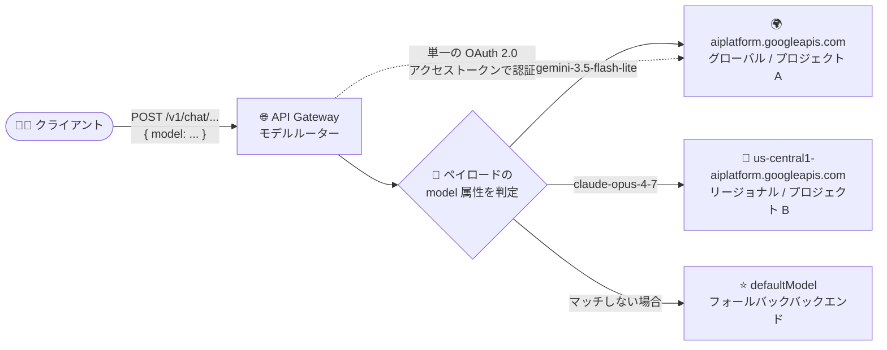

# API Gateway: モデルルーターが異なるホスト・異なるプロジェクトの Google API バックエンドに対応

**リリース日**: 2026-11-18

**サービス**: API Gateway

**機能**: モデルルーターのマルチホスト / クロスプロジェクトバックエンド対応

**ステータス**: Feature (モデルルーティング機能はパブリックプレビュー)

📊 [このアップデートのインフォグラフィックを見る](https://takech9203.github.io/google-cloud-news-summary/20261118-api-gateway-model-routers-multi-host.html)

## 概要

API Gateway のモデルルーティング機能において、1 つのモデルルーターが参照する Google API バックエンドを、異なるホストおよび異なるプロジェクトに配置できるようになりました。例えば、グローバルエンドポイント (`aiplatform.googleapis.com`) とリージョナルエンドポイント (`us-central1-aiplatform.googleapis.com`)、さらに `.vertexai.goog` エンドポイントを 1 つのルーター内で混在させることが可能です。これまでは、ルーターが参照するすべてのバックエンドが同一ホスト名を共有する必要がありました。

あわせてセキュリティ要件が強化され、ルーターが参照するすべてのバックエンドで `https` スキームが必須となりました。バックエンドに `http` を使用するルーターを含む API 構成の作成は失敗するようになります。ただし、デプロイ済みの既存ゲートウェイには影響しません。

このアップデートは、API Gateway を複数の基盤モデル (Gemini、Claude、OpenAI 互換モデルなど) へのルーティングレイヤーとして利用するユーザー、特にモデルごとに最適なリージョンやプロジェクトを使い分けたい組織にとって重要な改善です。

**アップデート前の課題**

- 以前は、1 つのモデルルーターが参照するすべてのバックエンドが単一のホスト名を共有する必要があった
- グローバルエンドポイントとリージョナルエンドポイントを 1 つのルーターで混在させることができなかった
- 異なるプロジェクトにデプロイされたモデルエンドポイントを 1 つのルーターから参照できなかった

**アップデート後の改善**

- 1 つのルーターから、グローバル (`aiplatform.googleapis.com`)、リージョナル (`us-central1-aiplatform.googleapis.com` など)、`.vertexai.goog` といった異なるホストのバックエンドを参照できるようになった
- 異なるプロジェクトに存在するモデルバックエンドを 1 つのルーターで参照できるようになった
- すべてのバックエンドに `https` が必須となり、プロンプトペイロードと認証情報の転送時の保護が強化された (構成作成時に `http` バックエンドが拒否される)

## アーキテクチャ図



クライアントのリクエストペイロード内の `model` 属性に基づき、モデルルーターが異なるホスト・異なるプロジェクトの Google API バックエンド (すべて `https` 必須) にルーティングします。認証は単一の OAuth 2.0 アクセストークンで行われ、任意の Google API ホストで有効です。

## サービスアップデートの詳細

### 主要機能

1. **マルチホストバックエンドのサポート**
   - 1 つのルーターが参照するバックエンドを、グローバルエンドポイント (`aiplatform.googleapis.com`)、リージョナルエンドポイント (例: `us-central1-aiplatform.googleapis.com`)、`.vertexai.goog` エンドポイントなど異なるホストに配置可能
   - ゲートウェイは、ルーターが参照するすべてのバックエンド (`defaultModel.backend` および各ルールの `backend`) に対して、任意の Google API ホストで有効な単一の OAuth 2.0 アクセストークンで認証する

2. **クロスプロジェクトバックエンドのサポート**
   - ルーターが参照するバックエンドを異なるプロジェクトに配置可能
   - ゲートウェイのサービスアカウント (デフォルトの Compute Engine サービスアカウント、または API 構成作成時に指定したユーザー管理サービスアカウント) に、ターゲットモデルをホストする各プロジェクトで Agent Platform User (`roles/aiplatform.user`) ロールの付与が必要

3. **https スキームの必須化**
   - ルーターが参照するすべてのバックエンドで `https` スキームが必須
   - バックエンドに `http` を使用するルーターを含む API 構成の作成は失敗する
   - デプロイ済みの既存ゲートウェイには影響しない

## 技術仕様

### バックエンドのホストとスキームに関するルール

| 項目 | 詳細 |
|------|------|
| サポートされるバックエンド | Google API エンドポイントのみ (`.googleapis.com` または `.vertexai.goog` で終わるホスト名) |
| ホストの混在 | グローバル / リージョナル / `.vertexai.goog` エンドポイントを 1 つのルーター内で混在可能。異なるプロジェクトも可 |
| スキーム | すべてのバックエンドで `https` が必須 (`http` は構成作成時に拒否) |
| エンドポイントの混在制限 | Google API エンドポイントとその他のエンドポイントを 1 つのルーター内で混在させることは不可 |
| 認証 | ルーターが参照する全バックエンドに対し、単一の OAuth 2.0 アクセストークンで認証 (任意の Google API ホストで有効) |
| pathTranslation | モデルルーティングのバックエンドは `CONSTANT_ADDRESS` が必須 (`APPEND_PATH_TO_ADDRESS` は拒否) |
| targetModel | `<provider>/<model-id>` 形式。provider は `google`、`openai`、`anthropic` のいずれか。構成作成 (デプロイ) 時に検証 |
| ネットワーク | VPC Service Controls および Private Service Connect (PSC) エンドポイント構成は非サポート。パブリックなリージョナル / グローバルの MaaS オープンモデルエンドポイントのみ |

### 構成上のその他の検証ルール

- `x-google-model-router` 拡張は OpenAPI 3.x 仕様でのみサポート (OpenAPI 2.0 / Swagger は非サポート)
- `x-google-model-router` はオペレーションレベルでのみ指定可能で、POST メソッドにのみ適用可能
- 同一オペレーションに `x-google-model-router` と `x-google-backend` の両方は指定不可
- 1 つの OpenAPI 仕様内でモデルルーティングオペレーションと非モデルルーティングオペレーションの混在は不可
- 構成検証はドメイン許可リストを強制しないため、すべてのバックエンド `address` が信頼できる Agent Platform エンドポイント (例: `aiplatform.googleapis.com`) のみを指すことを確認する必要がある

## 設定方法

### 前提条件

1. API 構成とゲートウェイの作成に API Gateway Admin (`roles/apigateway.admin`) ロールが必要
2. ゲートウェイが使用するサービスアカウントに、ターゲットモデルをホストする各プロジェクトで Agent Platform User (`roles/aiplatform.user`) ロールが必要 (バックエンドが他プロジェクトにある場合は、そのプロジェクトでも付与が必要)
3. ルーティング対象のモデルが Agent Platform Model Garden でデプロイ済みの MaaS オープンモデルであること
4. ターゲットプロジェクトと API Gateway インスタンスが VPC Service Controls 境界で制限されていないこと

### 手順

#### ステップ 1: OpenAPI 3.x 仕様で異なるホストのバックエンドを定義

```yaml
x-google-api-management:
  backends:
    gemini-global:
      address: "https://aiplatform.googleapis.com/v1/projects/PROJECT_A/\
        locations/global/publishers/google/models/gemini-3.5-flash-lite:generateContent"
      deadline: 60.0
      pathTranslation: CONSTANT_ADDRESS
    claude-regional:
      address: "https://us-central1-aiplatform.googleapis.com/v1/projects/PROJECT_B/\
        locations/us-central1/publishers/anthropic/models/claude-opus-4-7:rawPredict"
      deadline: 60.0
      pathTranslation: CONSTANT_ADDRESS
  ai:
    models:
      routing:
        routers:
          multi-host-router:
            defaultModel:
              backend: gemini-global
              targetModel: google/gemini-3.5-flash-lite
            rules:
              - model: "claude-opus-4-7"
                backend: claude-regional
                targetModel: anthropic/claude-opus-4-7
```

グローバルエンドポイント (プロジェクト A) とリージョナルエンドポイント (プロジェクト B) を 1 つのルーター内で参照する例です。すべてのバックエンドで `https` を指定します。

#### ステップ 2: API 構成を作成しゲートウェイにデプロイ

作成した OpenAPI 3.x 仕様から API 構成を作成し、API Gateway インスタンスにデプロイします。デプロイ完了後、ゲートウェイの URL を取得します。

```bash
gcloud api-gateway gateways describe GATEWAY_ID \
  --location=GATEWAY_LOCATION \
  --project=PROJECT_ID \
  --format='value(defaultHostname)'
```

#### ステップ 3: ルーティング動作をテスト

```bash
curl https://GATEWAY_URL/v1/chat/multi-host \
  -H "Content-Type: application/json" \
  -H "Authorization: Bearer $TOKEN" \
  -d '{
    "model": "claude-opus-4-7",
    "messages": [
      { "role": "user", "content": "Explain recursion in one sentence." }
    ]
  }'
```

ペイロードの `model` 属性がルールにマッチすると該当バックエンド (この例ではリージョナルエンドポイント) に、マッチしない場合は `defaultModel` のバックエンドにルーティングされます。

## メリット

### ビジネス面

- **マルチプロジェクト運用への適合**: モデルのデプロイをプロジェクト単位で分離している組織でも、単一のゲートウェイ / ルーターで統合的に AI トラフィックを管理できる
- **セキュリティ強化**: `https` の必須化により、プロンプトペイロードや認証情報が転送中に保護されることが構成レベルで保証される

### 技術面

- **グローバルとリージョナルの併用**: レイテンシやデータロケーションの要件に応じて、モデルごとにグローバル / リージョナルエンドポイントを使い分けられる
- **認証の簡素化**: 複数ホスト・複数プロジェクトにまたがる場合でも、ゲートウェイは単一の OAuth 2.0 アクセストークンで全バックエンドに認証できる
- **観測性の向上**: Cloud Logging の `backendRequest.hostname` フィールドでリクエストがプロキシされた Agent Platform バックエンドのホスト名を確認できる (バックエンドがホスト名を共有する場合、このフィールドだけではモデルを特定できない点に注意)

## デメリット・制約事項

### 制限事項

- バックエンドは Google API エンドポイント (`.googleapis.com` / `.vertexai.goog`) のみサポートされ、Google API エンドポイントとその他のエンドポイントを 1 つのルーターで混在させることはできない
- `http` バックエンドを使用する API 構成の作成は失敗する (新規構成に適用。デプロイ済みゲートウェイは影響なし)
- VPC Service Controls / Private Service Connect (PSC) エンドポイント構成は非サポート
- モデルルーティングなしでデプロイした既存ゲートウェイにモデルルーティングを追加する更新 (およびその逆) はできず、新しい API 構成とゲートウェイの作成が必要
- パブリックプレビュー期間中は、リクエスト単位でどのターゲットモデルが処理したかの帰属情報 (per-request attribution) は利用不可 (構造化されたルーティング決定ログは将来のリリースで追加予定)

### 考慮すべき点

- クロスプロジェクト構成では、ゲートウェイのサービスアカウントにモデルをホストする各プロジェクトで `roles/aiplatform.user` を付与する IAM 設計が必要
- 構成検証はドメイン許可リストを強制しないため、バックエンドの `address` が信頼できるエンドポイントのみを指しているかのレビューが必要
- 既存構成で `http` バックエンドを使用している場合、今後の構成再作成時に失敗するため、`https` への移行を計画すべき

## ユースケース

### ユースケース 1: グローバルとリージョナルエンドポイントの併用

**シナリオ**: データレジデンシー要件のある Claude モデルは `us-central1` のリージョナルエンドポイントで、汎用的な Gemini モデルはグローバルエンドポイントで提供したい。

**実装例**: 1 つのルーターに、`aiplatform.googleapis.com` (グローバル) をデフォルト、`us-central1-aiplatform.googleapis.com` (リージョナル) をルールのバックエンドとして定義する。

**効果**: クライアントは単一のゲートウェイ URL に対して `model` 属性を切り替えるだけで、要件に応じたエンドポイントへ透過的にルーティングされる。

### ユースケース 2: プロジェクト分離環境での統合 AI ゲートウェイ

**シナリオ**: チームごとにプロジェクトを分離してモデルをデプロイしているが、社内向けには単一の AI ゲートウェイを提供したい。

**効果**: ゲートウェイのサービスアカウントに各プロジェクトで `roles/aiplatform.user` を付与することで、1 つのルーターから複数プロジェクトのモデルバックエンドを参照でき、ゲートウェイの統合管理と課金・権限のプロジェクト分離を両立できる。

## 料金

このアップデート自体による追加料金の記載はありません。API Gateway の料金は [料金ページ](https://cloud.google.com/api-gateway/pricing) を参照してください。ルーティング先の基盤モデル (Agent Platform / Model Garden の MaaS オープンモデル) の利用料金は別途発生します。

## 関連サービス・機能

- **Gemini Enterprise Agent Platform (Model Garden / MaaS)**: モデルルーターのルーティング先となる基盤モデル (Gemini、Claude、OpenAI 互換モデル) をホストするエンドポイント
- **Cloud Logging**: ゲートウェイ経由の全リクエストが `apigateway.googleapis.com/requests` ログに記録され、`backendRequest.hostname` でプロキシ先バックエンドのホスト名を確認可能
- **Cloud Monitoring**: `apigateway.googleapis.com/proxy/request_count` メトリクス (BETA) でトラフィック量とエラー率を監視可能
- **IAM**: クロスプロジェクト構成に必要な `roles/aiplatform.user` と `roles/apigateway.admin` の管理

## 参考リンク

- 📊 [インフォグラフィック](https://takech9203.github.io/google-cloud-news-summary/20261118-api-gateway-model-routers-multi-host.html)
- [公式リリースノート](https://docs.cloud.google.com/release-notes#November_18_2026)
- [ドキュメント: Configure model routing](https://docs.cloud.google.com/api-gateway/docs/model-routing-configure)
- [ドキュメント: Securing backend services](https://docs.cloud.google.com/api-gateway/docs/securing-backend-services)
- [料金ページ](https://cloud.google.com/api-gateway/pricing)

## まとめ

API Gateway のモデルルーターが異なるホスト・異なるプロジェクトの Google API バックエンドに対応したことで、グローバル / リージョナルエンドポイントの使い分けやマルチプロジェクト環境での統合 AI ゲートウェイ構築が現実的になりました。あわせて `https` が必須化されたため、`http` バックエンドを含む既存の OpenAPI 仕様を持つユーザーは、次回の API 構成作成が失敗する前に `https` への移行を進めることを推奨します。クロスプロジェクト構成を利用する場合は、ゲートウェイのサービスアカウントへの `roles/aiplatform.user` 付与を忘れずに設計してください。

---

**タグ**: #APIGateway #ModelRouting #AgentPlatform #VertexAI #MaaS #Preview #Security
