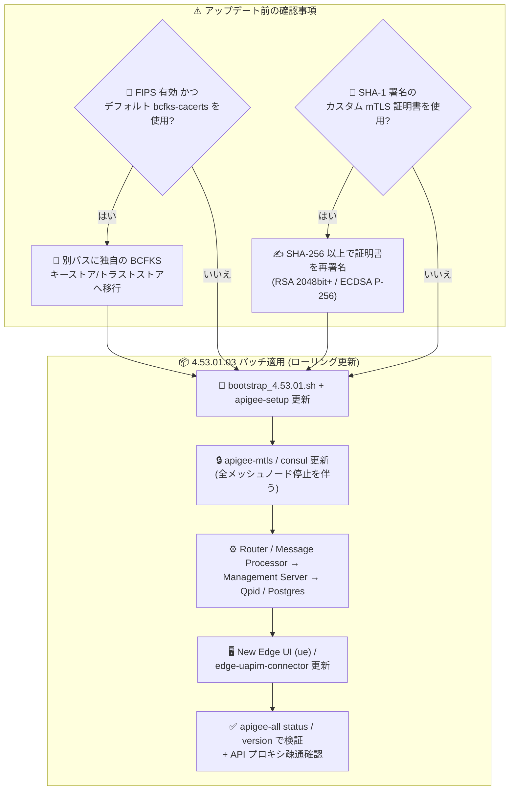

# Apigee Edge for Private Cloud: 4.53.01.03 リリース (セキュリティ強化・バグ修正)

**リリース日**: 2026-11-18

**サービス**: Apigee Edge for Private Cloud

**機能**: 4.53.01.03 パッチリリース (セキュリティ強化・バグ修正)

**ステータス**: Announcement / Security / Fixed

📊 [このアップデートのインフォグラフィックを見る](https://takech9203.github.io/google-cloud-news-summary/20261118-apigee-edge-private-cloud-4-53-01-03.html)

## 概要

Google Cloud は 2026 年 11 月 18 日、オンプレミス版 API 管理プラットフォームである Apigee Edge for Private Cloud のパッチリリース **4.53.01.03** を公開しました。本リリースは、Edge ランタイム、管理サーバー (Management Server)、New Edge UI、Apigee mTLS の各コンポーネントにわたる複数のセキュリティ脆弱性の修正 (セキュリティハードニング) を含むセキュリティ中心のパッチです。

セキュリティ面では 2 つの重要な変更が含まれます。1 つ目は、`edge-gateway` に同梱される `bcfks-cacerts` ファイルが、信頼されなくなったルート証明書を除去するために**空の BCFKS ストア**に変更された点です。2 つ目は、**Apigee mTLS が SHA-1 署名のカスタム証明書を拒否するようになった**点です。これらの変更は FIPS 有効環境やカスタム mTLS 証明書を利用している環境において、**アップデート前の対応作業 (アクション) を必要とする**破壊的変更であり、Apigee Edge for Private Cloud を運用する管理者は更新手順を慎重に確認する必要があります。

あわせて、4.53.01 更新後に発生していた OASValidation ポリシーの OpenAPI パスパラメータ検証エラー、`setup.sh -p uapim` 実行時の edge-uapim-connector セットアップ失敗、Message Processor が生成するエラーメッセージのサニタイズなど 3 件のバグ修正も含まれています。

**アップデート前の課題**

- Edge ランタイム、管理サーバー、New Edge UI、Apigee mTLS の各コンポーネントに複数のセキュリティ脆弱性が存在していた
- `edge-gateway` に同梱される `bcfks-cacerts` に、信頼されなくなったルート証明書が含まれていた
- Apigee mTLS が脆弱な SHA-1 署名のカスタム証明書を受け入れていた
- 4.53.01 への更新後、OASValidation ポリシーを使用する API プロキシのデプロイが OpenAPI Specification のパスパラメータ検証エラーで失敗していた (Issue 555253198)
- `setup.sh -p uapim` の実行が edge-uapim-connector のセットアップ中に失敗していた (Issue 580744258)
- Message Processor が生成する一部のエラーメッセージがサニタイズされていなかった (Issue 531571595)

**アップデート後の改善**

- Edge ランタイム、管理、New Edge UI、Apigee mTLS コンポーネント全体でセキュリティハードニングが適用された
- `bcfks-cacerts` が空の BCFKS ストアとなり、信頼されなくなったルート証明書への依存リスクが排除された
- Apigee mTLS が SHA-1 署名のカスタム証明書を拒否するようになり、SHA-256 以上の署名と 2048 ビット以上の RSA または ECDSA P-256 鍵が求められるようになった
- OASValidation ポリシーのパスパラメータ検証エラー、uapim セットアップ失敗が解消され、Message Processor のエラーメッセージにサニタイズが追加された

## アーキテクチャ図



4.53.01.03 への更新フローを示しています。FIPS 有効環境やカスタム mTLS 証明書利用環境では、パッチ適用**前**にキーストア移行や証明書の再署名が必要です。

## サービスアップデートの詳細

### 主要機能

1. **セキュリティハードニング (Security)**
   - Edge ランタイム、管理 (Management)、New Edge UI、Apigee mTLS コンポーネントにわたる複数のセキュリティ脆弱性を修正
   - `edge-gateway` に同梱される `bcfks-cacerts` を空の BCFKS ストアに変更し、信頼されなくなったルート証明書を除去
   - Apigee mTLS が SHA-1 署名のカスタム証明書を拒否するように変更 (CA 証明書 `ca_cert.pem` と各ノードのローカル証明書 `local_cert.pem` の両方に SHA-256 以上の署名と 2048 ビット以上の RSA または ECDSA P-256 鍵が必要)

2. **バグ修正 (Fixed)**
   - **Issue 555253198**: OASValidation ポリシーを使用する API プロキシのデプロイが、4.53.01 更新後に OpenAPI Specification のパスパラメータ検証エラーで失敗する問題を修正
   - **Issue 580744258**: `setup.sh -p uapim` の実行が edge-uapim-connector のセットアップ中に失敗する問題を修正
   - **Issue 531571595**: Message Processor が生成する一部のエラーメッセージにサニタイズを追加

3. **更新対象 RPM パッケージ**
   - 本リリースでは edge-gateway、edge-management-server、edge-message-processor、edge-postgres-server、edge-qpid-server、edge-router、edge-uapim、edge-uapim-connector (各 4.53.01-0.0.60415)、edge-management-ui (4.53.01-0.0.20090)、apigee-mtls (4.53.01-0.0.20267)、apigee-mtls-consul (4.53.01-0.0.20176)、apigee-setup (4.53.01-0.0.1167) が更新される
   - `cs`、`zk`、`ps`、`qpid`、`ldap`、`ui`、`sso` の各コンポーネントオプションは更新対象外 (これらに対する `update.sh -c` の実行は不要)

## 技術仕様

### 更新内容のサマリー

| 項目 | 詳細 |
|------|------|
| リリースバージョン | 4.53.01.03 (4.53.01 系のパッチリリース) |
| 対象製品 | Apigee Edge for Private Cloud (オンプレミス版) |
| セキュリティ修正 | Edge ランタイム / 管理 / New Edge UI / Apigee mTLS のハードニング |
| bcfks-cacerts の変更 | `/opt/apigee/edge-gateway/vault/bcfks-cacerts` を空の BCFKS ストアに変更 |
| mTLS 証明書要件 | SHA-1 署名を拒否。SHA-256 以上の署名 + RSA 2048 ビット以上または ECDSA P-256 鍵が必須 |
| サポートソフトウェアの変更 | なし |
| 新規の非推奨・廃止 | なし |

### FIPS 有効環境での注意 (破壊的変更)

`edge-gateway` を更新すると `/opt/apigee/edge-gateway/vault/bcfks-cacerts` が空の BCFKS ストアに置き換えられます。デフォルトのストア (同じパスで変更を加えたコピーを含む) を使用しているデプロイメントでは、**更新後に証明書検証が失敗**します。

- **対応が必要なケース**: FIPS 有効システムでデフォルトパスのストアを使用している場合 → 更新前に**別パス**に独自の BCFKS キーストア/トラストストアを用意して移行する
- **対応が不要なケース**: すでに別パスの独自ストアを使用している場合

## 設定方法

### 前提条件

1. Apigee から提供された認証情報 (ユーザー名・パスワード) があること
2. FIPS 有効環境でデフォルトの `bcfks-cacerts` を使用している場合は、更新前に独自の BCFKS キーストア/トラストストアへ移行済みであること
3. カスタム mTLS 証明書を使用している場合は、SHA-256 以上で再署名した証明書を用意しておくこと
4. 4.53.01 より前のバージョンから更新する場合は、「複数パッチバージョンの適用」手順を確認すること

### 手順

#### ステップ 1: 各ノードの準備

```bash
# apigee-monit が稼働している場合は停止 (更新中の自動再起動を防止)
/opt/apigee/apigee-service/bin/apigee-service apigee-monit unmonitor -c all
/opt/apigee/apigee-service/bin/apigee-service apigee-monit stop

# パッケージマネージャーのキャッシュをクリア
sudo yum clean all

# bootstrap スクリプトの取得と実行
curl https://software.apigee.com/bootstrap_4.53.01.sh -o /tmp/bootstrap_4.53.01.sh
sudo bash /tmp/bootstrap_4.53.01.sh apigeeuser=uName apigeepassword=pWord

# 環境プロファイルの読み込みと apigee-setup の更新
source /etc/profile.d/apigee-service.sh
/opt/apigee/apigee-service/bin/apigee-service apigee-setup update
```

#### ステップ 2: apigee-mtls の更新 (インストール済みの場合)

```bash
# 全メッシュノードで全コンポーネントを停止 (ダウンタイムが発生)
/opt/apigee/apigee-service/bin/apigee-all stop

# 既存の apigee-mtls をアンインストールし、更新版をインストール・設定
/opt/apigee/apigee-service/bin/apigee-service apigee-mtls uninstall
/opt/apigee/apigee-service/bin/apigee-service apigee-mtls install
/opt/apigee/apigee-service/bin/apigee-service apigee-mtls setup -f configFile

# カスタム証明書利用時は SHA-256 以上の証明書を各ノードに再統合してから起動
# (ZooKeeper/Consul サーバーノード → 残りのメッシュノードの順に起動)
/opt/apigee/apigee-service/bin/apigee-service apigee-mtls start
/opt/apigee/apigee-service/bin/apigee-service apigee-mtls status
```

apigee-mtls の更新はローリング更新ではなく、全メッシュノードの同時停止が必要なためダウンタイムが発生します。

#### ステップ 3: Edge コアコンポーネントのローリング更新

```bash
# Router / Message Processor → Management Server → Qpid / Postgres の順に
# 1 ノードずつ実行
/opt/apigee/apigee-setup/bin/update.sh -c edge -f configFile

# New Edge UI がインストールされている場合
/opt/apigee/apigee-setup/bin/update.sh -c ue -f configFile

# Apigee API hub コネクタがインストールされている場合
/opt/apigee/apigee-service/bin/apigee-service edge-uapim-connector update
/opt/apigee/apigee-service/bin/apigee-service edge-uapim-connector configure
/opt/apigee/apigee-service/bin/apigee-service edge-uapim-connector restart
/opt/apigee/apigee-service/bin/apigee-service edge-uapim-connector wait_for_ready
```

#### ステップ 4: 更新の検証

```bash
# 全ノードでサービス状態とバージョンを確認
/opt/apigee/apigee-service/bin/apigee-all status
/opt/apigee/apigee-service/bin/apigee-all version

# 停止していた apigee-monit を再開
/opt/apigee/apigee-service/bin/apigee-service apigee-monit start
```

ランタイムの API プロキシトラフィックが正常であることも確認します。

## メリット

### ビジネス面

- **セキュリティリスクの低減**: 複数の脆弱性修正と証明書要件の強化により、オンプレミス API 基盤のセキュリティポスチャが向上し、コンプライアンス要件への対応が容易になる
- **運用の安定化**: 4.53.01 で発生していた OASValidation 関連のデプロイ失敗が解消され、API プロキシの継続的デリバリーが安定する

### 技術面

- **暗号強度の底上げ**: mTLS メッシュで SHA-1 署名証明書が排除され、SHA-256 以上 + RSA 2048 ビット以上/ECDSA P-256 という現代的な暗号要件が強制される
- **信頼ストアの健全化**: 信頼されなくなったルート証明書が `bcfks-cacerts` から除去され、意図しない証明書チェーンの信頼を防止できる
- **情報漏えいリスクの低減**: Message Processor のエラーメッセージがサニタイズされ、エラー応答経由での内部情報露出リスクが減少する

## デメリット・制約事項

### 制限事項

- FIPS 有効環境でデフォルトの `bcfks-cacerts` ストア (同一パスの変更済みコピーを含む) を使用している場合、事前移行なしで更新すると証明書検証が失敗する
- SHA-1 署名のカスタム mTLS 証明書は拒否されるため、該当証明書は SHA-256 以上での再署名が必須
- apigee-mtls の更新は全メッシュノードの同時停止を伴い、メッシュとコンポーネントが再起動するまでダウンタイムが発生する

### 考慮すべき点

- Router / Message Processor → Management Server → Qpid / Postgres の順でのローリング更新手順を守る必要がある (データセンター横断で 1 ノードずつ)
- 4.53.01 より前のバージョンからの更新では、途中のパッチリリースに含まれる全コンポーネントの更新が必要 (「複数パッチバージョンの適用」手順を参照)
- 特定の以前のパッチバージョンに固定したい場合は、`apigee-mirror` によるローカルリポジトリの維持が必要

## ユースケース

### ユースケース 1: FIPS 有効環境での安全なパッチ適用

**シナリオ**: 金融機関が FIPS モードを有効にした RHEL 8 上で Apigee Edge for Private Cloud 4.53.01 を運用しており、デフォルトの `bcfks-cacerts` を使用している。

**実装例**:
```bash
# 更新前: 別パスに独自の BCFKS キーストア/トラストストアを作成して移行
# (FIPS considerations のドキュメント手順に従う)
# その後、通常の更新手順 (bootstrap → apigee-setup update → update.sh) を実行
```

**効果**: 更新後の証明書検証失敗によるサービス停止を回避しつつ、最新のセキュリティ修正を適用できる。

### ユースケース 2: カスタム mTLS 証明書の暗号強度刷新

**シナリオ**: Apigee mTLS メッシュで SHA-1 署名の自社 CA 発行証明書を使用している企業が 4.53.01.03 に更新する。

**効果**: 更新を契機に `ca_cert.pem` と各ノードの `local_cert.pem` を SHA-256 署名 + RSA 2048 ビット以上 (または ECDSA P-256) に刷新することで、メッシュ内通信の暗号強度を最新のベストプラクティスに準拠させられる。

## 料金

Apigee Edge for Private Cloud はライセンスベースのオンプレミス製品であり、本パッチの適用自体に追加料金は発生しません。ライセンスについては Apigee の営業担当またはサポートにお問い合わせください。

- 料金の詳細: [Apigee 料金ページ](https://cloud.google.com/apigee/pricing)

## 利用可能リージョン

オンプレミス (Private Cloud) 製品のため、リージョンの概念は適用されません。ユーザー自身のデータセンターやプライベート環境で稼働します。

## 関連サービス・機能

- **Apigee X / Apigee hybrid**: Google Cloud が推奨するクラウドネイティブな後継 API 管理プラットフォーム。長期的な移行先として検討対象
- **Apigee API hub**: edge-uapim-connector を通じて Edge for Private Cloud の API を API hub に連携可能 (本リリースでコネクタのセットアップ不具合が修正)
- **Apigee mTLS (HashiCorp Consul ベース)**: Edge for Private Cloud のノード間通信を mTLS で保護するコンポーネント。本リリースで証明書要件が強化
- **OASValidation ポリシー**: OpenAPI Specification に基づいてリクエスト/レスポンスを検証するポリシー。本リリースでパスパラメータ検証の不具合が修正

## 参考リンク

- 📊 [インフォグラフィック](https://takech9203.github.io/google-cloud-news-summary/20261118-apigee-edge-private-cloud-4-53-01-03.html)
- [公式リリースノート (Google Cloud Release Notes)](https://docs.cloud.google.com/release-notes#November_18_2026)
- [4.53.01.03 - Edge for Private Cloud release notes](https://docs.apigee.com/release/notes/4530103-edge-private-cloud-release-notes)
- [Apigee Edge for Private Cloud release notes](https://docs.cloud.google.com/apigee/docs/edge-private-cloud/release-notes)
- [Default Java keystore/truststore (FIPS considerations)](https://docs.apigee.com/private-cloud/v4.53.01/fips-considerations-rhel-8#default-java-keystoretruststore)
- [Upgrade Apigee mTLS](https://docs.apigee.com/private-cloud/v4.53.01/mtls-upgrade)
- [Known issues with Edge for Private Cloud](https://docs.apigee.com/release/known-issues#private-cloud-known-issues)
- [料金ページ](https://cloud.google.com/apigee/pricing)

## まとめ

Apigee Edge for Private Cloud 4.53.01.03 は、ランタイムから mTLS までの広範なセキュリティハードニングと、4.53.01 で発生していた実運用上の不具合修正を含む重要なパッチリリースです。特に FIPS 有効環境やカスタム mTLS 証明書を利用している環境では、**更新前に** BCFKS ストアの移行と SHA-256 への証明書再署名が必須となるため、更新手順を事前に確認した上で計画的に適用することを推奨します。

---

**タグ**: Apigee, Apigee Edge, Private Cloud, Security, mTLS, FIPS, BCFKS, OASValidation, パッチリリース
