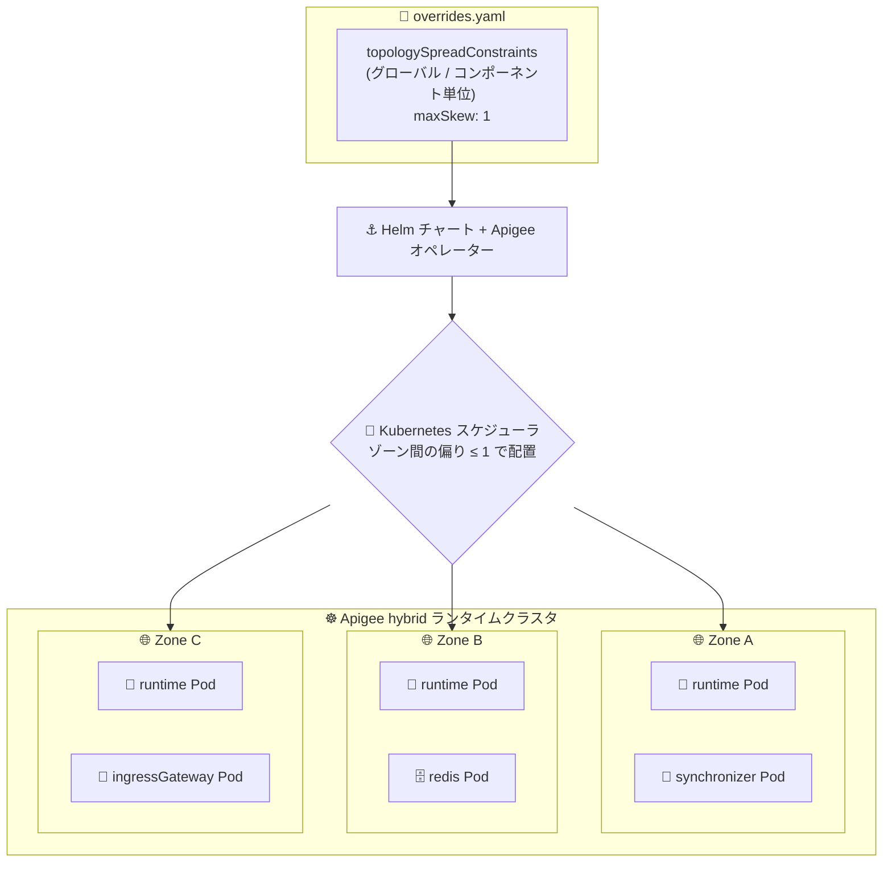

# Apigee hybrid: v1.17.4 パッチリリース (Pod Topology Spread Constraints 対応、CVE-2026-114938 修正)

**リリース日**: 2026-11-18

**サービス**: Apigee hybrid

**機能**: v1.17.4 パッチリリース (Kubernetes Pod Topology Spread Constraints 対応、セキュリティ修正、各種バグ修正)

**ステータス**: Announcement / Feature / Fixed / Security

📊 [このアップデートのインフォグラフィックを見る](https://takech9203.github.io/google-cloud-news-summary/20261118-apigee-hybrid-v1-17-4.html)

## 概要

2026 年 11 月 18 日、Google Cloud は Apigee hybrid の更新版 v1.17.4 をリリースしました。本リリースはパッチリリースであり、コンテナイメージは Apigee hybrid の Helm チャートに統合されています。Helm チャートを使用してパッチにアップグレードするとイメージも自動的に更新されるため、通常は手動でのイメージ変更は不要です。

本リリースの最大の新機能は、Apigee hybrid のランタイムコンポーネント (`apigeeIngressGateway`、`connectAgent`、`ingressGateways`、`istiod`、`mart`、`mcpServer`、`redis`、`redis.envoy`、`runtime`、`synchronizer`、`watcher`) に対する **Kubernetes Pod Topology Spread Constraints のサポート**です。Pod をアベイラビリティゾーンやノード間に分散配置 (`maxSkew: 1`) できるようになり、`overrides.yaml` でグローバル設定 (`topologySpreadConstraints`) またはコンポーネント単位の設定 (`<component>.topologySpreadConstraints`) が可能です。

また、JavaCallout ポリシーで実行されるカスタム Java コードを含む Apigee ランタイムにおける **CVE-2026-114938 の緩和**をはじめとするセキュリティ修正、Message Processor のメモリリーク修正、LLMTokenQuota ポリシーのトークンカウント修正、synchronizer の `pollInterval` 設定が無視される問題の修正など、運用上重要な修正が多数含まれています。Apigee hybrid を本番運用しているすべてのユーザーにアップグレードが推奨されるリリースです。

**アップデート前の課題**

- Apigee hybrid のランタイムコンポーネントの Pod 配置をゾーン・ノード間で均等に分散させる Topology Spread Constraints を `overrides.yaml` から構成できず、ゾーン障害時の可用性設計の選択肢が限られていた
- Apigee ランタイム (JavaCallout ポリシーで実行されるカスタム Java コードを含む) に CVE-2026-114938 の脆弱性が存在していた
- プロキシのデプロイ、環境のリロード・削除時に Message Processor でメモリリークが発生していた (コンパイル済み OASValidation 仕様の重複保持、置き換えられた・失敗した環境ロードのリソースやデバッグセッションマネージャーの未解放、ヘルスモニタ登録解除時の `HealthMonitorServiceImpl` の登録残留)
- LLMTokenQuota ポリシーが、SemanticCacheLookup ポリシーによってセマンティックキャッシュから返されたレスポンスに対してもトークンをカウントしてしまい、クォータを不必要に消費していた
- `apigee-env` Helm チャートと Apigee オペレーターが synchronizer の `pollInterval` 設定 (`synchronizer.pollInterval`、`envs[].pollInterval`、`envs[].components.synchronizer.pollInterval`) を無視していた

**アップデート後の改善**

- `overrides.yaml` の `topologySpreadConstraints` (グローバル) または `<component>.topologySpreadConstraints` (コンポーネント単位) により、ランタイム Pod をゾーン・ノード間に `maxSkew: 1` で分散配置できるようになった
- CVE-2026-114938 が緩和された (バグ ID: 586658318)。既存の JavaCallout のカスタムコードを変更する必要はない
- Message Processor のメモリリークが修正され、プロキシデプロイや環境リロード・削除を繰り返す運用でのメモリ安定性が向上した (バグ ID: 579213551)
- セマンティックキャッシュから返されたレスポンスはトークン数ゼロとしてカウントされ、analytics に `ai_llm_response_token_count` を記録しなくなった (バグ ID: 576697209)
- synchronizer の `pollInterval` 設定値が正しく反映されるようになった (60 秒未満の値は 60 秒に引き上げられる) (バグ ID: 572875915)

## アーキテクチャ図



v1.17.4 では、`overrides.yaml` で定義した Topology Spread Constraints に基づき、Kubernetes スケジューラが Apigee hybrid のランタイム Pod をアベイラビリティゾーン・ノード間に偏りなく (maxSkew: 1) 分散配置します。これにより単一ゾーン障害時の影響を最小化できます。

## サービスアップデートの詳細

### 主要機能

1. **Kubernetes Pod Topology Spread Constraints のサポート (新機能)**
   - 対象コンポーネント: `apigeeIngressGateway`、`connectAgent`、`ingressGateways`、`istiod`、`mart`、`mcpServer`、`redis`、`redis.envoy`、`runtime`、`synchronizer`、`watcher`
   - Pod をアベイラビリティゾーンおよびノード間に分散配置 (`maxSkew: 1`)
   - `overrides.yaml` の `topologySpreadConstraints` プロパティでグローバルに有効化・カスタマイズ可能
   - `<component>.topologySpreadConstraints` でコンポーネント単位のオーバーライドも可能

2. **セキュリティ修正: CVE-2026-114938 の緩和 (バグ ID: 586658318)**
   - JavaCallout ポリシーで実行されるカスタム Java コードを含む Apigee ランタイムの脆弱性を緩和
   - 顧客側でコールアウトコードの変更は不要

3. **Message Processor のメモリリーク修正 (バグ ID: 579213551)**
   - プロキシデプロイ、環境リロード、環境削除時のメモリリークを修正
   - コンパイル済み OASValidation 仕様をコンテンツハッシュで共有
   - 置き換えられた・失敗した環境ロードのリソースおよびデバッグセッションマネージャーを解放
   - ヘルスモニタ登録解除時に `HealthMonitorServiceImpl` の登録を適切に削除

4. **LLMTokenQuota ポリシーのトークンカウント修正 (バグ ID: 576697209)**
   - SemanticCacheLookup ポリシーによるセマンティックキャッシュからのレスポンスに対してトークンをカウントしていた問題を修正
   - キャッシュされたレスポンスはトークン数ゼロとしてカウントされ、analytics に `ai_llm_response_token_count` を記録しない

5. **synchronizer の pollInterval 設定の修正 (バグ ID: 572875915)**
   - `apigee-env` Helm チャートと Apigee オペレーターが `synchronizer.pollInterval`、`envs[].pollInterval`、`envs[].components.synchronizer.pollInterval` を無視していた問題を修正
   - 設定値が有効になり、60 秒未満の値は 60 秒に引き上げられる

## 技術仕様

### リリース概要

| 項目 | 詳細 |
|------|------|
| バージョン | Apigee hybrid v1.17.4 |
| リリース種別 | パッチリリース |
| コンテナイメージ | Helm チャートに統合 (Helm チャートによるアップグレードでイメージも自動更新) |
| 新機能 | Pod Topology Spread Constraints (`maxSkew: 1`、ゾーン・ノード間分散) |
| 対象コンポーネント | apigeeIngressGateway、connectAgent、ingressGateways、istiod、mart、mcpServer、redis、redis.envoy、runtime、synchronizer、watcher |
| 設定方法 | `overrides.yaml` の `topologySpreadConstraints` (グローバル) / `<component>.topologySpreadConstraints` (個別) |
| セキュリティ | CVE-2026-114938 の緩和 (Apigee ランタイム、JavaCallout のカスタム Java コードを含む) |

### 修正されたバグの一覧

| バグ ID | 内容 |
|---------|------|
| 586658318 | Apigee ランタイム (JavaCallout の顧客 Java コードを含む) における CVE-2026-114938 の緩和 |
| 579213551 | プロキシデプロイ・環境リロード・環境削除時の Message Processor メモリリーク修正 |
| 576697209 | LLMTokenQuota がセマンティックキャッシュのレスポンスをカウントする問題の修正 (キャッシュ応答はゼロトークン) |
| 572875915 | `apigee-env` Helm チャート / オペレーターが synchronizer の `pollInterval` を無視する問題の修正 |

### overrides.yaml の設定例 (Topology Spread Constraints)

```yaml
# グローバル設定: すべての対象ランタイムコンポーネントに適用
topologySpreadConstraints:
  - maxSkew: 1
    topologyKey: topology.kubernetes.io/zone
    whenUnsatisfiable: ScheduleAnyway

# コンポーネント単位のオーバーライド例
runtime:
  topologySpreadConstraints:
    - maxSkew: 1
      topologyKey: kubernetes.io/hostname
      whenUnsatisfiable: ScheduleAnyway
```

## 設定方法

### 前提条件

1. Apigee hybrid v1.17.x を Helm チャートで管理していること
2. `overrides.yaml` が最新のクラスタ構成を反映していること (ソース管理での保管を推奨)
3. ゾーン分散を利用する場合、Kubernetes クラスタが複数のアベイラビリティゾーンにノードを持つこと

### 手順

#### ステップ 1: v1.17.4 へのアップグレード

```bash
# Helm チャートのリポジトリを v1.17.4 に更新し、各チャートをアップグレード
# (パッチリリースのためイメージは Helm チャートに統合されており、自動的に更新される)
helm upgrade operator apigee-operator/ \
  --install \
  --namespace APIGEE_NAMESPACE \
  --atomic \
  -f overrides.yaml
```

詳細な手順は公式ドキュメント「[Upgrading Apigee hybrid to v1.17.4](https://docs.cloud.google.com/apigee/docs/hybrid/v1.17/upgrade)」を参照してください。新規インストールの場合は「[The big picture](https://docs.cloud.google.com/apigee/docs/hybrid/v1.17/what-is-hybrid)」から開始します。

#### ステップ 2: Topology Spread Constraints の設定

```bash
# overrides.yaml に topologySpreadConstraints を追加した後、
# 対象コンポーネントを管理する Helm チャートをアップグレードして反映
helm upgrade env-ENV_NAME apigee-env/ \
  --install \
  --namespace APIGEE_NAMESPACE \
  --atomic \
  -f overrides.yaml
```

`overrides.yaml` にグローバルの `topologySpreadConstraints`、または `runtime.topologySpreadConstraints` のようなコンポーネント単位の設定を追加し、該当する Helm チャートを適用します。

## メリット

### ビジネス面

- **可用性の向上**: ランタイム Pod がゾーン間に均等分散されるため、単一ゾーン障害時でも API トラフィック処理を継続しやすくなり、SLA 達成に寄与する
- **セキュリティリスクの低減**: CVE-2026-114938 への対応により、JavaCallout を利用するカスタムロジックを含むランタイムのリスクが緩和される
- **AI コストの適正化**: セマンティックキャッシュヒット時にトークンクォータを消費しなくなり、LLM プロキシのクォータ管理が実際の LLM 消費量と一致する

### 技術面

- **宣言的な配置制御**: Kubernetes 標準の Topology Spread Constraints を `overrides.yaml` から宣言的に管理でき、既存の tolerations や nodeSelector と組み合わせた柔軟なスケジューリングが可能
- **運用の安定性**: Message Processor のメモリリーク修正により、頻繁なプロキシデプロイや環境リロードを行う CI/CD 環境でのメモリ圧迫・再起動リスクが減少
- **設定の確実な反映**: synchronizer の `pollInterval` が正しく反映されるようになり、構成変更の同期間隔を意図通りに制御できる

## デメリット・制約事項

### 制限事項

- Topology Spread Constraints の対象は `apigeeIngressGateway`、`connectAgent`、`ingressGateways`、`istiod`、`mart`、`mcpServer`、`redis`、`redis.envoy`、`runtime`、`synchronizer`、`watcher` のランタイムプール系ワークロードであり、Cassandra (StatefulSet) は対象に含まれない
- synchronizer の `pollInterval` に 60 秒未満の値を設定しても、60 秒に引き上げられる

### 考慮すべき点

- ゾーン分散を有効化する場合、各ゾーンに十分なノードリソースがないと Pod のスケジューリングに影響する可能性があるため、`whenUnsatisfiable` の挙動 (厳格に配置不可とするか、ベストエフォートとするか) を含めて事前に検証環境で確認する
- パッチリリースとはいえセキュリティ修正 (CVE-2026-114938) を含むため、計画的かつ早期のアップグレードが推奨される
- `overrides.yaml` はアップグレードや構成変更のたびに使用されるため、バージョン管理されたリポジトリでの管理を徹底する

## ユースケース

### ユースケース 1: マルチゾーン構成での API ゲートウェイ可用性強化

**シナリオ**: 金融系サービスの API 基盤として Apigee hybrid を GKE のリージョナルクラスタ (3 ゾーン) で運用しており、ゾーン障害時にも API 処理能力の大幅な低下を避けたい。

**実装例**:
```yaml
topologySpreadConstraints:
  - maxSkew: 1
    topologyKey: topology.kubernetes.io/zone
    whenUnsatisfiable: ScheduleAnyway

ingressGateways:
  - name: prod-ingress
    topologySpreadConstraints:
      - maxSkew: 1
        topologyKey: topology.kubernetes.io/zone
        whenUnsatisfiable: ScheduleAnyway
```

**効果**: runtime や ingress gateway の Pod がゾーン間で偏りなく配置され、1 ゾーン喪失時でも残りのゾーンでトラフィックを処理でき、可用性が向上する。

### ユースケース 2: LLM プロキシでのセマンティックキャッシュとトークンクォータの併用

**シナリオ**: Apigee hybrid を LLM API のゲートウェイとして利用し、SemanticCacheLookup でキャッシュヒット率を高めつつ、LLMTokenQuota でテナントごとのトークン消費を制限している。

**効果**: v1.17.4 以降、キャッシュから返されたレスポンスはトークン数ゼロとして扱われるため、実際には LLM を呼び出していないリクエストでクォータが消費されず、テナントへの公平なクォータ適用とコスト削減効果の最大化が実現できる。

### ユースケース 3: 頻繁なプロキシデプロイを行う CI/CD 環境の安定化

**シナリオ**: 開発環境で 1 日に何十回もプロキシのデプロイや環境リロードを実施しており、Message Processor のメモリ使用量が徐々に増加して定期的な再起動が必要だった。

**効果**: メモリリーク修正 (バグ ID: 579213551) により、デプロイ・リロードを繰り返してもメモリ使用量が安定し、運用負荷と予期しない再起動のリスクが低減する。

## 料金

Apigee hybrid 自体のソフトウェアアップデートに追加料金は発生しません。Apigee の料金はサブスクリプション (Standard/Enterprise 等) または従量課金 (Pay-as-you-go) モデルに基づきます。詳細は料金ページを参照してください。

- [Apigee 料金ページ](https://cloud.google.com/apigee/pricing)

なお、ランタイムプレーンを稼働させる Kubernetes クラスタ (GKE など) のコンピュートリソース費用は別途発生します。ゾーン分散構成では各ゾーンにノードを確保するため、ノードプール設計によってはコストが変動する点に留意してください。

## 利用可能リージョン

Apigee hybrid のランタイムプレーンはユーザー管理の Kubernetes クラスタ (GKE、他クラウド、オンプレミス) 上で稼働するため、サポートされるプラットフォーム上であればリージョンを問わず利用できます。サポート対象プラットフォームは以下を参照してください。

- [Apigee hybrid supported platforms](https://docs.cloud.google.com/apigee/docs/hybrid/supported-platforms)

## 関連サービス・機能

- **Google Kubernetes Engine (GKE)**: Apigee hybrid ランタイムプレーンの主要な稼働基盤。リージョナルクラスタと組み合わせることで Topology Spread Constraints によるゾーン分散の効果を最大化できる
- **Kubernetes Topology Spread Constraints**: 今回サポートされた Kubernetes 標準機能。tolerations や nodeSelector と組み合わせて Pod スケジューリングを制御できる
- **Helm**: Apigee hybrid のインストール・アップグレード・構成管理の標準ツール。パッチリリースのイメージ更新も Helm チャート経由で自動化される
- **Apigee LLM 関連ポリシー (LLMTokenQuota / SemanticCacheLookup)**: LLM API ゲートウェイとしての Apigee 利用時に、トークンクォータ管理とセマンティックキャッシュを担うポリシー群
- **Cloud Monitoring / Apigee Analytics**: `ai_llm_response_token_count` などのメトリクスにより LLM トークン消費を可視化

## 参考リンク

- 📊 [インフォグラフィック](https://takech9203.github.io/google-cloud-news-summary/20261118-apigee-hybrid-v1-17-4.html)
- [公式リリースノート](https://docs.cloud.google.com/release-notes#November_18_2026)
- [Apigee hybrid v1.17 ドキュメント](https://docs.cloud.google.com/apigee/docs/hybrid/v1.17/what-is-hybrid)
- [Apigee hybrid 構成プロパティリファレンス](https://docs.cloud.google.com/apigee/docs/hybrid/v1.17/config-prop-ref)
- [Apigee hybrid Helm チャートリファレンス](https://docs.cloud.google.com/apigee/docs/hybrid/v1.17/helm-reference)
- [Apigee 料金ページ](https://cloud.google.com/apigee/pricing)

## まとめ

Apigee hybrid v1.17.4 は、CVE-2026-114938 の緩和を含むセキュリティ修正と、Message Processor のメモリリークや LLMTokenQuota のトークンカウントなど運用に直結するバグ修正を含む重要なパッチリリースです。新たにサポートされた Pod Topology Spread Constraints により、ランタイムコンポーネントのゾーン・ノード分散を宣言的に制御でき、可用性設計の幅が広がります。Apigee hybrid v1.17 系を運用中の場合は、検証環境での確認を経て早期に v1.17.4 へアップグレードし、マルチゾーンクラスタでは `topologySpreadConstraints` の導入を検討することを推奨します。

---

**タグ**: #ApigeeHybrid #Apigee #Kubernetes #TopologySpreadConstraints #Security #CVE #Helm #APIManagement #LLM
