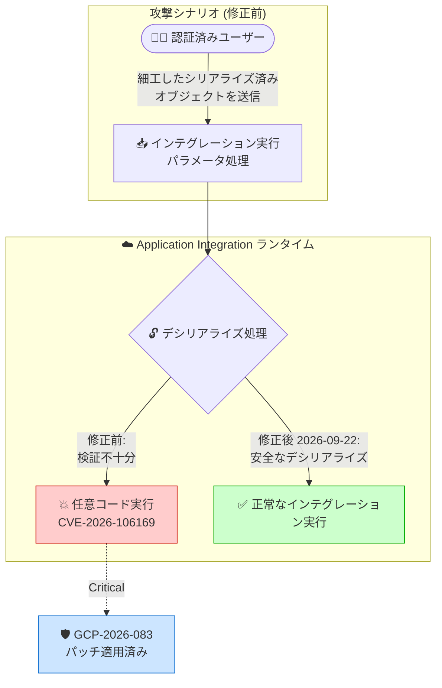

# Application Integration: 安全でないデシリアライゼーションの脆弱性 (GCP-2026-083 / CVE-2026-106169)

**リリース日**: 2026-11-18

**サービス**: Application Integration

**機能**: セキュリティ情報 (セキュリティ速報 GCP-2026-083)

**ステータス**: Security (重要度: Critical / 修正済み)

📊 [このアップデートのインフォグラフィックを見る](https://takech9203.github.io/google-cloud-news-summary/20261118-application-integration-deserialization-gcp-2026-083.html)

## 概要

Google Cloud は 2026 年 11 月 18 日、Application Integration に関するセキュリティ速報 GCP-2026-083 を公開しました。2026 年 9 月 22 日より前のバージョンの Application Integration において、インテグレーション実行パラメータ (integration execution parameter) の処理に「信頼できないデータのデシリアライゼーション (Deserialization of Untrusted Data)」の脆弱性が発見されました。この脆弱性は CVE-2026-106169 として採番され、重要度は **Critical** に分類されています。

この脆弱性を悪用すると、認証済みユーザーが細工したシリアライズ済みオブジェクトを使用して任意のコードを実行できる可能性がありました。インテグレーション実行パラメータは、トリガー経由でインテグレーションに渡される入力値 (`inputParameters` など) を扱う中核的な仕組みであり、実行のたびにユーザー由来のデータがランタイムで処理されるため、攻撃対象領域として注意が必要な箇所です。

**この脆弱性は 2026 年 9 月 22 日にサーバー側で修正済みであり、ユーザー側の対応は不要です。** Application Integration はフルマネージドサービスであるため、パッチ適用は Google 側で完結しています。本レポートは、Solutions Architect として把握しておくべき背景情報と、関連する一連のセキュリティ速報の文脈を整理したものです。

**アップデート前の課題 (脆弱性の内容)**

- 2026 年 9 月 22 日より前のバージョンでは、インテグレーション実行パラメータの処理において、信頼できないシリアライズ済みデータが安全に検証されずにデシリアライズされる可能性があった
- 認証済みユーザーが細工したシリアライズ済みオブジェクトを送り込むことで、任意のコードを実行できる可能性があった (重要度: Critical)

**アップデート後の改善 (修正内容)**

- 2026 年 9 月 22 日に Google 側でパッチが適用され、脆弱性は解消済み
- 顧客側での対応 (設定変更、再デプロイなど) は一切不要
- セキュリティ速報 GCP-2026-083 として情報が公開され、CVE-2026-106169 で追跡可能になった

## アーキテクチャ図

修正前は、認証済みユーザーが実行パラメータ経由で細工したシリアライズ済みオブジェクトを注入すると、デシリアライズ処理を通じて任意コード実行に至る可能性がありました。2026 年 9 月 22 日のパッチにより、この経路は遮断されています。

## サービスアップデートの詳細

### 脆弱性の概要

1. **脆弱性の種類: 信頼できないデータのデシリアライゼーション (CWE-502 相当)**
   - インテグレーション実行パラメータの処理 (integration execution parameter handling) に存在
   - 影響範囲は 2026 年 9 月 22 日より前のバージョンの Application Integration

2. **攻撃の前提と影響**
   - 攻撃には Application Integration への**認証済みアクセス**が必要
   - 細工したシリアライズ済みオブジェクトにより**任意コード実行**が可能だった

3. **対応状況**
   - 2026 年 9 月 22 日にパッチ適用済み
   - **ユーザー側の対応は不要** (フルマネージドサービスのため Google 側で修正完結)

### 技術的背景: インテグレーション実行パラメータとは

Application Integration では、インテグレーションの実行時にトリガー経由でパラメータが渡されます。公式 API リファレンスによると、実行リクエストには `inputParameters` (実行時入力値のマップ) や `configParameters` が含まれ、`IntegrationParameter` の `defaultValue` は「文字列、整数、倍精度浮動小数点数、任意の proto メッセージ、または**シリアライズ済みオブジェクト**」を取り得ると定義されています。このように実行パラメータはシリアライズされたデータを扱う設計であるため、デシリアライズ処理の安全性が重要になります。

## 技術仕様

### 脆弱性情報サマリー

| 項目 | 詳細 |
|------|------|
| セキュリティ速報 ID | GCP-2026-083 |
| CVE | CVE-2026-106169 |
| 公開日 | 2026-11-18 |
| 重要度 | Critical |
| 脆弱性の種類 | Deserialization of Untrusted Data (信頼できないデータのデシリアライゼーション) |
| 影響箇所 | インテグレーション実行パラメータの処理 |
| 影響バージョン | 2026 年 9 月 22 日より前の Application Integration |
| パッチ適用日 | 2026-09-22 (Google 側で適用済み) |
| 必要なユーザー対応 | なし |
| 攻撃の前提条件 | 認証済みユーザーであること |
| 想定される影響 | 任意コード実行 |

### 2026 年の Application Integration 関連セキュリティ速報の流れ

Application Integration では 2026 年に複数のセキュリティ速報が公開されており、一連の文脈で把握しておくことが推奨されます。

| 速報 ID | 公開日 | 脆弱性の種類 | 対象コンポーネント | 重要度 |
|---------|--------|-------------|-------------------|--------|
| GCP-2026-083 | 2026-11-18 | デシリアライゼーション | 実行パラメータ処理 | Critical |
| GCP-2026-074 | 2026-10-28 | デシリアライゼーション | SubWorkflow タスク | Critical |
| GCP-2026-068 | 2026-10-14 | 不適切な認可 | AuthConfig 検証・実行ランタイム | High |
| GCP-2026-066 | 2026-09-28 | Confused Deputy | Email タスク | High |
| GCP-2026-065 | 2026-09-28 | デシリアライゼーション | JavaScript タスク | Critical |
| GCP-2026-064 | 2026-09-28 | 不適切な認可 | タスク構成 | Critical |

## 推奨される対応

### 必須の対応

- **なし**。本脆弱性は 2026 年 9 月 22 日に Google 側でパッチ適用済みであり、顧客側の対応は不要です。

### 推奨されるセキュリティプラクティス

1. **最小権限の徹底**: 本脆弱性の悪用には認証済みアクセスが必要でした。`integrations.integrations.invoke` などのインテグレーション実行権限は、必要なプリンシパルにのみ付与する
2. **関連速報 GCP-2026-068 への対応準備**: 2027 年 1 月 15 日 (UTC) 以降、2026 年 10 月 15 日より前に作成された既存インテグレーションでも、スケジュール/イベントトリガーの使用に run-as サービスアカウント (および `iam.serviceAccounts.actAs` 権限) が必須になるため、事前に対応を進める
3. **セキュリティ速報の購読**: Google Cloud セキュリティ速報の [XML フィード](https://cloud.google.com/feeds/google-cloud-security-bulletins.xml) を購読し、今後の速報を早期に把握する
4. **監査ログの確認**: Cloud Audit Logs や Cloud Logging でインテグレーション実行履歴を定期的にレビューし、不審な実行がないか確認する

## デメリット・制約事項

### 考慮すべき点

- 本速報には CVSS スコアや悪用の有無 (in-the-wild exploitation) に関する記載はなく、公開情報は速報の記述に限られる
- 脆弱性の発見から速報公開 (2026-11-18) までの間、パッチは 2026 年 9 月 22 日に適用済みであったため、公開時点で既に保護されていた
- Application Integration はマネージドサービスであり、顧客側でバージョンを選択・固定することはできない (常に Google 管理の最新ランタイムで実行される)

## 関連サービス・機能

- **Cloud Audit Logs / Cloud Logging**: インテグレーションの実行履歴・操作ログの監査に使用。不審なアクセスの検知に有効
- **IAM (Identity and Access Management)**: インテグレーションの実行・編集権限の最小化に使用。GCP-2026-068 以降は run-as サービスアカウントへの `iam.serviceAccounts.actAs` 権限が要求される
- **Security Command Center**: Google Cloud 環境全体の脆弱性・脅威の一元的な可視化
- **Integration Connectors**: Application Integration と組み合わせて使われる接続サービス。権限設計の見直し時に併せて確認を推奨

## 参考リンク

- 📊 [インフォグラフィック](https://takech9203.github.io/google-cloud-news-summary/20261118-application-integration-deserialization-gcp-2026-083.html)
- [公式リリースノート (2026-11-18)](https://docs.cloud.google.com/release-notes#November_18_2026)
- [セキュリティ速報 GCP-2026-083 (Google Cloud Security Bulletins)](https://cloud.google.com/support/bulletins#gcp-2026-083)
- [Application Integration セキュリティ速報一覧](https://docs.cloud.google.com/application-integration/docs/security-bulletins)
- [CVE-2026-106169](https://cve.mitre.org/cgi-bin/cvename.cgi?name=CVE-2026-106169)
- [Application Integration ドキュメント](https://docs.cloud.google.com/application-integration/docs)
- [今後の認可変更への準備 (GCP-2026-068 関連)](https://docs.cloud.google.com/application-integration/docs/prepare-for-authorization-changes)

## まとめ

Application Integration の実行パラメータ処理に Critical 評価のデシリアライゼーション脆弱性 (CVE-2026-106169) が発見されましたが、2026 年 9 月 22 日に Google 側で修正済みであり、ユーザー側の対応は不要です。ただし、2026 年に Application Integration 関連のセキュリティ速報が相次いでいることを踏まえ、インテグレーション実行権限の最小化と、GCP-2026-068 に伴う 2027 年 1 月 15 日以降の run-as サービスアカウント必須化への準備を進めることを推奨します。

---

**タグ**: Application Integration, セキュリティ, 脆弱性, CVE-2026-106169, GCP-2026-083, デシリアライゼーション, Critical
