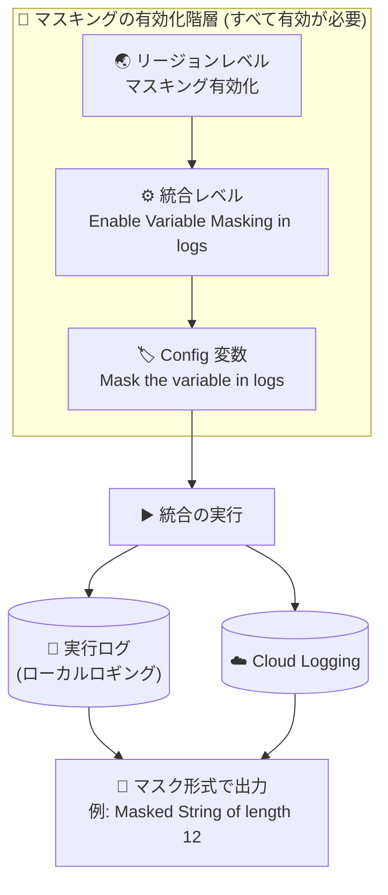

# Application Integration: 実行ログにおける Config 変数のマスキング対応

**リリース日**: 2026-11-18

**サービス**: Application Integration

**機能**: 統合実行ログでの Config 変数マスキング

**ステータス**: Change (機能変更)

📊 [このアップデートのインフォグラフィックを見る](https://takech9203.github.io/google-cloud-news-summary/20261118-application-integration-mask-config-variables.html)

## 概要

Application Integration において、統合 (Integration) の実行ログで Config 変数 (config variables) をマスクできるようになりました。Config 変数の作成時または編集時に「Mask the variable in logs」オプションを選択し、さらに統合レベルおよびリージョンレベルでマスキングを有効化することで、実行ログ上の値がマスク形式で出力されます。

Application Integration は統合の実行ごとにログメッセージを生成し、ローカルロギングや Cloud Logging を有効にしている場合、すべてのデータ変数とフィールドがログ出力に含まれます。Config 変数は接続名、エンドポイント URL など環境 (QA / ステージング / 本番) ごとに異なる設定値を外部化するための変数であり、環境固有の情報がログに平文で記録されることを避けたいケースがあります。今回の変更により、Config 変数についても他の変数と同様にログ出力時のマスキングが適用できるようになりました。

対象ユーザーは、Application Integration で環境別の設定値を Config 変数で管理しており、ログの閲覧者に対して設定値の露出を抑えたい開発者・運用者です。データプライバシー規制への準拠やセキュリティ・プライバシーの向上に寄与します。

**アップデート前の課題**

- 統合実行ログや Cloud Logging には、実行時のすべてのデータ変数とフィールドが出力されるため、Config 変数に設定した環境固有の値もログに平文で記録されていた
- ログの閲覧権限を持つユーザーに、見せたくない設定値が露出する可能性があった

**アップデート後の改善**

- Config 変数の作成・編集時に「Mask the variable in logs」を選択することで、統合実行ログ上で値がマスクされるようになった
- 統合レベル・リージョンレベルのマスキング設定と組み合わせることで、リージョン → 統合 → 変数という階層的なマスキング制御に Config 変数も組み込めるようになった
- ログ出力におけるセンシティブな設定値の露出を減らし、データプライバシー規制への準拠を支援する

## アーキテクチャ図

マスキングはリージョン → 統合 → 変数の 3 階層すべてで有効化した場合にのみ機能し、実行ログと Cloud Logging の両方で同じ固定フォーマットにより値がマスクされます。

## サービスアップデートの詳細

### 主要機能

1. **Config 変数のログマスキング**
   - Config 変数の作成・編集時に「Mask the variable in logs」オプションを選択可能
   - 統合実行ログおよび Cloud Logging の出力で、値が固定のマスク形式に置き換えられる
   - Application Integration がサポートするすべてのデータ型の変数でマスキングが可能

2. **階層的なマスキング制御**
   - マスキングは「リージョン (プロジェクト) → 統合 → 変数」の階層で制御される
   - 変数のマスキングを機能させるには、対象リージョンと統合の両方でマスキングを有効化する必要がある
   - 統合単位でマスキングを無効化するなど、ビジネス要件に応じた柔軟な制御が可能

3. **固定マスキングフォーマット**
   - 変数は「Masked String of length 12」のような固定形式でマスクされる
   - 正規表現 `/Masked.*\./` でマスクされた変数を検索可能 (String: `Masked String.*\.`、Integer: `Masked Int.*\.`、Boolean: `Masked Bool.*\.`)
   - 固定フォーマットのため、長い文字列でも効率的にマスクできる

## 技術仕様

### マスキングの階層と条件

| レベル | 設定箇所 | 備考 |
|------|------|------|
| リージョン (プロジェクト) | リージョン編集でマスキングを有効化 | 階層の最上位。プロジェクト全体で有効にするには全リージョンで有効化 |
| 統合 | Integration settings の「Enable Variable Masking in logs」 | 無効の場合、変数レベルの設定は機能しない |
| 変数 (Config 変数含む) | 変数の作成・編集時に「Mask the variable in logs」を選択 | 今回のアップデートで Config 変数が対象に |

### マスキングが行わないこと (重要)

マスキングはログ出力における値の露出を減らすのみで、以下は行いません。

- 変数値の暗号化や保存方法の変更は行わない
- 統合エディタ上では値は隠されない (編集権限があれば、マスク対象変数のデフォルト値も閲覧可能)
- 統合のダウンロード・エクスポート時には値は平文で書き出される (マスク対象でも redact されない)
- 統合をテンプレートとして共有する際も、レビューステップでクリアしない限り Config 変数の値は平文で引き継がれる

## 設定方法

### 前提条件

1. Application Integration が有効なプロジェクトとリージョンがあること
2. 対象リージョンでマスキングが有効化されていること
3. 対象の統合で「Enable Variable Masking in logs」が有効化されていること

### 手順

#### ステップ 1: リージョンでマスキングを有効化

リージョンの編集画面で、対象リージョンのマスキングを有効化します。プロジェクト全体に適用する場合は、プロジェクト内のすべてのリージョンで有効化します。

#### ステップ 2: 統合でマスキングを有効化

統合エディタのツールバーから「Integration settings」を開き、「Enable Variable Masking in logs」を有効にします。

#### ステップ 3: Config 変数でマスキングを選択

統合エディタの Variables ペインで Config 変数を作成または編集し、「Mask the variable in logs」を選択します。Config 変数には `CONFIG_` プレフィックスが付与され、統合の公開 (Publish) 時に値を入力します。

## メリット

### ビジネス面

- **データプライバシー規制への準拠**: ログに含まれるセンシティブな情報や PII の露出を抑え、コンプライアンス対応を支援する
- **セキュリティ・プライバシーの向上**: ログ閲覧権限を持つユーザーへの不要な設定値の露出を削減できる

### 技術面

- **CI/CD フローとの親和性**: 環境ごとの設定値を外部化する Config 変数をマスク対象にできるため、環境固有の値をログに残さずに環境間プロモーションのワークフローを維持できる
- **検索可能なマスク形式**: 固定フォーマットでマスクされるため、正規表現でマスク済み変数をログから特定でき、トラブルシューティング時の見通しがよい
- **追加コストなし**: 変数のマスキングに追加料金は発生しない

## デメリット・制約事項

### 制限事項

- ネストされたフィールドのデータマスキングはサポートされない
- マスキングは実行ログの出力にのみ適用され、暗号化・エディタ上の非表示・エクスポート時の redact は行われない

### 考慮すべき点

- リージョン・統合・変数のいずれかのレベルでマスキングが無効の場合、エンドツーエンドのマスキングは機能しない。設定漏れがあると意図せず値がログに露出する可能性がある
- マスキングはシークレットストアの代替ではない。Config 変数を含む変数にパスワード・API キー・トークンなどの認証情報を保存してはならない。認証情報には認証プロファイルまたは Secret Manager アクセスタスクを使用する
- 統合のダウンロード・エクスポートやテンプレート共有では値が平文で出力されるため、共有前に値のクリアを検討する

## ユースケース

### ユースケース 1: 本番環境の設定値をログから保護する

**シナリオ**: QA・ステージング・本番の各環境でエンドポイント URL や接続名を Config 変数で切り替えている。本番環境の内部エンドポイント情報を、実行ログの閲覧者に見せたくない。

**実装例**:

1. 本番プロジェクトの全リージョンでマスキングを有効化
2. 対象の統合で「Enable Variable Masking in logs」を有効化
3. `CONFIG_url` や `CONFIG_connection_name` などの Config 変数で「Mask the variable in logs」を選択

**効果**: 実行ログと Cloud Logging の両方で、本番の設定値が「Masked String of length N」の形式で出力され、ログ経由の情報露出を防げる。

### ユースケース 2: 顧客データを扱う統合での段階的なマスキング

**シナリオ**: 顧客の販売データ (連絡先、注文履歴、支払い情報など) を扱う複数の統合を 1 つのリージョンで運用しており、マスキングが不要な統合も混在している。

**効果**: リージョンレベルでマスキングを有効化したうえで、マスキング不要な特定の統合のみ無効化するなど、階層的な制御により保護レベルを統合単位で使い分けられる。

## 料金

変数のマスキングに追加料金はかかりません。Application Integration 自体の料金については公式の料金ページを参照してください。

- [Application Integration の料金](https://docs.cloud.google.com/application-integration/pricing)

## 関連サービス・機能

- **Cloud Logging**: 統合の実行ログの出力先。Cloud Logging 側でも実行ログと同じ固定フォーマットで変数がマスクされる
- **Secret Manager (Secret Manager アクセスタスク)**: 認証情報の保存にはマスキングではなく Secret Manager の利用が推奨される
- **認証プロファイル (Authentication profiles)**: 統合での認証情報管理の推奨手段。Config 変数に認証情報を保存する代替となる
- **Integration Connectors**: Config 変数で接続名を外部化するなど、環境間プロモーション (CI/CD) と組み合わせて利用されることが多い

## 参考リンク

- 📊 [インフォグラフィック](https://takech9203.github.io/google-cloud-news-summary/20261118-application-integration-mask-config-variables.html)
- [公式リリースノート](https://docs.cloud.google.com/release-notes#November_18_2026)
- [Mask sensitive data in logs (公式ドキュメント)](https://docs.cloud.google.com/application-integration/docs/mask-sensitive-data-logs)
- [Variables (Config 変数の作成)](https://docs.cloud.google.com/application-integration/docs/variables)
- [Edit an integration (統合レベルのマスキング設定)](https://docs.cloud.google.com/application-integration/docs/view-integration-details)
- [料金ページ](https://docs.cloud.google.com/application-integration/pricing)

## まとめ

Config 変数が実行ログのマスキング対象に加わったことで、環境別設定を外部化しつつログ上の情報露出を抑える運用が可能になりました。Config 変数を利用している統合では、リージョン・統合・変数の 3 階層すべてでマスキング設定を確認し、センシティブな設定値には「Mask the variable in logs」の適用を推奨します。ただしマスキングは暗号化やシークレット管理の代替ではないため、認証情報は引き続き認証プロファイルや Secret Manager で管理してください。

---

**タグ**: #ApplicationIntegration #ConfigVariables #DataMasking #CloudLogging #Security #Privacy #GoogleCloud
