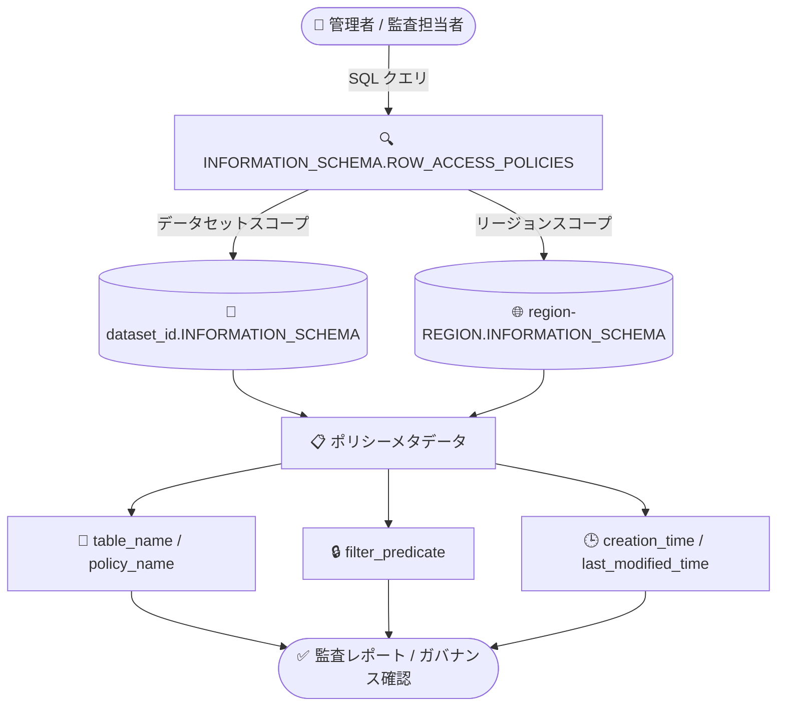

# BigQuery: INFORMATION_SCHEMA.ROW_ACCESS_POLICIES ビューが一般提供 (GA)

**リリース日**: 2026-11-18

**サービス**: BigQuery

**機能**: INFORMATION_SCHEMA.ROW_ACCESS_POLICIES ビュー

**ステータス**: GA (一般提供)

📊 [このアップデートのインフォグラフィックを見る](https://takech9203.github.io/google-cloud-news-summary/20261118-bigquery-information-schema-row-access-policies.html)

## 概要

BigQuery の `INFORMATION_SCHEMA.ROW_ACCESS_POLICIES` ビューが一般提供 (GA) になりました。このビューをクエリすることで、データセットまたはリージョン単位で、アクティブな行レベルアクセスポリシー (row access policy) のメタデータを取得し、フィルタ述語 (filter predicate) を横断的に確認できます。

行レベルセキュリティは、テーブル内の特定の行へのアクセスをユーザー条件に基づいて制御する BigQuery の機能です。1 つのテーブルに複数の行レベルアクセスポリシーを設定でき、列レベルセキュリティやデータセット・テーブルレベルのアクセス制御と併用できます。今回 GA になった INFORMATION_SCHEMA ビューにより、こうしたポリシーの棚卸しや監査を標準 SQL だけで実行できるようになり、データガバナンス担当者やセキュリティ管理者が組織内の行レベルセキュリティの適用状況を一元的に可視化できます。

同日には [BigQuery Lakehouse (Apache Iceberg) における行・列レベルセキュリティの GA](./2026-11-18-bigquery-lakehouse-iceberg-row-column-security-ga.md) も発表されており、行レベルセキュリティの適用範囲拡大と、その運用・監査基盤の整備が同時に進んだ形です。

**アップデート前の課題**

- 行レベルアクセスポリシーの一覧確認は、テーブルごとに Google Cloud コンソールや `bq ls --row_access_policies`、Row Access Policy API を使って個別に行う必要があった
- データセットやリージョン全体で「どのテーブルにどのようなフィルタ述語が設定されているか」を SQL で横断的に棚卸しする標準的な手段がなかった
- 監査やコンプライアンスレビューの際に、ポリシーの作成日時・最終更新日時を含むメタデータを一括取得することが難しかった

**アップデート後の改善**

- `SELECT` 文 1 つで、データセット内またはリージョン内のすべてのアクティブな行レベルアクセスポリシーのメタデータを取得できるようになった
- フィルタ述語 (`filter_predicate`) を SQL で横断的に確認でき、意図しないポリシーや古いポリシーの検出が容易になった
- `creation_time` / `last_modified_time` によりポリシーの変更履歴の確認ポイントが明確になり、監査対応が効率化された

## アーキテクチャ図



管理者や監査担当者がデータセット単位またはリージョン単位で INFORMATION_SCHEMA をクエリし、複数テーブルにまたがる行レベルアクセスポリシーのメタデータ (ポリシー名、フィルタ述語、作成・更新日時) を一括取得するフローです。

## サービスアップデートの詳細

### 主要機能

1. **行レベルアクセスポリシーの横断的なメタデータ取得**
   - データセット内またはリージョン内のすべてのアクティブな行レベルアクセスポリシーを 1 行ずつ返す
   - プロジェクト ID、データセット名、テーブル名、ポリシー名を含むため、どのリソースにどのポリシーが適用されているかを一覧できる

2. **フィルタ述語 (filter_predicate) の検査**
   - 各ポリシーがどの行を可視にするかを定義する SQL ブール式を直接確認できる
   - 例: `region = 'APAC'` のような述語を横断的にレビューし、ガバナンスポリシーとの整合性を検証できる

3. **2 種類のスコープ (データセット / リージョン)**
   - データセット修飾子: `DATASET_ID.INFORMATION_SCHEMA.ROW_ACCESS_POLICIES` — 特定データセット内のポリシーに限定
   - リージョン修飾子: `` `region-REGION`.INFORMATION_SCHEMA.ROW_ACCESS_POLICIES `` — プロジェクトレベルで指定リージョン内のポリシーを取得

## 技術仕様

### スキーマ

| 列名 | データ型 | 内容 |
|------|---------|------|
| `table_catalog` | STRING | 行アクセスポリシーを含むプロジェクトの ID |
| `table_schema` | STRING | 行アクセスポリシーを含むデータセット名 |
| `table_name` | STRING | 行アクセスポリシーを含むテーブル名 |
| `row_access_policy_name` | STRING | 行アクセスポリシーの名前 |
| `filter_predicate` | STRING | このポリシーでアクセス可能な行を定義する SQL ブール式 |
| `creation_time` | TIMESTAMP | ポリシーの作成日時 |
| `last_modified_time` | TIMESTAMP | ポリシーの最終更新日時 |

スキーマ変更時にクエリが壊れないよう、`SELECT *` ではなく列名を明示的に指定することが推奨されています。

### スコープと構文

| ビュー名 | リソーススコープ | リージョンスコープ |
|---------|----------------|------------------|
| `[PROJECT_ID.]region-REGION.INFORMATION_SCHEMA.ROW_ACCESS_POLICIES` | プロジェクトレベル | 指定リージョン |
| `[PROJECT_ID.]DATASET_ID.INFORMATION_SCHEMA.ROW_ACCESS_POLICIES` | データセットレベル | データセットのロケーション |

- INFORMATION_SCHEMA ビュー名は大文字と小文字が区別される
- クエリ実行のロケーションはビューのリージョンと一致している必要がある
- リージョン修飾子は階層的ではない (例: `region-us` マルチリージョンは `us-west1` などの個別リージョンを含まない)

### 必要な権限

このビューをクエリするには、データセットまたはプロジェクトに対して以下の権限が必要です。

- `bigquery.rowAccessPolicies.get`
- `bigquery.rowAccessPolicies.list`

これらの権限を含む事前定義ロール:

- BigQuery Data Owner (`roles/bigquery.dataOwner`)
- BigQuery Admin (`roles/bigquery.admin`)
- BigQuery Security Admin (`roles/bigquery.securityAdmin`)

## 設定方法

### 前提条件

1. 上記のいずれかの IAM ロール (または必要な権限を含むカスタムロール) が付与されていること
2. クエリ実行のロケーションが、対象の INFORMATION_SCHEMA ビューのリージョンと一致していること

### 手順

#### ステップ 1: リージョン内のポリシーを横断確認

```sql
SELECT
  table_catalog, table_schema, table_name,
  row_access_policy_name, filter_predicate,
  creation_time, last_modified_time
FROM `region-us`.INFORMATION_SCHEMA.ROW_ACCESS_POLICIES;
```

デフォルトプロジェクトの us リージョン内にあるすべてのアクティブな行レベルアクセスポリシーのメタデータを取得します。

#### ステップ 2: 特定データセット内のポリシーを確認

```sql
SELECT
  table_name, row_access_policy_name, filter_predicate,
  creation_time, last_modified_time
FROM my_dataset.INFORMATION_SCHEMA.ROW_ACCESS_POLICIES;
```

データセット `my_dataset` 内のポリシーに限定して取得します。

#### ステップ 3: テーブルごとのポリシー数を集計

```sql
SELECT COUNT(1) AS total_policies
FROM my_project.my_dataset.INFORMATION_SCHEMA.ROW_ACCESS_POLICIES
WHERE table_name = 'my_table';
```

特定テーブルに設定されているアクティブなポリシー数をカウントします。

## メリット

### ビジネス面

- **監査・コンプライアンス対応の効率化**: 行レベルセキュリティの適用状況を SQL で一括取得できるため、定期的なアクセス制御レビューや監査証跡の作成が容易になる
- **ガバナンスの可視化**: 組織のデータガバナンスポリシーに沿ってフィルタ述語が設定されているかを横断的にチェックでき、設定漏れや逸脱を早期に発見できる

### 技術面

- **標準 SQL による自動化**: スケジュールクエリなどと組み合わせて、ポリシーの棚卸しを定期的に自動実行するワークフローを構築できる
- **GA による本番利用の安心感**: 一般提供となったことで、本番環境の運用プロセス (監査パイプラインなど) に組み込みやすくなった

## デメリット・制約事項

### 制限事項

- グランティー (許可対象プリンシパル) の情報と DDL 列は含まれない。グランティーは BigQuery カタログメタデータではなく IAM ポリシーバインディングに保存されているため。プリンシパルの確認にはポリシーの一覧表示 (`bq ls --row_access_policies` など) を使用する
- 非表示データセット (hidden datasets) および BigLake データセット内の行アクセスポリシーは結果に含まれない
- リージョン修飾子は階層的ではないため、マルチリージョン指定では個別リージョン内のデータセットは対象外。複数リージョンを横断する場合はリージョンごとにクエリして結果を結合する必要がある

### 考慮すべき点

- INFORMATION_SCHEMA クエリの結果はキャッシュされないため、同一クエリでも実行のたびに課金が発生する
- このビューはメタデータの可視化のみを提供する。ポリシー自体の作成・変更・削除は DDL (`CREATE ROW ACCESS POLICY` など) や Row Access Policy API で行う

## ユースケース

### ユースケース 1: 定期的なアクセス制御監査

**シナリオ**: 金融機関のデータガバナンスチームが、四半期ごとに BigQuery 内の行レベルアクセスポリシーの棚卸しを行い、承認済みのフィルタ述語のみが使われていることを確認する。

**実装例**:
```sql
SELECT
  table_catalog, table_schema, table_name,
  row_access_policy_name, filter_predicate, last_modified_time
FROM `region-us`.INFORMATION_SCHEMA.ROW_ACCESS_POLICIES
ORDER BY last_modified_time DESC;
```

**効果**: 最近変更されたポリシーから優先的にレビューでき、未承認の述語変更や設定ミスを早期に検出できる。

### ユースケース 2: ポリシー設定漏れの検出

**シナリオ**: マルチテナントの分析基盤で、テナント分離用の行レベルアクセスポリシーが対象テーブルすべてに設定されているかを確認したい。

**効果**: INFORMATION_SCHEMA.TABLES と組み合わせてポリシー未設定のテーブルを特定でき、テナント間のデータ漏えいリスクを低減できる。

## 料金

- 行レベルセキュリティ自体は BigQuery に追加費用なしで含まれる
- オンデマンド料金のプロジェクトでは、INFORMATION_SCHEMA ビューへのクエリは処理バイト数が 10 MB 未満でも最低 10 MB 分のデータ処理料金が発生する
- 容量ベース (BigQuery Editions) のプロジェクトでは、購入済みスロットを消費する
- INFORMATION_SCHEMA クエリはキャッシュされないため、実行ごとに課金される (ストレージ料金は発生しない)

詳細は [BigQuery の料金ページ](https://cloud.google.com/bigquery/pricing) を参照してください。

## 関連サービス・機能

- **BigQuery 行レベルセキュリティ**: 本ビューが可視化する対象。`CREATE ROW ACCESS POLICY` DDL や Row Access Policy API でポリシーを管理する
- **BigQuery 列レベルセキュリティ / データマスキング**: 行レベルセキュリティと併用可能な細粒度アクセス制御。ポリシータグに基づき列単位で保護する
- **INFORMATION_SCHEMA.OBJECT_PRIVILEGES**: アクセス制御カテゴリの別の INFORMATION_SCHEMA ビュー。オブジェクトへの権限付与状況を確認できる
- **Cloud Audit Logs**: 行レベルセキュリティ利用時に推奨される監査ロギング。不審なアクティビティのモニタリングに使用する
- **BigQuery Lakehouse (Apache Iceberg) の行・列レベルセキュリティ (同日 GA)**: Iceberg テーブルにも行レベルセキュリティが拡大。本ビューと合わせてガバナンス基盤を強化できる

## 参考リンク

- 📊 [インフォグラフィック](https://takech9203.github.io/google-cloud-news-summary/20261118-bigquery-information-schema-row-access-policies.html)
- [公式リリースノート](https://docs.cloud.google.com/release-notes#November_18_2026)
- [ROW_ACCESS_POLICIES view (公式ドキュメント)](https://docs.cloud.google.com/bigquery/docs/information-schema-row-access-policies)
- [Introduction to BigQuery row-level security](https://docs.cloud.google.com/bigquery/docs/row-level-security-intro)
- [Introduction to INFORMATION_SCHEMA](https://docs.cloud.google.com/bigquery/docs/information-schema-intro)
- [Managing row-level security](https://docs.cloud.google.com/bigquery/docs/managing-row-level-security)
- [料金ページ](https://cloud.google.com/bigquery/pricing)

## まとめ

INFORMATION_SCHEMA.ROW_ACCESS_POLICIES ビューの GA により、行レベルアクセスポリシーの棚卸しとフィルタ述語の監査が標準 SQL だけで完結するようになりました。行レベルセキュリティを本番運用している組織は、このビューを使った定期的なポリシーレビューの自動化を検討することを推奨します。グランティー情報は含まれないため、プリンシパルの確認にはポリシー一覧表示の手段を併用してください。

---

**タグ**: BigQuery, INFORMATION_SCHEMA, 行レベルセキュリティ, Row Access Policy, データガバナンス, 監査, GA
