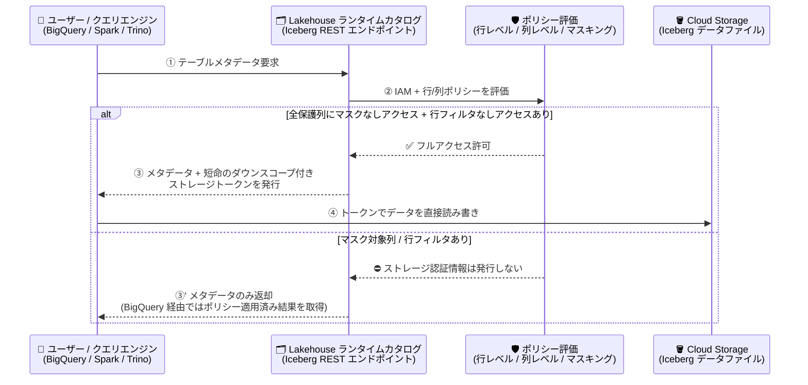

# BigQuery (Lakehouse): Iceberg テーブルの行レベル/列レベルセキュリティと INFORMATION_SCHEMA.ROW_ACCESS_POLICIES ビューが GA

**リリース日**: 2026-11-18

**サービス**: BigQuery (Lakehouse)

**機能**: Lakehouse ランタイムカタログの Apache Iceberg テーブルに対する行レベル/列レベルセキュリティ + INFORMATION_SCHEMA.ROW_ACCESS_POLICIES ビュー

**ステータス**: GA (一般提供)

📊 [このアップデートのインフォグラフィックを見る](https://takech9203.github.io/google-cloud-news-summary/20261118-bigquery-lakehouse-iceberg-row-column-security-ga.html)

## 概要

Lakehouse ランタイムカタログ内の Apache Iceberg テーブルに対して、BigQuery の行レベルセキュリティ (Row-Level Security) と、動的データマスキングを含む列レベルセキュリティ (Column-Level Security) が GA (一般提供) になりました。ポリシーは GoogleSQL の DDL ステートメントで管理でき、BigQuery ネイティブテーブルと同じ仕組みで、オープンフォーマットである Iceberg テーブルにもきめ細かいアクセス制御 (FGAC) を適用できます。

重要なポイントは、credential vending (認証情報ベンディング) モードとの統合です。credential vending モードを使用するカタログでは、Apache Iceberg REST カタログエンドポイントは、保護対象のすべての列へのマスクなしアクセス権を持ち、かつ (行レベルポリシーが存在する場合は) フィルタなしの行アクセス権を持つプリンシパルに対してのみ、ストレージ認証情報を発行します。これにより、Spark や Trino などの外部エンジンが Cloud Storage へ直接アクセスする経路からポリシーが迂回されることを防ぎます。

あわせて、`INFORMATION_SCHEMA.ROW_ACCESS_POLICIES` ビューも GA になりました。データセットまたはリージョン全体にわたって、アクティブな行レベルアクセスポリシーのメタデータをクエリし、フィルタ述語 (filter predicate) を SQL で一括確認できます。レイクハウス環境でデータガバナンスを担うデータ管理者、セキュリティ担当者、プラットフォームエンジニアにとって重要なアップデートです。

**アップデート前の課題**

- Apache Iceberg REST カタログエンドポイントで管理されるテーブルは、行レベル/列レベルセキュリティなどのきめ細かいアクセス制御 (FGAC) に対応しておらず、テーブル単位・バケット単位のアクセス制御しかできなかった
- 機密列や特定の行を保護するには、ビューの作成やデータの物理的な分割など、回避策の設計・運用が必要だった
- 行レベルアクセスポリシーの棚卸しは `bq ls --row_access_policies` や API によるテーブル単位の確認が中心で、データセットやリージョン全体を SQL で横断的に監査する手段が GA として提供されていなかった

**アップデート後の改善**

- Lakehouse ランタイムカタログ内の Iceberg テーブルに、BigQuery と同じ行レベルセキュリティと列レベルセキュリティ (動的データマスキング) を GoogleSQL DDL で適用できるようになった
- credential vending モードでは、保護列へのマスクなしアクセスと行レベルの無制限アクセスを持つプリンシパルにのみストレージ認証情報が発行されるため、外部エンジン経由のポリシー迂回を防止できる
- `INFORMATION_SCHEMA.ROW_ACCESS_POLICIES` ビューにより、データセットまたはリージョン全体の行レベルアクセスポリシーとフィルタ述語を SQL で監査できるようになった

## アーキテクチャ図



credential vending モードでは、Lakehouse ランタイムカタログがストレージトークンの発行前に行レベル/列レベルポリシーを評価し、フルアクセス権を持つプリンシパルにのみ Cloud Storage への直接アクセスを許可します。

## サービスアップデートの詳細

### 主要機能

1. **Iceberg テーブルへの行レベルセキュリティ (GA)**
   - Lakehouse ランタイムカタログ内の Apache Iceberg テーブルに行レベルアクセスポリシーを適用可能
   - `CREATE ROW ACCESS POLICY` などの GoogleSQL DDL でポリシーを作成・管理
   - フィルタ述語に基づき、ユーザーごとに参照可能な行を制御

2. **Iceberg テーブルへの列レベルセキュリティと動的データマスキング (GA)**
   - ポリシータグによる列レベルのアクセス制御を Iceberg テーブルに適用可能
   - 動的データマスキングにより、アクセス権のないユーザーにはマスク済みの値を返却 (クエリの書き換え不要)
   - マスキングは行レベルセキュリティの上に重ねて適用される

3. **credential vending モードとのポリシー連動**
   - credential vending モードのカタログでは、Iceberg REST カタログエンドポイントがストレージ認証情報の発行前にポリシーを評価
   - すべての保護列へのマスクなしアクセス権を持ち、かつ (行レベルポリシーが存在する場合) フィルタなしの行アクセス権を持つプリンシパルにのみ、短命のダウンスコープ付きストレージトークンを発行
   - Spark / Trino など Cloud Storage を直接読むエンジン経由でのポリシー迂回を防止

4. **INFORMATION_SCHEMA.ROW_ACCESS_POLICIES ビュー (GA)**
   - アクティブな行レベルアクセスポリシーのメタデータを SQL でクエリ可能
   - データセット単位またはリージョン単位でポリシーとフィルタ述語を横断的に確認
   - ガバナンス監査やポリシーの棚卸しを自動化できる

## 技術仕様

### 行レベル/列レベルセキュリティと credential vending の関係

| 項目 | 詳細 |
|------|------|
| 対象テーブル | Lakehouse ランタイムカタログ内の Apache Iceberg テーブル |
| ポリシー管理 | GoogleSQL DDL (`CREATE ROW ACCESS POLICY` など) |
| 列レベル保護 | ポリシータグ + 動的データマスキング |
| ストレージトークン発行条件 (credential vending モード) | 全保護列へのマスクなしアクセス + (行レベルポリシーが存在する場合) フィルタなしの行アクセス |
| トークンの性質 | 短命かつテーブルパスにダウンスコープされたストレージ認証情報 |
| 対応エンジン | BigQuery、Managed Service for Apache Spark、OSS Spark、Trino (Iceberg REST カタログエンドポイント経由) |

### ポリシー管理の DDL 例

```sql
-- Iceberg テーブルに行レベルアクセスポリシーを作成
CREATE ROW ACCESS POLICY sales_region_filter
ON my_project.my_dataset.iceberg_sales
GRANT TO ("group:apac-sales@example.com")
FILTER USING (region = "APAC");

-- 行レベルアクセスポリシーの削除
DROP ROW ACCESS POLICY sales_region_filter
ON my_project.my_dataset.iceberg_sales;

-- すべての行レベルアクセスポリシーの削除
DROP ALL ROW ACCESS POLICIES ON my_project.my_dataset.iceberg_sales;
```

### INFORMATION_SCHEMA.ROW_ACCESS_POLICIES のクエリ例

```sql
-- リージョン内のすべての行レベルアクセスポリシーとフィルタ述語を確認
SELECT *
FROM `region-us`.INFORMATION_SCHEMA.ROW_ACCESS_POLICIES;

-- 特定データセットのポリシーを確認
SELECT *
FROM my_dataset.INFORMATION_SCHEMA.ROW_ACCESS_POLICIES;
```

INFORMATION_SCHEMA ビューのクエリにはリージョン修飾子またはデータセット修飾子が必要で、クエリ実行ロケーションはビューのリージョンと一致している必要があります。

## 設定方法

### 前提条件

1. Lakehouse ランタイムカタログと Apache Iceberg REST カタログエンドポイントが構成済みであること
2. ポリシー迂回を防ぐには、カタログエンドポイントを credential vending モードで構成すること (自動プロビジョニングされたカタログエンドポイントサービスアカウントに、対象バケットの `roles/storage.objectUser` を付与)
3. 行レベルアクセスポリシーの管理には `bigquery.rowAccessPolicies.*` 権限 (例: `roles/bigquery.admin` または `roles/bigquery.dataOwner`) が必要

### 手順

#### ステップ 1: credential vending モードのカタログを確認

```bash
# カタログエンドポイントのサービスアカウントを確認
gcloud biglake iceberg catalogs describe CATALOG_ID \
  --project=PROJECT_ID \
  --format='value(biglake-service-account)'
```

credential vending モードのカタログでは、このサービスアカウントに対象 Cloud Storage バケットの `roles/storage.objectUser` が必要です。

#### ステップ 2: Iceberg テーブルに行レベルアクセスポリシーを作成

```sql
CREATE ROW ACCESS POLICY apac_only
ON my_project.my_dataset.iceberg_sales
GRANT TO ("group:apac-analysts@example.com")
FILTER USING (region = "APAC");
```

#### ステップ 3: 列レベルセキュリティ (ポリシータグ) とマスキングを適用

機密列にポリシータグを付与し、データポリシーでマスキングルール (ハッシュ、NULL 化など) を設定します。アクセス権のないユーザーのクエリ結果では、対象列がマスクされた値で返却されます。

#### ステップ 4: ポリシーの監査

```sql
SELECT table_name, row_access_policy_name, filter_predicate
FROM `region-us`.INFORMATION_SCHEMA.ROW_ACCESS_POLICIES
ORDER BY table_name;
```

## メリット

### ビジネス面

- **オープンレイクハウスでのコンプライアンス対応**: Iceberg テーブルのまま、個人情報保護や地域別アクセス制限などの規制要件 (GDPR など) に対応したきめ細かいアクセス制御を実現できる
- **ガバナンスの一元化**: BigQuery と外部エンジン (Spark / Trino) に対して一貫したポリシーを適用でき、エンジンごとのアクセス制御の重複実装が不要になる
- **監査の効率化**: INFORMATION_SCHEMA ビューで全ポリシーを SQL で棚卸しでき、監査対応の工数を削減できる

### 技術面

- **ポリシー迂回の防止**: credential vending により、ストレージ直接アクセス経路でも行/列ポリシーが実質的に強制される (フルアクセス権がないプリンシパルには認証情報が発行されない)
- **DDL ベースの宣言的管理**: GoogleSQL DDL でポリシーを管理できるため、Terraform や CI/CD と組み合わせた Infrastructure as Code 運用が容易
- **ビュー乱立の解消**: 行フィルタや列マスキング目的の認可ビューを大量に作成・維持する必要がなくなる

## デメリット・制約事項

### 制限事項

- credential vending は Apache Iceberg REST カタログエンドポイントでのみサポートされ、Apache Hive カタログエンドポイントでは利用できない
- Iceberg REST カタログエンドポイントは Iceberg V2 テーブル (GA) と V3 テーブル (Preview) をサポートし、V1 テーブルは非対応
- 行レベルセキュリティには BigQuery 共通の制約が適用される (レガシー SQL 非対応、JSON 列へのポリシー適用不可、ワイルドカードテーブル非対応、テーブルプレビュー/テーブルサンプリング非互換など)
- データマスキングはサブクエリを含まない行アクセスポリシーとのみ互換

### 考慮すべき点

- credential vending モードでは、ポリシーで保護されたテーブルに対し Spark / Trino などの外部エンジンからストレージ直接アクセスできるのはフルアクセス権を持つプリンシパルのみとなるため、既存のパイプライン (サービスアカウント) の権限設計を見直す必要がある
- DML やテーブルコピーなどの全行アクセスを要する操作には TRUE フィルタ (全行アクセス許可) の付与が必要
- VPC Service Controls 境界内のバケットを使用する場合、カタログエンドポイントのサービスアカウント (`blirc-...@gcp-sa-biglakerestcatalog.iam.gserviceaccount.com`) に対する ingress ルールの構成が必要

## ユースケース

### ユースケース 1: マルチエンジン環境での地域別データアクセス制御

**シナリオ**: グローバル企業が売上データを Iceberg テーブルとして Cloud Storage に保持し、BigQuery で BI 分析、Spark で ML パイプラインを実行している。各地域の担当者には自地域のデータのみを見せたい。

**実装例**:
```sql
CREATE ROW ACCESS POLICY apac_sales_filter
ON lakehouse_project.sales_ds.iceberg_sales
GRANT TO ("group:apac-team@example.com")
FILTER USING (sales_region = "APAC");
```

**効果**: BigQuery 経由のクエリでは行フィルタが適用され、credential vending により Spark からのストレージ直接アクセスもフルアクセス権を持つパイプライン用サービスアカウントに限定される。地域別のテーブル分割やビュー運用が不要になる。

### ユースケース 2: 機密列のマスキングと定期的なポリシー監査

**シナリオ**: 金融機関が顧客データを含む Iceberg テーブルを運用しており、アナリストには口座番号などの機密列をマスクして提供しつつ、監査部門は適用中のポリシーを四半期ごとに棚卸ししたい。

**実装例**:
```sql
SELECT table_catalog, table_schema, table_name,
       row_access_policy_name, filter_predicate
FROM `region-us`.INFORMATION_SCHEMA.ROW_ACCESS_POLICIES;
```

**効果**: 機密列はポリシータグと動的マスキングで保護され、監査部門は SQL 一発でリージョン全体のポリシーとフィルタ述語を確認できる。手動でのテーブル単位の確認作業が不要になる。

## 料金

行レベル/列レベルセキュリティの適用自体に関する個別料金は公式ドキュメントで確認してください。クエリは通常の BigQuery の分析料金 (オンデマンドまたはエディション) に従います。なお、行レベルセキュリティは特定の BigQuery エディションで作成された予約では利用できない場合があります。

- [BigQuery の料金](https://cloud.google.com/bigquery/pricing)

## 利用可能リージョン

公式ドキュメント ([Lakehouse ドキュメント](https://docs.cloud.google.com/lakehouse/docs)) でサポートリージョンを確認してください。`INFORMATION_SCHEMA.ROW_ACCESS_POLICIES` はリージョン修飾子 (例: `region-us`) を指定してクエリします。

## 関連サービス・機能

- **Lakehouse ランタイムカタログ / Apache Iceberg REST カタログエンドポイント**: 本アップデートの対象。credential vending モードで短命のダウンスコープ付きストレージトークンを発行
- **Cloud Storage**: Iceberg テーブルのデータファイル格納先。credential vending により直接のバケット権限付与が不要になる
- **Managed Service for Apache Spark / Trino**: Iceberg REST カタログエンドポイント経由で Iceberg テーブルを読み書きする外部エンジン
- **Data Catalog ポリシータグ (BigQuery 列レベルセキュリティ)**: 列レベルアクセス制御と動的データマスキングの基盤
- **VPC Service Controls**: 境界内バケットと組み合わせる場合は ingress ルールの構成が必要

## 参考リンク

- 📊 [インフォグラフィック](https://takech9203.github.io/google-cloud-news-summary/20261118-bigquery-lakehouse-iceberg-row-column-security-ga.html)
- [公式リリースノート](https://docs.cloud.google.com/release-notes#November_18_2026)
- [Lakehouse credential vending ドキュメント](https://docs.cloud.google.com/lakehouse/docs/credential-vending)
- [Apache Iceberg REST カタログエンドポイントのセットアップ](https://docs.cloud.google.com/lakehouse/docs/set-up-lakehouse-iceberg-rest-catalog)
- [BigQuery 行レベルセキュリティの概要](https://docs.cloud.google.com/bigquery/docs/row-level-security-intro)
- [行レベルアクセスポリシーの管理](https://docs.cloud.google.com/bigquery/docs/managing-row-level-security)
- [列レベルのデータマスキング](https://docs.cloud.google.com/bigquery/docs/column-data-masking)
- [INFORMATION_SCHEMA の概要](https://docs.cloud.google.com/bigquery/docs/information-schema-intro)
- [BigQuery の料金](https://cloud.google.com/bigquery/pricing)

## まとめ

Lakehouse ランタイムカタログの Iceberg テーブルに BigQuery の行レベル/列レベルセキュリティが GA となり、credential vending との連動によって外部エンジン経由のポリシー迂回も防げるようになったことで、オープンフォーマットのレイクハウスでもエンタープライズレベルのデータガバナンスが実現できます。Iceberg テーブルを Spark や Trino と併用している環境では、カタログエンドポイントの credential vending モード化とパイプライン用サービスアカウントの権限 (TRUE フィルタ等) の見直しを進め、`INFORMATION_SCHEMA.ROW_ACCESS_POLICIES` による定期的なポリシー監査を運用に組み込むことを推奨します。

---

**タグ**: BigQuery, Lakehouse, Apache Iceberg, 行レベルセキュリティ, 列レベルセキュリティ, データマスキング, credential vending, INFORMATION_SCHEMA, GA, データガバナンス
