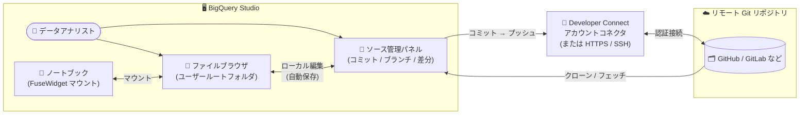

# BigQuery: BigQuery Studio Git リポジトリが一般提供 (GA) に

**リリース日**: 2026-11-18

**サービス**: BigQuery

**機能**: BigQuery Studio Git リポジトリ

**ステータス**: 一般提供 (GA)

📊 [このアップデートのインフォグラフィックを見る](https://takech9203.github.io/google-cloud-news-summary/20261118-bigquery-studio-git-repositories-ga.html)

## 概要

BigQuery Studio Git リポジトリが一般提供 (GA) になりました。この機能により、SQL スクリプトやノートブックなどのコードアセットを、BigQuery Studio のファイルブラウザ上で直接バージョン管理できます。リモート Git リポジトリのクローン、ブランチの管理、コミット・プッシュなどの Git 操作を、Google Cloud コンソールから離れることなく実行できます。

従来の BigQuery リポジトリ (Preview) がワークスペースベースのバージョン管理アプローチを採用していたのに対し、BigQuery Studio Git リポジトリは、左ペインのユーザールートフォルダ配下に展開される「フォルダベース」の合理化されたエクスペリエンスを提供します。コードアセットを通常のファイルやディレクトリと同じように操作しながら、リモート Git リポジトリとの接続を維持できます。

対象ユーザーは、BigQuery Studio 上で SQL やノートブックを開発するデータアナリスト・データエンジニアで、特にチームのコードレビューや CI/CD プロセスに BigQuery のコード資産を組み込みたいユーザーに有用です。

**アップデート前の課題**

- BigQuery Studio のコードアセット (SQL スクリプト、ノートブック) のバージョン管理には、ワークスペースベースの BigQuery リポジトリ (Preview) を使用する必要があり、リポジトリごとにワークスペースを個別に作成・管理する手間があった
- ファイルブラウザ上のファイル操作と Git 操作が分離しており、通常のファイル管理と同じ感覚でバージョン管理対象のコードを扱うことができなかった
- 複数のリモートリポジトリを同時にクローンして扱うには、それぞれのワークスペース管理が必要だった

**アップデート後の改善**

- ユーザールートフォルダ配下にリモート Git リポジトリをクローンし、通常のファイル・ディレクトリと同じ操作感 (作成、リネーム、移動、コピー、アップロード、ダウンロード、削除) でコードアセットを管理できるようになった
- コミット、プッシュ、フェッチ、ブランチのチェックアウト・切り替え、コミット履歴の参照、差分表示などの Git 操作を、コンソールの「ソース管理」パネルから直接実行できるようになった
- ワークスペースを個別に管理することなく、複数のリポジトリを一度にクローンして利用できるようになった
- GA 昇格により、本番環境での利用に適した安定性とサポートが提供されるようになった

## アーキテクチャ図



BigQuery Studio のファイルブラウザ配下にリモート Git リポジトリをクローンし、ソース管理パネルからコミット・プッシュ・フェッチなどの Git 操作を実行するワークフローを示しています。リモートリポジトリへの接続には Developer Connect アカウントコネクタ (または HTTPS / SSH) を使用します。

## サービスアップデートの詳細

### 主要機能

1. **フォルダベースの Git リポジトリ統合**
   - ファイルブラウザのユーザールートノードから「作成 > Git リポジトリ」でリモートリポジトリの URL を指定してクローンを作成
   - クローンされたリポジトリは通常のフォルダとして表示され、SQL クエリ、ノートブック、データキャンバス、データ準備、ファイル、サブディレクトリの作成やローカルファイルのアップロードが可能
   - ファイルの編集内容は自動保存される

2. **コンソール内での Git 操作 (ソース管理パネル)**
   - 変更ファイルの差分表示 (Show diff) による行単位の比較
   - コミットメッセージを入力してコミットし、「Push to remote」でリモートに同期
   - ブランチのチェックアウト・切り替え (未コミットの変更がある場合は切り替え不可)
   - アクティブブランチのコミット履歴の表示と、リモートからのフェッチ

3. **シャロークローン (Shallow clone) のサポート**
   - 作成時に「詳細オプション」でシャロークローンを選択し、取得するコミット数 (Depth) を指定可能
   - コミット履歴が深い大規模リポジトリのクローン時間を短縮し、タイムアウトを回避
   - 必要に応じて後から追加のコミットをフェッチして履歴を拡張可能

4. **ノートブックからのリポジトリマウント**
   - `google_dataform_fuse_widget` の `FuseWidget()` を実行することで、Git リポジトリをノートブックのランタイムにマウント
   - マウント接続時にカレントワーキングディレクトリと Python システムパスが自動更新され、リポジトリ内のクエリスクリプトやファイルを標準の `import` 文で直接読み込み可能
   - マウント / アンマウント / 接続 / 切断 / 修復 (Repair) の操作とステータスバーによる健全性確認 (Connected / Mounted / Stopped / Unhealthy)

5. **Developer Connect アカウントコネクタによる認証**
   - 既存の Developer Connect アカウントコネクタを自動検出し、リポジトリ接続に利用
   - コネクタがない場合は新規作成するか、HTTPS / SSH での接続に切り替え可能

## 技術仕様

### 接続・構成要素

| 項目 | 詳細 |
|------|------|
| 配置場所 | ユーザールートフォルダ配下 (技術的にはプロジェクトレベルで作成) |
| 認証方式 | Developer Connect アカウントコネクタ、HTTPS、SSH |
| 対応 Git プロバイダ (サードパーティ接続) | GitHub (SSH/HTTPS)、GitLab (SSH/HTTPS)、Bitbucket (SSH)、Azure DevOps Services (SSH) |
| クォータ | マウント内のファイルシステム操作は Dataform クォータを消費 |
| ノートブックファイルサイズ上限 (マウント内) | 30 MB |
| マウント外変更の反映 | 最大 60 秒 (`FuseWidget(CACHE_TTL_SECONDS=NUMBER)` で調整可能) |
| 組織ポリシー | `dataform.restrictGitRemotes` で接続可能なリモートリポジトリを制限可能 |

### ノートブックでのマウント

```python
from google_dataform_fuse_widget import FuseWidget
FuseWidget()

# キャッシュ TTL を変更する場合 (秒単位、短くすると Dataform クォータ消費が増加)
FuseWidget(CACHE_TTL_SECONDS=10)
```

ノートブックに保存されないスクラッチコードセル (Insert > Scratch code cell) での実行が推奨されています。

## 設定方法

### 前提条件

1. リモート Git リポジトリがパブリックインターネットから到達可能であること (ファイアウォール内のリポジトリの場合は、Dataform の Egress IP アドレス範囲をファイアウォールルールに追加する)
2. `dataform.restrictGitRemotes` 組織ポリシーを使用している場合は、接続先リモートリポジトリを `allowedValues` リストに追加しておくこと

### 手順

#### ステップ 1: Git リポジトリの作成

1. Google Cloud コンソールで BigQuery ページに移動
2. 左ペインで「Files」をクリックしてファイルブラウザを開く
3. ユーザールートノードの横の「View actions > Create > Git repository」をクリック
4. リモート Git リポジトリの URL を入力
5. Developer Connect アカウントコネクタを選択・作成するか、「switch to HTTPS or SSH」で接続方式を切り替え
6. (任意) 「Advanced options」で Shallow clone を選択し、Depth に取得コミット数を入力
7. 「Connect」をクリック

#### ステップ 2: 編集とコミット・プッシュ

1. ファイルノード (SQL スクリプトやノートブック) をクリックしてエディタで編集 (自動保存)
2. 左ペインで「Source control」をクリック
3. (任意) 変更ファイルにカーソルを合わせて「Show diff」で差分を確認
4. コミットメッセージを入力して「Commit」をクリック
5. 「Push to remote」をクリックしてリモートリポジトリに同期

#### ステップ 3: ブランチ操作

1. 「Source control」パネルの「Branches」セクションで「Actions > Check out new branch」をクリック
2. ベースにするブランチ (例: `origin/main`) とブランチ名を指定して「Checkout branch」をクリック
3. 既存ブランチへの切り替えは、対象ブランチの「Actions > Switch to BRANCH_NAME」で実行 (未コミットの変更がある場合は先にコミットが必要)

## メリット

### ビジネス面

- **ガバナンスと監査性の向上**: BigQuery の SQL やノートブックが Git 履歴で管理されるため、変更の追跡・レビュー・ロールバックが可能になり、データ分析資産の統制が強化される
- **チーム開発の効率化**: 既存の GitHub / GitLab などのチームのレビューフロー (Pull Request など) に BigQuery のコード資産をそのまま組み込める

### 技術面

- **ツール切り替え不要**: コンソールを離れずにクローン・コミット・プッシュ・ブランチ操作が完結し、ローカル環境への git クライアント設定が不要
- **ノートブックとの統合**: マウント機能により、ノートブックからリポジトリ内のスクリプトを標準の Python import で再利用でき、コードのモジュール化が促進される
- **大規模リポジトリへの対応**: シャロークローンにより、深いコミット履歴を持つリポジトリでもクローン時間とタイムアウトのリスクを低減できる

## デメリット・制約事項

### 制限事項

- BigQuery Studio Git リポジトリはユーザールートフォルダのコンテキストに制限され、個人利用 (private use) を意図した設計のため、他のユーザーとリポジトリを共有しないことが推奨されている
- マウント内のノートブックファイルサイズは 30 MB が上限 (超える場合は Colab ランタイムのローカルストレージに保存)
- マウント外での変更 (左ペインでのファイル編集・リネームなど) がマウント内に反映されるまで最大 60 秒かかる
- ファイル・ディレクトリの移動やコピーは同一 Git リポジトリ内に限定される
- ファイル数・ファイルサイズ・ブランチ数が多い、またはコミット履歴が深いリポジトリはクローンに時間がかかり、タイムアウトする可能性がある

### 考慮すべき点

- マウント内のファイルシステム操作は Dataform クォータを消費するため、`CACHE_TTL_SECONDS` を短くしすぎるとクォータ消費が増加する
- 未コミットの変更がある状態ではブランチの切り替え・新規チェックアウトができない
- ファイアウォール内のリモートリポジトリに接続する場合は、Dataform の Egress IP アドレス範囲の許可設定が必要
- Developer Connect の「アカウントコネクタ」を使用する点が、Git リポジトリ接続 (Git repository connections) とは異なるため、既存の Developer Connect 設定との違いに注意が必要

## ユースケース

### ユースケース 1: SQL 資産のチームレビューフローへの統合

**シナリオ**: データ分析チームが BigQuery Studio で開発した SQL スクリプトを、GitHub 上の Pull Request ベースのレビューフローで管理したい。

**実装例**:
```text
1. GitHub 上のチームリポジトリを BigQuery Studio Git リポジトリとしてクローン
2. 「Check out new branch」で origin/main をベースに feature ブランチを作成
3. SQL スクリプトを編集し、Show diff で差分を確認してコミット
4. Push to remote でリモートに反映し、GitHub 上で Pull Request を作成してレビュー
```

**効果**: BigQuery 上の分析コードにも通常のソフトウェア開発と同等のレビュープロセスを適用でき、品質と再現性が向上する。

### ユースケース 2: ノートブックからの共通クエリスクリプトの再利用

**シナリオ**: 複数のノートブックで共通の前処理ロジックや SQL スクリプトを使い回したい。

**実装例**:
```python
# ノートブックのスクラッチセルで実行
from google_dataform_fuse_widget import FuseWidget
FuseWidget()

# マウント後、リポジトリ内の Python モジュールを直接 import
from utils.preprocessing import clean_dataframe
```

**効果**: リポジトリをマウントすることで、ノートブックの作業ディレクトリと Python パスが自動設定され、共通コードのコピー&ペーストが不要になり保守性が向上する。

### ユースケース 3: 大規模リポジトリのシャロークローン運用

**シナリオ**: 数年分のコミット履歴を持つ大規模なデータ分析リポジトリを BigQuery Studio で扱いたいが、フルクローンではタイムアウトする。

**効果**: シャロークローンで直近のコミットのみを取得してクローン時間を短縮し、履歴調査が必要になった時点で「Fetch (shallow clone)」により追加コミットを段階的に取得できる。

## 料金

BigQuery Studio Git リポジトリ自体の追加料金に関する公式情報は、本レポート作成時点のドキュメントでは確認できませんでした。なお、マウント内のファイルシステム操作は Dataform クォータを消費します。最新の料金情報は以下の公式ページを参照してください。

- [BigQuery の料金](https://cloud.google.com/bigquery/pricing)

## 利用可能リージョン

BigQuery リポジトリはすべての BigQuery Studio ロケーションで作成できます。詳細は [BigQuery のロケーション](https://docs.cloud.google.com/bigquery/docs/locations#bqstudio-loc) を参照してください。

## 関連サービス・機能

- **BigQuery リポジトリ (Preview)**: ワークスペースベースのバージョン管理機能。BigQuery Studio Git リポジトリはそのフォルダベースの代替として推奨されている
- **Developer Connect**: リモート Git リポジトリへの認証接続に使用するアカウントコネクタを提供
- **Dataform**: Git 接続の基盤 (Egress IP、クォータ、`dataform.restrictGitRemotes` 組織ポリシー) を共有
- **Colab Enterprise ノートブック**: FuseWidget によるリポジトリマウントを通じて、ノートブックランタイムからリポジトリ内のファイルへ直接アクセス可能

## 参考リンク

- 📊 [インフォグラフィック](https://takech9203.github.io/google-cloud-news-summary/20261118-bigquery-studio-git-repositories-ga.html)
- [公式リリースノート](https://docs.cloud.google.com/release-notes#November_18_2026)
- [ドキュメント: Manage code with BigQuery Studio Git repositories](https://docs.cloud.google.com/bigquery/docs/git-repositories)
- [ドキュメント: Introduction to repositories](https://docs.cloud.google.com/bigquery/docs/repository-intro)
- [料金ページ](https://cloud.google.com/bigquery/pricing)

## まとめ

BigQuery Studio Git リポジトリの GA により、SQL スクリプトやノートブックのバージョン管理が、ワークスペースを介さないフォルダベースの直感的な操作でコンソール内に統合されました。BigQuery 上のコード資産を GitHub / GitLab などのチーム開発フローに組み込みたい場合は、本機能の導入を検討することを推奨します。個人利用向けの設計である点と Dataform クォータの消費には留意してください。

---

**タグ**: BigQuery, BigQuery Studio, Git, バージョン管理, Developer Connect, Dataform, GA
