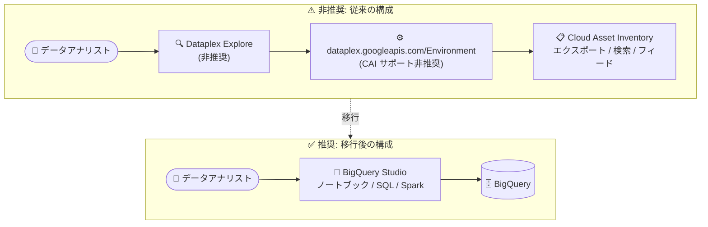

# Cloud Asset Inventory: dataplex.googleapis.com/Environment リソースタイプのサポート非推奨化

**リリース日**: 2026-11-18

**サービス**: Cloud Asset Inventory

**機能**: dataplex.googleapis.com/Environment リソースタイプのサポート

**ステータス**: Deprecated (非推奨)

📊 [このアップデートのインフォグラフィックを見る](https://takech9203.github.io/google-cloud-news-summary/20261118-cloud-asset-inventory-dataplex-environment-deprecated.html)

## 概要

Cloud Asset Inventory における `dataplex.googleapis.com/Environment` リソースタイプのサポートが非推奨 (Deprecated) となりました。これは、このリソースタイプの提供元である Dataplex Explore (データ探索ワークベンチ) 自体が非推奨となったことに伴う措置です。

Dataplex Explore は、Spark SQL スクリプトと Jupyter ノートブックを使用したサーバーレスのインタラクティブなデータ探索体験を提供する機能で、2022 年 10 月に GA となっていました。`Environment` リソースは、Explore のセッションを実行するための環境を表すリソースタイプです。Google Cloud は、インタラクティブな分析ワークフローの移行先として BigQuery Studio を案内しています。

このアップデートの影響を受けるのは、Cloud Asset Inventory のエクスポート、検索、フィード (Pub/Sub 監視) などで `dataplex.googleapis.com/Environment` リソースタイプを利用している組織です。アセット棚卸しスクリプトやコンプライアンス監視の対象リストにこのタイプを含めている場合は、見直しが必要です。

**アップデート前の課題**

- Dataplex Explore の `Environment` リソースは Cloud Asset Inventory の対象リソースタイプとして追跡できたが、Dataplex Explore 自体が非推奨となり、リソースタイプを追跡し続ける意義が失われていた
- 非推奨機能のリソースタイプがサポート対象に残ることで、アセット管理の対象リストに古い機能への依存が残る状態だった

**アップデート後の改善**

- `dataplex.googleapis.com/Environment` リソースタイプの非推奨化が正式にアナウンスされ、利用者は依存箇所の特定と移行計画を立てられるようになった
- インタラクティブ分析の移行先として BigQuery Studio が明示され、移行の方向性が明確になった

## アーキテクチャ図



Dataplex Explore の非推奨化に伴い、その実行環境を表す `Environment` リソースタイプの Cloud Asset Inventory サポートも非推奨となります。インタラクティブ分析ワークフローは BigQuery Studio へ移行することが推奨されています。

## サービスアップデートの詳細

### 主要なポイント

1. **`dataplex.googleapis.com/Environment` リソースタイプの非推奨化**
   - Cloud Asset Inventory のサポート対象リソースタイプから非推奨化される
   - Cloud Asset Inventory のリソースタイプは、BigQuery / Cloud Storage へのエクスポート、アセット一覧表示、Pub/Sub によるアセット変更監視、SQL によるアセットクエリ、リソース検索などの操作で利用される

2. **非推奨化の理由: Dataplex Explore の非推奨化**
   - Dataplex Explore (データ探索ワークベンチ) は、Spark SQL スクリプトと Jupyter ノートブックによるサーバーレスなデータ探索機能を提供していた
   - `Environment` は Explore のセッション (Spark SQL / ノートブック実行) をホストする環境リソース

3. **移行先: BigQuery Studio**
   - インタラクティブな分析ワークフローは BigQuery Studio への移行が案内されている
   - BigQuery Studio はノートブック (SQL セル、PySpark を含む)、保存クエリ、Git リポジトリ連携などを提供する統合分析環境

## 技術仕様

### 影響を受ける Cloud Asset Inventory の操作

| 操作 | 影響 |
|------|------|
| BigQuery / Cloud Storage へのエクスポート | `dataplex.googleapis.com/Environment` タイプの出力に依存している場合は見直しが必要 |
| アセット一覧表示 (List assets) | 同上 |
| Pub/Sub によるアセット変更監視 (フィード) | 対象タイプに `Environment` を含むフィード定義の見直しが必要 |
| リソース検索 (Search APIs) | 検索条件 (`--asset-types`) に `Environment` を指定している場合は見直しが必要 |

## 設定方法

### 依存箇所の確認手順

#### ステップ 1: 組織内の Environment リソースを検索

```bash
gcloud asset search-all-resources \
  --scope=organizations/ORGANIZATION_ID \
  --asset-types="dataplex.googleapis.com/Environment"
```

組織内に Dataplex Explore の Environment リソースが存在するかを確認します。

#### ステップ 2: フィード定義の確認

```bash
gcloud asset feeds list --organization=ORGANIZATION_ID
```

アセット変更監視のフィード定義に `dataplex.googleapis.com/Environment` が含まれていないかを確認し、含まれている場合は対象タイプから除外するなどの見直しを行います。

## デメリット・制約事項

### 考慮すべき点

- `dataplex.googleapis.com/Environment` を対象とするエクスポートジョブ、フィード、検索クエリは将来的に機能しなくなる可能性があるため、早めに依存を解消する
- Dataplex Explore 上の Spark SQL スクリプトやノートブックのワークフローは、BigQuery Studio への移行計画を立てる必要がある
- サポート終了の具体的な日程はリリースノートに記載されていないため、今後のアナウンスを注視する

## ユースケース

### ユースケース 1: アセット棚卸しパイプラインの見直し

**シナリオ**: Cloud Asset Inventory のエクスポート機能で全リソースを BigQuery に出力し、コンプライアンスレポートを作成している組織。出力結果に `dataplex.googleapis.com/Environment` が含まれている。

**効果**: 非推奨タイプへの依存を事前に特定し、レポートのスキーマや集計クエリを更新することで、サポート終了時の障害を回避できる。

### ユースケース 2: インタラクティブ分析の BigQuery Studio への移行

**シナリオ**: Dataplex Explore の Environment 上で Spark SQL スクリプトや Jupyter ノートブックを利用してデータ探索を行っていたチーム。

**効果**: BigQuery Studio のノートブック (SQL セル、PySpark 対応) に移行することで、非推奨機能から脱却しつつ、Gemini によるコード支援や Git リポジトリ連携などの最新機能を活用できる。

## 料金

このアップデートは非推奨化のアナウンスであり、料金への直接の影響はありません。Dataplex および BigQuery の料金は以下を参照してください。

- [Dataplex 料金ページ](https://cloud.google.com/dataplex/pricing)
- [BigQuery 料金ページ](https://cloud.google.com/bigquery/pricing)

## 関連サービス・機能

- **Dataplex (Explore)**: 非推奨化の起点となった機能。Spark SQL スクリプトと Jupyter ノートブックによるサーバーレスデータ探索を提供していた
- **BigQuery Studio**: インタラクティブ分析ワークフローの推奨移行先。ノートブック、保存クエリ、Git リポジトリ連携などを提供する統合分析環境
- **Cloud Asset Inventory**: Google Cloud リソースのメタデータを管理するサービス。エクスポート、検索、変更監視などの操作でリソースタイプを指定する

## 参考リンク

- 📊 [インフォグラフィック](https://takech9203.github.io/google-cloud-news-summary/20261118-cloud-asset-inventory-dataplex-environment-deprecated.html)
- [公式リリースノート](https://docs.cloud.google.com/release-notes#November_18_2026)
- [Cloud Asset Inventory サポート対象アセットタイプ](https://docs.cloud.google.com/asset-inventory/docs/asset-types)
- [BigQuery Studio ドキュメント](https://docs.cloud.google.com/bigquery/docs/bigquery-web-ui)

## まとめ

Dataplex Explore の非推奨化に伴い、Cloud Asset Inventory の `dataplex.googleapis.com/Environment` リソースタイプのサポートも非推奨となりました。アセット管理パイプラインでこのリソースタイプに依存している場合は依存箇所を特定して除外し、Dataplex Explore 上のインタラクティブ分析ワークフローは BigQuery Studio への移行を計画することを推奨します。

---

**タグ**: Cloud Asset Inventory, Dataplex, BigQuery Studio, Deprecated, データ探索, アセット管理
