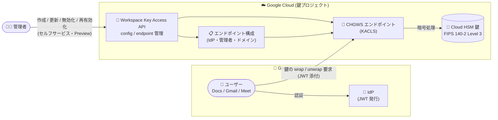

# Cloud Key Management Service: Cloud HSM for Google Workspace が Workspace Key Access API によるセルフサービス操作をサポート (Preview)

**リリース日**: 2026-11-18

**サービス**: Cloud Key Management Service (Cloud HSM)

**機能**: Cloud HSM for Google Workspace の Workspace Key Access API によるセルフサービス操作

**ステータス**: Preview

📊 [このアップデートのインフォグラフィックを見る](https://takech9203.github.io/google-cloud-news-summary/20261118-cloud-kms-hsm-workspace-key-access-api.html)

## 概要

Cloud HSM for Google Workspace (CHGWS) において、**Workspace Key Access API** を使用したセルフサービス操作が Preview として利用可能になりました。CHGWS は、Cloud KMS が提供する Google Workspace 向けの暗号鍵サービスで、Google Workspace クライアントサイド暗号化 (CSE) の鍵アクセス制御サービス (KACLS) として機能します。FIPS 140-2 Level 3 準拠の HSM (ハードウェアセキュリティモジュール) に保管された鍵を使用し、DISA IL5 などの規制要件への対応を支援します。

今回のアップデートにより、以下の操作を Workspace Key Access API (gcloud CLI では `gcloud beta workspace-key-access` コマンドグループ) 経由でユーザー自身が実行できるようになりました。

- エンドポイント構成 (config) の作成・更新
- エンドポイントの作成
- エンドポイントが使用する構成の変更 (別の config への切り替え)
- エンドポイントの無効化と再有効化

対象ユーザーは、Google Workspace CSE を Cloud HSM で運用する (または運用を検討している) 組織の管理者やセキュリティチームです。特にサードパーティ IdP の利用や Single-tenant Cloud HSM の利用など、手動オンボーディングが必要だった環境での運用負荷軽減が期待できます。

**アップデート前の課題**

- CHGWS のオンボーディングとエンドポイント作成は、アカウント担当者 (account representative) への申請が必要で、Google Workspace ID、IdP の JWKS URL、JWT issuer/audience、Cloud KMS 鍵情報などをリクエストとして提出する必要があった
- IdP 設定変更など既存のエンドポイント構成の変更にも Google 側の対応が必要で、セルフサービスで迅速に変更できなかった
- エンドポイントの無効化・有効化は直接サポートされておらず、バッキングする Cloud KMS 鍵のすべての鍵バージョンを個別に無効化・有効化するという間接的な回避策が必要だった

**アップデート後の改善**

- Workspace Key Access API により、エンドポイント構成の作成・更新、エンドポイントの作成をユーザー自身が API / gcloud CLI で実行できるようになった
- エンドポイントを別の構成に切り替えられるようになり、IdP 変更などの構成変更を迅速に反映できるようになった
- エンドポイントの無効化・再有効化が API 操作として直接サポートされ、鍵バージョンを個別に操作する回避策が不要になった

## アーキテクチャ図



Google Workspace の CSE クライアントは IdP の JWT を添えて CHGWS エンドポイント (KACLS) に鍵の wrap/unwrap を要求し、エンドポイントは Cloud HSM 鍵で暗号処理を行います。今回のアップデートで、管理者はこのエンドポイントと構成を Workspace Key Access API 経由でセルフサービス管理できるようになりました。

## サービスアップデートの詳細

### 主要機能

1. **エンドポイント構成 (config) の作成・更新**
   - `gcloud beta workspace-key-access configs create / update` で、Google Workspace のカスタマー ID、管理者メールアドレス、KACLS オーナードメイン、IdP 構成 (issuer、audience、jwksUri、idpType) を指定して構成を作成・更新できる
   - IdP 構成はプライマリ IdP (`PRIMARY_IDP`) とゲスト IdP (`GUEST_IDP`) の両方を指定可能で、追加 audience (非 Web プラットフォームのクライアント ID など) にも対応

2. **エンドポイントの作成**
   - `gcloud beta workspace-key-access endpoints create` で、構成 (config) と Cloud KMS 鍵 (CryptoKey) を紐付けたエンドポイントを作成できる
   - Multi-tenant Cloud HSM (`hsm`) と Single-tenant Cloud HSM (`hsm_single_tenant`) の両方の保護レベルの鍵に対応

3. **エンドポイントの構成切り替え**
   - 既存のエンドポイントを別の構成 (config) を使用するように更新できる
   - IdP の変更や管理者情報の変更などを、新しい構成への切り替えとして反映できる

4. **エンドポイントの無効化・再有効化**
   - エンドポイント単位での無効化 (disable) と再有効化 (enable) を直接実行できる
   - 従来のように、バッキングする Cloud KMS 鍵の全鍵バージョンを個別に無効化する必要がなくなった

## 技術仕様

### Workspace Key Access API の主要リソース

| 項目 | 詳細 |
|------|------|
| API | `workspacekeyaccess/v1beta` (Preview / gcloud beta) |
| Config リソース | `projects/{project}/locations/{location}/configs/{config}` |
| Endpoint リソース | `projects/{project}/locations/{location}/endpoints/{endpoint}` |
| Config の必須項目 | `--customer-id`、`--admin-emails`、`--kacls-owner-domains`、`--idp-configs` |
| Endpoint の必須項目 | `--config` (構成)、`--kms-key` (Cloud KMS CryptoKey) |
| 対応する鍵の保護レベル | `hsm` (Multi-tenant)、`hsm_single_tenant` (Single-tenant) |
| 鍵のロケーション | 米国またはヨーロッパのリージョン / マルチリージョン (エンドポイントは `us` または `eur3` に自動プロビジョニング) |

### IdP 構成 (`--idp-configs`) のフィールド

| フィールド | 説明 |
|------|------|
| `issuer` | IdP の JWT トークン issuer (Google Identity Platform の場合 `https://accounts.google.com`) |
| `audience` | JWT の期待される audience (Web アプリケーション用クライアント ID) |
| `additionalAudiences` | 追加の audience (モバイル・デスクトップなど非 Web クライアント ID) |
| `jwksUri` | IdP の JWKS URI (Google Identity Platform の場合 `https://www.googleapis.com/oauth2/v3/certs`) |
| `idpType` | IdP の種別 (`PRIMARY_IDP` または `GUEST_IDP`) |

## 設定方法

### 前提条件

1. Google Workspace で クライアントサイド暗号化 (CSE) が有効化され、IdP が構成されていること
2. Cloud KMS 用の鍵プロジェクトが用意され、Cloud KMS API が有効化されていること (CHGWS 専用プロジェクトの利用を推奨)
3. CHGWS サービスエージェントが作成され、鍵プロジェクトに `roles/cloudkmskacls.serviceAgent` ロールが付与されていること

```bash
# CHGWS サービスアイデンティティの作成
gcloud beta services identity create \
  --service=cloudkmskacls-pa.googleapis.com

# サービスエージェントへのロール付与
gcloud projects add-iam-policy-binding PROJECT_ID \
  --member=serviceAccount:service-PROJECT_NUMBER@gcp-sa-cloudkmskacls.iam.gserviceaccount.com \
  --role=roles/cloudkmskacls.serviceAgent
```

### 手順

#### ステップ 1: Cloud HSM 鍵の作成

```bash
gcloud kms keyrings create CHGWS_KEY_RING --location us

gcloud kms keys create CHGWS_KEY \
  --protection-level "hsm" \
  --keyring CHGWS_KEY_RING \
  --location us \
  --purpose "encryption" \
  --rotation-period 7d \
  --next-rotation-time "2026-12-01T01:00:00"
```

CHGWS エンドポイントのバッキング鍵として使用する Cloud HSM 鍵を作成します。Single-tenant Cloud HSM を使用する場合は `--protection-level "hsm_single_tenant"` と `--crypto-key-backend` を指定します。

#### ステップ 2: エンドポイント構成 (config) の作成

```bash
gcloud beta workspace-key-access configs create my-config \
  --location=us \
  --customer-id=C0123abcd \
  --admin-emails=admin@example.com \
  --kacls-owner-domains=example.com \
  --idp-configs=issuer=https://idp.example.com,audience=my-audience,jwksUri=https://idp.example.com/.well-known/jwks.json,idpType=PRIMARY_IDP
```

Google Workspace のカスタマー ID、管理者メールアドレス、KACLS オーナードメイン、IdP 構成を指定して構成を作成します。ゲスト IdP を使用する場合は `--idp-configs` を複数指定します。

#### ステップ 3: エンドポイントの作成

```bash
gcloud beta workspace-key-access endpoints create my-endpoint \
  --location=us \
  --config=projects/my-project/locations/us/configs/my-config \
  --kms-key=projects/my-project/locations/us/keyRings/CHGWS_KEY_RING/cryptoKeys/CHGWS_KEY
```

構成と Cloud KMS 鍵を紐付けてエンドポイントを作成します。作成後、生成された CHGWS の URL を Google Workspace 管理コンソールの CSE 鍵サービスとして登録します。

## メリット

### ビジネス面

- **オンボーディングのリードタイム短縮**: アカウント担当者経由の申請プロセスを待たずに、エンドポイントの構築を自組織で進められるため、CSE 導入プロジェクトの期間短縮が期待できる
- **規制対応の運用性向上**: DISA IL5 などの規制要件に対応する CHGWS 環境を、変更管理プロセスに組み込みやすいセルフサービス API で運用できる

### 技術面

- **構成変更の自動化**: config / endpoint が API リソースとして管理できるため、gcloud や REST API を用いた IaC・自動化パイプラインへの組み込みが可能になる
- **運用操作の簡素化**: エンドポイントの無効化・再有効化が直接操作として提供され、従来の「全鍵バージョンを個別に無効化する」回避策より安全かつ簡潔に運用できる
- **IdP 変更への迅速な対応**: 新しい構成を作成してエンドポイントを切り替えることで、IdP 移行や audience 追加などに迅速に対応できる

## デメリット・制約事項

### 制限事項

- Preview 段階の機能であり、API (`workspacekeyaccess/v1beta`) および gcloud コマンド (beta トラック) は予告なく変更される可能性がある
- 鍵のロケーションは米国またはヨーロッパの地域に限定され、エンドポイントは `us` または `eur3` マルチリージョンに提供される

### 考慮すべき点

- Google Workspace 側の前提条件 (CSE の有効化、IdP の構成、クライアント ID の準備) は引き続き必要であり、IdP の JWKS URL は公開アクセス可能である必要がある
- 鍵サービスの移行 (他の KACLS からの移行・他の KACLS への移行) は、引き続きアカウント担当者経由の申請が必要
- 課金管理の観点から、CHGWS 鍵のみを含む専用の Google Cloud プロジェクトの利用が推奨されている

## ユースケース

### ユースケース 1: サードパーティ IdP を使用する組織の CSE オンボーディング

**シナリオ**: サードパーティ IdP を使用しているため Workspace 管理コンソールの自動オンボーディングが利用できず、従来は手動申請が必要だった組織が、Gmail / Drive の CSE を Cloud HSM で構築する。

**実装例**:
```bash
# 1. 構成の作成 (サードパーティ IdP を指定)
gcloud beta workspace-key-access configs create corp-config \
  --location=us \
  --customer-id=CUSTOMER_ID \
  --admin-emails=secops@example.com \
  --kacls-owner-domains=example.com \
  --idp-configs=issuer=https://login.example-idp.com,audience=cse-web-client-id,jwksUri=https://login.example-idp.com/.well-known/jwks.json,idpType=PRIMARY_IDP

# 2. エンドポイントの作成
gcloud beta workspace-key-access endpoints create corp-endpoint \
  --location=us \
  --config=projects/key-project/locations/us/configs/corp-config \
  --kms-key=projects/key-project/locations/us/keyRings/CHGWS_KEY_RING/cryptoKeys/CHGWS_KEY
```

**効果**: 申請ベースのプロセスを経ずにエンドポイントを構築でき、CSE 導入のリードタイムを短縮できる。

### ユースケース 2: セキュリティインシデント時の鍵アクセスの一時遮断

**シナリオ**: 不審なアクセスを検知した際に、Workspace の CSE コンテンツへの鍵アクセスを一時的に遮断し、調査完了後に復旧する。

**効果**: エンドポイントの無効化・再有効化が API 操作として直接実行できるため、従来のように鍵バージョンを個別に無効化することなく、インシデント対応手順をシンプルかつ自動化可能な形で整備できる。

## 料金

Cloud HSM for Google Workspace は Cloud KMS の Cloud HSM 鍵を使用するため、鍵バージョンの保持と暗号オペレーションに対して Cloud KMS の料金が発生します。課金管理を容易にするため、CHGWS 鍵専用の Google Cloud プロジェクトの利用が推奨されています。最新の料金は公式料金ページを参照してください。

- [Cloud KMS 料金ページ](https://cloud.google.com/kms/pricing)

## 利用可能リージョン

- Cloud KMS 鍵は米国またはヨーロッパ地域内の任意のリージョン / マルチリージョンに保管可能
- CHGWS エンドポイントは、鍵のロケーションに最も近い `us` または `eur3` マルチリージョンに自動的に提供される

## 関連サービス・機能

- **Google Workspace クライアントサイド暗号化 (CSE)**: CHGWS が鍵アクセス制御サービス (KACLS) として機能する対象。Gmail、Drive、Docs、Meet、Calendar などの CSE 暗号化コンテンツの鍵を保護する
- **Cloud HSM (Multi-tenant / Single-tenant)**: CHGWS エンドポイントのバッキング鍵として使用される FIPS 140-2 Level 3 準拠の HSM 鍵。Single-tenant Cloud HSM では専有 HSM インスタンスを利用できる
- **Identity Provider (Google Identity Platform / サードパーティ IdP)**: CSE ユーザーの認証と JWT 発行を担い、構成 (config) の IdP 設定で issuer / audience / JWKS URI を指定する

## 参考リンク

- 📊 [インフォグラフィック](https://takech9203.github.io/google-cloud-news-summary/20261118-cloud-kms-hsm-workspace-key-access-api.html)
- [公式リリースノート](https://docs.cloud.google.com/release-notes#November_18_2026)
- [Onboard to Cloud HSM for Google Workspace](https://docs.cloud.google.com/kms/docs/onboard-hsm-workspace)
- [Cloud HSM for Google Workspace](https://docs.cloud.google.com/kms/docs/hsm-for-workspace)
- [gcloud beta workspace-key-access configs create](https://docs.cloud.google.com/sdk/gcloud/reference/beta/workspace-key-access/configs/create)
- [gcloud beta workspace-key-access endpoints create](https://docs.cloud.google.com/sdk/gcloud/reference/beta/workspace-key-access/endpoints/create)
- [Cloud KMS 料金ページ](https://cloud.google.com/kms/pricing)

## まとめ

Cloud HSM for Google Workspace のエンドポイント管理が、Workspace Key Access API によるセルフサービス操作 (Preview) に対応し、従来の申請ベースのオンボーディングや鍵バージョン単位の回避策に頼らない運用が可能になりました。サードパーティ IdP や Single-tenant Cloud HSM を利用する組織で Google Workspace CSE の導入・運用を担当している場合は、`gcloud beta workspace-key-access` コマンドによる構成・エンドポイント管理のワークフローを検証し、オンボーディングと運用手順の見直しを検討することを推奨します。

---

**タグ**: Cloud KMS, Cloud HSM, Google Workspace, クライアントサイド暗号化, CSE, KACLS, Workspace Key Access API, セキュリティ, Preview
