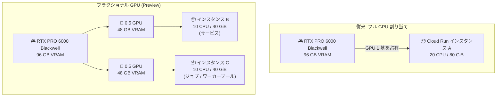

# Cloud Run: NVIDIA RTX PRO 6000 Blackwell のフラクショナル GPU (Preview)

**リリース日**: 2026-11-18

**サービス**: Cloud Run

**機能**: NVIDIA RTX PRO 6000 Blackwell のフラクショナル GPU (0.5 GPU) 構成

**ステータス**: Preview

📊 [このアップデートのインフォグラフィックを見る](https://takech9203.github.io/google-cloud-news-summary/20261118-cloud-run-fractional-gpu-rtx-pro-6000-blackwell.html)

## 概要

Cloud Run のサービス、ジョブ、ワーカープールで、NVIDIA RTX PRO 6000 Blackwell GPU のフラクショナル GPU (0.5 GPU) を構成できるようになりました (Preview)。従来はインスタンスごとに GPU 全体 (96 GB VRAM) を割り当てる必要がありましたが、今回のアップデートにより 0.5 GPU (48 GB VRAM) 単位での割り当てが可能になります。

フラクショナル GPU は、フルサイズの GPU 性能を必要としないモデルの推論ワークロードに対して、Blackwell アーキテクチャの高い性能を享受しながら GPU 割り当てを削減できる、よりコスト効率の高い選択肢です。中小規模の LLM や画像生成モデルなど、48 GB の VRAM で十分なワークロードを運用するユーザーが主な対象です。

あわせて必要となる CPU とメモリの最小構成もフル GPU の約半分 (10 CPU / 40 GiB 以上) に緩和されており、GPU・CPU・メモリの全リソースを小さく構成することでインスタンスあたりのコストを抑えられます。クォータも milliGPU 単位で管理され、初回デプロイ時に自動付与される 3,000 milliGPU で、フル GPU なら 3 基、フラクショナル GPU (0.5) なら 6 基分のインスタンスを稼働できます。

**アップデート前の課題**

- RTX PRO 6000 Blackwell を使う場合、VRAM を 48 GB しか使わないワークロードでも GPU 1 基全体 (96 GB VRAM) を割り当てる必要があった
- フル GPU 構成では最低 20 CPU / 80 GiB メモリが必須で、小規模な推論ワークロードにはリソースもコストも過剰だった
- 同一クォータ内で稼働できる GPU インスタンス数が GPU 基数に制限され、小さなモデルを多数のサービスに分散配置しにくかった

**アップデート後の改善**

- 0.5 GPU (48 GB VRAM) 単位で GPU を割り当てられるようになり、フル GPU を必要としないモデルの推論をコスト効率よく実行できるようになった
- フラクショナル GPU では 10/12/14/16 CPU と 40 GiB 以上のメモリ (CPU あたり最大 4 GiB) で構成でき、CPU・メモリの最小要件がフル GPU の約半分になった
- クォータが milliGPU 単位 (フル GPU = 1,000 milliGPU、0.5 GPU = 500 milliGPU) で管理され、同じクォータで最大 2 倍のインスタンスを稼働できるようになった
- サービス、ジョブ、ワーカープールのすべてのリソースタイプで利用できる

## アーキテクチャ図



1 基の物理 GPU を 0.5 GPU (48 GB VRAM) 単位に分割し、複数の Cloud Run インスタンスがそれぞれ独立したフラクションを利用できるようになります。これにより同じ GPU クォータでより多くのインスタンスを稼働できます。

## サービスアップデートの詳細

### 主要機能

1. **0.5 GPU 単位のフラクショナル割り当て**
   - `--gpu 0.5` を指定することで、RTX PRO 6000 Blackwell の半分 (48 GB VRAM) をインスタンスに割り当て可能
   - フラクショナル GPU のタイプは GRID、ドライバーバージョンはフル GPU と同じ 580.x.x (CUDA 13.0)
   - サービス、ジョブ、ワーカープールのすべてで利用可能

2. **CPU・メモリ最小要件の緩和**
   - フラクショナル GPU では 10、12、14、16 CPU のいずれかを選択 (フル GPU は最低 20 CPU)
   - メモリは最低 40 GiB、CPU あたり最大 4 GiB まで構成可能 (フル GPU は最低 80 GiB)

3. **milliGPU 単位のクォータ管理**
   - `nvidia-rtx-pro-6000` のクォータは milliGPU 単位で付与 (フル GPU = 1,000 milliGPU、0.5 GPU = 500 milliGPU)
   - リージョンで初めて利用する際、初回デプロイ時に 3,000 milliGPU (ゾーン冗長性オフ) が自動付与され、フル GPU 3 基またはフラクショナル GPU 6 基に相当

## 技術仕様

### GPU 構成の比較

| 項目 | フル GPU (1) | フラクショナル GPU (0.5) |
|------|-------------|--------------------------|
| GPU メモリ (VRAM) | 96 GB | 48 GB |
| 最小 CPU | 20 CPU | 10 CPU (10/12/14/16 から選択) |
| 最小メモリ | 80 GiB | 40 GiB (CPU あたり最大 4 GiB) |
| クォータ消費 | 1,000 milliGPU | 500 milliGPU |
| GPU タイプ指定 | `nvidia-rtx-pro-6000` | `nvidia-rtx-pro-6000` |
| ドライバー | 580.x.x (CUDA 13.0) | 580.x.x (CUDA 13.0)、タイプ: GRID |
| 対象ステータス | GA | Preview |

### 共通仕様

| 項目 | 詳細 |
|------|------|
| 対応リソース | Cloud Run サービス、ジョブ、ワーカープール |
| インスタンスあたり GPU 数 | 最大 1 (サイドカー利用時は 1 コンテナにのみアタッチ可能) |
| 起動時間 | ドライバープリインストール済みインスタンスが約 5 秒で起動 |
| ドライバーライブラリ | `/usr/local/nvidia/lib64` に自動マウント (`LD_LIBRARY_PATH` に自動追加) |
| L4 GPU | フラクショナル GPU は非対応 |
| ゾーン冗長性 | オン (デフォルト、高価格) / オフ (低価格、ベストエフォートのフェイルオーバー) |

## 設定方法

### 前提条件

1. Cloud Run API が有効化されていること
2. Cloud Run デベロッパー (`roles/run.developer`) とサービスアカウントユーザー (`roles/iam.serviceAccountUser`) のロールがあること
3. フラクショナル GPU 対応リージョン (us-central1 または europe-west4) にデプロイすること
4. 必要に応じて milliGPU クォータの引き上げをリクエストすること

### 手順

#### ステップ 1: フラクショナル GPU 付きサービスをデプロイ

```bash
gcloud run deploy SERVICE \
  --image IMAGE_URL \
  --gpu 0.5 \
  --gpu-type nvidia-rtx-pro-6000 \
  --cpu 10 \
  --memory 40Gi \
  --no-cpu-throttling \
  --region us-central1
```

`--gpu` に `0.5` を指定するとフラクショナル GPU、`1` を指定するとフル GPU が割り当てられます。CPU は 10/12/14/16 のいずれか、メモリは 40 GiB 以上 (CPU あたり最大 4 GiB) を指定します。

#### ステップ 2: 既存サービスの GPU 構成を更新

```bash
gcloud run services update SERVICE \
  --gpu 0.5 \
  --gpu-type nvidia-rtx-pro-6000 \
  --cpu 10 \
  --memory 40Gi \
  --no-gpu-zonal-redundancy
```

ゾーン冗長性をオフ (`--no-gpu-zonal-redundancy`) にすると GPU 秒あたりの単価が下がります。構成変更により新しいリビジョンが作成されます。

#### ステップ 3: GPU 設定の確認

```bash
gcloud run services describe SERVICE
```

返された構成の GPU 設定 (`nvidia.com/gpu` と `run.googleapis.com/accelerator`) を確認します。

## メリット

### ビジネス面

- **GPU コストの削減**: フル GPU を必要としない推論ワークロードで GPU 割り当てを半分にでき、CPU・メモリの最小構成も約半分になるため、インスタンスあたりの総コストを大幅に削減できる
- **スモールスタートの実現**: 同じ自動付与クォータ (3,000 milliGPU) で最大 6 インスタンスまで稼働でき、小規模から GPU 推論サービスを開始しやすい

### 技術面

- **Blackwell アーキテクチャの活用**: 割り当てを半分にしても最新 Blackwell 世代の性能・機能 (CUDA 13.0) をそのまま利用できる
- **フルマネージドな GPU 共有**: ドライバーや分割設定の管理は不要で、`--gpu 0.5` の指定だけで利用可能。スケールツーゼロやオンデマンド割り当てなど Cloud Run GPU の特性はそのまま
- **柔軟なリソース設計**: 10〜16 CPU、40 GiB〜のメモリを VRAM 48 GB と組み合わせ、ワークロードに最適なサイズを選択できる

## デメリット・制約事項

### 制限事項

- Preview 段階の機能であり、Pre-GA Offerings Terms が適用される (SLA やサポートが限定される可能性)
- フラクショナル GPU は NVIDIA RTX PRO 6000 Blackwell のみ対応で、L4 GPU では利用できない
- 分割単位は 0.5 GPU (48 GB VRAM) のみ
- フラクショナル GPU の対応リージョンは us-central1 (アイオワ) と europe-west4 (オランダ) の 2 リージョンのみ (フル GPU は asia-southeast1、asia-south2 でも利用可能)
- CPU は 10/12/14/16 のいずれかに限定され、メモリは CPU あたり最大 4 GiB までという上限がある

### 考慮すべき点

- VRAM が 48 GB に制限されるため、ロードするモデルサイズと KV キャッシュの合計が収まるか事前に検証が必要
- フラクショナル GPU の既知の問題 (Known issues) がドキュメントに記載されているため、本番利用前に確認が必要
- ゾーン冗長性オフは低価格だがフェイルオーバーはベストエフォートとなるため、可用性要件とのバランスを検討する
- ワーカープールは GPU の自動スケーリングに対応しておらず、プロセスが動いていなくてもインスタンス稼働中は GPU が課金される

## ユースケース

### ユースケース 1: 中規模 LLM のオンライン推論 API

**シナリオ**: 48 GB VRAM に収まる中規模のオープンモデル (量子化済みモデルなど) を Cloud Run サービスとして公開し、リクエスト量に応じてスケールさせたい。フル GPU ではコストが見合わない。

**実装例**:
```bash
gcloud run deploy llm-inference \
  --image us-docker.pkg.dev/PROJECT/repo/vllm-server:latest \
  --gpu 0.5 \
  --gpu-type nvidia-rtx-pro-6000 \
  --cpu 10 \
  --memory 40Gi \
  --no-cpu-throttling \
  --no-gpu-zonal-redundancy \
  --region us-central1
```

**効果**: GPU・CPU・メモリの割り当てをフル GPU 構成の約半分に抑えながら、Blackwell 世代の推論性能とスケールツーゼロによるコスト最適化を両立できる。

### ユースケース 2: バッチ推論ジョブの並列実行

**シナリオ**: 画像のバッチ処理や埋め込み生成など、1 タスクあたり 48 GB VRAM で十分なバッチ推論を Cloud Run ジョブで並列実行したい。

**効果**: 自動付与される 3,000 milliGPU クォータ内でフラクショナル GPU インスタンスを最大 6 並列まで稼働でき、同じクォータのままスループットを従来の 2 倍に高められる。

## 料金

Cloud Run の GPU は、インスタンスのライフサイクル全体にわたり秒単位で課金されます。ゾーン冗長性のオン/オフで GPU 秒あたりの単価が異なり、オフの方が低価格です。フラクショナル GPU では CPU・メモリの最小構成がフル GPU の約半分となるため、インスタンスあたりの総コストを削減できます。フラクショナル GPU 自体の SKU 単価は [Cloud Run 料金ページ](https://cloud.google.com/run/pricing) を参照してください。

### 料金例 (us-central1、インスタンスベース課金、USD)

| リソース | 単価 |
|--------|-----------------|
| NVIDIA RTX PRO 6000 (ゾーン冗長性なし) | $0.00036522 / GPU 秒 |
| NVIDIA RTX PRO 6000 (ゾーン冗長性あり) | $0.00056913 / GPU 秒 |
| CPU | $0.000018 / vCPU 秒 |
| メモリ | $0.000002 / GiB 秒 |

参考として、フル GPU 構成 (1 GPU + 20 CPU + 80 GiB、ゾーン冗長性なし) を 1 時間稼働すると GPU 約 $1.31 + CPU 約 $1.30 + メモリ約 $0.58 = 約 $3.19 ですが、フラクショナル GPU の最小構成 (10 CPU + 40 GiB) では CPU・メモリ部分が約半分の約 $0.94 になります。

## 利用可能リージョン

**フラクショナル NVIDIA RTX PRO 6000 Blackwell GPU (Preview)**:

- us-central1 (アイオワ、低 CO2)
- europe-west4 (オランダ、低 CO2)

**(参考) フル NVIDIA RTX PRO 6000 Blackwell GPU**: 上記に加え asia-southeast1 (シンガポール)、asia-south2 (デリー)

## 関連サービス・機能

- **Cloud Run ワーカープール CPU 自動スケーリング (Preview)**: 同日に発表されたアップデート。ワーカープールを CPU 使用率でスケールできるが、GPU ワーカープールは自動スケーリング非対応な点に注意
- **GKE (GPU タイムシェアリング / MIG)**: Kubernetes レベルで GPU 共有を細かく制御したい場合の選択肢。Cloud Run のフラクショナル GPU はよりシンプルなフルマネージドな代替手段
- **Vertex AI Prediction**: マネージドなモデルサービングの選択肢。コンテナベースで柔軟に構成したい場合は Cloud Run GPU が適する
- **Cloud Monitoring / Cloud Logging**: GPU インスタンスの稼働状況・ログの監視に利用

## 参考リンク

- 📊 [インフォグラフィック](https://takech9203.github.io/google-cloud-news-summary/20261118-cloud-run-fractional-gpu-rtx-pro-6000-blackwell.html)
- [公式リリースノート](https://docs.cloud.google.com/release-notes#November_18_2026)
- [ドキュメント: サービスの GPU 構成](https://docs.cloud.google.com/run/docs/configuring/services/gpu)
- [ドキュメント: ジョブの GPU 構成](https://docs.cloud.google.com/run/docs/configuring/jobs/gpu)
- [ドキュメント: ワーカープールの GPU 構成](https://docs.cloud.google.com/run/docs/configuring/workerpools/gpu)
- [料金ページ](https://cloud.google.com/run/pricing)

## まとめ

Cloud Run の RTX PRO 6000 Blackwell で 0.5 GPU 単位のフラクショナル割り当てが可能になり、フル GPU を必要としない推論ワークロードのコスト効率が大きく向上しました。48 GB VRAM で足りるモデルを運用しているなら、us-central1 または europe-west4 で `--gpu 0.5` を指定した構成を検証し、CPU・メモリとあわせたコスト削減効果を確認することをおすすめします。

---

**タグ**: Cloud Run, GPU, NVIDIA RTX PRO 6000, Blackwell, フラクショナル GPU, AI 推論, サーバーレス, Preview
