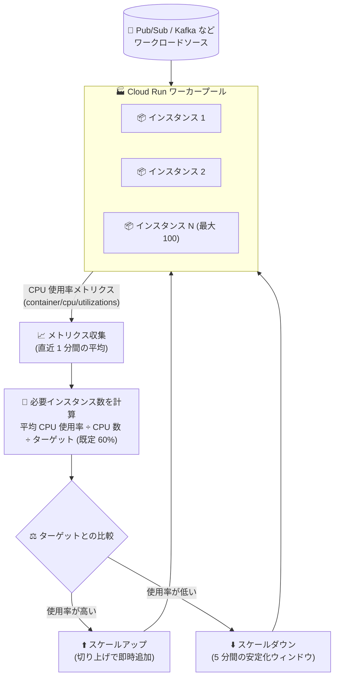

# Cloud Run: ワーカープールの CPU オートスケーリング (Preview)

**リリース日**: 2026-11-18

**サービス**: Cloud Run

**機能**: ワーカープールの CPU 使用率ベースのオートスケーリング

**ステータス**: Preview

📊 [このアップデートのインフォグラフィックを見る](https://takech9203.github.io/google-cloud-news-summary/20261118-cloud-run-worker-pools-cpu-autoscaling.html)

## 概要

Cloud Run ワーカープールで、平均 CPU 使用率に基づいてインスタンス数を自動調整する CPU オートスケーリングが Preview として利用可能になりました。デフォルトの CPU ターゲット (60%) をそのまま使うことも、カスタムの CPU ターゲット (10%〜90%) や最小・最大インスタンス数を指定することもできます。

ワーカープールは HTTP リクエストを受け付けないバックグラウンド処理 (Pub/Sub の Pull 型コンシューマや Kafka コンシューマなど) 向けの Cloud Run リソースです。リクエスト駆動の Cloud Run サービスと異なり、リクエスト数や同時実行数によるスケーリングが使えないため、これまでスケーリングの自動化には追加の仕組みが必要でした。今回のアップデートにより、`--scaling=auto` フラグを指定するだけで、Cloud Run 本体のマネージドな仕組みとして CPU 使用率ベースの自動スケーリングが有効化できます。

バックグラウンドワーカーやバッチ的なデータ処理を Cloud Run 上で運用しているチームにとって、負荷に応じた容量調整を大幅に簡素化できるアップデートです。

**アップデート前の課題**

- ワーカープールは手動スケーリング (固定インスタンス数) がデフォルトであり、負荷変動に合わせて `--instances` の値を人手またはスクリプトで変更する必要があった
- 自動スケーリングを実現するには、CREMA (Cloud Run External Metrics Autoscaling) などのカスタムオートスケーラーサービスを別途デプロイ・運用する必要があった
- カスタムオートスケーラーは Prometheus クエリや KEDA ベースの YAML 設定、専用サービスアカウントなどのセットアップが必要で、運用負荷が高かった

**アップデート後の改善**

- `--scaling=auto` を指定するだけで、Cloud Run のマネージド機能として CPU 使用率ベースのオートスケーリングが有効になった
- デフォルトで CPU 使用率 60% をターゲットに 1〜100 インスタンスの範囲で自動スケールし、`--scaling-cpu-target`、`--min`、`--max` でカスタマイズも可能になった
- 追加のオートスケーラーサービスのデプロイ・運用が不要になり、スケーリングモードや上限値の変更では新リビジョンも作成されないため、運用がシンプルになった

## アーキテクチャ図



ワーカープールの全インスタンスの平均 CPU 使用率を 1 分間隔で評価し、ターゲット使用率との比から必要なインスタンス数を再計算するオートスケーリングループです。スケールダウン時は 5 分間の安定化ウィンドウにより、インスタンス数の頻繁な増減を防ぎます。

## サービスアップデートの詳細

### 主要機能

1. **デフォルト CPU ターゲットによるオートスケーリング**
   - `--scaling=auto` を指定すると、CPU 使用率 60% をターゲットに 1〜100 インスタンスの範囲で自動スケール
   - デフォルトターゲットのまま、最小・最大インスタンス数 (`--min` / `--max`) のみのカスタマイズも可能
   - スケーリングモードやインスタンス上限の変更では新しいリビジョンは作成されない

2. **カスタム CPU ターゲットの設定**
   - `--scaling-cpu-target` で 0.1〜0.90 (10%〜90%) の範囲でターゲットを指定可能
   - 高めのターゲット (80〜90%): 安定したバックグラウンド処理やバッチ処理向け。リソース効率とコストを最適化
   - 低めのターゲット (20〜40%): スパイクの多いワークロードや処理レイテンシ要件が厳しいワークロード向け。余裕を持った先行プロビジョニング

3. **スケーリング動作の制御**
   - 必要インスタンス数は「直近 1 分間の平均 CPU 使用量 ÷ インスタンスあたりの CPU 数 ÷ CPU ターゲット」を切り上げて算出
   - プールレベルでインスタンス数を計算し、インスタンススプリットの設定に応じてアクティブなリビジョンへ配分
   - スケールダウンには 5 分間 (300 秒) の安定化ウィンドウを使用し、直近 5 分間の最大推奨値を維持

4. **デフォルト設定への復元**
   - `--scaling-cpu-target=default` や `--min=default` / `--max=default` で、オートスケーリングを有効にしたままデフォルト値 (60%、1〜100 インスタンス) に戻せる

## 技術仕様

### スケーリングパラメータ

| 項目 | 詳細 |
|------|------|
| スケーリング指標 | 平均 CPU 使用率 (`run.googleapis.com/container/cpu/utilizations`) |
| デフォルト CPU ターゲット | 60% |
| カスタム CPU ターゲット範囲 | 10%〜90% (`0.1`〜`0.90`) |
| デフォルト最小インスタンス数 | 1 (1 以上を指定、0 にはできない) |
| デフォルト最大インスタンス数 | 100 |
| 計算式 | Instances = ⌈(直近 1 分間の平均 CPU 使用量/秒 ÷ インスタンスあたり CPU 数) ÷ CPU ターゲット⌉ |
| スケールダウン安定化 | 5 分間 (300 秒) のウィンドウで最大推奨値を維持 |
| リビジョン作成 | スケーリングモード・ターゲット・インスタンス上限の変更ではリビジョンを作成しない |
| ステータス | Preview (Pre-GA Offerings Terms が適用) |

### YAML 設定例

```yaml
apiVersion: run.googleapis.com/v1
kind: WorkerPool
metadata:
  name: WORKER_POOL
  annotations:
    run.googleapis.com/launch-stage: BETA
    run.googleapis.com/scalingMode: automatic
    run.googleapis.com/scaling-cpu-target: 'CPU_TARGET'
    run.googleapis.com/minScale: 'MIN_INSTANCES'
    run.googleapis.com/maxScale: 'MAX_INSTANCES'
```

カスタムアノテーション (`scaling-cpu-target`、`minScale`、`maxScale`) は省略するとデフォルト値が使われます。手動スケーリングから切り替える場合は `run.googleapis.com/manualInstanceCount` アノテーションを削除します。

### 必要な IAM ロール

| ロール | 対象 |
|--------|------|
| Cloud Run デベロッパー (`roles/run.developer`) | Cloud Run ワーカープール |
| サービス アカウント ユーザー (`roles/iam.serviceAccountUser`) | サービス ID |

## 設定方法

### 前提条件

1. Cloud Run ワーカープールをデプロイできる環境 (Cloud Run Admin API が有効)
2. gcloud CLI の beta コンポーネント (`gcloud beta run worker-pools` コマンドを使用)
3. CREMA (Cloud Run External Metrics Autoscaling) を利用中の場合は、CPU オートスケーリングへ切り替える前に手動スケーリングへ戻すこと

### 手順

#### ステップ 1: デフォルト CPU ターゲットでオートスケーリングを有効化

```bash
# 新規デプロイ時
gcloud beta run worker-pools deploy WORKER_POOL \
  --image=IMAGE_URL \
  --scaling=auto

# 既存ワーカープールの更新
gcloud beta run worker-pools update WORKER_POOL \
  --scaling=auto
```

CPU 使用率 60% をターゲットに、1〜100 インスタンスの範囲で自動スケールします。

#### ステップ 2: カスタム CPU ターゲットとインスタンス上限を設定

```bash
gcloud beta run worker-pools update WORKER_POOL \
  --scaling-cpu-target=0.75 \
  --min=2 \
  --max=50
```

CPU ターゲットは `0.1`〜`0.90` の範囲で指定します。省略した設定にはデフォルト値 (60%、最小 1、最大 100) が適用されます。

#### ステップ 3: (必要に応じて) デフォルト設定に戻す

```bash
gcloud beta run worker-pools update WORKER_POOL \
  --scaling-cpu-target=default \
  --min=default \
  --max=default
```

オートスケーリングを有効にしたまま、ターゲットとインスタンス上限をデフォルト値に戻します。

#### ステップ 4: スケーリング動作をモニタリング

Cloud Monitoring で `run.googleapis.com/container/instance_count` メトリクスを確認し、負荷テストの結果に基づいてターゲットを調整します。まずはデフォルトターゲットから始めることが推奨されています。

## メリット

### ビジネス面

- **運用コストの削減**: カスタムオートスケーラー (CREMA など) の構築・運用が不要になり、スケーリングの仕組みを Google のマネージド機能に任せられる
- **インフラコストの最適化**: 負荷の低い時間帯はインスタンスを自動縮小し、ピーク時のみ拡張することで、固定インスタンス数運用に比べて無駄な稼働を削減できる

### 技術面

- **設定の簡素化**: フラグ 1 つ (`--scaling=auto`) でオートスケーリングを有効化でき、gcloud / YAML / REST API のいずれからも設定可能
- **安定したスケーリング動作**: 5 分間のスケールダウン安定化ウィンドウと切り上げ計算により、インスタンス数の振動 (フラッピング) を抑制
- **リビジョンを増やさない設定変更**: スケーリングモードやターゲット、上限値の変更では新リビジョンが作成されず、設定変更の影響範囲が小さい
- **ワークロード特性に合わせた調整**: CPU ターゲットを 10〜90% の範囲で調整でき、レイテンシ重視・コスト重視のどちらにも最適化できる

## デメリット・制約事項

### 制限事項

- Preview (Pre-GA) 機能であり、Pre-GA Offerings Terms が適用される。サポートが限定される可能性がある
- 最小インスタンス数は 1 以上が必須で、ゼロへのスケールインはできない (ワーカープールを停止するには手動スケーリングで 0 を指定)
- スケーリング指標は CPU 使用率のみで、メモリ使用率やキューの深さ (未処理メッセージ数) ベースのスケーリングには対応しない
- CREMA によるスケーリングと併用できない (CREMA 利用中は手動スケーリングへの切り替えが必要)

### 考慮すべき点

- CPU 使用率はキューのバックログを直接反映しないため、Pub/Sub や Kafka の未処理メッセージ数に厳密に追従させたい場合は、引き続き CREMA (KEDA ベース) などの外部メトリクスオートスケーリングが適する場合がある
- 単一スレッドのアプリケーションをマルチ CPU インスタンスで動かすと平均 CPU 使用率が低く観測され、スケーリング判断に影響する可能性がある
- スケールアップによりバックエンドサービス (Cloud SQL など) への接続数が増えるため、`--max` で上限を適切に設定することが推奨される
- スケールダウンは 5 分間の安定化ウィンドウの影響で緩やかに進むため、急激なコスト削減は期待しない

## ユースケース

### ユースケース 1: Pub/Sub Pull 型コンシューマの自動スケーリング

**シナリオ**: Pub/Sub サブスクリプションからメッセージを Pull して処理するワーカープールを運用している。日中はメッセージ流量が多く、夜間はほぼゼロになるため、固定インスタンス数ではピーク時に処理遅延が発生し、閑散時にはリソースが無駄になっていた。

**実装例**:
```bash
gcloud beta run worker-pools deploy pubsub-consumer \
  --image=us-docker.pkg.dev/PROJECT_ID/repo/consumer:latest \
  --scaling=auto \
  --min=1 \
  --max=30
```

**効果**: メッセージ処理による CPU 負荷の増減に応じてインスタンス数が 1〜30 の範囲で自動調整され、ピーク時の処理遅延と閑散時の無駄な稼働コストの両方を削減できる。

### ユースケース 2: バッチ的なデータ変換ワーカーのコスト最適化

**シナリオ**: レイテンシ要件が緩いデータ変換処理をワーカープールで実行している。リソース効率を最大化してコストを抑えたい。

**実装例**:
```bash
gcloud beta run worker-pools update batch-transformer \
  --scaling-cpu-target=0.85 \
  --max=20
```

**効果**: CPU ターゲットを 85% に引き上げることで各インスタンスを高い使用率で稼働させ、必要なインスタンス数を最小化してインフラコストを削減できる。

## 料金

CPU オートスケーリング自体に追加料金はなく、ワーカープールのインスタンスが稼働した分の vCPU・メモリに対して、Cloud Run のインスタンスベース課金が適用されます。オートスケーリングにより稼働インスタンス数が負荷に追従するため、固定インスタンス数での運用に比べて低負荷時のコストを抑えられます。

詳細は [Cloud Run の料金ページ](https://cloud.google.com/run/pricing) を参照してください。

## 利用可能リージョン

リリースノートおよびドキュメントにリージョン制限の記載はありません。最新情報は [Cloud Run のドキュメント](https://docs.cloud.google.com/run/docs/configuring/workerpools/cpu-autoscaling) を参照してください。

## 関連サービス・機能

- **Cloud Run サービス (metrics-based scaling)**: リクエスト駆動のサービスでは従来から CPU 使用率とリクエスト同時実行数によるオートスケーリングが提供されており、今回ワーカープールにも CPU ベースの仕組みが拡張された
- **Cloud Run External Metrics Autoscaling (CREMA)**: KEDA ベースで Kafka や Prometheus などの外部メトリクスによりワーカープールをスケールする仕組み。キュー長ベースのスケーリングが必要な場合の選択肢だが、CPU オートスケーリングとは併用不可
- **Cloud Monitoring**: `run.googleapis.com/container/cpu/utilizations` (スケーリング指標) や `run.googleapis.com/container/instance_count` (インスタンス数) のメトリクスでスケーリング動作を監視し、ターゲット調整に活用
- **Pub/Sub / Managed Service for Apache Kafka**: ワーカープールの代表的なワークロードソース。メッセージ処理負荷が CPU 使用率としてスケーリングに反映される

## 参考リンク

- 📊 [インフォグラフィック](https://takech9203.github.io/google-cloud-news-summary/20261118-cloud-run-worker-pools-cpu-autoscaling.html)
- [公式リリースノート](https://docs.cloud.google.com/release-notes#November_18_2026)
- [ドキュメント: Configure CPU autoscaling for worker pools](https://docs.cloud.google.com/run/docs/configuring/workerpools/cpu-autoscaling)
- [ドキュメント: ワーカープールの手動スケーリング](https://docs.cloud.google.com/run/docs/configuring/workerpools/manual-scaling)
- [ドキュメント: CREMA によるワーカープールのオートスケーリング](https://docs.cloud.google.com/run/docs/configuring/workerpools/crema-autoscaling)
- [料金ページ](https://cloud.google.com/run/pricing)

## まとめ

Cloud Run ワーカープールにマネージドな CPU オートスケーリングが追加され、これまでカスタムオートスケーラーの構築・運用が必要だった負荷追従型のスケーリングが `--scaling=auto` フラグ 1 つで実現できるようになりました。Pub/Sub コンシューマやバックグラウンド処理をワーカープールで運用しているチームは、まずデフォルトターゲット (60%) で有効化し、Cloud Monitoring のインスタンス数メトリクスを観察しながらワークロード特性に合わせて CPU ターゲットと最小・最大インスタンス数を調整することを推奨します。

---

**タグ**: #CloudRun #WorkerPools #Autoscaling #CPUAutoscaling #Serverless #Preview
