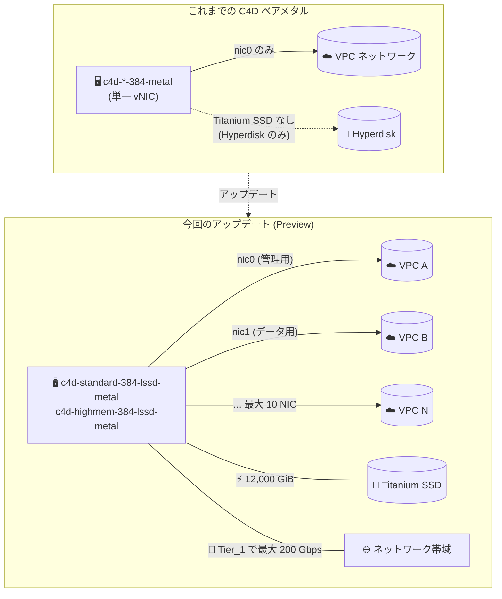

# Compute Engine: C4D ベアメタルインスタンスのマルチ NIC 対応と Titanium SSD 搭載マシンタイプ (Preview)

**リリース日**: 2026-11-18

**サービス**: Compute Engine

**機能**: C4D ベアメタルインスタンスのマルチ NIC 対応 (最大 10 個) と Titanium SSD 搭載の新マシンタイプ 2 種

**ステータス**: Preview

📊 [このアップデートのインフォグラフィックを見る](https://takech9203.github.io/google-cloud-news-summary/20261118-compute-engine-c4d-bare-metal-multi-nic.html)

## 概要

Compute Engine の C4D ベアメタルインスタンスに関する 2 つの機能が Preview として発表されました。1 つ目は、C4D ベアメタルインスタンスで 1 インスタンスあたり最大 10 個のネットワークインターフェースを作成できるようになったことです。2 つ目は、Titanium SSD を搭載した 2 つの新しいベアメタルマシンタイプ `c4d-standard-384-lssd-metal` と `c4d-highmem-384-lssd-metal` の追加です。これらのマシンタイプは 12,000 GiB の Titanium SSD を備え、per VM Tier_1 ネットワーキングにより最大 200 Gbps のネットワーク帯域幅を提供します。

C4D は第 5 世代 AMD EPYC Turin プロセッサと Titanium (ネットワーク処理などをホスト CPU からオフロードする Google 独自のインフラ) を基盤とする汎用マシンシリーズです。ベアメタルインスタンスは専用のホストサーバーを必要とし、ハイパーバイザーを介さずに物理サーバーへ直接アクセスできるため、ライセンス要件や低レイテンシ要件の厳しいワークロード (商用データベース、SAP、仮想化ソフトウェアなど) に適しています。

今回のアップデートは、ネットワークの分離・多重接続が必要なエンタープライズワークロードや、高速なローカルストレージを必要とするデータ集約型ワークロードをベアメタル環境で実行したいユーザーが対象です。

**アップデート前の課題**

- Compute Engine のベアメタルインスタンスの多くは単一の vNIC のみをサポートしており、公式ドキュメントでも「マルチ NIC のベアメタルインスタンスを構成するには Dynamic NIC (VLAN サブインターフェース) を使う」とされていた (複数 vNIC をサポートするのは Z4M、A4X Max、A5X など一部のマシンタイプに限られていた)
- C4D ベアメタルインスタンスでは Local SSD (Titanium SSD) が利用できず、Titanium SSD を使うには `-lssd` バリアントの C4D VM を使用する必要があった
- 複数の VPC ネットワークへの直接接続 (管理プレーンとデータプレーンの分離など) をベアメタル上で行う構成に制約があった

**アップデート後の改善**

- C4D ベアメタルインスタンスで 1 インスタンスあたり最大 10 個のネットワークインターフェースを作成できるようになった (Preview)
- 新マシンタイプ `c4d-standard-384-lssd-metal` と `c4d-highmem-384-lssd-metal` により、ベアメタルでも 12,000 GiB の Titanium SSD を利用できるようになった (Preview)
- 新マシンタイプは per VM Tier_1 ネットワーキングで最大 200 Gbps のネットワーク帯域幅を提供し、高帯域なネットワーク処理とローカルストレージ I/O を両立できるようになった

## アーキテクチャ図



従来の C4D ベアメタルは単一 vNIC かつ Titanium SSD 非対応でしたが、今回の Preview により最大 10 個のネットワークインターフェースで複数の VPC に直接接続でき、12,000 GiB の Titanium SSD と最大 200 Gbps の帯域幅を備えた構成が可能になります。

## サービスアップデートの詳細

### 主要機能

1. **マルチネットワークインターフェース対応 (最大 10 個)**
   - C4D ベアメタルインスタンスで 1 インスタンスあたり最大 10 個のネットワークインターフェースを作成可能 (Preview)
   - 複数の VPC ネットワークへの直接接続により、トラフィック分離 (データプレーンと管理プレーンの分離など) や VPC 間のパケットルーティングといったマルチ NIC のユースケースをベアメタルで実現できる

2. **Titanium SSD 搭載の新ベアメタルマシンタイプ (Preview)**
   - `c4d-standard-384-lssd-metal` と `c4d-highmem-384-lssd-metal` の 2 種類を追加
   - どちらも 12,000 GiB の Titanium SSD を搭載 (C4D VM の `c4d-standard-384-lssd` / `c4d-highmem-384-lssd` と同じく 12,000 GiB クラスのローカルストレージ容量)
   - Titanium SSD はホスト CPU からディスク I/O 処理をオフロードする Titanium を基盤とした高性能ローカルストレージ

3. **per VM Tier_1 ネットワーキングで最大 200 Gbps**
   - 新マシンタイプは per VM Tier_1 ネットワーキングパフォーマンスにより最大 200 Gbps のネットワーク帯域幅を提供
   - C4D ベアメタルの標準ネットワーキングは最大 100 Gbps で、Tier_1 により上限が引き上げられる

## 技術仕様

### C4D ベアメタルマシンタイプの比較

| マシンタイプ | vCPU | メモリ | Titanium SSD | ネットワーク帯域幅 |
|------|------|------|------|------|
| c4d-highcpu-384-metal (既存) | 384 | 768 GB | なし | 標準 最大 100 Gbps / Tier_1 最大 200 Gbps |
| c4d-standard-384-metal (既存) | 384 | 1,488 GB | なし | 標準 最大 100 Gbps / Tier_1 最大 200 Gbps |
| c4d-highmem-384-metal (既存) | 384 | 3,072 GB | なし | 標準 最大 100 Gbps / Tier_1 最大 200 Gbps |
| c4d-standard-384-lssd-metal (新規・Preview) | 384 | 公式ドキュメント参照 | 12,000 GiB | Tier_1 で最大 200 Gbps |
| c4d-highmem-384-lssd-metal (新規・Preview) | 384 | 公式ドキュメント参照 | 12,000 GiB | Tier_1 で最大 200 Gbps |

### C4D ベアメタルインスタンスの特徴

| 項目 | 詳細 |
|------|------|
| プロセッサ | 第 5 世代 AMD EPYC Turin |
| 基盤 | Titanium (ネットワーク処理・Titanium SSD I/O のオフロード) |
| ホスト | 専用ホストサーバー (ベアメタルインスタンスはホスト上で唯一のインスタンス) |
| アタッチ可能なディスク | Hyperdisk Balanced、Hyperdisk Extreme |
| ネットワークドライバ | IDPF (ベアメタルインスタンスは IDPF をサポートする OS イメージが必要) |
| ネットワークインターフェース数 | 最大 10 個 (今回の Preview) |
| OS 制限 | C4D ベアメタルは SUSE Linux Enterprise Server (SLES) 15 SP6 をサポートしない |

## 設定方法

### 前提条件

1. マルチ NIC 構成では、各ネットワークインターフェースは一意のサブネットを使用する必要がある
2. vNIC はインスタンス作成時にのみ構成できる (作成後の追加は Dynamic NIC を使用)
3. ベアメタルインスタンスには IDPF ネットワークドライバをサポートする OS イメージが必要

### 手順

#### ステップ 1: 複数のネットワークインターフェースを指定してインスタンスを作成

```bash
gcloud compute instances create my-c4d-metal-instance \
    --zone=ZONE \
    --machine-type=c4d-standard-384-lssd-metal \
    --network-interface=network=vpc-prod,subnet=subnet-prod \
    --network-interface=network=vpc-mgmt,subnet=subnet-mgmt
```

`--network-interface` フラグを繰り返し指定することで、複数の VPC ネットワーク/サブネットに接続するインターフェースを構成します (各インターフェースは一意のサブネットを使用)。

#### ステップ 2: ゲスト OS 内のルーティング設定

マルチ NIC インスタンスでは、ゲスト OS 内でルートポリシーとローカルルートテーブルの構成が必要です。詳細は [複数のネットワークインターフェースの概要](https://docs.cloud.google.com/vpc/docs/multiple-interfaces-concepts) を参照してください。

## メリット

### ビジネス面

- **ベアメタル移行の選択肢拡大**: ライセンスやコンプライアンス上ベアメタルが必要なワークロードでも、ネットワーク分離要件や高速ローカルストレージ要件を満たせるようになり、オンプレミスからの移行対象が広がる
- **性能とコストの最適化**: Titanium SSD によるローカル I/O と最大 200 Gbps の帯域幅により、大規模データ処理をベアメタル 1 台に集約しやすくなる

### 技術面

- **トラフィック分離**: データプレーン、管理プレーン、バックアップ用など、用途ごとに NIC と VPC を分離した設計がベアメタルで可能になる
- **高速ローカルストレージ**: 12,000 GiB の Titanium SSD により、低レイテンシなスクラッチ領域・キャッシュ・一時データ処理が可能
- **Titanium オフロード**: ネットワーク処理とディスク I/O がホスト CPU からオフロードされるため、アプリケーションに CPU リソースを集中できる

## デメリット・制約事項

### 制限事項

- どちらの機能も Preview であり、GA 前の機能には SLA が適用されない
- ベアメタルインスタンスは専用ホストサーバーを必要とし、ホスト上で唯一のインスタンスとなる
- vNIC はインスタンス作成時にのみ構成可能 (作成後に追加する場合は Dynamic NIC を使用)
- C4D ベアメタルは Confidential VM (AMD SEV) の対象外
- C4D ベアメタルは SLES 15 SP6 をサポートしない

### 考慮すべき点

- Titanium SSD はローカルストレージであり、永続性が必要なデータには Hyperdisk などの永続ストレージとの併用が必要
- マルチ NIC 構成では各インターフェースに一意のサブネットが必要で、ゲスト OS 内のルーティング設定も必要になる
- 最大 200 Gbps の帯域幅を得るには per VM Tier_1 ネットワーキングの構成が必要

## ユースケース

### ユースケース 1: ネットワーク仮想アプライアンス (NVA) のベアメタル実行

**シナリオ**: パケット検査、NAT、ファイアウォールなどのネットワークセキュリティ機能を提供するソフトウェアを、複数の VPC ネットワーク間のルーティングポイントとして高性能なベアメタル上で実行したい。

**効果**: 最大 10 個のネットワークインターフェースで複数の VPC に直接接続し、ハイパーバイザーオーバーヘッドのないベアメタル上で高スループットなパケット処理を実現できる。

### ユースケース 2: 高速ローカルストレージを必要とするデータベース・分析ワークロード

**シナリオ**: 商用データベースやインメモリ分析など、ライセンス要件でベアメタルが必要かつ低レイテンシのローカルストレージ I/O が性能を左右するワークロードを実行したい。

**効果**: `c4d-highmem-384-lssd-metal` (384 vCPU・highmem 構成) と 12,000 GiB の Titanium SSD により、ストレージ I/O ボトルネックを抑えつつベアメタル要件を満たせる。管理用とデータ用の NIC を分離した構成も可能。

## 料金

ベアメタルインスタンスおよび Titanium SSD の料金は、マシンタイプとリージョンによって異なります。新マシンタイプの個別料金は以下の公式料金ページで確認してください。

- [Compute Engine の料金](https://cloud.google.com/compute/all-pricing)
- [VM インスタンスの料金](https://cloud.google.com/compute/vm-instance-pricing)

なお、C4D シリーズはオンデマンド、Spot VM、将来予約などの消費オプションと、リソースベース/フレキシブル確約利用割引 (CUD) をサポートします。

## 利用可能リージョン

C4D ベアメタルインスタンスのリージョン別提供状況は、公式ドキュメントの [Bare metal instances on Compute Engine](https://docs.cloud.google.com/compute/docs/instances/bare-metal-instances) を参照してください。

## 関連サービス・機能

- **VPC (マルチ NIC / Dynamic NIC)**: 複数 VPC への直接接続やトラフィック分離を実現する基盤。vNIC の上限を超える場合は Dynamic NIC で最大 16 インターフェースまで拡張可能
- **Titanium**: ネットワーク処理と Titanium SSD のディスク I/O をホスト CPU からオフロードする Google のインフラ基盤
- **Hyperdisk (Balanced / Extreme)**: C4D ベアメタルにアタッチ可能な永続ブロックストレージ。Titanium SSD と組み合わせて使用
- **per VM Tier_1 ネットワーキング**: インバウンド/アウトバウンドのネットワークスループット上限を引き上げるオプション。新マシンタイプで最大 200 Gbps を実現
- **内部パススルーネットワークロードバランサ**: マルチ NIC インスタンスを VPC 間ルーティングのネクストホップとして使う際のベストプラクティス構成

## 参考リンク

- 📊 [インフォグラフィック](https://takech9203.github.io/google-cloud-news-summary/20261118-compute-engine-c4d-bare-metal-multi-nic.html)
- [公式リリースノート](https://docs.cloud.google.com/release-notes#November_18_2026)
- [C4D マシンシリーズ (汎用マシンファミリー)](https://docs.cloud.google.com/compute/docs/general-purpose-machines#c4d_series)
- [Compute Engine のベアメタルインスタンス](https://docs.cloud.google.com/compute/docs/instances/bare-metal-instances)
- [複数のネットワークインターフェースの概要](https://docs.cloud.google.com/vpc/docs/multiple-interfaces-concepts)
- [複数のネットワークインターフェースを持つ VM の作成](https://docs.cloud.google.com/compute/docs/instances/create-instance-multiple-nics)
- [Local SSD / Titanium SSD について](https://docs.cloud.google.com/compute/docs/disks/local-ssd)
- [料金ページ](https://cloud.google.com/compute/all-pricing)

## まとめ

C4D ベアメタルインスタンスが最大 10 個のネットワークインターフェースと Titanium SSD 搭載の新マシンタイプ (Preview) に対応し、ネットワーク分離や高速ローカルストレージを必要とするエンタープライズワークロードのベアメタル移行の選択肢が大きく広がりました。NVA や商用データベースなどのベアメタル要件を持つワークロードを運用しているチームは、Preview 段階で `c4d-standard-384-lssd-metal` / `c4d-highmem-384-lssd-metal` とマルチ NIC 構成の検証を始めることを推奨します。

---

**タグ**: Compute Engine, C4D, ベアメタル, マルチ NIC, Titanium SSD, Tier_1 ネットワーキング, Preview
