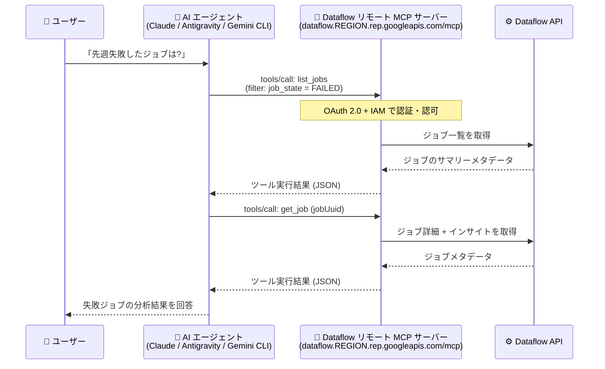

# Dataflow: リモート MCP サーバー (Preview)

**リリース日**: 2026-11-18

**サービス**: Dataflow

**機能**: Dataflow リモート MCP サーバー

**ステータス**: Preview

📊 [このアップデートのインフォグラフィックを見る](https://takech9203.github.io/google-cloud-news-summary/20261118-dataflow-remote-mcp-server.html)

## 概要

Dataflow にリモート Model Context Protocol (MCP) サーバーが Preview として提供開始されました。MCP は LLM や AI アプリケーション・エージェントが外部データソースに接続する方法を標準化するプロトコルで、Dataflow リモート MCP サーバーを使うと、Antigravity、ChatGPT、Claude、Gemini CLI などの AI アプリケーションや自作のエージェントから、Dataflow ジョブの情報を自然言語で取得できるようになります。本機能は Data Agent Kit にも統合されています。

リモート MCP サーバーは Google Cloud のインフラ上で動作し、HTTP エンドポイント (`https://dataflow.REGION.rep.googleapis.com/mcp`) を提供します。ローカル MCP サーバーのように自前でプロセスを起動・管理する必要はなく、Dataflow API を有効化するだけで利用可能になります。MCP バージョン 2026-07-28 のステートレスなプロトコルに準拠しており、各リクエストが自己記述的で、initialize ハンドシェイクやセッション ID を必要としません。

データパイプラインの運用担当者や SRE が、「先週失敗したジョブは何件か」「このジョブのグラフは何をしているのか」といった質問を AI エージェント経由で直接 Dataflow に問い合わせられるようになり、AI を活用したパイプライン運用・トラブルシューティングの基盤となるアップデートです。

**アップデート前の課題**

- AI エージェントから Dataflow ジョブの情報を取得するには、カスタムツールの実装や gcloud / REST API 呼び出しのラッパーを自作する必要があった
- ローカル MCP サーバーを使う場合、各開発者のマシンでプロセスの起動・認証設定・バージョン管理を個別に行う必要があった
- ジョブの状態確認やジョブグラフの把握には、Google Cloud コンソールや Dataflow API を人間が直接操作する必要があった

**アップデート後の改善**

- Google 管理のリージョナル HTTP エンドポイントに接続するだけで、AI アプリケーションから Dataflow ジョブのメタデータ・一覧・ジョブグラフを取得できるようになった
- OAuth 2.0 + IAM による認証・認可、集中監査ロギング、Model Armor によるプロンプト/レスポンス保護 (オプション) など、Google Cloud リモート MCP サーバー共通のガバナンス機能を利用できるようになった
- Data Agent Kit との統合により、エージェント開発で Dataflow の運用情報をすぐに利用できるようになった

## アーキテクチャ図



AI エージェントが MCP クライアントとして Dataflow リモート MCP サーバーのリージョナルエンドポイントにツール呼び出しを送信し、MCP サーバーが Dataflow API からジョブ情報を取得して返却するフローです。

## サービスアップデートの詳細

### 主要機能

1. **get_job**
   - 単一の Dataflow ジョブのメタデータを取得する
   - ジョブの UUID、名前、タイプ (バッチ/ストリーミング)、状態、SDK バージョン、ワーカープール、CMEK 設定、ラベルなどを返す
   - ジョブインサイト (推奨事項) の閲覧権限があれば、インサイトも含めて取得できる

2. **list_jobs**
   - リージョン内のすべての Dataflow ジョブのサマリーメタデータを一覧取得する
   - `job_name`、`job_type`、`job_state`、`create_time` による AIP-160 形式のフィルタリングに対応 (例: `job_state = "JOB_STATE_FAILED" AND create_time >= "2026-06-06T00:00:00Z"`)
   - ジョブ数が多い場合のページネーション、作成日時による昇順/降順の並べ替え (`NEWER_JOBS_FIRST` / `OLDER_JOBS_FIRST`) をサポート

3. **list_job_steps**
   - ジョブを構成するすべてのステップを一覧取得する
   - ステップを組み合わせることでジョブグラフ全体を再構成でき、「このジョブは何をしているのか」の分析に利用できる
   - 大規模なグラフに対するページネーションをサポート

4. **Data Agent Kit への統合**
   - Dataflow リモート MCP サーバーは Data Agent Kit にも統合されており、データエージェント開発で利用できる

## 技術仕様

### MCP サーバーの仕様

| 項目 | 詳細 |
|------|------|
| エンドポイント | `https://dataflow.REGION.rep.googleapis.com/mcp` (リージョナル) |
| トランスポート | Streamable HTTP |
| プロトコル | MCP バージョン 2026-07-28 (ステートレス) |
| 認証 | OAuth 2.0 + IAM (すべての Google Cloud ID をサポート、API キーにも対応) |
| OAuth スコープ | `https://www.googleapis.com/auth/cloud-platform` |
| 有効化 | Dataflow API の有効化で自動的に利用可能 |
| `tools/list` | 認証不要で呼び出し可能 |

### 必要な IAM ロールと権限

| ロール | 用途 |
|------|------|
| MCP Tool User (`roles/mcp.toolUser`) | MCP ツール呼び出し (`mcp.tools.call`) |
| Dataflow Viewer (`roles/dataflow.viewer`) | ジョブの取得・一覧 (`dataflow.jobs.list`, `dataflow.jobs.get`) |

ジョブインサイトの取得には `recommender.dataflowDiagnosticsInsights.list` 権限が追加で必要です。

### ツール一覧の取得例

```bash
curl -X POST https://dataflow.us-central1.rep.googleapis.com/mcp \
  -H 'Content-Type: application/json' \
  -H 'Accept: application/json' \
  -H 'MCP-Protocol-Version: 2026-07-28' \
  -H 'Mcp-Method: tools/list' \
  -d '{
    "jsonrpc": "2.0",
    "id": 1,
    "method": "tools/list",
    "params": {
      "_meta": {
        "io.modelcontextprotocol/protocolVersion": "2026-07-28"
      }
    }
  }'
```

## 設定方法

### 前提条件

1. Dataflow API が有効化されたプロジェクト (MCP サーバーは API 有効化と同時に利用可能になる)
2. 利用する ID に `roles/mcp.toolUser` と `roles/dataflow.viewer` を付与

### 手順

#### ステップ 1: 認証情報の準備 (ADC)

```bash
gcloud auth application-default login
```

Application Default Credentials (ADC) を設定します。エージェント用には専用の ID を作成してアクセスを制御・監視することが推奨されています。

#### ステップ 2: AI アプリケーションに MCP サーバーを登録

Gemini CLI の場合は `~/.gemini/extensions/EXT_NAME/gemini-extension.json` に拡張を作成します。

```json
{
  "name": "dataflow-mcp",
  "version": "1.0.0",
  "mcpServers": {
    "dataflow": {
      "httpUrl": "https://dataflow.us-central1.rep.googleapis.com/mcp",
      "authProviderType": "google_credentials",
      "oauth": {
        "scopes": ["https://www.googleapis.com/auth/cloud-platform"]
      },
      "timeout": 30000,
      "headers": {
        "x-goog-user-project": "PROJECT_ID"
      }
    }
  }
}
```

その他の AI アプリケーションでは、サーバー URL に `https://dataflow.REGION.rep.googleapis.com/mcp`、トランスポートに Streamable HTTP を指定して接続します。

#### ステップ 3: エージェントから問い合わせ

```text
"How many jobs failed in the last week in PROJECT_ID?"
"What is the graph for JOB_UUID in PROJECT_ID doing?"
```

エージェントが `list_jobs` や `list_job_steps` を自動的に呼び出して回答します。

## メリット

### ビジネス面

- **運用の民主化**: SQL やコンソール操作に不慣れなメンバーでも、自然言語でパイプラインの稼働状況を確認できる
- **インシデント対応の迅速化**: 失敗ジョブの特定からジョブグラフの把握までを AI エージェントが代行し、MTTR の短縮に寄与する
- **管理負荷の軽減**: Google 管理のエンドポイントのため、MCP サーバー自体の構築・運用・パッチ適用が不要

### 技術面

- **標準プロトコル対応**: MCP 準拠のため、Claude、Antigravity、ChatGPT、Gemini CLI、自作エージェントなど幅広いクライアントから同じ方法で接続できる
- **IAM によるきめ細かい認可**: 既存の Google Cloud の権限モデル (ロール・監査ログ) をそのまま適用できる
- **他の MCP サーバーとの組み合わせ**: Cloud Logging / Cloud Monitoring の MCP サーバーと併用すると、「最後に失敗したジョブとその原因」のような高度な分析が可能

## デメリット・制約事項

### 制限事項

- Preview 段階の機能であり、Pre-GA Offerings Terms (および生成 AI Preview 製品の追加規約) が適用される。サポートが限定される可能性がある
- 提供されるツールは読み取り系の 3 つ (get_job / list_jobs / list_job_steps) のみで、ジョブの起動・停止・更新などの操作はできない
- エンドポイントはリージョナルであり、複数リージョンのジョブを扱うにはリージョンごとに接続を構成する必要がある
- ロールアウト中はリージョン間で利用可能なツールに差異が生じる場合がある (数日以内に解消される)

### 考慮すべき点

- エージェント用には専用の ID を作成し、アクセスの制御と監視を行うことが推奨されている
- `list_jobs` のフィルタは `job_state` の OR はサポートするが AND は無効など、AIP-160 フィルタ構文に一部制約がある
- Cloud Logging / Cloud Monitoring MCP サーバーと組み合わせた高度なプロンプトには、別途スキルの定義が必要になる場合がある

## ユースケース

### ユースケース 1: 失敗ジョブの日次トリアージ

**シナリオ**: データエンジニアリングチームが、毎朝前日の Dataflow ジョブの失敗を確認してトリアージしている。

**実装例**:
```text
プロンプト: "How many jobs failed in the last week in my-project?"

エージェントが実行するツール呼び出し:
list_jobs(
  projectId="my-project",
  filter='job_state = "JOB_STATE_FAILED" AND create_time >= "2026-11-11T00:00:00Z"'
)
```

**効果**: コンソールを開かずに失敗ジョブの一覧と件数を取得でき、Cloud Logging MCP サーバーと組み合わせれば失敗原因の調査まで AI エージェントに任せられる。

### ユースケース 2: ジョブグラフの理解とレビュー

**シナリオ**: 引き継いだパイプラインの処理内容を把握したい。ジョブグラフが大きく、コンソールでの確認に時間がかかる。

**効果**: `list_job_steps` でジョブを構成するステップを取得し、エージェントが「このジョブは何をしているのか」を要約して説明してくれるため、パイプラインの理解とドキュメント化が高速化する。

## 料金

Dataflow リモート MCP サーバー自体の追加料金に関する公式情報は、現時点の Release Notes およびドキュメントでは確認できませんでした。ツールが返すのはジョブメタデータのみで、Dataflow ジョブの実行料金は通常どおり Dataflow の料金体系に従います。詳細は [Dataflow 料金ページ](https://cloud.google.com/dataflow/pricing) を参照してください。

## 利用可能リージョン

Dataflow のリージョナルエンドポイント (`dataflow.REGION.rep.googleapis.com`) が提供されるリージョンで利用できます。利用可能なリージョンの一覧は [Dataflow locations](https://docs.cloud.google.com/dataflow/docs/resources/locations) を参照してください。ロールアウト中はリージョンによって利用可能なツールに差異がある場合があります。

## 関連サービス・機能

- **Data Agent Kit**: Dataflow リモート MCP サーバーが統合されており、データエージェント開発に利用できる
- **Cloud Logging MCP サーバー**: ログ検索と組み合わせることで、失敗ジョブの原因分析まで AI エージェントで完結できる
- **Cloud Monitoring MCP サーバー**: メトリクスと組み合わせて、ジョブのパフォーマンス分析が可能
- **Model Armor**: リモート MCP サーバーのプロンプト/レスポンスをオプションで保護できる
- **IAM / Cloud Audit Logs**: MCP ツール呼び出しの認可と集中監査ロギングを提供

## 参考リンク

- 📊 [インフォグラフィック](https://takech9203.github.io/google-cloud-news-summary/20261118-dataflow-remote-mcp-server.html)
- [公式リリースノート](https://docs.cloud.google.com/release-notes#November_18_2026)
- [Dataflow リモート MCP サーバーの使用方法](https://docs.cloud.google.com/dataflow/docs/guides/use-dataflow-mcp)
- [Dataflow MCP リファレンス](https://docs.cloud.google.com/dataflow/docs/reference/mcp)
- [Google Cloud MCP サーバーの概要](https://docs.cloud.google.com/mcp/overview)
- [AI アプリケーションでの MCP 構成](https://docs.cloud.google.com/mcp/configure-mcp-ai-application)
- [料金ページ](https://cloud.google.com/dataflow/pricing)

## まとめ

Dataflow リモート MCP サーバーの登場により、AI エージェントから標準プロトコルで Dataflow ジョブの状態・一覧・ジョブグラフを取得できるようになり、パイプライン運用の AI 活用が大きく前進しました。Google 管理のエンドポイントと IAM ベースの認可により、カスタムツールの自作なしで安全に導入できます。まずは `roles/mcp.toolUser` と `roles/dataflow.viewer` を付与した専用 ID を用意し、Gemini CLI や Claude などの MCP クライアントから失敗ジョブのトリアージを試してみることをおすすめします。

---

**タグ**: Dataflow, MCP, Model Context Protocol, AI エージェント, Data Agent Kit, Preview, データパイプライン
