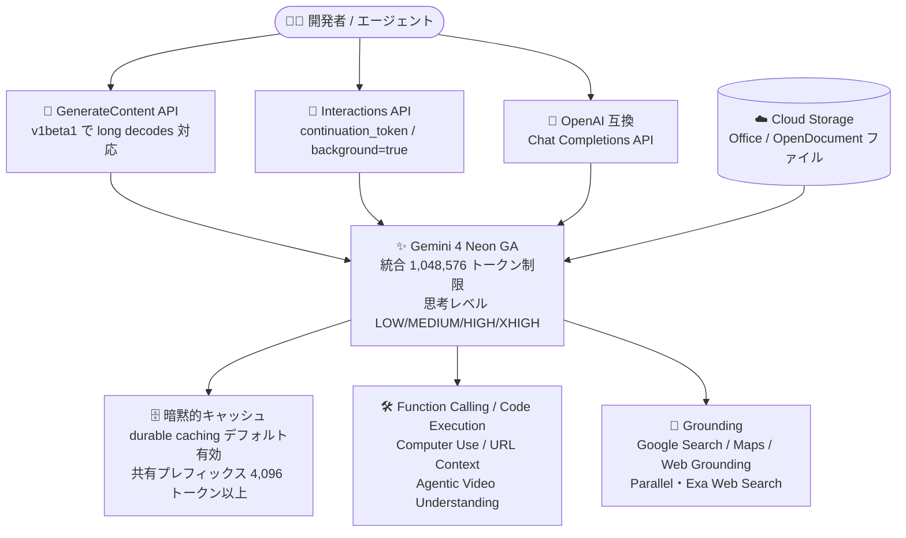

# Gemini Enterprise Agent Platform: Gemini 4 Neon (gemini-4-neon) が GA

**リリース日**: 2026-11-18

**サービス**: Gemini Enterprise Agent Platform

**機能**: Gemini 4 Neon (gemini-4-neon) の一般提供開始 (GA)

**ステータス**: GA (一般提供)

📊 [このアップデートのインフォグラフィックを見る](https://takech9203.github.io/google-cloud-news-summary/20261118-gemini-enterprise-agent-platform-gemini-4-neon-ga.html)

## 概要

Gemini Enterprise Agent Platform で、Google の Frontier Model である **Gemini 4 Neon (`gemini-4-neon`)** が一般提供 (GA) になりました。Gemini 4 Neon は、高性能なコーディング、マルチステップ推論、マルチモーダル理解を低レイテンシで実現するモデルで、エージェント型のエンタープライズワークフローに最適化されています。なお、Gemini 4 Neon は Service Specific Terms の Section 34 が適用される Google Frontier Model であり、不正利用モニタリングの対象となります。

本モデルは、入力と出力を合算した統合 1,048,576 トークン制限、`continuation_token` による最大 1,048,576 トークンまでの長時間デコード (long decodes)、4 段階の思考レベル (LOW / MEDIUM / HIGH / XHIGH)、デフォルト有効の暗黙的コンテキストキャッシュ (durable caching) など、Gemini 4 ファミリー共通の新しい API 規約を踏襲しています。GenerateContent API、Interactions API、OpenAI 互換 Chat Completions API の 3 つの API サーフェスから利用でき、グローバルエンドポイントおよび us / eu マルチリージョンで提供されます。

対象ユーザーは、Agent Platform 上でカスタムエージェントや生成 AI アプリケーションを構築する開発者・アーキテクトです。なお、同日に発表された Gemini Enterprise の Web アプリ / モバイルアプリ / Workflow Builder / AI developer tools での Gemini 4 Neon 提供は別のアップデートであり、本レポートは Agent Platform (API) 側に焦点を当てています。

**アップデート前の課題**

- 低レイテンシとフロンティアモデル級の推論性能 (特に XHIGH レベルの深い推論) を両立するモデルの選択肢が限られており、エージェント型ワークフローではレイテンシと性能のトレードオフが課題だった
- 先行する Gemini 4 Argon では、非ストリーミングの単一フォアグラウンドセグメント出力が 32,768 トークンに制限され、思考レベルも LOW / MEDIUM / HIGH の 3 段階 (XHIGH 非対応) だった
- Gemini 3 系のモデルでは、Office / OpenDocument ファイルを直接入力できず、PDF やテキストへの変換などの前処理が必要なケースがあった

**アップデート後の改善**

- 低レイテンシでの高性能コーディング・マルチステップ推論・マルチモーダル理解が GA のモデルとして利用可能になり、本番のエージェント型ワークロードに SLA を含む消費オプション (Provisioned Throughput など) と組み合わせて採用できるようになった
- 単一フォアグラウンドセグメントでストリーミング / 非ストリーミングともに最大 65,536 出力トークンを生成でき、long decodes により最大 1,048,576 トークン (入力トークン分を除く) まで出力を拡張できるようになった
- 思考レベルに XHIGH が追加され (デフォルトは HIGH)、深い推論が必要なワークロードに対応できるようになった
- Microsoft Office (.docx / .pptx / .xlsx など) および OpenDocument (.odt / .odp / .ods など) ファイルをインラインまたは Cloud Storage (`gs://`) から直接入力できるようになった (multimodal FunctionResponse パート内も含む)

## アーキテクチャ図



Gemini 4 Neon は 3 つの API サーフェス (GenerateContent / Interactions / OpenAI 互換) から利用でき、暗黙的キャッシュ、各種ツール、グラウンディングオプション、Office / OpenDocument ファイル入力をサポートします。

## サービスアップデートの詳細

### 主要機能

1. **統合 1,048,576 トークン制限と long decodes**
   - 入力と出力を合算した統合 1,048,576 トークン制限 (出力には思考トークン、関数呼び出し、最終レスポンスを含む)
   - 単一フォアグラウンドセグメントは、ストリーミング / 非ストリーミングともに最大 65,536 出力トークンを生成
   - long decodes (`continuation_token`) により、Interactions API と GenerateContent API (`v1beta1`) で出力を最大 1,048,576 トークン (入力トークン分を除く) まで拡張可能
   - Interactions API では非同期のサーバー管理バックグラウンド実行 (`background=true`) もサポート

2. **4 段階の思考レベル (LOW / MEDIUM / HIGH / XHIGH)**
   - デフォルトは HIGH で、深い推論ワークロード向けに XHIGH を提供
   - `thinking_budget` の指定や `thinking_level="MINIMAL"` の指定は HTTP 400 バリデーションエラーを返す (Gemini 3 からの移行時は要注意)

3. **暗黙的コンテキストキャッシュ (durable caching)**
   - 共有プロンプトプレフィックスが 4,096 トークン以上の場合に自動で適用される暗黙的キャッシュをサポートし、durable caching がデフォルトで有効
   - 明示的コンテキストキャッシュ (explicit caching) は非サポート
   - 2027 年 1 月 12 日以降、Gemini 4 Hydrogen 以降のモデルで TTL 設定付きのキャッシュ書き込み制御が利用可能になり、キャッシュ書き込みはデフォルトで標準入力トークン価格の 1.25 倍で課金 (保持期間が長いほど高コスト)

4. **Office / OpenDocument ファイル入力**
   - Microsoft Office (.docx / .dotx / .doc / .pptx / .ppt / .xlsx / .xls) および OpenDocument (.odt / .odp / .ods) ファイルを、インラインまたは Cloud Storage (`gs://`) から入力可能
   - multimodal FunctionResponse パート内でのファイル入力にも対応

5. **幅広い API サーフェス・ツール・消費オプション**
   - GenerateContent API、Interactions API、OpenAI 互換 Chat Completions API に対応
   - Function Calling、Code Execution、Computer Use、URL Context、Agentic Video Understanding をサポート
   - グラウンディング: Grounding with Google Search、Google Maps、Web Grounding for Enterprise、Parallel / Exa Web Search
   - 消費オプション: Standard PayGo (Usage Tiers 対応)、Priority PayGo、Off-peak PayGo、バッチ推論、Provisioned Throughput

## 技術仕様

### モデル仕様

| 項目 | 詳細 |
|------|------|
| モデル ID | `gemini-4-neon` |
| ステータス | GA (一般提供) |
| モデル分類 | Google Frontier Model (Service Specific Terms Section 34 の対象、不正利用モニタリングあり) |
| トークン制限 | 入力 + 出力の統合 1,048,576 トークン (出力は思考・関数呼び出し・最終レスポンスを含む) |
| 単一セグメント出力 | 最大 65,536 出力トークン (ストリーミング / 非ストリーミング共通) |
| long decodes | 最大 1,048,576 トークン (入力トークン分を除く)。Interactions API と GenerateContent (`v1beta1`) で対応 |
| バックグラウンド実行 | Interactions API の `background=true` (非同期・サーバー管理) |
| 思考レベル | LOW / MEDIUM / HIGH (デフォルト) / XHIGH。`thinking_budget` と `MINIMAL` は HTTP 400 |
| コンテキストキャッシュ | 暗黙的キャッシュのみ (4,096 トークン以上の共有プレフィックス)、durable caching デフォルト有効 |
| ファイル入力 | PDF / テキストに加え、Office (.docx / .pptx / .xlsx など)、OpenDocument (.odt / .odp / .ods など) |
| API サーフェス | GenerateContent API、Interactions API、OpenAI 互換 Chat Completions API |
| ロケーション | `global` エンドポイント、`us` / `eu` マルチリージョン |

### リクエスト例 (GenerateContent + long decodes)

```python
from google import genai
from google.genai import types

client = genai.Client(enterprise=True, project="PROJECT_ID", location="global")

# Google Gen AI SDK は continuation_token を自動処理 (v1beta1 をデフォルト使用)
for chunk in client.models.generate_content_stream(
    model="gemini-4-neon",
    contents="大規模コードベースのリファクタリング計画を詳細に作成してください。",
    config=types.GenerateContentConfig(
        max_output_tokens=256000,  # 65,536 超で long decodes が有効
        thinking_config=types.ThinkingConfig(thinking_level="XHIGH"),
    ),
):
    print(chunk.text, end="")
```

## 設定方法

### 前提条件

1. 課金が有効な Google Cloud プロジェクトと Agent Platform API の有効化
2. API キーまたはアプリケーションデフォルト認証情報 (ADC) による認証
3. 最新の Google Gen AI SDK (Python `google-genai >= 2.34.0`、JavaScript/TypeScript `@google/genai >= 2.32.0` など)

### 手順

#### ステップ 1: SDK のインストールと環境変数の設定

```bash
pip install --upgrade "google-genai>=2.34.0"

export GOOGLE_CLOUD_PROJECT=PROJECT_ID
export GOOGLE_CLOUD_LOCATION=global   # または us / eu
export GOOGLE_GENAI_USE_ENTERPRISE=True
```

グローバルエンドポイントまたは us / eu マルチリージョンを指定します。

#### ステップ 2: Gemini 4 Neon へのリクエスト

```bash
curl -X POST \
  -H "Authorization: Bearer $(gcloud auth print-access-token)" \
  -H "Content-Type: application/json" \
  "https://aiplatform.googleapis.com/v1/projects/PROJECT_ID/locations/global/publishers/google/models/gemini-4-neon:generateContent" \
  -d '{
    "contents": {"role": "USER", "parts": {"text": "How does AI work?"}}
  }'
```

long decodes (`continuation_token`) を直接 REST で使う場合は `/v1beta1/` エンドポイントパスを使用します (既知の問題として `v1` では非サポート)。

#### ステップ 3: Gemini 3 系からの移行時の調整

```text
- thinking_budget と thinking_level="MINIMAL" を削除 (HTTP 400 になる)
- 明示的キャッシュの呼び出しを削除し、静的なプロンプト (4,096 トークン以上) を先頭に配置
- 統合トークン制限 (入力 + 出力で 1,048,576) を前提にトークン予算を再設計
```

## メリット

### ビジネス面

- **低レイテンシのフロンティアモデルを本番採用可能**: GA により、エージェント型のエンタープライズワークロードに対し、Provisioned Throughput などの消費オプションと組み合わせた本番運用の計画が立てやすくなる
- **ドキュメント処理ワークフローの簡素化**: Office / OpenDocument ファイルを直接入力できるため、社内文書を扱う AI ワークフローの前処理コストを削減できる
- **コスト最適化の選択肢**: Standard / Priority / Off-peak PayGo、バッチ推論など、ワークロード特性に応じた消費オプションを選択できる

### 技術面

- **長大な出力の生成**: long decodes により、網羅的なコード生成、長文ドキュメント生成、詳細な形式証明など、65,536 トークンを超える出力が必要なタスクに対応できる
- **推論の深さを制御可能**: LOW から XHIGH までの 4 段階の思考レベルで、レイテンシ・コストと推論品質のバランスを明示的に制御できる
- **自動キャッシュによるコスト・レイテンシ削減**: 暗黙的キャッシュ + durable caching がデフォルト有効のため、共有プレフィックスを持つリクエストで追加実装なしにキャッシュ効果を得られる
- **OpenAI 互換 API 対応**: 既存の OpenAI Chat Completions ベースの実装から少ない変更で移行できる

## デメリット・制約事項

### 制限事項

- `thinking_budget` の指定や `thinking_level="MINIMAL"` は HTTP 400 バリデーションエラーになる (Gemini 3 系からの移行時にコード修正が必要)
- 明示的コンテキストキャッシュ (explicit caching) は非サポート。暗黙的キャッシュは共有プレフィックスが 4,096 トークン以上の場合のみ適用
- long decodes (`continuation_token`) は `v1beta1` API のみ対応 (既知の問題)。`v1` では利用できない
- 提供ロケーションは `global` と `us` / `eu` マルチリージョンに限定される

### 考慮すべき点

- 出力トークンには思考トークンと関数呼び出しが含まれるため、HIGH / XHIGH の思考レベルでは推論トークン分のヘッドルームを考慮したトークン予算設計が必要
- 2027 年 1 月 12 日以降、キャッシュ書き込みがデフォルトで標準入力トークン価格の 1.25 倍で課金されるようになるため、キャッシュ利用パターンとコストの再評価が必要 (保持期間が長いほど高コスト)
- Google Frontier Model として不正利用モニタリング (Service Specific Terms Section 34) の対象となるため、コンプライアンス要件を確認すること

## ユースケース

### ユースケース 1: 長大な成果物を生成するコーディングエージェント

**シナリオ**: リポジトリ全体の解析結果をもとに、詳細な設計書や大規模なコード一式を一度のリクエストで生成したい。単一セグメントの 65,536 トークン制限では成果物が途中で途切れてしまう。

**実装例**:
```python
interaction = client.interactions.create(
    model="gemini-4-neon",
    input="このリポジトリ全体のマイグレーション計画と変更コードを生成してください。",
    generation_config={
        "max_output_tokens": 500000,
        "thinking_level": "xhigh",
    },
    background=True,  # サーバー管理の非同期バックグラウンド実行
)
```

**効果**: SDK が `continuation_token` を自動処理し、最大 1,048,576 トークンまでの長大な出力を取得できる。`background=true` によりクライアントが接続を維持し続ける必要がなくなる。

### ユースケース 2: 社内 Office 文書を扱うエンタープライズエージェント

**シナリオ**: Cloud Storage に保存された .docx / .xlsx / .pptx などの社内文書を、変換処理なしでエージェントに読み込ませ、要約・分析・質問応答を行いたい。

**効果**: Office / OpenDocument ファイルを `gs://` から直接入力できるため、PDF 変換などの前処理パイプラインが不要になり、multimodal FunctionResponse 経由でツール実行結果としてファイルを渡すエージェント設計も可能になる。

### ユースケース 3: 共通の長いシステムプロンプトを持つマルチテナントエージェント

**シナリオ**: 多数のユーザーが同一の長大なシステム指示とツール定義 (4,096 トークン以上) を共有するエージェントサービスで、入力トークンコストとレイテンシを抑えたい。

**効果**: 暗黙的キャッシュ + durable caching がデフォルト有効のため、静的なプロンプト部分を先頭に配置するだけで、追加実装なしにキャッシュヒットによるコスト削減と低レイテンシ化が期待できる。

## 料金

Gemini 4 Neon はトークンベースの従量課金で、Standard PayGo (Usage Tiers 対応)、Priority PayGo、Off-peak PayGo、バッチ推論、Provisioned Throughput の各消費オプションが利用できます。Gemini 4 Neon 固有の単価は公式料金ページを参照してください。

- 暗黙的キャッシュの作成に使われる入力トークンは標準入力トークン価格で課金され、暗黙的キャッシュに個別のストレージ費用はかからない
- **2027 年 1 月 12 日以降**: Gemini 4 Hydrogen 以降のモデルで TTL 設定付きのキャッシュ書き込み制御が導入され、キャッシュ書き込みはデフォルトで標準入力トークン価格の **1.25 倍** で課金される (保持期間が長いほど高コスト)

詳細: [Gemini Enterprise Agent Platform の生成 AI 料金](https://cloud.google.com/gemini-enterprise-agent-platform/generative-ai/pricing)

## 利用可能リージョン

- グローバルエンドポイント: `global`
- マルチリージョン: `us`、`eu`

## 関連サービス・機能

- **Interactions API**: `continuation_token` による long decodes や `background=true` の非同期バックグラウンド実行をサポートするステートフルな API
- **Cloud Storage**: Office / OpenDocument ファイルを `gs://` URI で直接入力するためのストレージ
- **Provisioned Throughput**: 安定稼働が必要な本番ワークロード向けに、コミットメントベースでスループットを保証する消費オプション
- **Grounding with Google Search / Google Maps / Web Grounding for Enterprise**: 回答を最新の外部情報に接地させるグラウンディングオプション
- **Agent Studio**: Agent Platform 上でモデルを対話的に試せる開発環境

## 参考リンク

- 📊 [インフォグラフィック](https://takech9203.github.io/google-cloud-news-summary/20261118-gemini-enterprise-agent-platform-gemini-4-neon-ga.html)
- [公式リリースノート](https://docs.cloud.google.com/release-notes#November_18_2026)
- [Get started with Gemini 4](https://docs.cloud.google.com/gemini-enterprise-agent-platform/models/start/get-started-with-gemini-4)
- [コンテキストキャッシュの概要](https://docs.cloud.google.com/gemini-enterprise-agent-platform/models/context-cache/context-cache-overview)
- [Provisioned Throughput 対応モデル](https://docs.cloud.google.com/gemini-enterprise-agent-platform/models/provisioned-throughput/supported-models)
- [料金ページ](https://cloud.google.com/gemini-enterprise-agent-platform/generative-ai/pricing)

## まとめ

Gemini 4 Neon の GA により、低レイテンシと XHIGH レベルの深い推論を両立するフロンティアモデルを、GenerateContent / Interactions / OpenAI 互換 API から本番のエージェント型ワークロードに採用できるようになりました。統合 1,048,576 トークン制限、long decodes、Office / OpenDocument ファイル入力といった Gemini 4 世代の API 規約は Gemini 3 系と互換性のない変更 (`thinking_budget` 廃止、明示的キャッシュ非対応など) を含むため、移行ガイドに沿った既存コードの見直しを推奨します。あわせて、2027 年 1 月 12 日開始のキャッシュ書き込み課金 (標準入力価格の 1.25 倍) を見据えたキャッシュ戦略とコストの再評価を行ってください。

---

**タグ**: Gemini Enterprise Agent Platform, Gemini 4 Neon, GA, 生成 AI, LLM, エージェント, long decodes, 思考レベル, コンテキストキャッシュ, Interactions API
