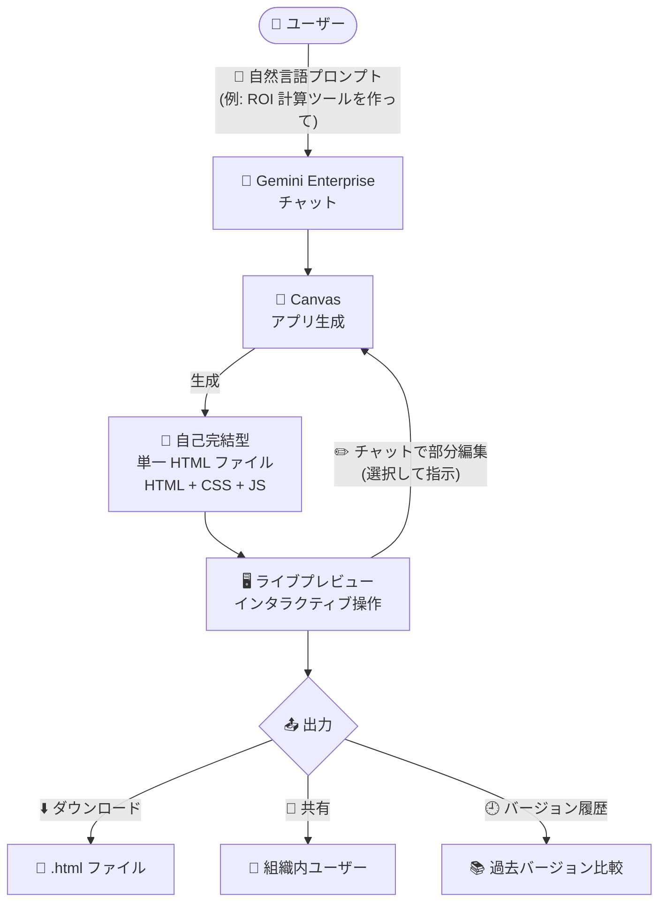

# Gemini Enterprise: Canvas でインタラクティブな Web アプリ作成が GA

**リリース日**: 2026-11-18

**サービス**: Gemini Enterprise

**機能**: Canvas でのインタラクティブ Web アプリ作成

**ステータス**: GA (一般提供)

📊 [このアップデートのインフォグラフィックを見る](https://takech9203.github.io/google-cloud-news-summary/20261118-gemini-enterprise-canvas-interactive-web-apps.html)

## 概要

Gemini Enterprise の Canvas で、インタラクティブなシングルページ Web アプリを作成する機能が一般提供 (GA) になりました。チャットで作りたいアプリ、ダッシュボード、プロトタイプを自然言語で記述するだけで、Canvas が動作するインタラクティブなシングルページアプリを、自己完結型の単一 HTML ファイルとして生成します。コードを書く必要は一切ありません。

ユーザーは生成された HTML の作成・プレビュー・編集・エクスポート・共有が可能です。Canvas はチャットの隣に表示される専用の対話型ツールで、これまでのドキュメント・スライド生成に加えて Web アプリ生成に対応したことで、ビジネスユーザーが ROI 計算ツールや簡易ダッシュボードなどのプロトタイプを即座に形にできるようになりました。開発チームに依頼することなく、アイデアを動くアプリとして検証したい非エンジニアのビジネスユーザーが主な対象です。

**アップデート前の課題**

- インタラクティブなプロトタイプやダッシュボードを作成するには、コーディングスキルや開発環境、開発チームへの依頼が必要だった
- Canvas で生成できるコンテンツはドキュメントとスライドが中心で、動作検証可能なアプリの形でアイデアを表現できなかった
- アイデアの検証からプロトタイプ共有までのリードタイムが長く、ビジネスユーザー自身で完結できなかった

**アップデート後の改善**

- チャットでアプリの内容を記述するだけで、動作するシングルページアプリが単一の自己完結型 HTML ファイルとして生成されるようになった (ノーコード)
- Canvas パネル内でライブプレビューを操作 (ボタンクリック、テキスト入力、タブ切り替えなど) しながら、チャットで対象を指定した部分編集が可能になった
- 生成した HTML ファイルのダウンロード、組織内の任意のユーザーへの共有、バージョン履歴による比較ができるようになった

## アーキテクチャ図



ユーザーのプロンプトから Canvas が単一 HTML ファイルのアプリを生成し、ライブプレビューでの操作確認、チャットによる反復編集、ダウンロード・共有までを 1 つの画面で完結するフローです。

## サービスアップデートの詳細

### 主要機能

1. **ノーコードでの Web アプリ生成**
   - チャットでアプリ、ダッシュボード、プロトタイプを記述すると、動作するインタラクティブなシングルページアプリを生成
   - HTML・CSS・JavaScript を 1 つにまとめた自己完結型の単一 HTML ファイルとして出力され、ブラウザのみで動作
   - チャットボックスの「Tools」または `/` 入力から Canvas を選択、またはアプリ作成を示すプロンプトを入力するだけで開始可能

2. **ライブプレビューと反復編集**
   - **インタラクティブプレビュー**: Canvas パネル内でボタンクリック、テキスト入力、タブ切り替えなどを直接テスト可能
   - **チャットによる部分編集**: 「グラフを棒グラフに変更」「ダークモードトグルを追加」のような指示で、ファイル全体を再生成せずに検索・置換ベースで更新
   - **選択して質問 (Select and ask)**: プレビュー内の特定要素をハイライトして、そのコンポーネントに絞った編集を依頼可能
   - **コード・スキルビュー**: 生成に使われたコードとスキル構成を読み取り専用で確認可能

3. **バージョン管理・共有・エクスポート**
   - ツールバーのバージョン履歴コントロールで、現在と過去のバージョンを確認・比較
   - 組織内の任意のユーザーへアプリを共有
   - 自己完結型 `.html` ファイルとしてダウンロードし、Canvas 外でも利用可能
   - フルスクリーン表示に対応

## 技術仕様

### 機能の仕様と制約

| 項目 | 詳細 |
|------|------|
| 出力形式 | 単一の自己完結型 HTML ファイル (HTML + CSS + JavaScript) |
| 実行環境 | ブラウザのみで完結 (クライアントサイド実行) |
| 永続ストレージ | なし (アプリの状態はブラウザセッション内のみ、DB・サーバーなし) |
| ホスティング | なし (マネージド URL での公開や Web サービスとしての実行は不可) |
| 外部 API 呼び出し | 制限あり (シークレットキー認証やサーバーサイド処理が必要な呼び出しは非対応) |
| 対応エディション | Gemini Enterprise Business / Standard / Plus |
| 対応リージョン | global、US、EU |
| 対応クライアント | Web アプリのみ (モバイルアプリは非対応) |

### 必要な IAM 権限 (カスタムロール利用時)

事前定義ロール (`roles/discoveryengine.user` など) には必要な権限が含まれていますが、カスタム IAM ロールを使用する場合は `immersiveArtifacts` 権限の追加が必要です。

```bash
gcloud iam roles update ROLE_ID \
  --project=PROJECT_ID \
  --add-permissions=discoveryengine.immersiveArtifacts.create,discoveryengine.immersiveArtifacts.delete,discoveryengine.immersiveArtifacts.export,discoveryengine.immersiveArtifacts.get,discoveryengine.immersiveArtifacts.list,discoveryengine.immersiveArtifacts.navigate,discoveryengine.immersiveArtifacts.update
```

これらの権限は Preview 段階のため Google Cloud コンソールからは追加できず、gcloud CLI を使用します (alpha ステージの警告が表示されますが適用は可能)。

## 設定方法

### 前提条件

1. Gemini Enterprise Web アプリが作成済みであること
2. 管理者が Gemini Enterprise Admin ロール (`roles/discoveryengine.agentspaceAdmin`) を保有していること
3. Canvas 機能トグルが有効化されていること (デフォルトでは無効)

### 手順

#### ステップ 1: 管理者が Canvas と App Builder を有効化

1. Google Cloud コンソールで Gemini Enterprise ページに移動
2. 対象アプリ名をクリックし、「Configurations」→「Feature Management」タブを開く
3. **Enable canvas** トグルをオンにする
4. **Enable app builder** トグルをオンにする (Web アプリの生成・共有・HTML ダウンロードが有効になる。Enable canvas が前提)
5. 生成アプリに Web 検索結果やオンライン画像を取り込みたい場合は **Search grounding** もオンにする

#### ステップ 2: エンドユーザーが Web アプリを作成

1. Gemini Enterprise Web アプリにサインイン
2. 新しいチャットを開始
3. チャットボックスで「Tools」をクリックするか `/` を入力し、Canvas を選択 (または作りたいアプリを記述したプロンプトを直接入力)
4. 例: 「人員数と時給のスライダー付き ROI 計算ツールを作って」と入力して送信
5. Canvas がアプリを生成し、ライブプレビューを表示。チャットで追加指示を出して反復的に改善

## メリット

### ビジネス面

- **プロトタイピングの民主化**: コーディング不要でビジネスユーザー自身がアイデアを動くアプリとして形にでき、開発チームへの依頼や待ち時間が不要になる
- **検証サイクルの短縮**: チャットでの反復編集により、アイデア → 動作確認 → 修正のループを数分単位で回せる
- **組織内での共有が容易**: 生成したアプリを組織内ユーザーに直接共有でき、フィードバック収集が迅速になる

### 技術面

- **自己完結型の単一 HTML**: 依存関係のない単一ファイルのため、配布・保管・レビューが容易で、ホスティング基盤を必要としない
- **効率的な差分編集**: ファイル全体を再生成せず検索・置換ベースで更新するため、編集が高速で既存部分の意図しない変更を抑制できる
- **バージョン履歴**: 過去バージョンとの比較が可能で、編集の試行錯誤を安全に行える

## デメリット・制約事項

### 制限事項

- 永続ストレージ・データベースなし: アプリの状態はブラウザセッション内に限られ、ユーザー間・セッション間でデータを保持できない
- マネージドホスティングなし: 公開 URL での提供や Web サービスとしての運用はできない
- 外部 API 呼び出しの制限: シークレット認証キーやバックエンド処理が必要な API 呼び出しは、認証情報を安全に保管するサーバーサイドがないため非対応
- クライアントサイド実行のみ: 重い処理、長時間ジョブ、サーバーサイド実行が必要なタスクは非対応
- 複雑さ・サイズの上限: 非常に大規模・複雑なアプリは生成やコンテキストの上限を超える可能性がある (大きなワークフローは小さなアプリに分割することを推奨)
- モバイルアプリ非対応: Canvas は Web アプリでのみ利用可能

### 考慮すべき点

- Canvas はデフォルトで無効のため、管理者による「Enable canvas」と「Enable app builder」の有効化が必要
- Canvas のクエリは通常のチャットクエリと同じ方法でカウントされ、同じクォータを共有する (月間上限到達時は Usage limit reached エラー)
- ファイル・添付は Gemini Enterprise 標準のファイル形式・サイズ制限に従う
- 生成されたアプリは AI 生成コンテンツのため、業務利用前に必ず内容をレビューする

## ユースケース

### ユースケース 1: 営業部門の ROI 計算ツール

**シナリオ**: 営業担当者が顧客向け提案で、導入効果を体感してもらえるインタラクティブな ROI 計算ツールを即席で用意したい。

**実装例**:
```
プロンプト例:
「人員数と時給を調整できるスライダー付きの ROI 計算ツールを作って。
 年間削減コストと投資回収期間をリアルタイムでグラフ表示して」

反復編集例:
「グラフを棒グラフに変更して」
「通貨表示を日本円にして」
```

**効果**: 開発依頼なしで数分で動作するツールが完成し、HTML をダウンロードして商談先でもオフラインでデモ可能。

### ユースケース 2: 業務ダッシュボードのプロトタイプ検証

**シナリオ**: 企画部門が BI ダッシュボードの要件定義前に、レイアウトや操作感を関係者と合意したい。

**効果**: タブ切り替えやフィルタ操作まで動作するプロトタイプを組織内に共有し、実装前に UI/UX のフィードバックを収集。開発チームとの認識齟齬による手戻りを削減できる。

## 料金

Canvas の利用は Gemini Enterprise のライセンス (Business / Standard / Plus エディション) に含まれます。Canvas のクエリは通常の Gemini Enterprise チャットクエリと同じ方法でカウントされ、同じクォータを共有します。プロジェクトの月間支出上限、または機能ごとのプールされたクォータ上限に達すると「Usage limit reached」エラーが表示されます。

詳細は [Gemini Enterprise の料金ページ](https://cloud.google.com/gemini-enterprise/pricing) を参照してください。

## 利用可能リージョン

Canvas は global、US、EU リージョンで一般提供されています。

## 関連サービス・機能

- **Canvas (ドキュメント・スライド生成)**: 本機能は既存の Canvas によるドキュメント・スライド生成を拡張するもので、同じ対話型エディタでチャットと並行して作業できる
- **Gemini Enterprise 管理機能 (Feature Management)**: 管理者は Web アプリの機能管理設定で「Enable canvas」「Enable app builder」「Search grounding」を制御する
- **Workflow Builder / スキル**: Canvas のアプリ生成には生成時のスキル構成が利用され、読み取り専用のコード・スキルビューで確認できる
- **IAM (Discovery Engine ロール)**: Canvas の利用には `discoveryengine.immersiveArtifacts.*` 権限が必要 (事前定義ロールには含まれる)

## 参考リンク

- 📊 [インフォグラフィック](https://takech9203.github.io/google-cloud-news-summary/20261118-gemini-enterprise-canvas-interactive-web-apps.html)
- [公式リリースノート](https://docs.cloud.google.com/release-notes#November_18_2026)
- [ドキュメント: Create documents, slides, and web apps in Canvas](https://docs.cloud.google.com/gemini/enterprise/docs/assistant-canvas)
- [ドキュメント: Manage web app features](https://docs.cloud.google.com/gemini/enterprise/docs/manage-web-app-features)
- [ドキュメント: Configure Canvas](https://docs.cloud.google.com/gemini/enterprise/docs/configure-canvas)
- [料金ページ](https://cloud.google.com/gemini-enterprise/pricing)

## まとめ

Gemini Enterprise の Canvas が Web アプリ生成に GA 対応したことで、非エンジニアのビジネスユーザーでも自然言語だけでインタラクティブなプロトタイプやダッシュボードを作成・共有できるようになりました。永続ストレージやホスティングがないクライアントサイド完結型という制約を理解した上で、アイデア検証や社内ツールのプロトタイピング用途での活用が推奨されます。利用開始には管理者による「Enable canvas」「Enable app builder」トグルの有効化が必要なため、まずは機能管理設定を確認しましょう。

---

**タグ**: #GeminiEnterprise #Canvas #WebApps #NoCode #GA #GenerativeAI
