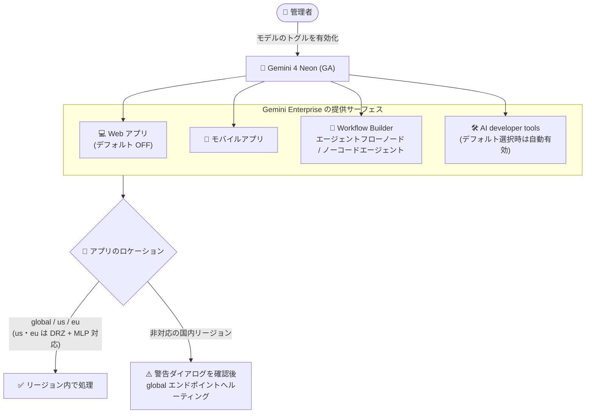

# Gemini Enterprise: Gemini 4 Neon が Web アプリ・モバイルアプリ・Workflow Builder・AI developer tools で GA

**リリース日**: 2026-11-18

**サービス**: Gemini Enterprise

**機能**: Gemini 4 Neon の一般提供 (Web アプリ / モバイルアプリ / Workflow Builder / AI developer tools)

**ステータス**: GA (一般提供)

📊 [このアップデートのインフォグラフィックを見る](https://takech9203.github.io/google-cloud-news-summary/20261118-gemini-enterprise-gemini-4-neon-ga.html)

## 概要

Google の最新フロンティアモデルである Gemini 4 Neon が、Gemini Enterprise の主要なサーフェスで一般提供 (GA) となりました。対象となるのは Gemini Enterprise の **Web アプリ**、**モバイルアプリ**、**Workflow Builder**、および **AI developer tools** の 4 つのサーフェスです。これにより、エンドユーザーのチャット利用からノーコードのエージェント構築、開発者向けコーディング支援まで、Gemini Enterprise のあらゆる利用シーンで最新モデルを選択できるようになりました。

ロケーション面では、`global`、`us`、`eu` のマルチリージョンでサポートされ、`us` と `eu` ではデータレジデンシー (at-rest DRZ) と ML 処理 (MLP) のコミットメントにも対応します。一方、モデルが提供されていない国内リージョン (in-country region) では、警告ダイアログを確認した上でトラフィックを global エンドポイントにルーティングする形での利用となります。

管理者視点では、Gemini Enterprise アプリにおいて Gemini 4 Neon は**デフォルトで無効**であり、ユーザーに公開するには管理者がモデルのトグルを有効化する必要があります。AI developer tools では、「Antigravity authorized models」がデフォルト選択のままであればライセンスユーザーに対して自動的に有効になりますが、カスタムモデルリストを構成している組織では管理者による手動選択が必要です。

**アップデート前の課題**

- Gemini Enterprise の Web アプリ・モバイルアプリ・Workflow Builder・AI developer tools では Gemini 4 Neon を利用できず、エンドユーザーやエージェント構築者は既存の Gemini 4 モデル (Hydrogen、Carbon、Argon など) や Gemini 3.x 系モデルを使う必要があった
- 既存の Gemini 4 系モデル (Hydrogen、Carbon、Argon) は国内リージョンでは global リージョンのみの提供であり、最新モデルを使いながらデータレジデンシー要件を満たす選択肢が限られていた

**アップデート後の改善**

- Gemini Enterprise の 4 つのサーフェス (Web アプリ、モバイルアプリ、Workflow Builder、AI developer tools) すべてで Gemini 4 Neon が GA として利用可能になった
- `us` / `eu` マルチリージョンでデータレジデンシー (at-rest DRZ) と ML 処理 (MLP) がサポートされ、規制要件のある組織でも最新モデルを採用しやすくなった
- Workflow Builder のエージェントフローノードとノーコードエージェントで Gemini 4 Neon を選択でき、エージェントの推論品質を向上できるようになった

## アーキテクチャ図

Gemini 4 Neon は管理者による有効化を経て 4 つのサーフェスで利用可能になり、アプリのロケーションに応じてリージョン内処理または global エンドポイントへのルーティングが行われます。

## サービスアップデートの詳細

### 主要機能

1. **Web アプリ / モバイルアプリでの利用**
   - Gemini Enterprise の Web アプリとモバイルアプリで Gemini 4 Neon をチャットのモデルとして選択可能
   - デフォルトでは無効 (OFF) のため、管理者が Gemini Enterprise アプリの設定でモデルのトグルを有効化する必要がある

2. **Workflow Builder での利用**
   - エージェントフローノード (agent flow nodes) で Gemini 4 Neon を指定可能
   - ノーコードエージェント (no-code agents) のモデルとしても選択可能で、ビジネスユーザーが構築するエージェントにも最新モデルを適用できる

3. **AI developer tools での利用**
   - 「Antigravity authorized models」がデフォルト選択の場合、ライセンスを持つユーザーに対して自動的に有効化される
   - 組織がカスタムモデルリストを指定している場合は、管理者が Gemini 4 Neon を手動で選択する必要がある

4. **ロケーションとデータレジデンシー**
   - `global`、`us`、`eu` のマルチリージョンでサポート
   - `us` と `eu` では at-rest DRZ (データレジデンシー) と MLP (ML 処理) のコミットメントに対応
   - 非対応の国内リージョンでは、警告ダイアログの確認を条件に global エンドポイントへルーティングされる

## 技術仕様

### 提供サーフェスと有効化方法

| サーフェス | デフォルト状態 | 有効化方法 |
|------|------|------|
| Web アプリ | 無効 (OFF) | 管理者がモデルのトグルを有効化 |
| モバイルアプリ | 無効 (OFF) | 管理者がモデルのトグルを有効化 |
| Workflow Builder | - | エージェントフローノード / ノーコードエージェントでモデルを選択 |
| AI developer tools | デフォルト選択時は有効 | カスタムモデルリスト使用時は管理者が手動選択 |

### ロケーションとデータレジデンシー

| ロケーション | 提供可否 | at-rest DRZ / MLP |
|------|------|------|
| global | 利用可能 | - |
| us マルチリージョン | 利用可能 | DRZ・MLP 対応 |
| eu マルチリージョン | 利用可能 | DRZ・MLP 対応 |
| 非対応の国内リージョン | 警告確認後に global へルーティング | 非対応 (global 処理となる) |

## 設定方法

### 前提条件

1. Gemini Enterprise のライセンスとアプリが構成済みであること
2. モデルの有効化を行う管理者権限があること
3. 国内リージョンのアプリで利用する場合、global ルーティングに関する警告ダイアログの内容を組織のポリシーに照らして確認すること (リソースロケーション組織ポリシーで global が許可されていない場合、モデルを有効化できない)

### 手順

#### ステップ 1: Web アプリ / モバイルアプリでの有効化

Google Cloud コンソールの Gemini Enterprise 管理画面から、Web アプリ機能の管理ページで **Gemini 4 Neon** のトグルを有効化します。アプリのロケーションがモデル非対応のリージョンの場合は、global エンドポイントへのルーティングに関する警告ダイアログを確認します。

詳細: [Manage features on the web app](https://docs.cloud.google.com/gemini/enterprise/docs/manage-web-app-features)

#### ステップ 2: Workflow Builder でのモデル選択

Workflow Builder でエージェントフローノードまたはノーコードエージェントを構成する際に、使用モデルとして Gemini 4 Neon を選択します。

#### ステップ 3: AI developer tools での構成

「Antigravity authorized models」の設定を確認します。デフォルト選択のままであればライセンスユーザーに自動で有効化されます。カスタムモデルリストを使用している場合は、管理者が設定画面で Gemini 4 Neon を追加選択します。

詳細: [Configure AI developer tools settings](https://docs.cloud.google.com/gemini/enterprise/docs/ai-developer-tools-settings)

## メリット

### ビジネス面

- **最新モデルの全社展開**: チャット、エージェント構築、開発支援という異なる役割のユーザーすべてに、単一の管理体系のもとで最新フロンティアモデルを提供できる
- **コンプライアンス対応**: `us` / `eu` でのデータレジデンシーと ML 処理サポートにより、規制業種でも最新モデルの採用判断がしやすい

### 技術面

- **エージェント品質の向上**: Workflow Builder のエージェントフローノードとノーコードエージェントで最新モデルを使えるため、複雑な推論を伴うワークフローの精度向上が期待できる
- **ガバナンスの維持**: デフォルト OFF とトグルによる管理、カスタムモデルリストでの明示的な選択により、組織のモデル利用ポリシーを維持したまま段階的に展開できる

## デメリット・制約事項

### 制限事項

- Gemini Enterprise アプリではデフォルトで無効のため、管理者が有効化しない限りユーザーは利用できない
- データレジデンシーと ML 処理のサポートは `us` / `eu` マルチリージョンに限られる
- 非対応の国内リージョンでは global エンドポイントへのルーティングが必須となり、リージョナルなデータレジデンシーは適用されない

### 考慮すべき点

- 国内リージョンのアプリで有効化する場合、global ルーティングがデータ取り扱いポリシーに適合するか事前に確認が必要
- リソースロケーション組織ポリシーで global ロケーションを許可していないプロジェクトでは、非対応リージョンのアプリでモデルを有効化できない
- AI developer tools でカスタムモデルリストを運用している組織は、自動では有効化されないため、管理者による追加作業を展開計画に含める必要がある

## ユースケース

### ユースケース 1: EU 拠点企業でのデータレジデンシー要件を満たした最新モデル展開

**シナリオ**: EU の規制業種の企業が、データレジデンシー要件を維持しながら社内のナレッジ検索・チャットに最新モデルを導入したい。

**効果**: `eu` マルチリージョンで at-rest DRZ と MLP がサポートされるため、データを EU 内に保持したまま Gemini 4 Neon を Web アプリ・モバイルアプリで利用できる。

### ユースケース 2: Workflow Builder によるノーコードエージェントの高度化

**シナリオ**: 業務部門がノーコードエージェントで問い合わせ対応フローを構築しているが、複数ステップの判断を要する処理で精度が不足している。

**効果**: エージェントフローノードのモデルを Gemini 4 Neon に切り替えることで、コード変更なしに多段推論を伴うワークフローの品質を向上できる。

### ユースケース 3: 開発チームへの段階的なモデル展開

**シナリオ**: 開発組織が AI developer tools でモデル利用を統制しており、新モデルは検証後に展開する運用をとっている。

**効果**: カスタムモデルリストを使っていれば Gemini 4 Neon は自動有効化されないため、検証チームのみに先行展開し、確認後に全ライセンスユーザーへ広げる段階的な運用が可能。

## 料金

Gemini 4 Neon は Gemini Enterprise のライセンスを持つユーザー向けに各サーフェスで提供されます。ライセンス体系および料金の詳細は公式ページを参照してください。

- [Gemini Enterprise](https://cloud.google.com/gemini-enterprise)

## 利用可能リージョン

- **マルチリージョン**: `global`、`us`、`eu` (`us` / `eu` は at-rest DRZ と MLP に対応)
- **国内リージョン**: Gemini 4 Neon 非対応のリージョンでは、警告ダイアログの確認後に global エンドポイントへルーティング

詳細は [Data residency for Gemini Enterprise](https://docs.cloud.google.com/gemini/enterprise/docs/locations) を参照してください。

## 関連サービス・機能

- **Gemini Enterprise Agent Platform**: Gemini 4 Neon は Agent Platform (API) でも同日に GA となっている (API の詳細は別レポートを参照)
- **Workflow Builder**: エージェントフローノードとノーコードエージェントで Gemini 4 Neon を選択可能
- **Antigravity (AI developer tools)**: Antigravity アプリ / CLI / IDE 向け拡張などの開発者ツールで Gemini 4 Neon を利用可能
- **組織ポリシー (リソースロケーション)**: global ロケーションの許可設定が、非対応リージョンでのモデル有効化可否に影響する

## 参考リンク

- 📊 [インフォグラフィック](https://takech9203.github.io/google-cloud-news-summary/20261118-gemini-enterprise-gemini-4-neon-ga.html)
- [公式リリースノート](https://docs.cloud.google.com/release-notes#November_18_2026)
- [Data residency for Gemini Enterprise](https://docs.cloud.google.com/gemini/enterprise/docs/locations)
- [Manage features on the web app](https://docs.cloud.google.com/gemini/enterprise/docs/manage-web-app-features)
- [Configure AI developer tools settings](https://docs.cloud.google.com/gemini/enterprise/docs/ai-developer-tools-settings)

## まとめ

Gemini 4 Neon が Gemini Enterprise の Web アプリ・モバイルアプリ・Workflow Builder・AI developer tools で GA となり、`us` / `eu` でのデータレジデンシー対応により規制要件のある組織でも最新モデルを採用しやすくなりました。Gemini Enterprise アプリではデフォルト無効のため、利用を開始するには管理者によるモデルトグルの有効化と、AI developer tools のモデルリスト設定の確認を行うことを推奨します。

---

**タグ**: Gemini Enterprise, Gemini 4 Neon, GA, 生成 AI, Workflow Builder, Antigravity, データレジデンシー
