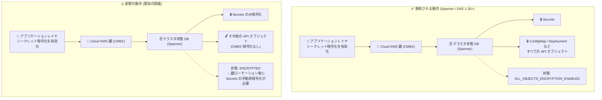

# Google Kubernetes Engine: アプリケーションレイヤ シークレット暗号化が Secrets のみ暗号化される既知の問題

**リリース日**: 2026-11-18

**サービス**: Google Kubernetes Engine (GKE)

**機能**: アプリケーションレイヤ シークレット暗号化 (Application-layer Secrets Encryption)

**ステータス**: 既知の問題 (Known Issue)

📊 [このアップデートのインフォグラフィックを見る](https://takech9203.github.io/google-cloud-news-summary/20261118-gke-application-layer-secrets-encryption-issue.html)

## 概要

GKE バージョン 1.35、1.36、1.37 において、コントロール プレーンがクラスタ状態を Spanner に保存しているクラスタで、新規または既存クラスタにアプリケーションレイヤ シークレット暗号化を有効化した場合、本来であればすべての Kubernetes API オブジェクトが暗号化される (`ALL_OBJECTS_ENCRYPTION_ENABLED`) はずが、Kubernetes Secrets のみが暗号化される (`ENCRYPTED`) 状態になる既知の問題が公表されました。

GKE 1.35 以降では、クラスタ状態のキーバリュー ストアが Spanner の場合、アプリケーションレイヤ シークレット暗号化はすべての Kubernetes API オブジェクトを Cloud KMS 鍵で暗号化する仕様です (etcd の場合は主に Secrets を暗号化)。今回の問題により、新たに暗号化を構成したクラスタではこの「全オブジェクト暗号化」が適用されず、Secrets のみの暗号化にフォールバックしてしまいます。

すでに全オブジェクト暗号化 (`ALL_OBJECTS_ENCRYPTION_ENABLED`) の状態にあるクラスタは影響を受けず、引き続きすべてのオブジェクトが暗号化されます。一方、`ENCRYPTED` 状態のクラスタは Secrets のみが暗号化されるため、Cloud KMS 鍵のローテーション後に Secrets を手動で再暗号化する運用が必要になります。新規構成クラスタで全オブジェクト暗号化を復元する修正は現在進行中です。

**この問題による影響**

- GKE 1.35/1.36/1.37 の Spanner ベースのクラスタで新たにアプリケーションレイヤ シークレット暗号化を有効化すると、期待される全オブジェクト暗号化ではなく Secrets のみの暗号化 (`ENCRYPTED`) になる
- `ENCRYPTED` 状態のクラスタでは、Cloud KMS 鍵ローテーション後に Secrets の手動再暗号化が必要 (全オブジェクト暗号化の場合は不要)
- Secrets 以外の Kubernetes API オブジェクトは CMEK による追加の暗号化レイヤで保護されない (Google Cloud のデフォルトの保存時暗号化は引き続き適用される)

**影響を受けないケース**

- すでに `ALL_OBJECTS_ENCRYPTION_ENABLED` 状態にあるクラスタは、引き続きすべての Kubernetes API オブジェクトが暗号化される
- etcd ベースのクラスタは元々 Secrets を主な暗号化対象とする仕様のため、挙動の変化はない

## アーキテクチャ図



GKE 1.35/1.36/1.37 の Spanner ベースのクラスタで暗号化を新規構成した場合、期待される全オブジェクト暗号化 (上) ではなく Secrets のみの暗号化 (下) となる比較図です。

## 問題の詳細

### 影響範囲

| 項目 | 詳細 |
|------|------|
| 影響を受ける GKE バージョン | 1.35、1.36、1.37 |
| 影響を受ける構成 | コントロール プレーンがクラスタ状態を Spanner に保存しているクラスタで、アプリケーションレイヤ シークレット暗号化を新規に有効化した場合 (新規・既存クラスタとも) |
| 期待される状態 | `ALL_OBJECTS_ENCRYPTION_ENABLED` (すべての Kubernetes API オブジェクトを暗号化) |
| 実際の状態 | `ENCRYPTED` (Kubernetes Secrets のみを暗号化) |
| 影響を受けないクラスタ | すでに `ALL_OBJECTS_ENCRYPTION_ENABLED` 状態のクラスタ (引き続き全オブジェクトを暗号化)、etcd ベースのクラスタ |
| 修正状況 | 新規構成クラスタで全オブジェクト暗号化を復元する修正が進行中 |

### 暗号化の仕組み (背景)

アプリケーションレイヤ シークレット暗号化は、エンベロープ暗号化を採用しています。ローカルのデータ暗号鍵 (DEK) でクラスタ状態データベース内のオブジェクトを暗号化し、DEK 自体を Cloud KMS で管理する鍵暗号鍵 (KEK) で暗号化します。GKE 1.35 以降では、クラスタ状態を保持するキーバリュー ストアによって暗号化対象が異なります。

- **Spanner**: すべての Kubernetes API オブジェクトを暗号化 (本来の仕様)
- **etcd**: 主に Secrets を暗号化

今回の問題は、Spanner ベースのクラスタで新規に暗号化を構成した際に、etcd 相当の「Secrets のみ」の暗号化スコープになってしまうものです。

## 確認方法

### 暗号化状態の確認 (gcloud)

自クラスタがこの問題の影響を受けているかどうかは、`databaseEncryption.state` の値で確認できます。

```bash
gcloud container clusters describe CLUSTER_NAME \
  --location=CONTROL_PLANE_LOCATION \
  --format='value(databaseEncryption.state)' \
  --project=CLUSTER_PROJECT_ID
```

出力の意味:

| 出力値 | 意味 |
|--------|------|
| `ALL_OBJECTS_ENCRYPTION_ENABLED` | クラスタ状態データベース内のすべての Kubernetes API オブジェクトが暗号化されている (影響なし) |
| `ENCRYPTED` | Secrets のみが暗号化されている (本問題の影響を受けている可能性あり) |
| `DECRYPTED` | アプリケーションレイヤ シークレット暗号化が無効 |

### 暗号化状態の確認 (コンソール)

1. Google Cloud コンソールで GKE のページに移動する
2. 対象クラスタの名前をクリックする
3. 「セキュリティ」セクションの「アプリケーションレイヤでのシークレット暗号化」フィールドを確認する
   - **Enabled (All Objects)**: すべての Kubernetes API オブジェクトが暗号化されている
   - **Enabled**: Secrets のみが暗号化されている

## 対応・運用上の注意

### ENCRYPTED 状態のクラスタで必要な運用

`ENCRYPTED` 状態 (Secrets のみ暗号化) のクラスタでは、Cloud KMS 鍵のローテーション後、既存の Secrets は旧バージョンの KEK で暗号化されたままになります。新しい KEK バージョンで保護するには、Secrets の手動再暗号化が必要です。

```bash
# 鍵ローテーション後、新バージョンが整合するまで 3 時間以上待機してから実行
kubectl get secrets --namespace=NAMESPACE -o json \
  | kubectl annotate --overwrite -f - encryption-key-rotation-time="TIME"
```

- `NAMESPACE`: Secrets を更新する Namespace。Standard クラスタでは `--all-namespaces` フラグでクラスタ内のすべての Secrets を一括更新可能。Autopilot クラスタでは自分が所有する Namespace のみ更新可能
- `TIME`: ローテーション時刻を示す文字列 (例: `20261118-090909`)

全オブジェクト暗号化 (`ALL_OBJECTS_ENCRYPTION_ENABLED`) のクラスタでは、この手動再暗号化は不要です。

### 鍵バージョン破棄時の注意

クラスタ状態データベース内のオブジェクトの暗号化に使用中の KMS 鍵バージョンを破棄すると、クラスタが劣化状態になり最終的に動作不能になります。`ENCRYPTED` 状態のクラスタでは再暗号化が完了するまで旧 KEK バージョンを破棄しないよう、特に注意が必要です。

## 考慮すべき点

- CMEK による全オブジェクト暗号化をコンプライアンス要件として採用している場合、GKE 1.35/1.36/1.37 で新規に構成したクラスタが要件を満たしていない可能性があるため、`databaseEncryption.state` の確認を推奨
- `ENCRYPTED` 状態であっても Google Cloud のデフォルトの保存時暗号化は引き続きすべてのデータに適用される (CMEK による追加レイヤが Secrets に限定されるのみ)
- 新規構成クラスタで全オブジェクト暗号化を復元する修正が進行中のため、修正リリース後に状態を再確認するとよい
- Cloud KMS の鍵ローテーションを自動化している場合は、`ENCRYPTED` 状態の間、ローテーションに合わせた Secrets 再暗号化 (CronJob などによる自動化) の運用を組み込む必要がある

## 関連サービス・機能

- **Cloud KMS**: アプリケーションレイヤ シークレット暗号化の KEK を管理。鍵のローテーション (自動/手動)、鍵バージョンの破棄・復元を担う
- **Cloud HSM / Cloud EKM**: Cloud KMS がサポートする保護レベルの鍵も KEK として利用可能 (この場合 Cloud KMS の暗号リクエスト クォータを消費)
- **Spanner**: GKE コントロール プレーンのクラスタ状態データベースとして利用されるキーバリュー ストア。本問題は Spanner ベースのクラスタが対象

## 参考リンク

- 📊 [インフォグラフィック](https://takech9203.github.io/google-cloud-news-summary/20261118-gke-application-layer-secrets-encryption-issue.html)
- [公式リリースノート](https://docs.cloud.google.com/release-notes#November_18_2026)
- [アプリケーションレイヤでのシークレットの暗号化](https://docs.cloud.google.com/kubernetes-engine/docs/how-to/encrypting-secrets)
- [アプリケーションレイヤ シークレット暗号化が有効であることを確認する](https://docs.cloud.google.com/kubernetes-engine/docs/how-to/encrypting-secrets#verifying_secrets_encryption)
- [Cloud KMS 鍵のローテーション](https://docs.cloud.google.com/kms/docs/rotating-keys)

## まとめ

GKE 1.35/1.36/1.37 の Spanner ベースのクラスタで新規にアプリケーションレイヤ シークレット暗号化を有効化すると、全オブジェクト暗号化ではなく Secrets のみの暗号化になる既知の問題です。該当バージョンで暗号化を構成したクラスタは `gcloud container clusters describe` で `databaseEncryption.state` を確認し、`ENCRYPTED` の場合は Cloud KMS 鍵ローテーション後の Secrets 手動再暗号化を運用に組み込んでください。全オブジェクト暗号化を復元する修正が進行中のため、今後のリリースノートの続報にも注目が必要です。

---

**タグ**: #GKE #Kubernetes #セキュリティ #CloudKMS #CMEK #既知の問題 #暗号化
