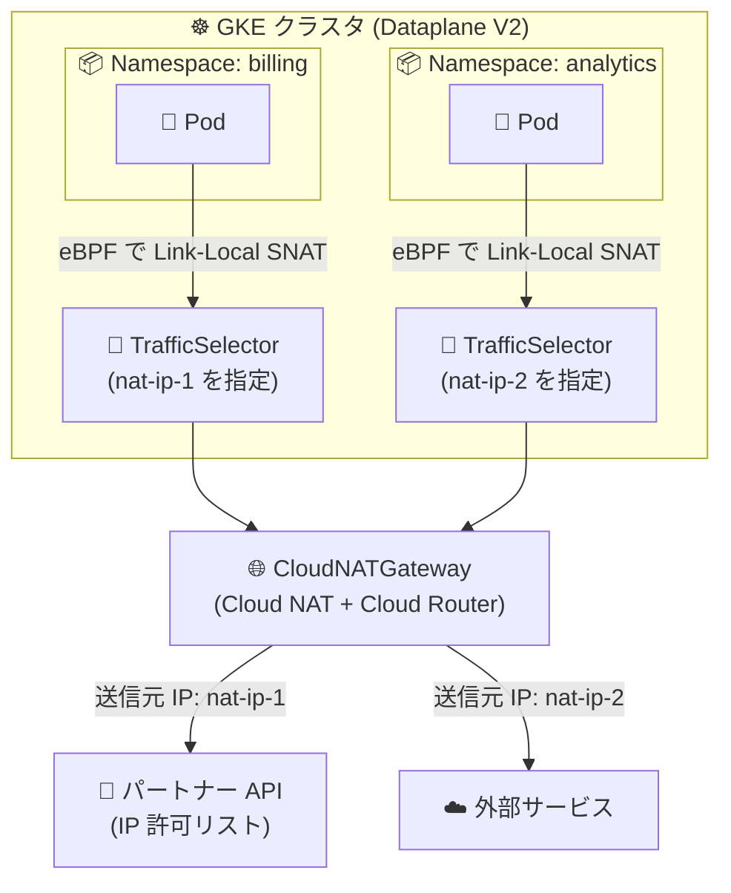

# Google Kubernetes Engine: GKE Granular NAT (Preview)

**リリース日**: 2026-11-18

**サービス**: Google Kubernetes Engine (GKE)

**機能**: GKE Granular NAT — Kubernetes Namespace 単位の Egress 制御と専用送信元 IP アドレスの割り当て

**ステータス**: Preview

📊 [このアップデートのインフォグラフィックを見る](https://takech9203.github.io/google-cloud-news-summary/20261118-gke-granular-nat-preview.html)

## 概要

GKE Granular NAT が Preview として利用可能になった。GKE バージョン 1.37.1-gke.2611000 以降で GKE Dataplane V2 が有効な Autopilot および Standard クラスタで利用でき、`CloudNATGateway` と `TrafficSelector` という 2 つのカスタムリソースを使って、Kubernetes Namespace 単位でアウトバウンドトラフィックを制御し、専用の Egress 送信元 IP アドレスを割り当てられる。

従来はクラスタ全体に単一の NAT ポリシーを適用するしかなかったが、本機能により特定の Namespace からの Egress を専用の外部 IP アドレス (Public NAT) または専用のサブネット範囲 (Private NAT) 経由でルーティングできる。カスタムプロキシインスタンスを運用することなく、外部パートナーやオンプレミスシステムに対して決定論的な送信元 IP アドレスを提供できる。

対象ユーザーは、外部パートナーやオンプレミスシステムに接続するアプリケーションに対して企業のセキュリティポリシーを適用する Cloud アーキテクト、ネットワークスペシャリスト、オペレーターである。

**アップデート前の課題**

- NAT ポリシーはクラスタ全体に対して単一の設定しか適用できず、Namespace やワークロード単位で送信元 IP アドレスを使い分けることができなかった
- 外部パートナーの API やペイメントゲートウェイが厳格な IP アドレス許可リストを適用している場合、クラスタ全体の Egress IP アドレスを許可リストに登録する必要があり、特定のサービスだけを許可することができなかった
- Namespace ごとに送信元 IP アドレスを分けるには、中間プロキシ Pod やカスタム NAT ルーティングアプライアンスを独自にデプロイ・パッチ適用・スケーリングする運用負荷が発生していた

**アップデート後の改善**

- `CloudNATGateway` と `TrafficSelector` カスタムリソースを kubectl で宣言的に適用するだけで、Namespace 単位の Egress ルーティングポリシーを定義できるようになった
- 特定の Namespace からの Egress を専用の静的外部 IP アドレス (Public NAT) または専用のプライベート NAT サブネット範囲 (Private NAT) 経由でルーティングできるようになった
- GKE がリージョナル Cloud NAT ゲートウェイと変換ルールを自動的にプロビジョニング・同期するため、カスタムプロキシインスタンスの管理が不要になった
- ネットワーク管理者が IP アドレスとゲートウェイのライフサイクルを管理し、クラスタオペレーターがラベルセレクタで Namespace をゲートウェイにマッピングするという、チーム間の責務分離が可能になった

## アーキテクチャ図



各 Namespace の Pod からの Egress トラフィックは、ノード上の eBPF プログラムで Link-Local アドレス (169.254.32.0/20) に SNAT された後、Cloud NAT ゲートウェイが TrafficSelector の指定に基づいて Namespace ごとの専用送信元 IP アドレスに最終変換して外部へ送出する。

## サービスアップデートの詳細

### 主要機能

1. **CloudNATGateway カスタムリソース (クラスタスコープ)**
   - 新しい Public / Private Cloud NAT ゲートウェイのプロビジョニング、または既存ゲートウェイの利用をクラスタに対して宣言的に定義
   - Cloud Router との関連付け、接続タイムアウト、ロギング、IP アドレスプール、ポートオプションなどを設定可能
   - ゲートウェイはクラスタと同一リージョン・同一 VPC ネットワークに配置する必要がある

2. **TrafficSelector カスタムリソース (クラスタスコープ)**
   - `namespaceSelector` で送信元 Pod (Namespace) をマッチングし、宛先 CIDR (インターネット向けは `0.0.0.0/0`、オンプレミス向けは特定の CIDR 範囲) を指定して Egress ルーティングポリシーを定義
   - `cloud.google.com/cloud-nat` アノテーションで、Namespace に割り当てる予約済み静的外部 IP アドレス (`nat-external-ips`) またはプライベート NAT サブネット (`nat-subnet`) を指定

3. **Public NAT: Namespace 単位の静的外部 Egress IP アドレス**
   - 予約済みの静的外部 IP アドレスを Namespace ごとに割り当て、パートナー API やペイメントゲートウェイの IP 許可リスト要件に対応
   - クラスタ全体ではなく個別サービス単位での許可リスト登録が可能になる

4. **Private NAT: VPC / NCC 接続向けの専用内部 IP 範囲**
   - `PRIVATE_NAT` purpose のサブネットを作成し、オンプレミスネットワークや NCC ハブ上の他の VPC スポークへ接続するワークロードに特定の内部 IP アドレス範囲を割り当て
   - IP アドレスの重複や枯渇を回避しつつ、予測可能なプライベート IP アドレスを利用可能

5. **既存 Cloud NAT ゲートウェイの共有**
   - 同一 VPC ネットワーク・同一リージョン内の複数 GKE クラスタで既存の Cloud NAT ゲートウェイを共有可能
   - 複数クラスタのワークロードが統一された外部 IP アドレスプールから Egress でき、許可リスト管理やコンプライアンス監査を簡素化

### アウトバウンドパケットフロー

| ステージ | 処理内容 |
|---------|---------|
| 1. ワークロード識別 | GKE Dataplane V2 がノード内で Pod トラフィックを key-value のワークロードセレクタ (例: `namespace=NAMESPACE`) に関連付け |
| 2. ノードレベル変換 (Link-Local SNAT) | TrafficSelector ルールにマッチしたパケットの送信元 IP を、eBPF プログラムが Namespace に割り当てられた Link-Local IP (169.254.32.0/20) に変換 |
| 3. ゲートウェイポリシーマッチング | VPC ネットワークに入ったパケットの Link-Local 送信元 IP を Cloud NAT が NAT ルールと照合 |
| 4. 最終変換と Egress | Public NAT は外部 IP アドレス、Private NAT はプライベート NAT サブネットの内部 IP アドレスに送信元を変換して送出 |

## 技術仕様

### 要件

| 項目 | 詳細 |
|------|------|
| GKE バージョン | 1.37.1-gke.2611000 以降 |
| クラスタタイプ | Autopilot / Standard (リージョナル・ゾーナル両対応)、VPC ネイティブクラスタ |
| データプレーン | GKE Dataplane V2 が必須 |
| IAM 権限 | クラスタへのカスタムリソース適用に Kubernetes Engine Admin (`roles/container.admin`) |
| Shared VPC | ホストプロジェクト管理者がサービスプロジェクトの GKE サービスエージェントに Compute Network Admin (`roles/compute.networkAdmin`) を付与する必要あり |
| ファイアウォール | ノードを対象とするルールで送信元/宛先を指定する場合、Link-Local 範囲 (169.254.32.0/20) を含める必要あり |
| VPC ルート | Public NAT で処理する各 CIDR に対し、デフォルトインターネットゲートウェイを次ホップとする静的ルートが必要 |

### TrafficSelector の設定例 (Public NAT)

```yaml
kind: TrafficSelector
apiVersion: networking.gke.io/v2
metadata:
  name: ns-red-public-route
  annotations:
    cloud.google.com/cloud-nat: '{"nat-external-ips":"nat-ip-1"}'
spec:
  action:
    kind: CloudNATGateway
    name: cloud-nat-public-managed
  subject:
    pods:
      namespaceSelector:
        matchLabels:
          app: namespace-red-app
  egress:
    to:
      ipBlock:
        cidrs:
        - 0.0.0.0/0
```

## 設定方法

### 前提条件

1. GKE 1.37.1-gke.2611000 以降の VPC ネイティブクラスタで GKE Dataplane V2 が有効であること
2. クラスタに対する Kubernetes Engine Admin (`roles/container.admin`) 権限があること
3. カスタムファイアウォールルールを使用している場合、Link-Local 範囲 (169.254.32.0/20) を許可していること

### 手順 (Public NAT の例)

#### ステップ 1: Cloud Router の作成と静的外部 IP アドレスの予約

```bash
# リージョナル Cloud Router を作成 (GKE は自動作成しない)
gcloud compute routers create ROUTER_NAME \
  --network=VPC_NETWORK_NAME \
  --region=REGION

# デフォルト用と Namespace 用の静的外部 IP アドレスを予約
gcloud compute addresses create nat-ip-default --region=REGION
gcloud compute addresses create nat-ip-1 --region=REGION
gcloud compute addresses create nat-ip-2 --region=REGION
```

クラスタと同一リージョンに Cloud Router と静的外部 IP アドレスを用意する。

#### ステップ 2: CloudNATGateway マニフェストの作成

```yaml
kind: CloudNATGateway
apiVersion: networking.gke.io/v1
metadata:
  name: cloud-nat-public-managed
spec:
  type: Public
  cloudRouter:
    name: projects/PROJECT_ID/regions/REGION/routers/ROUTER_NAME
  publicNATOptions:
    defaultNatExternalIPs:
    - name: nat-ip-default
  connectionOptions:
    udpTimeoutSeconds: 30
    tcpEstablishedTimeoutSeconds: 1200
  logOptions:
    enable: true
    filter: ALL
```

マネージドなリージョナル Cloud NAT ゲートウェイを宣言的に定義する。

#### ステップ 3: TrafficSelector の作成と適用

```bash
kubectl apply -f cloud-nat-public.yaml -f traffic-selectors-public.yaml
```

各 Namespace を専用の NAT IP アドレスにマッピングする TrafficSelector を適用すると、GKE が Cloud NAT ゲートウェイの変換ルールを自動的にプロビジョニングして予約済み外部 IP アドレスを割り当てる。

#### クリーンアップ時の注意

削除は必ず「TrafficSelector → CloudNATGateway → 機能の無効化 (`--no-enable-granular-nat`)」の順で行う。カスタムリソースが残った状態で機能を無効化するとコントローラーが停止し、リソースが Terminating 状態でスタックして Cloud NAT ルールが削除されなくなる。また、システム作成のセレクタ (`gnat-intra-cluster` や `gnat-default-internet`) を削除するとクラスタトラフィックが壊れるため、`--all` フラグは使用しない。

## メリット

### ビジネス面

- **パートナー連携のセキュリティ要件への対応**: 外部パートナーのファイアウォール、ペイメントゲートウェイ、オンプレミスのエッジセキュリティデバイスが、クラスタ全体ではなく個別サービス単位でトラフィックを許可リスト登録できる
- **運用コストの削減**: 中間プロキシ Pod やカスタム NAT アプライアンスのデプロイ・パッチ適用・スケーリングといった運用負荷が不要になる
- **チーム間の責務分離**: ネットワーク管理者は IP アドレスとゲートウェイのライフサイクルを、クラスタオペレーターは Namespace とゲートウェイのマッピングを、それぞれ独立して管理できる

### 技術面

- **Kubernetes ネイティブな宣言的管理**: kubectl と CRD (TrafficSelector / CloudNATGateway) だけで Egress ルーティングを定義・更新でき、標準的な Kubernetes ワークフローから離れる必要がない
- **決定論的な送信元 IP アドレス**: Public NAT では静的外部 IP アドレス、Private NAT では専用サブネット範囲により、Egress の送信元 IP が予測可能になる
- **マルチクラスタでの IP プール共有**: 同一 VPC・リージョン内の複数クラスタが共有 Cloud NAT ゲートウェイ経由で統一された Egress IP プールを利用できる

## デメリット・制約事項

### 制限事項

- **Namespace 単位の粒度のみ**: Preview リリースでは、Namespace 内の個別 Pod やサービスアカウントをラベルセレクタで選択することはできない
- **ゲートウェイあたりのルール上限**: 各 Cloud NAT ゲートウェイは最大 128 個の NAT ルールをサポートし、1 ゲートウェイあたり最大 128 個の Namespace にポリシーを設定できる。それ以上は追加のゲートウェイが必要
- **Cloud NAT の標準的な制限**: Public NAT / Private NAT の標準的な制限事項が Granular NAT の Egress トラフィックにも適用される

### 考慮すべき点

- **Pre-GA (Preview) 機能**: Pre-GA Offerings Terms が適用され、「現状有姿」で提供される。サポートが限定的な場合があるため、本番環境への適用は慎重に判断する
- **VPC 内トラフィックは対象外**: TrafficSelector の宛先 CIDR に、クラスタの VPC ネットワーク内または VPC ネットワークピアリングで接続された VPC のサブネット範囲を含めてはならない。Private NAT は NCC スポーク向け接続またはハイブリッド NAT 経由の接続のみを提供する
- **ファイアウォールルールの見直し**: ノード向けの Egress/Ingress 許可ルールで送信元/宛先パラメータを指定している場合、Link-Local 範囲 (169.254.32.0/20) の追加が必要

## ユースケース

### ユースケース 1: 外部パートナー API への特定ワークロードの許可リスト登録

**シナリオ**: 共有クラスタ上で複数のアプリケーションを運用しており、課金マイクロサービスのみが外部パートナーの API に接続する。パートナー側は厳格な送信元 IP 許可リストを適用している。

**実装例**:
```yaml
kind: TrafficSelector
apiVersion: networking.gke.io/v2
metadata:
  name: billing-egress
  annotations:
    cloud.google.com/cloud-nat: '{"nat-external-ips":"billing-nat-ip"}'
spec:
  action:
    kind: CloudNATGateway
    name: cloud-nat-public-managed
  subject:
    pods:
      namespaceSelector:
        matchLabels:
          app: billing
  egress:
    to:
      ipBlock:
        cidrs:
        - 0.0.0.0/0
```

**効果**: パートナーは課金サービス専用の静的外部 IP アドレスのみを許可リストに登録すればよく、クラスタ全体を許可する必要がなくなる。

### ユースケース 2: IP アドレス競合のないオンプレミス接続

**シナリオ**: Cloud Interconnect や Network Connectivity Center のハブ & スポークモデル経由でオンプレミスのネットワークやデータベースにアクセスするワークロードがあり、IP アドレスの重複や枯渇が課題となっている。

**効果**: 専用のプライベート NAT サブネット範囲 (/29 CIDR など) を介して Egress をルーティングすることで、ワークロードが予測可能なプライベート IP アドレスを使用し、IP アドレスの重複・枯渇を回避できる。

### ユースケース 3: 複数クラスタでの Egress IP プール共有

**シナリオ**: 同一 VPC ネットワーク・リージョン内で、セカンダリ Pod IP 範囲を共有する複数の GKE クラスタを運用している。

**効果**: 複数クラスタの Namespace を共有 Cloud NAT ゲートウェイにリンクすることで、統一された外部 IP アドレスプールから Egress でき、外部の許可リスト管理とコンプライアンス監査が簡素化される。

## 料金

GKE Granular NAT 自体の追加料金に関する公式情報は確認できなかったが、基盤として Cloud NAT ゲートウェイ、Cloud Router、予約済み静的外部 IP アドレスを使用するため、それぞれの標準料金が適用される。詳細は以下の料金ページを参照。

- [Cloud NAT の料金](https://cloud.google.com/nat/pricing)
- [外部 IP アドレスの料金](https://cloud.google.com/vpc/network-pricing)

## 利用可能リージョン

リージョン固有の制限は公式ドキュメントに記載されていない。Cloud NAT ゲートウェイと Cloud Router はクラスタと同一リージョン・同一 VPC ネットワークに配置する必要がある。

## 関連サービス・機能

- **Cloud NAT**: Granular NAT の基盤となるマネージド NAT サービス。Public NAT / Private NAT の変換ルールを GKE が自動的にプロビジョニング・同期する
- **Cloud Router**: Cloud NAT ゲートウェイに関連付けるリージョナルルーター。ユーザーが事前に作成する必要がある
- **GKE Dataplane V2**: eBPF ベースのデータプレーン。ノード上での TrafficSelector ルール評価と Link-Local SNAT を担う必須コンポーネント
- **Network Connectivity Center (NCC)**: Private NAT と組み合わせ、ハブ & スポークモデルでオンプレミスや他 VPC スポークへの接続に専用内部 IP 範囲を割り当てられる
- **Cloud Logging**: Cloud NAT ログの `gke_workload_identity` フィールドで接続イベントを特定の GKE Namespace に関連付けてトラブルシューティングが可能

## 参考リンク

- 📊 [インフォグラフィック](https://takech9203.github.io/google-cloud-news-summary/20261118-gke-granular-nat-preview.html)
- [公式リリースノート](https://docs.cloud.google.com/release-notes#November_18_2026)
- [About GKE Granular NAT](https://docs.cloud.google.com/kubernetes-engine/docs/concepts/about-granular-nat)
- [Configure GKE Granular NAT](https://docs.cloud.google.com/kubernetes-engine/docs/how-to/configure-granular-nat)
- [Cloud NAT の料金](https://cloud.google.com/nat/pricing)

## まとめ

GKE Granular NAT は、これまでクラスタ全体で単一だった NAT ポリシーを Namespace 単位に細分化し、カスタムプロキシなしで決定論的な Egress 送信元 IP アドレスを実現する重要なネットワーク機能である。外部パートナーの IP 許可リスト要件やオンプレミス接続での IP 管理に課題を抱えるチームは、GKE 1.37.1-gke.2611000 以降 + Dataplane V2 のクラスタで Preview を検証し、ファイアウォールルールへの Link-Local 範囲 (169.254.32.0/20) の追加要否を確認することを推奨する。

---

**タグ**: #GKE #CloudNAT #Networking #Egress #Kubernetes #DataplaneV2 #Preview
