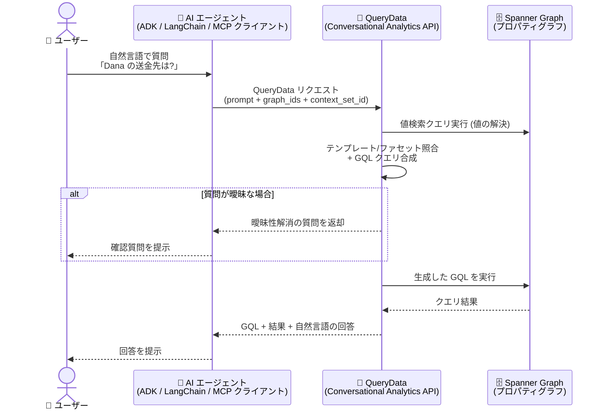

# Spanner: QueryData による自然言語からの GQL クエリ生成 (Preview)

**リリース日**: 2026-11-18

**サービス**: Spanner

**機能**: QueryData による Spanner Graph 向け GQL クエリ生成

**ステータス**: Preview

📊 [このアップデートのインフォグラフィックを見る](https://takech9203.github.io/google-cloud-news-summary/20261118-spanner-querydata-gql-generation.html)

## 概要

Spanner に、自然言語の質問から Graph Query Language (GQL) クエリを自動生成する QueryData 機能が Preview として追加された。QueryData は Conversational Analytics API のエンドポイントとして提供されるエージェント向けツールで、Spanner Graph のプロパティグラフに対する NL2GQL (自然言語から GQL への変換) をプログラマブルに実行できる。これにより、AI エージェントや LLM アプリケーションは GQL を記述することなく、グラフとして接続されたデータを探索できるようになる。

リクエストの `graph_ids` フィールドに対象のプロパティグラフを指定すると GQL が生成される (省略した場合は基盤テーブルに対する GoogleSQL が生成される)。さらに、オプションの「コンテキストセット」(クエリテンプレート・クエリファセット・値検索の集合) を提供することで、組織固有の用語やビジネスロジックを反映した高精度なクエリ生成が可能になる。

対象ユーザーは、Spanner Graph 上に不正検知・リスク分析・ナレッジグラフなどのグラフデータを持ち、会話型アシスタントや ADK / LangChain / MCP クライアントなどのエージェント基盤から接続データを活用したい開発者である。

**アップデート前の課題**

- Spanner Graph のデータを探索するには、開発者やアナリストがマルチホップの GQL クエリを自分で記述する必要があった
- AI エージェントからグラフデータを利用する場合、スキーマ解釈とクエリ合成のロジックをアプリケーション側で独自に実装する必要があった
- 汎用 LLM の知識だけでは、「ハイリスク送金」のような組織固有の用語をグラフモデル上の正確な条件にマッピングすることが難しかった

**アップデート後の改善**

- 自然言語の質問から、プロパティグラフのスキーマに基づいた GQL クエリを QueryData が自動生成・実行できるようになった
- コンテキストセット (テンプレート・ファセット・値検索) により、ドメイン固有の用語やビジネスルールを反映した高精度なクエリ生成が可能になった
- 質問が曖昧な場合は曖昧性解消のための確認質問 (disambiguation question) を返せるため、エージェントがユーザーに聞き返す対話フローを構築できるようになった

## アーキテクチャ図



AI エージェントがユーザーの質問を QueryData エンドポイントに送信すると、値の解決 → 意図照合 (必要に応じて曖昧性解消) → GQL 合成 → Spanner Graph での実行、という流れで結果が返される。

## サービスアップデートの詳細

### 主要機能

1. **自然言語からの GQL 生成 (NL2GQL)**
   - プロパティグラフのスキーマに基づき、自然言語の質問から GQL クエリを生成
   - `spanner_reference.database_reference` の `graph_ids` フィールドに対象グラフを指定することが必須。省略すると基盤テーブルに対するリレーショナル SQL (GoogleSQL) の生成にフォールバックする
   - 「口座 7 から送金されたお金が 60 日以内に戻ってきたか?」のようなマルチホップの質問にも、グラフ走査を含む GQL を生成して対応

2. **コンテキストセットによる精度向上**
   - **クエリテンプレート**: 代表的な自然言語の質問と事前検証済み GQL のペア。ビジネス上の意図と GQL 文のマッピングを定義
   - **クエリファセット**: 再利用可能な GQL 句 (グラフパターン、フィルタ条件、日付範囲、金額しきい値など)。複数の条件を動的に組み合わせられる
   - **値検索**: `GRAPH_TABLE` に対する SELECT 文として記述するセマンティック/文字列一致検索。質問中の語句 (例: 「rainy day」) をノード・エッジのプロパティに格納された実際の値 (例: `Rainy Day Fund`) に解決する
   - コンテキストセットは Spanner Studio で作成・管理でき、コンテキストエンジニアリングエージェントによる自動作成も可能

3. **クエリ生成の処理フロー**
   - **値の解決**: 値検索クエリを Spanner データベースに対して実行し、質問中の語句を具体的なプロパティ値にマッピング
   - **意図照合と曖昧性解消**: コンテキストセットのテンプレート・ファセットと照合し、質問が不明瞭な場合は確認質問を返却
   - **クエリ合成**: スキーマ・テンプレート構造・ファセット・解決済みの値から完全な GQL クエリを合成
   - **クエリ実行**: 生成した GQL を Spanner データベースに対して実行し結果を返却

4. **柔軟な出力オプション (`generation_options`)**
   - `generate_query_result`: 生成した GQL を実行して結果を返す
   - `generate_natural_language_answer`: 結果を要約した自然言語の回答を生成
   - `generate_explanation`: 生成した GQL の説明を生成
   - `generate_disambiguation_question`: 曖昧な質問に対する確認質問を生成

## 技術仕様

### QueryData リクエストの主要フィールド

| 項目 | 詳細 |
|------|------|
| API | Conversational Analytics API (`POST /v1beta/projects/*/locations/*/conversations:queryData`) |
| `prompt` | エンドユーザーからの自然言語の質問 |
| `engine` | データベースの方言。Spanner Graph では `GOOGLE_SQL` を指定 |
| `graph_ids` | 対象プロパティグラフ名のリスト。**GQL 生成には必須** (省略時はリレーショナル SQL を生成) |
| `context_set_id` | データベースに保存された事前作成コンテキストの完全な ID |
| `generation_options` | クエリ結果・自然言語回答・説明・曖昧性解消質問の生成を制御 |

### リクエスト例 (FinGraph サンプルグラフ)

```json
{
  "parent": "projects/my-project/locations/global",
  "prompt": "Find everyone that Dana transferred money to, along with the account IDs and transfer amounts.",
  "context": {
    "datasource_references": {
      "spanner_reference": {
        "database_reference": {
          "engine": "GOOGLE_SQL",
          "project_id": "my-project",
          "instance_id": "my-instance",
          "database_id": "fin-graph-db",
          "graph_ids": ["FinGraph"]
        },
        "agent_context_reference": {
          "context_set_id": "projects/my-project/locations/us-central1/contextSets/fingraph-assistant"
        }
      }
    }
  },
  "generation_options": {
    "generate_query_result": true,
    "generate_natural_language_answer": true,
    "generate_disambiguation_question": true,
    "generate_explanation": true
  }
}
```

## メリット

### ビジネス面

- **グラフデータの民主化**: GQL を知らないアナリストやエンドユーザーが、会話型アシスタント経由で不正検知・リスク・コンプライアンスのグラフデータを探索できる
- **用語の一貫性**: コンテキストセットにより「ハイリスク送金」などの組織固有の定義をすべての回答で一貫して適用できる
- **開発コスト削減**: NL2GQL のスキーマ解釈・クエリ合成ロジックをマネージドなエンドポイントに委譲でき、独自実装が不要になる

### 技術面

- **エージェント基盤との親和性**: ADK、LangChain、MCP クライアント、Antigravity などのエージェントハーネスからツールとして呼び出す設計。会話履歴やユーザー状態の管理はハーネス側、スキーマ解釈とクエリ合成は QueryData 側という役割分担が明確
- **曖昧性解消のサポート**: 質問が不十分な場合に確認質問を返すため、ロバストな対話フローを構築できる
- **事前検証済みクエリの活用**: テンプレートとファセットにより、LLM の自由生成に頼らない再現性の高いクエリ生成が可能

## デメリット・制約事項

### 制限事項

- Preview 機能であり、Pre-GA Offerings Terms (および生成 AI Preview プロダクトの追加規約) が適用される。サポートは限定的な場合がある
- GoogleSQL 方言のデータベースが対象で、**PostgreSQL インターフェースはサポートされない**
- `graph_ids` を省略すると GQL ではなく基盤テーブルへの GoogleSQL が生成されるため、グラフクエリを意図する場合は指定が必須
- Conversational Analytics API が公式にサポートする言語は英語のみ

### 考慮すべき点

- Spanner Graph 自体が Enterprise / Enterprise Plus エディションの機能であるため、Standard エディションでは利用できない
- 生成精度を高めるには、コンテキストセット (テンプレート・ファセット・値検索) の作成・メンテナンスという運用タスクが発生する
- 生成されたクエリは Spanner 上で実行されるため、Spanner 側のコンピューティングコストへの影響を考慮する必要がある

## ユースケース

### ユースケース 1: グラフデータに対する会話型アシスタント

**シナリオ**: 金融機関のサポート担当者やアナリストが、「口座 7 から送金されたお金は 60 日以内に戻ってきた?」といった質問を自然言語で行う。

**効果**: QueryData がマルチホップの GQL クエリを生成・実行し、循環送金のような複雑なグラフパターンの回答を GQL の知識なしで得られる。

### ユースケース 2: 不正・リスク・コンプライアンス調査のコパイロット

**シナリオ**: アナリストが口座の所有関係や送金ネットワークを追加質問を重ねながら探索する。コンテキストセットで「ハイリスク送金」などの用語を定義しておく。

**効果**: すべての回答で組織のビジネス定義が一貫して適用され、調査の精度とスピードが向上する。

### ユースケース 3: ナレッジグラフ推論エージェント

**シナリオ**: ADK や MCP クライアントで構築したエージェントが、QueryData をツールとして呼び出し、「ある人物が中間エンティティを介して支配している口座はどれか」といった関係性の推論をグラフデータに接地 (グラウンディング) して行う。

**効果**: LLM の推論を Spanner Graph に格納された実際の関係データに基づいて行えるため、ハルシネーションを抑えた信頼性の高いエージェントを構築できる。

## 料金

QueryData は Conversational Analytics API の機能として提供される。料金の詳細は [Data Cloud Agent の料金ページ](https://cloud.google.com/products/data-agents/pricing)を参照。また、生成されたクエリの実行は Spanner 側のリソースを消費するため、[Spanner の料金](https://cloud.google.com/spanner/pricing)も別途適用される。

## 利用可能リージョン

Conversational Analytics API はデフォルトでグローバルエンドポイントを使用し、データレジデンシー要件に応じてリージョナル/マルチリージョナルエンドポイントも指定できる。最新の対応ロケーションは[公式ドキュメント](https://docs.cloud.google.com/gemini/data-agents/conversational-analytics-api/locations)を参照。

## 関連サービス・機能

- **Spanner Graph**: QueryData の対象となるプロパティグラフ機能。Enterprise / Enterprise Plus エディションで利用可能
- **Conversational Analytics API**: QueryData エンドポイントを提供する API。AlloyDB、Cloud SQL (MySQL / PostgreSQL)、BigQuery などのデータソースにも対応
- **Agent Development Kit (ADK) / MCP**: QueryData をツールとして呼び出すエージェントハーネス。知識グラフ推論エージェントの構築に利用
- **Spanner Studio**: コンテキストセットの作成・管理を行う管理画面

## 参考リンク

- 📊 [インフォグラフィック](https://takech9203.github.io/google-cloud-news-summary/20261118-spanner-querydata-gql-generation.html)
- [公式リリースノート](https://docs.cloud.google.com/release-notes#November_18_2026)
- [QueryData for Spanner Graph の概要](https://docs.cloud.google.com/gemini/data-agents/querydata/spanner-graph/data-agent-overview)
- [コンテキストセットの概要 (Spanner Graph)](https://docs.cloud.google.com/gemini/data-agents/querydata/spanner-graph/context-sets-overview)
- [QueryData for Spanner Graph のテスト](https://docs.cloud.google.com/gemini/data-agents/querydata/spanner-graph/inspect-data-agent)
- [アプリケーションへの QueryData の統合](https://docs.cloud.google.com/gemini/data-agents/querydata/spanner-graph/integrate-applications-data-agent)
- [Spanner の QueryData ドキュメント](https://docs.cloud.google.com/spanner/docs/querydata)
- [料金ページ (Data Cloud Agent)](https://cloud.google.com/products/data-agents/pricing)

## まとめ

QueryData の Spanner Graph 対応により、AI エージェントや LLM アプリケーションが GQL を書かずにグラフデータを探索できる、マネージドな NL2GQL 基盤が利用可能になった。不正検知やナレッジグラフなど Spanner Graph を活用中 (または検討中) のチームは、FinGraph サンプルで動作を確認し、コンテキストセットの設計を通じて自社ドメインの用語を反映したエージェント構築を検証することを推奨する。Preview 段階のため、本番適用は GA を見据えた評価に留めるのが望ましい。

---

**タグ**: Spanner, Spanner Graph, GQL, QueryData, Conversational Analytics API, NL2GQL, AIエージェント, Preview
