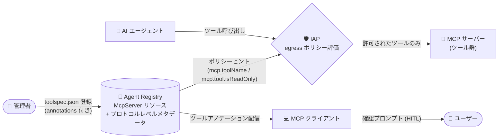

# Agent Registry: MCP ツールのプロトコルレベルメタデータ対応 (Preview)

**リリース日**: 2026-11-19

**サービス**: Agent Registry

**機能**: MCP ツールのプロトコルレベルメタデータ (IAP ポリシーヒント / HITL 制御 / プロバイダーメタデータ属性)

**ステータス**: Preview

📊 [このアップデートのインフォグラフィックを見る](https://takech9203.github.io/google-cloud-news-summary/20261119-agent-registry-mcp-tool-metadata.html)

## 概要

Agent Registry が Model Context Protocol (MCP) ツールの**プロトコルレベルメタデータ**をサポートしました (Preview)。今回のアップデートにより、MCP 仕様に準拠したツールアノテーション (ツールの挙動ヒント) を Agent Registry に登録・保持できるようになり、ツール有効化のための Identity-Aware Proxy (IAP) ポリシーヒント、Human-in-the-Loop (HITL) 制御、およびプロバイダーメタデータ属性として活用できます。

Agent Registry は、AI エージェント、MCP サーバー、エンドポイント、スキルを一元的に登録・検索・ガバナンスするためのサービスです。MCP サーバーを登録する際の `toolspec.json` には、MCP 仕様の Tool オブジェクトスキーマに準拠した `annotations` (`readOnlyHint`、`destructiveHint`、`idempotentHint`、`openWorldHint`) を含めることができ、これらのヒントが IAP のポリシー評価属性 (例: `iap.googleapis.com/mcp.tool.isReadOnly`) や、MCP クライアントでのユーザー確認プロンプト (HITL) の判断材料として利用されます。

エージェントが利用するツールを「どのエージェントが」「どのような特性のツールを」呼び出せるかという粒度で統制したい Solutions Architect やプラットフォーム管理者にとって、エージェントガバナンスをツールレベルまで深化させる重要なアップデートです。

**アップデート前の課題**

- 手動登録した MCP サーバーは、エンドポイント URL とツール一覧 (名前・説明) の登録が中心で、ツールのリスク特性 (読み取り専用か、破壊的操作を伴うかなど) を IAP ポリシーによるツール単位の有効化制御に直接結び付ける標準的な仕組みが提供されていなかった
- MCP ツールの挙動ヒントをレジストリ経由でクライアントに伝搬し、ユーザー確認 (HITL) の要否判断に活用する一貫したメタデータ基盤がなかった
- MCP サーバーやツールの提供元 (プロバイダー) に関する付加的な属性情報をレジストリ上で構造化して保持する手段が限られていた

**アップデート後の改善**

- `toolspec.json` の MCP 準拠アノテーションがプロトコルレベルメタデータとして Agent Registry に取り込まれ、IAP の条件付き egress ポリシーで `iap.googleapis.com/mcp.toolName` や `iap.googleapis.com/mcp.tool.isReadOnly` などの属性を参照したツール単位のアクセス制御 (ツール有効化のポリシーヒント) が可能になった
- ツールアノテーションが MCP クライアントに送信され、ツールの基本的なリスクを示すヒントとして、ユーザーへの確認プロンプト (HITL 制御) を出すかどうかの判断に利用できるようになった
- プロバイダーメタデータ属性 (key-value 形式の `attributes`、例: `agentregistry.googleapis.com/system/RuntimeReference`) により、リソースの付加情報を構造化して保持・参照できるようになった

## アーキテクチャ図



管理者が MCP 仕様準拠のアノテーション付きツール仕様を Agent Registry に登録すると、IAP がそのメタデータをポリシーヒントとしてツール単位の egress 制御に利用し、MCP クライアントはアノテーションをもとにユーザー確認 (HITL) の要否を判断できます。

## サービスアップデートの詳細

### 主要機能

1. **MCP ツールのプロトコルレベルメタデータ登録**
   - MCP サーバー登録時の `toolspec.json` に、MCP Tool オブジェクトスキーマ準拠の `annotations` (`title`、`readOnlyHint`、`destructiveHint`、`idempotentHint`、`openWorldHint`) を含めて登録可能
   - 登録されたメタデータは読み取り専用の `McpServer` ディスカバリリソースとして公開され、`get_mcp_server` などで参照できる

2. **IAP ポリシーヒントによるツール有効化制御**
   - IAP のエージェント間 egress ポリシーの CEL 条件式で、`api.getAttribute('iap.googleapis.com/mcp.toolName', '')` や `api.getAttribute('iap.googleapis.com/mcp.tool.isReadOnly', false)` などの属性を参照可能
   - 「このエージェントは読み取り専用ツールのみ呼び出せる」といったツール特性ベースの最小権限ポリシーを定義できる

3. **Human-in-the-Loop (HITL) 制御**
   - ツールアノテーションは MCP クライアントに送信され、ツールの基本的なリスクを示すヒントとして機能する
   - 多くのクライアントはヒントを信頼できない情報 (untrusted) として扱うが、ユーザーへの確認プロンプトをいつ表示するかの判断に利用できる

4. **プロバイダーメタデータ属性**
   - リソースに key-value 形式の属性 (`AttributesEntry`: key は文字列、value は Struct 形式) を保持
   - 例として、ホスティング先ランタイムを示す `agentregistry.googleapis.com/system/RuntimeReference` 属性があり、IAM ポリシー評価に使われるエージェントプリンシパルにも埋め込まれる

## 技術仕様

### MCP ツールアノテーション (プロトコルレベルメタデータ)

| フィールド | 説明 | デフォルト |
|------|------|------|
| `title` | ツールの人間可読なタイトル | - |
| `readOnlyHint` | `true` の場合、ツールは環境を変更しない (データ取得のみ) | `false` |
| `destructiveHint` | `true` の場合、破壊的 (永続的) な変更を行う可能性がある。`readOnlyHint == false` のときのみ意味を持つ | `true` |
| `idempotentHint` | `true` の場合、同じ引数での繰り返し呼び出しは追加の影響を持たない。`readOnlyHint == false` のときのみ意味を持つ | `false` |
| `openWorldHint` | `true` の場合、外部エンティティの「オープンワールド」と対話する (例: Web 検索はオープン、メモリツールはクローズド) | `true` |

### IAP ポリシーで参照できる主な属性

| 属性 | 説明 |
|------|------|
| `iap.googleapis.com/mcp.toolName` | 呼び出し対象の MCP ツール名 |
| `iap.googleapis.com/mcp.tool.isReadOnly` | ツールが読み取り専用かどうか |
| `iap.googleapis.com/request.auth.type` | 認可タイプ (例: `MCP`) |

### toolspec.json の例

```json
{
  "tools": [
    {
      "name": "get_customer_info",
      "description": "Retrieves customer details from the database.",
      "annotations": {
        "title": "Get Customer Info",
        "readOnlyHint": true,
        "idempotentHint": true
      }
    },
    {
      "name": "create_support_ticket",
      "description": "Creates a new support ticket in the issue tracking system.",
      "annotations": {
        "title": "Create Support Ticket",
        "destructiveHint": true,
        "idempotentHint": false,
        "openWorldHint": true
      }
    }
  ]
}
```

ツール仕様ファイルの最大サイズは 10 KB です。

## 設定方法

### 前提条件

1. [Agent Registry のセットアップ](https://docs.cloud.google.com/agent-registry/setup) が完了していること
2. ガバナンスプロジェクトで Agent Registry API Editor (`roles/agentregistry.editor`) ロールが付与されていること (MCP サーバーの登録に必要)

### 手順

#### ステップ 1: アノテーション付きツール仕様で MCP サーバーを登録

```bash
gcloud agent-registry services create SERVER_NAME \
  --project=PROJECT_ID \
  --location=REGION \
  --display-name="DISPLAY_NAME" \
  --mcp-server-spec-type=tool-spec \
  --mcp-server-spec-content=toolspec.json \
  --interfaces=url=SERVER_URL,protocolBinding=jsonrpc
```

`toolspec.json` に MCP 仕様準拠の `annotations` を含めることで、プロトコルレベルメタデータが `McpServer` ディスカバリリソースに登録されます。

#### ステップ 2: ツールメタデータを参照する IAP egress ポリシーを作成

```json
{
  "policy": {
    "bindings": [
      {
        "role": "roles/iap.egressor",
        "members": [
          "principal://iam.googleapis.com/projects/1234567890/locations/global/workloadIdentityPools/my-pool.svc.id.goog/subject/ns/default/sa/my-ae-agent"
        ],
        "condition": {
          "title": "Allow read-only egress to MCP server tools",
          "expression": "api.getAttribute('iap.googleapis.com/mcp.toolName', '') == 'GitHubTool' && api.getAttribute('iap.googleapis.com/mcp.tool.isReadOnly', false) == true && api.getAttribute('iap.googleapis.com/request.auth.type', '') == 'MCP'"
        }
      }
    ]
  }
}
```

```bash
gcloud iap web set-iam-policy agents-iap-policy.json \
  --project=PROJECT_ID \
  --resource-type=agent-registry \
  --mcp-server=MCP_SERVER_ID \
  --region=REGION
```

CEL 条件式でツール名や読み取り専用ヒントを参照し、特定エージェントに対してツール単位のアクセスを許可します。Google 管理のリモート MCP サーバー (自動登録) は `global` ロケーションにのみ作成されるため、IAP ポリシーも `--region=global` で適用します。

## メリット

### ビジネス面

- **エージェントガバナンスの強化**: ツールのリスク特性 (読み取り専用/破壊的) に基づく最小権限ポリシーを組織的に適用でき、エージェントによる意図しない破壊的操作のリスクを低減できる
- **コンプライアンス対応**: HITL 制御により、重要な操作の前に人間の確認を挟む統制を仕組みとして組み込める

### 技術面

- **標準準拠のメタデータ**: MCP 仕様 (Tool オブジェクトスキーマ) に準拠したアノテーションをそのまま登録でき、既存の MCP エコシステムと互換性がある
- **ポリシーとメタデータの連動**: レジストリに登録したツールメタデータが IAP の CEL 条件式から属性として参照できるため、ツール追加時もポリシー定義を汎用的に保てる (例: `isReadOnly == true` のツールのみ許可)

## デメリット・制約事項

### 制限事項

- 本機能は **Preview** であり、GA 前の機能は変更される可能性がある
- ツール仕様ファイル (`toolspec.json`) の最大サイズは 10 KB
- 自動登録される Google / Google Cloud リモート MCP サーバーの `McpServer` リソースは `global` ロケーションにのみ作成されるため、リージョンを指定した参照や IAP ポリシー適用は `NOT_FOUND` エラーになる (リージョンでの管理が必要な場合は手動登録が必要)

### 考慮すべき点

- ツールアノテーションは多くの MCP クライアントで信頼できない情報 (untrusted) として扱われるヒントであり、それ単体をセキュリティ境界と見なすべきではない。IAP ポリシーなどの強制力のある制御と組み合わせて利用する
- `destructiveHint` と `idempotentHint` は `readOnlyHint == false` のときのみ意味を持つ
- 手動登録では Agent Registry がサーバーを自動検査しないため、ツール仕様の正確な登録・更新は運用側の責任となる

## ユースケース

### ユースケース 1: 読み取り専用ツールに限定したエージェント運用

**シナリオ**: 社内データ参照用のオーケストレーターエージェントに、外部 MCP サーバーのツールのうち読み取り専用のものだけを許可したい。

**実装例**:
```
IAP egress ポリシーの CEL 条件式:
api.getAttribute('iap.googleapis.com/mcp.tool.isReadOnly', false) == true
  && api.getAttribute('iap.googleapis.com/request.auth.type', '') == 'MCP'
```

**効果**: ツールが追加されても、`readOnlyHint: true` のツールのみ自動的に許可対象となり、破壊的操作を伴うツールへのアクセスをポリシーレベルで遮断できる。

### ユースケース 2: 破壊的ツール実行前の人間による承認 (HITL)

**シナリオ**: チケット作成やリソース削除など `destructiveHint: true` のツールについて、エージェントが自律実行する前にユーザー確認を挟みたい。

**効果**: Agent Registry 経由で配信されるツールアノテーションをもとに、MCP クライアントが確認プロンプトの表示要否を判断でき、重要操作に対する Human-in-the-Loop 統制を実現できる。

## 料金

リリースノートおよび確認できたドキュメントの範囲では、本機能に固有の料金情報は記載されていません。最新の料金情報は [Agent Registry の公式ドキュメント](https://docs.cloud.google.com/agent-registry/overview) を参照してください。

## 利用可能リージョン

- 外部 MCP サーバーの手動登録は、サポートされているリージョン、マルチリージョン、または `global` ロケーションで可能
- 自動登録される Google / Google Cloud リモート MCP サーバーは `global` ロケーションにのみ登録される (リージョナルエンドポイントは単一の global リソースの `interfaces` フィールドに列挙)
- 詳細は [Agent Registry locations](https://docs.cloud.google.com/agent-registry/locations) を参照

## 関連サービス・機能

- **Identity-Aware Proxy (IAP)**: `roles/iap.egressor` とツールメタデータ属性を使った条件付き egress ポリシーで、エージェントから MCP サーバー/ツールへのアクセスを制御
- **Gemini Enterprise Agent Platform**: Agent Gateway とセマンティックガバナンスポリシーエンジンを組み合わせたエージェント統制の基盤。Agent Registry はそのレジストリ層を担う
- **GKE / Cloud Run**: `registry.gke.io/functional-type: "MCP_SERVER"` ラベルなどにより MCP サーバーを自動登録できるサポート対象ランタイム
- **Apigee API hub**: MCP スタイルの API を Agent Registry に自動同期可能

## 参考リンク

- 📊 [インフォグラフィック](https://takech9203.github.io/google-cloud-news-summary/20261119-agent-registry-mcp-tool-metadata.html)
- [公式リリースノート](https://docs.cloud.google.com/release-notes#November_19_2026)
- [MCP サーバーの登録 (MCP server specifications)](https://docs.cloud.google.com/agent-registry/register-mcp-servers)
- [Agent Registry JSON schemas (MCP tool schema)](https://docs.cloud.google.com/agent-registry/json-schemas)
- [Agent Registry のデータモデル](https://docs.cloud.google.com/agent-registry/data-model)
- [IAM / IAP ポリシーの構成 (エージェントガバナンス)](https://docs.cloud.google.com/gemini-enterprise-agent-platform/govern/policies/configure-iam-policies)

## まとめ

Agent Registry が MCP ツールのプロトコルレベルメタデータに対応したことで、ツールのリスク特性に基づく IAP ポリシー制御と HITL 統制を、レジストリを起点に一貫して構成できるようになりました。エージェントが利用する MCP ツールのガバナンスを強化したい組織は、まず `toolspec.json` にアノテーションを付与して登録し、`iap.googleapis.com/mcp.tool.isReadOnly` などの属性を使った egress ポリシーの適用を検討することを推奨します。Preview 機能のため、本番適用時は仕様変更の可能性に留意してください。

---

**タグ**: Agent Registry, MCP, Identity-Aware Proxy, Human-in-the-Loop, エージェントガバナンス, Gemini Enterprise Agent Platform, Preview
