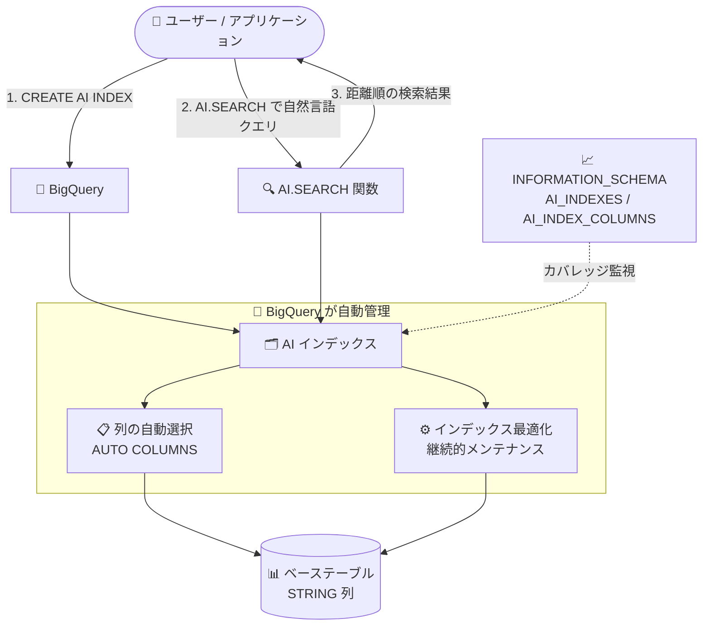

# BigQuery: CREATE AI INDEX ステートメントによる AI インデックス作成 (Preview)

**リリース日**: 2026-11-19

**サービス**: BigQuery

**機能**: CREATE AI INDEX ステートメントによる AI インデックスと自然言語検索

**ステータス**: Preview

📊 [このアップデートのインフォグラフィックを見る](https://takech9203.github.io/google-cloud-news-summary/20261119-bigquery-ai-index-natural-language-search.html)

## 概要

BigQuery に `CREATE AI INDEX` ステートメントが Preview として追加されました。AI インデックスをテーブルに作成すると、`AI.SEARCH` 関数を使ってテーブルの列に対する自然言語検索 (セマンティック検索) を実行できます。最大の特徴は、エンベディング (埋め込みベクトル) の生成やエンベディングモデルの管理をユーザーが手動で行う必要がない点です。

従来、BigQuery でセマンティック検索を実現するには、エンベディングモデルへの接続設定、エンベディング列の生成、ベクトルインデックスの作成といった複数のステップを自分で構築・管理する必要がありました。AI インデックスでは、列の選択 (AUTO COLUMNS 指定時)、インデックスの最適化、継続的なメンテナンスを BigQuery が自動的に管理します。インデックス作成後は、ベーステーブルと検索クエリ文字列を渡すだけで `AI.SEARCH` による検索が可能です。

データウェアハウス上のテキストデータに対して、セマンティック検索・RAG・レコメンデーションなどを手軽に実現したいデータエンジニアやアナリストに有用なアップデートです。

**アップデート前の課題**

- セマンティック検索を行うには、Cloud リソース接続の作成、エンベディングモデル (例: `text-embedding-005`) の指定、`AI.EMBED` によるエンベディング列の生成など、複数の構成要素を手動でセットアップする必要があった
- エンベディング列やベクトルインデックスの設計 (どの列を対象にするか、インデックスタイプの選択など) をユーザー自身が判断・管理する必要があった
- モデルやインデックスの継続的なメンテナンスの考慮が必要だった

**アップデート後の改善**

- `CREATE AI INDEX` を 1 文実行するだけで、エンベディング生成やモデル管理なしに自然言語検索の準備が完了するようになった
- `AUTO COLUMNS` 指定により、BigQuery がインデックス対象の列 (最大 50 列) を自動選択できるようになった
- 列の選択、インデックスの最適化、継続的なメンテナンスを BigQuery が自動管理するようになった
- `INFORMATION_SCHEMA.AI_INDEXES` / `AI_INDEX_COLUMNS` ビューでインデックスのカバレッジや対象列を監視できる

## アーキテクチャ図



`CREATE AI INDEX` の実行後は、列選択・最適化・メンテナンスを BigQuery が自動管理し、ユーザーは `AI.SEARCH` に自然言語クエリを渡すだけで検索結果を取得できます。

## サービスアップデートの詳細

### 主要機能

1. **CREATE AI INDEX ステートメント**
   - テーブルに AI インデックスを作成する DDL ステートメント
   - `AUTO COLUMNS` を指定すると、作成時点で対象となり得る列から最大 50 列を BigQuery が自動選択
   - 列を明示指定することも可能 (タイトルなど情報量の多い列を先頭に置くことが推奨されている)

2. **エンベディング・モデル管理が不要な自然言語検索**
   - 手動でのエンベディング生成やエンベディングモデルの管理が不要
   - `AI.SEARCH` 関数にベーステーブル (またはクエリ) と検索文字列を渡すだけでセマンティック検索を実行
   - 結果は `distance` (距離) 付きで返却され、`top_k` で取得件数を制御可能

3. **INFORMATION_SCHEMA によるモニタリング**
   - `INFORMATION_SCHEMA.AI_INDEXES`: カバレッジ率 (`coverage_percentage`)、未インデックス行数、論理バイト数などのインデックスメタデータ
   - `INFORMATION_SCHEMA.AI_INDEX_COLUMNS`: インデックス対象列の確認 (`AUTO COLUMNS` の選択結果の検証に有用)
   - `INFORMATION_SCHEMA.JOBS`: ジョブ ID が `gc_` で始まるバックグラウンドのインデックスメンテナンスジョブのスロット消費 (`total_slot_ms`) や課金バイト数 (`total_bytes_billed`) を追跡

4. **DROP AI INDEX によるインデックス削除**
   - `DROP AI INDEX IF EXISTS index_name ON dataset.table` でインデックスのみを削除可能
   - テーブルを削除するとインデックスも自動的に削除される

## 技術仕様

### AI インデックスの仕様

| 項目 | 詳細 |
|------|------|
| 対象列の型 | トップレベルの非繰り返し `STRING` 列のみ (配列・構造体・JSON・ネストフィールド・疑似列は不可) |
| 最大列数 | 1 インデックスあたり 50 列 |
| インデックス数 | 1 テーブルにつき 1 つの AI インデックス |
| 対象テーブル | 標準テーブルのみ (ビュー、マテリアライズドビュー、外部テーブル、BigLake / Iceberg テーブル、スナップショットは不可) |
| 作成時の行数上限 | オンデマンド: 100 万行 / `BACKGROUND` 予約割り当てあり: 1 億行 |
| 共存制約 | AI インデックスを持つテーブルには、ベクトルインデックスや自動生成エンベディング列を併用できない |
| その他の制約 | クロスリージョンレプリカを持つデータセットでは作成不可。`AUTO COLUMNS` は作成後に追加された列を自動では対象にしない (インデックスの再作成が必要) |

### 必要な IAM ロール

| 操作 | 必要なロール |
|------|------------|
| インデックスの作成・削除 | BigQuery Data Owner (`roles/bigquery.dataOwner`) |
| テーブルへのクエリ | BigQuery Data Viewer + BigQuery Job User |
| インデックスメタデータの閲覧 | BigQuery Data Viewer |

## 設定方法

### 前提条件

1. インデックス対象のテーブルが標準テーブルであること (トップレベルの非繰り返し `STRING` 列を含む)
2. インデックスを作成するデータセットに対する BigQuery Data Owner (`roles/bigquery.dataOwner`) ロール
3. 100 万行を超えるテーブルにインデックスを作成する場合は `BACKGROUND` ジョブタイプの予約割り当て

### 手順

#### ステップ 1: AI インデックスの作成

```sql
-- 列を自動選択する場合 (最大 50 列を BigQuery が選択)
CREATE AI INDEX products_ai_index
ON mydataset.products(AUTO COLUMNS);

-- 列を明示指定する場合 (情報量の多い列を先頭に)
CREATE AI INDEX products_ai_index
ON mydataset.products(name, description);
```

#### ステップ 2: インデックスのカバレッジを確認

```sql
SELECT table_name, index_name, coverage_percentage, unindexed_row_count
FROM my_project.my_dataset.INFORMATION_SCHEMA.AI_INDEXES;
```

インデックス作成が完了するまで検索結果は不完全になるため、`coverage_percentage` を確認してから検索を実行します。

#### ステップ 3: AI.SEARCH で自然言語検索を実行

```sql
SELECT base.id, base.name, base.description, distance
FROM AI.SEARCH(
  TABLE mydataset.products,
  'shoes that keep your feet dry in the rain',
  top_k => 5)
ORDER BY distance;
```

#### ステップ 4: 不要になったインデックスの削除

```sql
DROP AI INDEX IF EXISTS products_ai_index ON mydataset.products;
```

## メリット

### ビジネス面

- **導入の高速化**: エンベディングパイプラインの構築なしに SQL 1 文でセマンティック検索を導入でき、検索機能や RAG 基盤の立ち上げ期間を短縮できる
- **運用負荷の削減**: 列選択・最適化・メンテナンスが BigQuery のマネージド機能になるため、専任の運用工数を抑えられる

### 技術面

- **エンベディング管理の抽象化**: 接続設定、エンベディングモデルの選定、`AI.EMBED` 列の設計といった従来必要だった構成要素が不要になる
- **自動列選択**: `AUTO COLUMNS` により、どの列を検索対象にすべきかの初期判断を BigQuery に任せられる
- **可観測性**: `INFORMATION_SCHEMA` ビューでカバレッジ、対象列、バックグラウンドジョブのコストを SQL で監視できる

## デメリット・制約事項

### 制限事項

- Preview 段階の機能であり、Pre-GA Offerings Terms が適用される (サポートが限定される場合がある)
- 対象はトップレベルの非繰り返し `STRING` 列のみ (配列、構造体、JSON、ネストフィールドは不可)
- 1 テーブルに 1 インデックス、1 インデックスに最大 50 列
- 標準テーブルのみ対応 (ビュー、外部テーブル、BigLake / Iceberg テーブルなどは不可)
- 作成時の行数上限: オンデマンドは 100 万行、`BACKGROUND` 予約割り当てありで 1 億行
- AI インデックスを持つテーブルにはベクトルインデックスや自動生成エンベディング列を併用できない
- クロスリージョンレプリカを持つデータセットでは利用不可

### 考慮すべき点

- `AUTO COLUMNS` は作成後に追加された列を対象にしないため、スキーマ変更時はインデックスの削除・再作成が必要
- インデックス作成は非同期であり、`coverage_percentage` が 100 になるまで検索結果が不完全になる
- バックグラウンドのインデックスメンテナンスジョブ (`gc_` プレフィックス) のスロット消費・課金バイト数を `INFORMATION_SCHEMA.JOBS` で監視し、コストを把握しておくことが望ましい

## ユースケース

### ユースケース 1: EC サイトの商品カタログ検索

**シナリオ**: 商品名と説明文を持つ商品テーブルに対し、「雨の日でも足が濡れない靴」のような自然言語クエリで商品を検索したい。

**実装例**:
```sql
CREATE AI INDEX products_ai_index
ON mydataset.products(name, description);

SELECT base.id, base.name, base.description, distance
FROM AI.SEARCH(
  TABLE mydataset.products,
  'shoes that keep your feet dry in the rain',
  top_k => 5)
ORDER BY distance;
```

**効果**: キーワード完全一致に依存しないセマンティックな商品検索を、エンベディングパイプラインなしで実現できる。

### ユースケース 2: 社内ナレッジ・問い合わせログの横断検索

**シナリオ**: サポート問い合わせログや社内ドキュメントのテキスト列が多数あるテーブルに対し、どの列が検索に有効か判断せずに検索基盤を作りたい。

**効果**: `AUTO COLUMNS` により BigQuery が対象列を自動選択するため、スキーマの事前分析なしに複数列を横断した自然言語検索を開始できる。`AI_INDEX_COLUMNS` ビューで選択結果を後から検証できる。

## 料金

本機能 (Preview) の個別の料金は、公式ドキュメント上で明示を確認できませんでした。コストの把握には以下が利用できます。

- バックグラウンドのインデックスメンテナンスジョブ: `INFORMATION_SCHEMA.JOBS` でジョブ ID が `gc_` で始まるジョブの `total_slot_ms` と `total_bytes_billed` を確認
- インデックスのストレージ: `INFORMATION_SCHEMA.AI_INDEXES` の `total_logical_bytes` を確認

最新の料金は [BigQuery の料金ページ](https://cloud.google.com/bigquery/pricing) を参照してください。

## 利用可能リージョン

公式ドキュメントで本機能のリージョン別提供状況は確認できませんでした。最新情報は [Use AI indexes のドキュメント](https://docs.cloud.google.com/bigquery/docs/ai-index) を参照してください。なお、クロスリージョンレプリカを持つデータセットでは利用できない制約があります。

## 関連サービス・機能

- **AI.SEARCH 関数**: AI インデックスを利用した検索の実行インターフェース。セマンティック検索に加え、ベクトルインデックス構成によってはハイブリッド検索やリランキング (`rerank => TRUE`) にも対応
- **ベクトルインデックス (CREATE VECTOR INDEX)**: エンベディング列に対する従来型のインデックス。モデルや列を細かく制御したい場合の選択肢 (AI インデックスとは同一テーブルで併用不可)
- **自動エンベディング生成 (Autonomous Embedding Generation)**: `AI.EMBED` を使った生成列によるエンベディング自動更新の仕組み (AI インデックスとは同一テーブルで併用不可)
- **BigQuery Reservations**: 100 万行を超えるテーブルへのインデックス作成に必要な `BACKGROUND` ジョブタイプの予約割り当て

## 参考リンク

- 📊 [インフォグラフィック](https://takech9203.github.io/google-cloud-news-summary/20261119-bigquery-ai-index-natural-language-search.html)
- [公式リリースノート](https://docs.cloud.google.com/release-notes#November_19_2026)
- [Use AI indexes (公式ドキュメント)](https://docs.cloud.google.com/bigquery/docs/ai-index)
- [AI.SEARCH 関数リファレンス](https://docs.cloud.google.com/bigquery/docs/reference/standard-sql/bigqueryml-syntax-ai-search)
- [ベクトルインデックスの管理](https://docs.cloud.google.com/bigquery/docs/vector-index)
- [BigQuery 料金ページ](https://cloud.google.com/bigquery/pricing)

## まとめ

`CREATE AI INDEX` は、エンベディング生成やモデル管理といったセマンティック検索導入の最大のハードルを取り除き、SQL 1 文で自然言語検索を可能にする重要なアップデートです。まずは小規模なテキストテーブルで `AUTO COLUMNS` を使ったインデックスを作成し、`INFORMATION_SCHEMA.AI_INDEXES` でカバレッジを確認しながら `AI.SEARCH` の検索品質を評価することを推奨します。Preview 段階のため、本番適用時は制約事項 (列型、行数上限、ベクトルインデックスとの併用不可など) を事前に確認してください。

---

**タグ**: BigQuery, AI Index, AI.SEARCH, セマンティック検索, 自然言語検索, Preview, エンベディング, DDL
