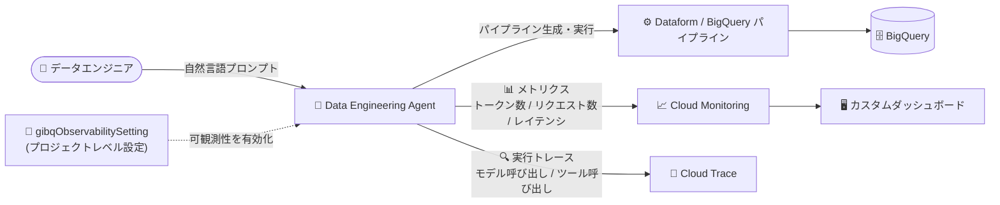

# BigQuery: Data Engineering Agent のエージェント可観測性が GA

**リリース日**: 2026-11-19

**サービス**: BigQuery

**機能**: Data Engineering Agent のエージェント可観測性 (Agent Observability)

**ステータス**: GA (一般提供)

📊 [このアップデートのインフォグラフィックを見る](https://takech9203.github.io/google-cloud-news-summary/20261119-bigquery-data-engineering-agent-observability.html)

## 概要

BigQuery の Data Engineering Agent で、エージェント可観測性 (Agent Observability) を有効化できるようになり、一般提供 (GA) が開始されました。この機能を有効にすると、エージェントのトークン消費量、リクエスト数、モデルレイテンシを Cloud Monitoring でモニタリングし、実行トレースやツール呼び出しを Cloud Trace で詳細に検査できます。

Data Engineering Agent は、自然言語プロンプトで BigQuery のデータパイプラインの構築・変更・トラブルシューティングを行えるエージェントです。Dataform との統合、プラン生成、コード検証、自動データラングリングなどの機能を提供します。今回の GA により、このエージェントの動作をプロダクション環境で求められる水準で監視・デバッグできるようになりました。

本機能は、BigQuery の会話型分析 (Conversational Analytics) と同じプロジェクトレベルの可観測性設定 (`gibqObservabilitySetting`) を使用します。エージェントを本番のデータエンジニアリングワークフローに組み込むチームにとって、コスト管理 (トークン消費)、パフォーマンス管理 (レイテンシ)、障害解析 (トレース) の基盤が整った形です。

**アップデート前の課題**

- Data Engineering Agent のトークン消費量やリクエスト数を標準的なモニタリング基盤で定量的に把握する手段が限られていた
- エージェントがどのようなツール呼び出しやモデル呼び出しを行ったかを追跡できず、エラーやレイテンシの原因調査が難しかった
- エージェント利用コストやパフォーマンスの傾向をダッシュボードで継続的に可視化する仕組みがなかった

**アップデート後の改善**

- トークン消費量 (入力・出力・思考・キャッシュなど)、リクエスト数、モデルレイテンシを Cloud Monitoring のメトリクスとして監視できるようになった
- 会話ターン内のモデル呼び出しやツール呼び出しのシーケンスを Cloud Trace のスパンとして可視化し、エラーやレイテンシのトラブルシューティングが可能になった
- Metrics Explorer やカスタムダッシュボードで `agent_type = DEA` のフィルタを使い、Data Engineering Agent 固有の利用状況を継続的に可視化できるようになった

## アーキテクチャ図



プロジェクトレベルの可観測性設定を有効にすると、Data Engineering Agent の利用状況がメトリクスとして Cloud Monitoring に、実行トレースが Cloud Trace に送信され、ダッシュボードやトレースエクスプローラで分析できます。

## サービスアップデートの詳細

### 主要機能

1. **Cloud Monitoring でのメトリクス監視**
   - トークン消費量 (入力、出力、候補、思考、キャッシュ)、リクエスト数、モデルレイテンシを監視できる
   - Metrics Explorer で `Gemini Data Analytics` (`geminidataanalytics`) のメトリクスを選択し、`agent_type = DEA` でフィルタして Data Engineering Agent のみを対象にできる
   - カスタムダッシュボードを作成し、合計値や 50/95 パーセンタイルのレイテンシなどを継続的に可視化できる

2. **Cloud Trace での実行トレース検査**
   - 会話ターン内のモデル呼び出しやツール呼び出しなどの処理シーケンスをスパンとして可視化できる
   - Trace エクスプローラでスパンの詳細を確認し、エラーやレイテンシの原因を特定できる
   - トレースデータは可観測性データセットに 30 日間保存され、より長期に保持したい場合はリンクされたデータセット経由で BigQuery に移動できる

3. **会話型分析と共通のプロジェクトレベル設定**
   - BigQuery の会話型分析と同じ可観測性設定 (`gibqObservabilitySetting`) を使用するため、1 つの設定でエージェント群の可観測性を管理できる
   - Google Cloud コンソール (Agents > Monitoring)、gcloud CLI、API のいずれからも有効化できる

## 技術仕様

### Data Engineering Agent の主なメトリクス

| メトリクス | メトリクス名 | フィルタ |
|------|------|------|
| 入力トークン数 | `geminidataanalytics.googleapis.com/chat/input_token_count` | `agent_type = DEA` |
| 出力トークン数 | `geminidataanalytics.googleapis.com/chat/output_token_count` | `agent_type = DEA` |
| 候補トークン数 | `geminidataanalytics.googleapis.com/chat/candidate_token_count` | `agent_type = DEA` |
| 思考トークン数 | `geminidataanalytics.googleapis.com/chat/thought_token_count` | `agent_type = DEA` |
| キャッシュトークン数 | `geminidataanalytics.googleapis.com/chat/cached_token_count` | `agent_type = DEA` |
| モデルレイテンシ | `geminidataanalytics.googleapis.com/chat/model_latencies` | `agent_type = DEA` |
| A2A リクエストのクォータ使用量 | `geminidataanalytics.googleapis.com/quota/a2a/requests_per_agent/usage` | `agent_id = dataengineeringagent` |

### 必要な権限 (抜粋)

可観測性の有効化には、`cloudaicompanion.gibqObservabilitySettings.create` / `update`、`cloudaicompanion.settingBindings.gibqObservabilitySettingsCreate`、`serviceusage.services.enable` などの権限が必要です。監視データの閲覧には以下のロールが推奨されています。

| 用途 | ロール |
|------|------|
| モニタリングデータの閲覧 | Monitoring Viewer (`roles/monitoring.viewer`) |
| トレースの閲覧 | Cloud Trace User (`roles/cloudtrace.user`) |
| ログの閲覧 | Logs Viewer (`roles/logging.viewer`) |
| データセットの閲覧 | BigQuery Data Viewer (`roles/bigquery.dataViewer`) |
| 管理者設定の閲覧 | Gemini for Google Cloud User (`roles/cloudaicompanion.user`) |

## 設定方法

### 前提条件

1. Cloud Trace、Cloud Monitoring、Cloud Logging、Observability、Gemini for Google Cloud の各 API を有効化していること
2. 可観測性設定の作成・バインドに必要な IAM 権限を保持していること

### 手順

#### ステップ 1: 必要な API を有効化

```bash
gcloud services enable \
    monitoring.googleapis.com \
    cloudtrace.googleapis.com \
    --project=PROJECT_ID
```

Cloud Monitoring と Cloud Trace の API をプロジェクトで有効化します。コンソールの場合は「Agents > Monitoring」から「Enable Monitoring」をクリックして一括で有効化できます。

#### ステップ 2: 可観測性設定を作成

```bash
gcloud gemini gibq-observability-settings create default \
    --conversational-analytics-setting-metrics-enabled \
    --conversational-analytics-setting-traces-enabled \
    --project=PROJECT_ID \
    --location=global
```

メトリクスとトレースを有効にしたプロジェクトレベルの可観測性設定を作成します。

#### ステップ 3: 設定をプロジェクトにバインド

```bash
gcloud gemini gibq-observability-settings setting-bindings create \
    binding-PROJECT_ID \
    --gibq-observability-setting=default \
    --target=projects/PROJECT_ID \
    --project=PROJECT_ID \
    --location=global
```

作成した設定をプロジェクトに適用します。有効化後に収集が開始され、過去のデータはバックフィルされません。

## メリット

### ビジネス面

- **コストの可視化**: トークン消費量をメトリクスとして追跡できるため、エージェント利用コストの傾向把握と予算管理がしやすくなる
- **本番運用への安心感**: GA 機能として標準の Google Cloud Observability スタックで監視できるため、エージェントを本番のデータエンジニアリングワークフローへ導入する際のガバナンス要件を満たしやすい

### 技術面

- **標準ツールとの統合**: Cloud Monitoring / Cloud Trace という既存の運用基盤をそのまま活用でき、アラートやダッシュボードなどの既存プラクティスを適用できる
- **詳細なトラブルシューティング**: 会話ターン内のモデル呼び出し・ツール呼び出しをスパン単位で検査でき、エラーやレイテンシ悪化の原因特定が容易になる
- **一元管理**: 会話型分析と共通のプロジェクトレベル設定で、BigQuery のエージェント群の可観測性を一括管理できる

## デメリット・制約事項

### 制限事項

- メトリクスは可観測性を有効化した後から収集され、過去のデータはバックフィルされない
- Cloud Trace のトレースデータの保存期間は 30 日間 (長期保持には BigQuery への移動が必要)
- 可観測性はデフォルトで無効のため、管理者による明示的な有効化が必要

### 考慮すべき点

- 有効化には Cloud Monitoring / Cloud Trace / Cloud Logging / Observability / Gemini for Google Cloud の API 有効化と複数の IAM 権限が必要
- Cloud Monitoring や Cloud Trace の利用量に応じた料金が別途発生しうるため、各サービスの料金体系を確認する
- 組織のドメイン制限ポリシーによっては、API 直接呼び出し時にアクセストークンの種別に起因するエラーが発生する場合がある (gcloud CLI またはサービスアカウントの借用で回避)

## ユースケース

### ユースケース 1: エージェント利用コストのモニタリング

**シナリオ**: データエンジニアリングチームが Data Engineering Agent を日常的に利用しており、トークン消費量の傾向を把握して予算超過を防ぎたい。

**実装例**:
```
1. Cloud Monitoring でカスタムダッシュボードを作成
2. Input/Output/Thought Token Count メトリクスを追加し、agent_type = DEA でフィルタ
3. Aligner を Delta、Grouping を Sum に設定し、日次のトークン消費量を可視化
4. しきい値ベースのアラートポリシーを設定
```

**効果**: トークン消費の急増を早期に検知し、プロンプト設計の見直しや利用ルールの整備につなげられる。

### ユースケース 2: パイプライン生成が遅い・失敗する場合の原因調査

**シナリオ**: エージェントによるパイプライン生成の応答が遅い、または特定のリクエストでエラーが発生しており、どの処理ステップが原因かを特定したい。

**効果**: Cloud Trace の Trace エクスプローラで会話ターンのスパンを確認し、モデル呼び出しとツール呼び出しのどこで時間がかかっているか、どこでエラーが発生したかをスパン単位で特定できる。

## 料金

エージェント可観測性の有効化に伴い、Cloud Monitoring や Cloud Trace の利用量に応じた料金が発生する可能性があります。詳細は Google Cloud Observability の料金ページを参照してください。

Data Engineering Agent 自体の利用は、使用された Gemini モデルの標準トークンレート (1x) で課金され、エージェント独自の追加料金はありません (Gemini Flash / Pro モデル間で自動ルーティングされます)。

- [Google Cloud Observability の料金](https://cloud.google.com/stackdriver/pricing)
- [BigQuery の料金](https://cloud.google.com/bigquery/pricing)

## 利用可能リージョン

可観測性設定 (`gibqObservabilitySettings`) は `global` ロケーションで作成します。なお、Data Engineering Agent 自体は `us`、`eu`、`asia-northeast1` (東京)、`global` の管轄区域レベルのリージョナリゼーションに対応しており、処理リージョンは関連付けられた Dataform ワークスペースのロケーションに基づき決定されます。詳細は [Gemini in BigQuery の処理ロケーション](https://docs.cloud.google.com/bigquery/docs/gemini-locations)を参照してください。

## 関連サービス・機能

- **Cloud Monitoring**: エージェントのトークン消費量・リクエスト数・レイテンシをメトリクスとして収集し、ダッシュボードやアラートで活用
- **Cloud Trace**: 会話ターン内のモデル呼び出し・ツール呼び出しをスパンとして可視化し、トラブルシューティングに活用
- **Dataform**: Data Engineering Agent がパイプラインコードを生成・管理するリポジトリ / ワークスペースの基盤
- **会話型分析 (Conversational Analytics)**: 同じプロジェクトレベルの可観測性設定を共有する BigQuery のエージェント機能
- **Cloud Logging / 会話ログ**: エージェント関連では、会話単位のログを BigQuery テーブルに記録して GoogleSQL で分析する会話ログ機能も利用可能

## 参考リンク

- 📊 [インフォグラフィック](https://takech9203.github.io/google-cloud-news-summary/20261119-bigquery-data-engineering-agent-observability.html)
- [公式リリースノート](https://docs.cloud.google.com/release-notes#November_19_2026)
- [Data Engineering Agent でパイプラインを構築 (モニタリング手順)](https://docs.cloud.google.com/bigquery/docs/data-engineering-agent-pipelines)
- [Data Engineering Agent の概要](https://docs.cloud.google.com/gemini/data-agents/data-engineering-agent/agent-overview)
- [データエージェントの作成とモニタリング](https://docs.cloud.google.com/bigquery/docs/create-data-agents)
- [Google Cloud Observability の料金](https://cloud.google.com/stackdriver/pricing)

## まとめ

Data Engineering Agent のエージェント可観測性が GA となり、トークン消費・リクエスト数・レイテンシのメトリクス監視と、実行トレースによる詳細なデバッグが標準の Cloud Monitoring / Cloud Trace で可能になりました。エージェントを本番のデータパイプライン運用に組み込んでいる、または導入を検討しているチームは、まず可観測性設定を有効化し、`agent_type = DEA` フィルタを使ったカスタムダッシュボードの整備から始めることを推奨します。

---

**タグ**: BigQuery, Data Engineering Agent, Gemini, Cloud Monitoring, Cloud Trace, Observability, GA
