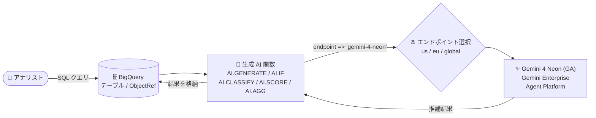

# BigQuery: 生成 AI 関数で gemini-4-neon モデルをサポート (GA)

**リリース日**: 2026-11-19

**サービス**: BigQuery

**機能**: 生成 AI 関数での Gemini 4 Neon (gemini-4-neon) モデルのサポート

**ステータス**: GA (一般提供)

📊 [このアップデートのインフォグラフィックを見る](https://takech9203.github.io/google-cloud-news-summary/20261119-bigquery-generative-ai-gemini-4-neon.html)

## 概要

BigQuery の生成 AI 関数 (AI.GENERATE などの AI 関数群) が、新たに **gemini-4-neon** モデルをサポートしました。このモデルは一般提供 (GA) です。gemini-4-neon は 2026 年 11 月 18 日に Gemini Enterprise Agent Platform で GA となった Google Frontier Model であり、エージェント型のエンタープライズワークフロー向けに、高性能なコーディング、マルチステップ推論、マルチモーダル理解を低レイテンシで提供します。

今回のアップデートにより、BigQuery のデータを移動させることなく、SQL から直接 Gemini 4 Neon を呼び出してテキスト・画像・音声・動画・PDF などのデータを分析できるようになりました。データウェアハウス上で最新世代のフロンティアモデルを活用した意味解析・分類・要約・構造化出力の生成を行いたいデータアナリストやデータエンジニアが対象です。

**アップデート前の課題**

- BigQuery の生成 AI 関数で利用できる Gemini 4 系モデルは gemini-4-hydrogen、gemini-4-carbon、gemini-4-argon などに限られており、最新の Gemini 4 Neon は選択できなかった
- Gemini 4 Neon の特長である統合トークン制限 (入出力合計 1,048,576 トークン) や 4 段階の思考レベル (LOW / MEDIUM / HIGH / XHIGH) を BigQuery のワークロードから利用できなかった
- Microsoft Office / OpenDocument ファイルの直接入力など、Neon 世代で追加されたマルチモーダル機能を SQL ベースの分析パイプラインに組み込めなかった

**アップデート後の改善**

- BigQuery の生成 AI 関数の `endpoint` 引数に `gemini-4-neon` を指定することで、GA 品質のフロンティアモデルを SQL から直接利用できるようになった
- 高性能なコーディング・マルチステップ推論・マルチモーダル理解を低レイテンシで実行する Neon の能力を、BigQuery 内のデータに対してそのまま適用できるようになった
- プレビューではなく GA のため、本番ワークロードでの利用が可能になった

## アーキテクチャ図



BigQuery の生成 AI 関数が、マルチリージョンエンドポイント (us / eu / global) を経由して Gemini Enterprise Agent Platform 上の gemini-4-neon を呼び出し、推論結果を BigQuery に返すフローを示しています。

## サービスアップデートの詳細

### 主要機能

1. **BigQuery 生成 AI 関数での gemini-4-neon サポート (GA)**
   - AI.GENERATE などの生成 AI 関数の `endpoint` 引数でモデル名を指定して利用できる
   - モデル名のみを指定した場合、BigQuery ML がクエリの実行リージョンに応じて完全なエンドポイントを自動選択する (US リージョン → `us`、EU リージョン → `eu`、その他 → `global`)

2. **Gemini 4 Neon の統合トークン制限と長い出力 (Long decodes)**
   - 入力と出力を合計した 1,048,576 トークンの統合制限を持つ (出力には思考・関数呼び出し・最終応答を含む)
   - 単一のフォアグラウンドセグメントで最大 65,536 出力トークンを生成し、`continuation_token` による Long decodes で出力を最大 1,048,576 トークン (入力トークン分を除く) まで拡張可能

3. **4 段階の思考レベル (Thinking levels)**
   - `LOW`、`MEDIUM`、`HIGH` (デフォルト)、`XHIGH` の 4 段階をサポートし、`XHIGH` は深い推論ワークロード向け
   - `thinking_budget` の設定や `thinking_level="MINIMAL"` は HTTP 400 エラーとなる

4. **マルチモーダル入力の拡張**
   - PDF・プレーンテキストに加え、Microsoft Office (.docx、.pptx、.xlsx など) と OpenDocument (.odt、.odp、.ods) ファイルをインラインまたは Cloud Storage (gs://) から入力可能

## 技術仕様

### gemini-4-neon モデル仕様

| 項目 | 詳細 |
|------|------|
| モデル ID | `gemini-4-neon` |
| ローンチステージ | GA (リリース日: 2026 年 11 月 18 日) |
| コンテキストウィンドウ | 1,048,576 トークン (入出力統合) |
| 最大出力トークン | 1,048,576 (Long decodes 使用時。単一セグメントは 65,536) |
| 思考レベル | LOW / MEDIUM / HIGH (デフォルト) / XHIGH |
| コンテキストキャッシュ | 暗黙的キャッシュのみ (最小 4,096 トークン、durable caching デフォルト有効。明示的キャッシュは非サポート) |
| サンプリングパラメータ | temperature 1.0 / topP 0.95 / topK 64 (固定。カスタム値は無視される) |
| ツール | 関数呼び出し、コード実行、Computer Use、URL コンテキスト、Agentic video understanding、グラウンディング (Google 検索、Google Maps ほか) |
| 利用可能エンドポイント | global、us / eu マルチリージョン |
| ナレッジカットオフ | 2026 年 3 月 |
| セキュリティ統制 | データレジデンシー、CMEK、VPC-SC、AXT |

### BigQuery からの利用 (AI.GENERATE 構文)

```sql
AI.GENERATE(
  [ prompt => ] 'PROMPT'
  [, endpoint => 'ENDPOINT']
  [, model_params => MODEL_PARAMS]
  [, output_schema => 'OUTPUT_SCHEMA']
  [, connection_id => 'CONNECTION']
  [, request_type => 'REQUEST_TYPE']
)
```

- `endpoint` に `gemini-4-neon` を指定する。エンドポイントを省略した場合は BigQuery ML が最近の安定版 Gemini (デフォルトは `gemini-3.5-flash-lite`) を選択する
- Agent Platform はこれらのモデルに対してマルチリージョンエンドポイントのみをサポートする (単一リージョンエンドポイントは非サポート)
- `request_type` で動的共有クォータ (SHARED) / Provisioned Throughput (DEDICATED) を制御できる

## 設定方法

### 前提条件

1. BigQuery と Gemini Enterprise Agent Platform (旧 Vertex AI) API が有効な Google Cloud プロジェクト
2. 接続 (connection) を使用する場合は、AI 関数用の権限設定 (接続を省略した場合はエンドユーザー認証情報を使用)

### 手順

#### ステップ 1: gemini-4-neon を指定して AI.GENERATE を実行

```sql
SELECT
  title,
  AI.GENERATE(
    CONCAT('次の記事を 1 文で要約してください: ', body),
    endpoint => 'gemini-4-neon'
  ).result AS article_summary
FROM `bigquery-public-data.bbc_news.fulltext`
LIMIT 3;
```

`endpoint` にモデル名を指定するだけで、BigQuery ML が実行リージョンに応じた適切なマルチリージョンエンドポイントを自動選択します。

#### ステップ 2: 構造化出力の生成 (output_schema)

```sql
SELECT
  AI.GENERATE(
    patient_description,
    endpoint => 'gemini-4-neon',
    output_schema => 'name STRING, age INT64, phone_number STRING'
  )
FROM mydataset.patient_data;
```

`output_schema` を指定すると、非構造化データから指定スキーマに沿った構造化データを抽出できます。

## メリット

### ビジネス面

- **最新フロンティアモデルの GA 利用**: プレビューではなく GA のため、SLA を意識した本番のデータ分析パイプラインに組み込める
- **データ移動が不要**: BigQuery 内のデータに対して SQL だけで高度な生成 AI 処理を実行でき、別途アプリケーションを構築するコストを削減できる

### 技術面

- **大規模コンテキスト**: 入出力統合で 1,048,576 トークンの制限を持ち、長い文書や大量のコンテキストを扱う分析が可能
- **思考レベルの制御**: LOW〜XHIGH の 4 段階で推論の深さとレイテンシ・コストのバランスを調整できる
- **マルチモーダル対応**: テキストに加えて画像・音声・動画・PDF、さらに Office / OpenDocument ファイルも分析対象にできる

## デメリット・制約事項

### 制限事項

- サンプリングパラメータ (temperature、top_p、top_k) のカスタム値は無視される (固定値で動作)
- `thinking_budget` の設定や `thinking_level="MINIMAL"` は HTTP 400 エラーとなる (MINIMAL は利用不可)
- 明示的コンテキストキャッシュは非サポート (暗黙的キャッシュのみ、最小 4,096 トークン)
- Agent Platform はマルチリージョンエンドポイント (us / eu / global) のみをサポートし、単一リージョンエンドポイントは利用できない
- RAG Engine およびチューニング (Tuning) は非サポート
- VPC Service Controls 境界内では、委任アクセスを使用する ObjectRef 値を AI 関数で処理できない (`OBJ.MAKE_REF(uri)` による直接アクセスを使用する)

### 考慮すべき点

- Gemini 4 Neon は Google Frontier Model として Service Specific Terms の Section 34 (不正使用モニタリング) の対象
- プラットフォームの信頼性・キャパシティ・セキュリティ維持のため、Gemini 4 Neon は検証済みのエンタープライズ顧客に対して一部リージョンで提供される
- 思考 (thinking) トークンも出力トークンとして課金対象になるため、タスクに応じて思考レベルを調整してコストを管理する

## ユースケース

### ユースケース 1: 大規模ドキュメントの要約・構造化抽出

**シナリオ**: 契約書や議事録などの長文ドキュメントを BigQuery に格納し、SQL だけで要約や項目抽出を行う。gemini-4-neon の大規模コンテキストと構造化出力を活用する。

**実装例**:
```sql
SELECT
  doc_id,
  AI.GENERATE(
    document_text,
    endpoint => 'gemini-4-neon',
    output_schema => 'summary STRING, parties ARRAY<STRING>, effective_date STRING'
  ) AS extracted
FROM mydataset.contracts;
```

**効果**: アプリケーションコードを書かずに、データウェアハウス内で長文の要約と構造化抽出を完結できる。

### ユースケース 2: 複雑な推論を要するデータ分類・評価

**シナリオ**: サポートチケットやレビューの分析で、単純なキーワードマッチでは判定できない多段階の推論が必要なケースに、思考レベル HIGH / XHIGH の gemini-4-neon を適用する。AI.CLASSIFY や AI.SCORE などのマネージド AI 関数と組み合わせ、GROUP BY / ORDER BY で集計・ランキングする。

**効果**: 深い推論能力を活かした高精度な分類・スコアリングを、SQL の集計処理に自然に組み込める。

## 料金

BigQuery の生成 AI 関数は、クエリ実行に使用する BigQuery のコンピュートリソースの料金に加えて、Gemini Enterprise Agent Platform へのモデル呼び出しに対する料金が発生します。

- クエリ実行前の入力トークン数の見積もりには `AI.COUNT_TOKENS` 関数を利用できる
- ジョブ単位の Agent Platform 費用は、Cloud Billing レポートでラベル `bigquery_job_id_prefix` によりフィルタして確認できる
- 思考プロセス (thinking) のトークンも課金対象

具体的な単価は以下の公式料金ページを参照してください。

- [BigQuery ML の料金](https://cloud.google.com/bigquery/pricing#bigquery-ml-pricing)
- [Gemini (Agent Platform) の生成 AI 料金](https://cloud.google.com/gemini-enterprise-agent-platform/generative-ai/pricing)

## 利用可能リージョン

gemini-4-neon は `global` エンドポイントおよび `us` / `eu` マルチリージョンで利用できます。BigQuery からモデル名のみを指定した場合のエンドポイント選択ルールは次のとおりです。

| クエリ実行リージョン | 使用されるエンドポイント |
|---------------------|------------------------|
| us マルチリージョンまたは US 内の単一リージョン | `us` |
| eu マルチリージョンまたは EU 内の単一リージョン (europe-west2 / europe-west6 を除く) | `eu` |
| その他 (europe-west2、europe-west6 を含む) | `global` |

※ asia-south1 でクエリを実行する場合は、完全修飾の global エンドポイント名を使用する必要があります。詳細は [BigQuery のロケーション](https://docs.cloud.google.com/bigquery/docs/locations#bqml-loc) を参照してください。

## 関連サービス・機能

- **Gemini Enterprise Agent Platform (旧 Vertex AI)**: gemini-4-neon のホスティング基盤。BigQuery の生成 AI 関数はこのプラットフォームにリクエストを送信して推論を実行する
- **BigQuery マネージド AI 関数 (AI.IF / AI.CLASSIFY / AI.SCORE / AI.AGG)**: フィルタリング・分類・スコアリング・集約を行う Gemini ベースの関数群。AI.IF と AI.CLASSIFY では最適化モードによりトークン消費とレイテンシを削減できる
- **Cloud Billing**: ジョブ単位のモデル呼び出しコストの追跡に使用
- **Cloud Storage**: ObjectRef / gs:// URI 経由で画像・音声・動画・PDF・Office ファイルなどの非構造化データをモデルに入力する際に使用

## 参考リンク

- 📊 [インフォグラフィック](https://takech9203.github.io/google-cloud-news-summary/20261119-bigquery-generative-ai-gemini-4-neon.html)
- [公式リリースノート](https://docs.cloud.google.com/release-notes#November_19_2026)
- [BigQuery での生成 AI の概要](https://docs.cloud.google.com/bigquery/docs/generative-ai-overview)
- [AI.GENERATE 関数リファレンス](https://docs.cloud.google.com/bigquery/docs/reference/standard-sql/bigqueryml-syntax-ai-generate)
- [Gemini 4 Neon モデルドキュメント](https://docs.cloud.google.com/gemini-enterprise-agent-platform/models/gemini/4-neon)
- [BigQuery ML の料金ページ](https://cloud.google.com/bigquery/pricing#bigquery-ml-pricing)

## まとめ

BigQuery の生成 AI 関数が GA の gemini-4-neon に対応したことで、大規模コンテキスト・多段階推論・マルチモーダル理解といった最新フロンティアモデルの能力を、SQL だけで本番データ分析に組み込めるようになりました。既存の AI 関数を利用中であれば、`endpoint => 'gemini-4-neon'` を指定して精度・レイテンシ・コストを既存モデルと比較検証することを推奨します。思考レベルの調整とトークン課金の挙動を踏まえたコスト管理も併せて検討してください。

---

**タグ**: BigQuery, Gemini, gemini-4-neon, 生成AI, AI.GENERATE, BigQuery ML, GA
