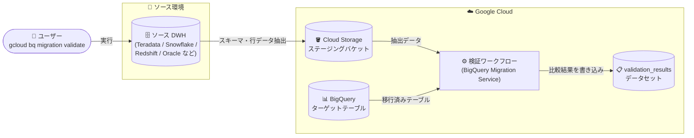

# BigQuery Migration Service: 移行データ検証サービス (Validation Service)

**リリース日**: 2026-11-19

**サービス**: BigQuery (BigQuery Migration Service)

**機能**: 移行データ検証サービス (Validation Service)

**ステータス**: Preview

📊 [このアップデートのインフォグラフィックを見る](https://takech9203.github.io/google-cloud-news-summary/20261119-bigquery-migration-service-validation.html)

## 概要

BigQuery Migration Service に、ソースデータウェアハウスから BigQuery へ移行したテーブルが正しく移行されたかを検証する「検証サービス (Validation Service)」が Preview として追加されました。スキーマ、集計メトリクス、行レベルデータの 3 つの観点 (検証ピラー) で、移行元テーブルと BigQuery 上のターゲットテーブルの一致を確認できます。

検証サービスのクライアントはソースデータベースに接続し、ソースのスキーマと行データをユーザーが管理する Cloud Storage バケットに抽出します。その後、検証サービスが Cloud Storage 上の抽出データと移行済みの BigQuery テーブルを比較し、不一致 (discrepancy) を検出します。実行は `gcloud bq migration validate` コマンドで行い、結果は BigQuery の結果データセット (`validation_results`) や Cloud Storage 上のレポートで確認できます。

Teradata、Snowflake、Amazon Redshift、Oracle などからのデータウェアハウス移行を担当するデータエンジニアや移行プロジェクトチームにとって、移行の正確性を体系的に証明する手段が Google Cloud 公式ツールとして提供される点が大きな価値です。

**アップデート前の課題**

- BigQuery Migration Service には評価 (Assessment)、SQL 翻訳、データ転送の機能はあったが、移行後のデータ正当性検証はサービス内の機能として提供されていなかった
- データ検証にはオープンソースの Data Validation Tool (professional-services-data-validator) などの外部ツールを利用する必要があった
- スキーマ・集計値・行レベルデータの照合を個別に実装・運用する手間があった

**アップデート後の改善**

- `gcloud bq migration validate` コマンド 1 つで、スキーマ検証・集計検証・行レベルデータ検証を一括 (または個別) に実行できるようになった
- 検証結果が BigQuery の結果データセット (`run_history`、`run_metrics`、`column_history` など) と Cloud Storage レポートに自動記録され、監査証跡として履歴管理できるようになった
- Google Cloud コンソールの Migration services ページ (Validate Migration) から最近の検証結果を確認できるようになった

## アーキテクチャ図



検証クライアントがソース DWH からスキーマと行データを Cloud Storage に抽出し、BigQuery Migration Service の検証ワークフローが BigQuery 上のターゲットテーブルと比較して、結果を `validation_results` データセットに記録します。

## サービスアップデートの詳細

### 主要機能

1. **3 つの検証ピラー**
   - **スキーマ検証 (`--schema`)**: カラム名、データ型、型の互換性をソーステーブルとターゲット BigQuery テーブル間で比較
   - **集計検証 (`--aggregate`)**: 行数、SUM、AVG、MIN、MAX、ブール値分布、文字列長などのテーブルレベル・カラムレベルの集計メトリクスをテーブル全体で比較
   - **データ検証 (`--data`)**: 全件スキャン (`BRUTE_FORCE`) またはキーに基づくランダムサンプリング (`SAMPLE`) による行単位比較で、欠落行やセルレベルの値のずれを検出

2. **柔軟な実行オプション**
   - `--tables` で対象テーブルを絞り込み、`--where` / `--source-where` / `--target-where` で SQL 述語によるフィルタリングが可能
   - `--max-concurrency` による並列スライス抽出、`--labels` による実行結果へのラベル付与に対応
   - 検証設定はローカルパスまたは Cloud Storage の `gs://` URI で指定可能

3. **結果の記録と可視化**
   - 結果は BigQuery の `validation_results` データセット (`run_history`、`run_metrics`、`column_history`、`run_{RUN_ID}_mismatches_details`) に記録
   - Cloud Storage には `validation_summary.txt`、`column_details.txt`、`results.json`、`queries.sql` のレポートが出力される
   - Google Cloud コンソールの「Migration services」ページの「Validate Migration」から最近の実行結果を確認可能

4. **自動設定生成とドライバ管理**
   - `generate-config` コマンドで dwh-migration-dumper ツールのメタデータアーカイブからテーブル検証設定 (YAML) を自動生成可能
   - 多くのソースでは JDBC ドライバを Maven Central から自動ダウンロードし SHA-256 チェックサムを検証。Teradata などの独自ドライバやエアギャップ環境では `drivers/` ディレクトリや `BQMS_DRIVER_DIR` でユーザー指定可能

## 技術仕様

### 検証実行ステータス

| ステータス | 意味 |
|------|------|
| `IN_PROGRESS` | 検証ワークフローが BigQuery 上で実行中 |
| `COMPLETED` | 行レベル・集計の不一致ゼロで完了 (検証合格) |
| `HEALED` | 欠落行なし。検出された差分はすべて浮動小数点の微小な表現揺らぎ (セル比較 < 1e-4、集計 < 1e-6) で自動調整され、合格扱い |
| `COMPLETED_WITH_MISMATCHES` | 検証は完了したが、欠落行・欠落カラム・集計差・セルレベルの差分を検出 |
| `ERROR` | ターゲットテーブル欠如、権限エラー、不正な SQL などのシステム・設定エラーで失敗 |

カラムレベルの不一致は `EXACT_MATCH` / `DATA_DRIFT` (値のずれ) / `SCHEMA` (ターゲットにカラム欠落) / `ROW` (行の欠落) に分類されます。

### サポートされるソースデータウェアハウス

| ソース | 設定自動生成 | JDBC ドライバ |
|------|------|------|
| Teradata | 対応 (dwh-migration-dumper) | ユーザー提供 |
| Snowflake | 対応 | 自動ダウンロード |
| Amazon Redshift | 対応 | 自動ダウンロード |
| Oracle | 対応 | 自動ダウンロード |
| PostgreSQL | 対応 | 自動ダウンロード |
| Databricks | 非対応 (手動設定) | 自動ダウンロード |
| Apache Hive / SQL Server / MariaDB / MySQL | ソースによる | 自動ダウンロード |

`VARCHAR(255)` や `DECIMAL(10,2)` のようなパラメータ付きデータ型もサポートされます。サポート外のデータ型のカラムは検証から除外されます (自動生成設定では `columnSettings.exclude` に自動追加)。

### 設定ファイル (settings.yaml) の例

```yaml
googleCloudStorage:
  gcsPath: gs://BUCKET_NAME/PATH_PREFIX
  format: parquet   # parquet (デフォルト) または csv
results:
  projectId: RESULTS_PROJECT_ID
  dataset: validation_results   # 省略時のデフォルト
  location: RESULTS_LOCATION
resultTtlHours: 168.0           # 実行ごとの比較テーブルの TTL (デフォルト 7 日)
```

## 設定方法

### 前提条件

1. ターゲット BigQuery データセットを含む Google Cloud プロジェクトで課金が有効であること
2. BigQuery、BigQuery Migration Service、Cloud Storage (パスワードを Secret Manager に保存する場合は Secret Manager も) の各 API を有効化すること
3. ターゲット BigQuery データセットと同じロケーションに Cloud Storage ステージングバケットを用意すること
4. ソースデータベースに読み取り専用ユーザーを用意すること (検証対象テーブルへの SELECT 権限と、スキーマ・主キー検出用のシステムカタログビューへの読み取りアクセス。書き込み・DDL・管理者権限は付与しない)

### 手順

#### ステップ 1: 検証設定の作成

```bash
# dwh-migration-dumper のメタデータアーカイブからテーブル設定を自動生成
# (validation_config/databases/DATABASE/SCHEMA/TABLE.yaml が生成される)
# または validation_config/tables.yaml を手動作成
```

接続情報 (`connections.yaml`)、ステージング・結果設定 (`settings.yaml`)、テーブルごとの検証設定を `validation_config/` ディレクトリに用意します。

#### ステップ 2: 検証の実行

```bash
# ローカルの設定ディレクトリを指定して全ピラーを検証
gcloud bq migration validate PATH_TO_VALIDATION_CONFIG

# Cloud Storage 上の設定を指定する場合
gcloud bq migration validate gs://BUCKET_NAME/validation_config

# 特定テーブル・特定ピラーのみ検証 (WHERE フィルタ付き)
gcloud bq migration validate PATH_TO_VALIDATION_CONFIG \
  --schema \
  --aggregate \
  --tables orders,customers \
  --where "order_date >= '2026-01-01'"
```

ターゲットデータセットが `us` 以外のロケーション (例: `eu`) の場合は、実行前に `export BQMS_VALIDATION_LOCATION=LOCATION` を設定します。ソース抽出は同期実行され、その後テーブルごとに非同期の検証ワークフローが起動されます。終了コード 0 は「抽出とアップロードの成功」を意味し、ターゲット比較の完了やデータ一致を意味しない点に注意してください。

#### ステップ 3: 結果の確認

```sql
-- 最近の検証実行ステータスを確認
SELECT run_id, source_table, target_table, status,
       started_at, finished_at, gcs_uri, error_message
FROM `TARGET_PROJECT_ID.validation_results.run_history`
ORDER BY started_at DESC
LIMIT 20;
```

```bash
# Cloud Storage のサマリーレポートを表示
gcloud storage cat gs://BUCKET/PREFIX/validationOutputs/SOURCE_TABLE_PATH/RUN_ID/validation_summary.txt
```

## メリット

### ビジネス面

- **移行品質の証明**: スキーマ・集計・行レベルの 3 段階検証により、移行完了の判断基準を定量的に示すことができ、ステークホルダーへの説明責任を果たしやすくなる
- **移行プロジェクトの効率化**: BigQuery Migration Service 内で評価 → SQL 翻訳 → データ転送 → 検証までを一貫して実施でき、外部ツールの組み合わせ運用が不要になる

### 技術面

- **監査証跡の自動化**: `run_history`、`run_metrics`、`column_history` により実行履歴とカラム単位の検証履歴が長期保存され、履歴比較・監査が可能
- **浮動小数点ジッターの自動調整**: 微小な浮動小数点差分は `HEALED` として自動調整されるため、本質的でない差分によるノイズを削減できる
- **セキュリティ設定が充実**: 機密カラムの除外 (`columnSettings.exclude`)、CMEK によるステージングデータ・結果データセットの暗号化、最小権限アクセスなどのガイドラインが提供されている

## デメリット・制約事項

### 制限事項

- Preview 段階であり、Pre-GA Offerings Terms が適用される (サポートが限定される可能性がある)
- ターゲットは BigQuery のみ。非 BigQuery データベース同士の検証や、BigQuery をソースとする検証は非対応
- ターゲット BigQuery データセット、結果データセット、Cloud Storage ステージングバケット、検証ワークフローロケーション (`BQMS_VALIDATION_LOCATION`) は同一ロケーションに揃える必要がある
- データ型のサポートはソースごとに異なり、サポート外の型のカラムは検証から除外される (例: Redshift の GEOMETRY は非対応、Teradata の精度未指定 NUMBER は非対応)
- 検証サービスは一部のロケーションでのみ利用可能
- BigQuery のテーブル名は大文字小文字が区別されるため、`targetTable.name` は実テーブルの大文字小文字と正確に一致させる必要がある

### 考慮すべき点

- 実行ごとの比較テーブルは `resultTtlHours` (デフォルト 168 時間 = 7 日) で自動失効する。`validation_results` データセットにデータセットレベルのデフォルトテーブル有効期限を設定すると、`run_history` などの長期監査テーブルまで失効してしまうため設定しないこと
- データ検証 (`--data`) はマスクされていない生のセル値を Cloud Storage と BigQuery に抽出・ロードするため、機密カラムの除外や CMEK 暗号化などのデータ保護設定を事前に検討する必要がある
- 検証クライアントは設定ファイルに記述された SQL をソース DB 上で実行するため、設定ファイルはコードレビュー必須のリポジトリや書き込み権限を制限した Cloud Storage バケットで管理することが推奨される

## ユースケース

### ユースケース 1: Teradata から BigQuery への大規模移行の最終検証

**シナリオ**: Teradata から BigQuery Data Transfer Service でデータを移行した後、カットオーバー前に全テーブルの整合性を確認したい。

**実装例**:
```bash
# dwh-migration-dumper のメタデータから設定を自動生成した上で
gcloud bq migration validate gs://migration-bucket/validation_config \
  --schema --aggregate --data
```

**効果**: スキーマ・集計・行レベルの 3 段階で一致を確認でき、`COMPLETED` / `HEALED` ステータスを移行完了の客観的な判断基準として利用できる。

### ユースケース 2: 日次増分移行中の継続的な整合性チェック

**シナリオ**: 移行期間中、ソースと BigQuery の並行稼働フェーズで、直近データの一致を日次で確認したい。

**実装例**:
```bash
gcloud bq migration validate PATH_TO_VALIDATION_CONFIG \
  --aggregate \
  --tables orders \
  --where "order_date >= '2026-01-01'" \
  --labels phase=parallel-run
```

**効果**: WHERE 句で対象期間を絞った軽量な集計検証を定期実行でき、`run_history` / `run_metrics` で一致状況の推移を追跡できる。

## 料金

BigQuery Migration API 自体の利用は無料です。ただし、以下のコストが別途発生します。

- Cloud Storage ステージングバケットに抽出したデータのストレージ料金
- `validation_results` データセットなど BigQuery に格納される結果データのストレージ料金と、検証ワークフロー・結果クエリに伴う BigQuery の通常料金

詳細は [BigQuery の料金ページ](https://cloud.google.com/bigquery/pricing) および [Cloud Storage の料金ページ](https://cloud.google.com/storage/pricing) を参照してください。

## 利用可能リージョン

検証サービスは一部のロケーションで利用可能です。対応ロケーションは [BigQuery Migration Service のロケーション](https://docs.cloud.google.com/bigquery/docs/locations#migration-service-loc) を参照してください。

## 関連サービス・機能

- **BigQuery Data Transfer Service**: ソース DWH から BigQuery へのデータ転送を担うサービス。転送後のデータを本検証サービスで照合する
- **Cloud Storage**: 抽出したスキーマ・集計・サンプル行データのステージングと検証レポートの出力先
- **Secret Manager**: ソースデータベースのパスワードを安全に保管するために利用可能
- **Cloud KMS (CMEK)**: ステージングバケットと結果データセットの顧客管理暗号鍵による暗号化に利用
- **BigQuery Migration Service の他機能**: 移行評価 (Assessment)、バッチ/インタラクティブ SQL 翻訳、移行リネージサービス (Preview) と組み合わせて移行プロセス全体をカバー
- **Data Validation Tool (OSS)**: Google Cloud Platform の professional-services が提供するオープンソースのデータ検証ツール。従来はこちらが検証の選択肢だった

## 参考リンク

- 📊 [インフォグラフィック](https://takech9203.github.io/google-cloud-news-summary/20261119-bigquery-migration-service-validation.html)
- [公式リリースノート](https://docs.cloud.google.com/release-notes#November_19_2026)
- [ドキュメント: Validate your data warehouse migration](https://docs.cloud.google.com/bigquery/docs/migration/migration-validation)
- [ドキュメント: Introduction to BigQuery migration](https://docs.cloud.google.com/bigquery/docs/migration-intro)
- [BigQuery Migration Service のロケーション](https://docs.cloud.google.com/bigquery/docs/locations#migration-service-loc)
- [料金ページ (BigQuery)](https://cloud.google.com/bigquery/pricing)

## まとめ

BigQuery Migration Service にデータウェアハウス移行後の整合性を検証する公式機能が Preview で追加され、スキーマ・集計・行レベルの 3 段階検証を `gcloud bq migration validate` コマンド 1 つで実行できるようになりました。移行プロジェクトを進めているチームは、カットオーバー判断の客観的な基準として本機能の活用を検討することを推奨します。Preview 段階のため、本番適用時はサポートロケーションとデータ型の対応状況、データ取り扱いのセキュリティ設定を事前に確認してください。

---

**タグ**: BigQuery, BigQuery Migration Service, Data Validation, Data Warehouse Migration, Preview
