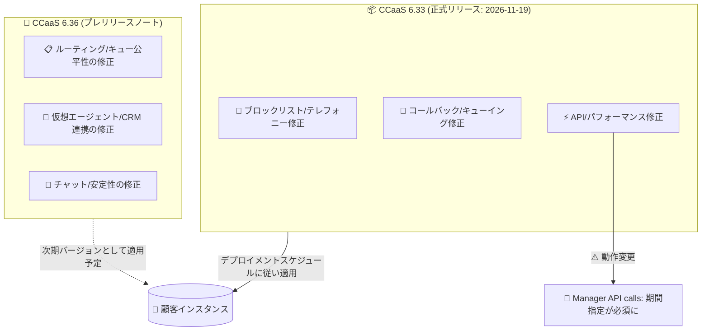

# Google Cloud Contact Center as a Service (CCaaS): バージョン 6.33 正式リリースと 6.36 プレリリースノート

**リリース日**: 2026-11-19

**サービス**: Google Cloud Contact Center as a Service (CCaaS) / Contact Center AI Platform (CCAI Platform)

**機能**: バージョン 6.33 正式リリース + バージョン 6.36 プレリリースノート (Fixed: 不具合修正)

**ステータス**: Announcement + Fixed

📊 [このアップデートのインフォグラフィックを見る](https://takech9203.github.io/google-cloud-news-summary/20261119-ccaas-6-33-release-6-36-prerelease.html)

## 概要

Google Cloud Contact Center as a Service (CCaaS、旧称 Contact Center AI Platform / CCAI Platform) について、2 つの発表がありました。1 つ目は**バージョン 6.33 の正式リリース**です。6.33 は 2026-11-10 にプレリリースノートとして告知されていた内容が正式に提供開始されたもので、14 件の不具合修正を含みます。各インスタンスへの適用タイミングは、顧客が選択しているデプロイメントスケジュールに依存します。

2 つ目は**次期バージョン 6.36 のプレリリースノート**の公開です。プレリリースノートは次バージョンで提供が見込まれる変更内容の事前告知で、リリース時には記載どおりの内容になることが期待されます。6.36 も新機能の追加ではなく、キューイング・ルーティング、仮想エージェント、チャット/メッセージング、CRM 連携、パフォーマンスにわたる **30 件超の不具合修正**に特化しています。

いずれも新機能の追加ではなく信頼性向上のリリースですが、6.33 には **Manager API の `calls` エンドポイントに期間 (date range) の指定が必須になる**という動作変更が含まれるため、API インテグレーションを運用しているチームは注意が必要です。コンタクトセンターの管理者・スーパーバイザー・API 利用者にとって、運用品質とレポーティング精度の両面で重要なアップデートです。

**アップデート前の課題**

6.33 で修正された主な不具合 (正式リリースにより解消):

- インバウンドブロックリストに登録した番号からの着信が、直通番号 (ダイレクトライン) ではブロックされなかった
- ハングアップ通知が失われると Telnyx コールがキューに無期限に滞留し、放棄されたコールバックコールが「システム障害」として誤記録され FIFO 優先順位も失われた
- 自動応答コールが接続タイムアウト時に同一エージェントへ無限に再オファーされ、スケジュール済みコールバックが最大猶予期限を過ぎて架電されることがあった
- Manager API の `calls` エンドポイントに対する期間無制限の大規模クエリがタイムアウトした
- 休日設定の読み込み、通話終了、エージェント通話履歴取得で大幅なシステム遅延が発生した

6.36 プレリリースで修正が見込まれる主な不具合:

- システムフェイルオーバー発生時にモバイルアプリのチャットが「進行中」のまま無期限に残った
- エージェントが設定した対応可能時間が仮想エージェントからのエスカレーションやエージェント間転送で無視され、勤務時間外のエージェントにコールがルーティングされた
- エージェント可用性チェックのタイムアウト時に、新しいコールが待機制限をバイパスして古いコールを追い越した
- Vertex AI の基盤モデル廃止 (retirement) により、スマートディスポジションが候補を返さなくなっていた
- 名前に特定の日本語文字を含むユーザーでチャットウィジェットが起動しなかった

**アップデート後の改善**

- 6.33 の正式リリースにより、ブロックリスト・キューイング・コールバック・パフォーマンスに関する 14 件の修正が、各インスタンスのデプロイメントスケジュールに従って順次適用される
- Manager API の `calls` エンドポイントが期間指定必須となり、大規模クエリによるタイムアウトが解消される
- 6.36 では、キュー待ち時間の公平性 (待機制限バイパスの解消)、レポーティング精度 (仮想エージェントのタイムスタンプ、転送コールのキュー滞在時間)、CRM 連携 (Salesforce の重複コンタクト防止) などが改善される見込み
- 日本のユーザーに関係する修正として、日本語文字を含む名前でのチャットウィジェット起動失敗が解消される見込み

## アーキテクチャ図



6.33 は正式リリースとして各インスタンスのデプロイメントスケジュールに従って適用され、6.36 は次期バージョンの事前告知 (プレリリースノート) という位置づけです。6.33 の Manager API `calls` エンドポイントの期間指定必須化は、既存インテグレーションに影響し得る動作変更です。

## サービスアップデートの詳細

### バージョン 6.33 (正式リリース) の主な修正内容

1. **着信制御・テレフォニー**
   - インバウンドブロックリストの番号が直通番号への着信でブロックされない問題を修正
   - 高負荷時にハングアップ通知が失われた場合に Telnyx コールがキューに無期限滞留する問題を修正
   - コールアダプタがハングアップ直後に誤って再ダイヤルし、参加者ステータスの失敗と必須ディスポジションパネルの早期クローズを引き起こす問題を修正

2. **コールバック・キューイング**
   - キュー待機中に放棄されたコールバックコールが「システム障害」として誤記録され、キューグループ間移動時に FIFO 優先順位が維持されない問題を修正
   - 自動応答コールが接続タイムアウト時に同一エージェントへの無限再オファーループに陥り、オーバーキャパシティデフレクションが発動しない問題を修正
   - スケジュール済みコールバックの再ダイヤルが最大猶予期限を超過して実行される問題を修正

3. **エージェント体験・ポータル UI**
   - 音声コールのラップアップ終了時にアクティブなチャットが残っていると、エージェントの「次のステータス」が早期クリアされ Agent Monitoring に表示されない問題を修正
   - ポータル言語がカナダフランス語 (fr_CA) の場合に Agents ページのログアウト確認ダイアログが英語で表示される問題を修正
   - Agents ビューのチームフィルタが古いデータにより無関係なチームのエージェントを表示する問題を修正

4. **仮想エージェント・CRM 連携**
   - 転送ターンが会話終了を兼ねる場合に、仮想エージェント間のチャット転送が失敗する問題を修正
   - 仮想エージェントチャット中に `{ACCOUNT_ID}` プレースホルダが空文字列に解決され、CRM API リクエストが失敗する問題を修正

5. **API・パフォーマンス**
   - Manager API の `calls` エンドポイントに対する期間無制限の大規模クエリがタイムアウトする問題を修正 (**このエンドポイントへのリクエストには期間指定 (bounded date range) が必須になる**)
   - 休日設定の読み込み・エージェントデスクトップでの通話終了・エージェント通話履歴取得に起因する大幅な遅延とシステム不安定性を修正

### バージョン 6.36 (プレリリースノート) の主な修正内容

6.36 は 30 件超の修正を含みます。テーマ別の主な内容は以下のとおりです。

1. **キューイング・ルーティングの公平性と正確性**
   - エージェント可用性チェックのタイムアウト時に、新しいコールが待機制限をバイパスして古いコールを追い越す問題を修正
   - エージェントが設定した対応可能時間 (availability hours) が仮想エージェントエスカレーションやエージェント間転送で無視される問題を修正
   - 高度なコールスケジューリング (advanced call scheduling) がスロットの静的キャパシティ到達後も予約を受け付ける (オーバーブッキング) 問題を修正
   - キュー内アナウンスのたびに待ち時間がリセットされ、転送コールのキュー滞在時間レポートが不正確になる問題や、キュー内アナウンス有効時に発信者がプライマリキューに長時間滞留する問題を修正
   - 自動リダイレクトを構成した親キューへの転送での切断、カスケードグループのタイマー超過後の保持、割り当て瞬間のアナウンス分岐によるエージェントの予約スタックなどを修正

2. **仮想エージェント (IVR/チャット) の信頼性**
   - IVR 仮想エージェントのエスカレーションがリダイレクトリクエストのタイムアウト時に「接続中」のままスタックする問題を修正
   - 仮想エージェントのコール接続タイムスタンプとハンドル時間が不正確にレポートされる問題を修正
   - 顧客が人間のエージェントキューへの転送前に切断した仮想エージェントコールバックが「システムエラー」として誤記録される問題を修正
   - メディアストリーム切断の未検出による技術エラーでの会話終了や、セッションの予期しない途中終了によるデフォルトエントリキューへの誤ルーティングを修正
   - ネストしたオーバーキャパシティデフレクションでボイスメールが宛先キューではなくターゲットエージェントに誤って帰属される問題を修正
   - 基盤となる Vertex AI モデルの廃止によりスマートディスポジションが候補を返さない問題を修正

3. **チャット・メッセージング**
   - チャットのタイムアウト予定時刻とシステムフェイルオーバーが重なると、モバイルアプリのチャットが「進行中」のまま無期限にスタックする問題を修正
   - 転送先として表示されているにもかかわらず、アクティブな SMS チャットを他の SMS キューへ転送できない問題を修正
   - 名前に特定の日本語文字を含むユーザーでチャットウィジェットが起動しない問題を修正
   - ブラウザの localStorage が満杯の場合に DTMF 信号が送信されず、IVR ナビゲーションがサイレントに失敗する問題を修正

4. **CRM 連携・エクスポート**
   - CRM へのアップロード失敗後も送信メディア添付ファイルが「アップロード保留中」のまま残る問題を修正
   - 再訪した SDK ユーザーが Salesforce で正しく識別されず、重複したコンタクトレコードが作成される問題を修正
   - カスタム外部ストレージのパステンプレートとファイル名規則がセッションサマリーエクスポートに適用されない問題を修正
   - 発信者が応答前にキャンセルした Telnyx のインバウンドコールが「エージェントキャンセル」として誤記録される問題を修正

5. **パフォーマンス・安定性**
   - インスタンス設定変更のたびにエージェントアダプタがカスタム着信音を不要に再読み込みし、高トラフィック時にプラットフォームの不安定化と接続障害を引き起こす問題、および複数エージェントウィンドウからの同時着信音リクエストによる性能劣化を修正
   - 大量の可聴メッセージ (audible message) 参照による、通話設定・時間外メッセージ・ポータル一覧表示の遅延を修正
   - カスタムエージェントデスクトップパネルの保存が全アクティブユーザーのシステム不安定化と接続タイムアウトを引き起こす問題を修正

6. **ローカライズ・UI**
   - 言語がフランス語 (カナダ) の場合にコールアダプタの自己参加者サフィックスとコールタイプ値が英語で表示される問題を修正
   - キューからカスケードグループを削除できず「Internal server error」が発生する問題、プレセッション SmartActions のデータ欠落によるレポート除外、タスク仮想エージェントセッション終了後に非アクティブチャットの解散タイマーがリセットされない問題などを修正

## 技術仕様

### 2 つの発表の位置づけ

| 項目 | CCaaS 6.33 | CCaaS 6.36 |
|------|------|------|
| リリース形態 | 正式リリース | プレリリースノート (次期バージョンの事前告知) |
| 内容 | 不具合修正 14 件 | 不具合修正 30 件超 |
| 適用タイミング | 各インスタンスのデプロイメントスケジュールに依存 | 正式リリース後、デプロイメントスケジュールに従って適用 |
| 動作変更 | Manager API `calls` エンドポイントの期間指定が必須化 | 記載なし (リリース時に変更の可能性あり) |
| 必要な作業 | Manager API 利用者は期間指定の確認を推奨 | 基本的に不要 |

### Manager API `calls` エンドポイントの動作変更 (6.33)

| 項目 | 詳細 |
|------|------|
| 対象エンドポイント | `GET /manager/api/v1/calls` |
| 変更内容 | 期間無制限 (unbounded date range) のクエリが不可となり、期間指定 (bounded date range) が必須に |
| 背景 | 大規模な期間無制限クエリによるリクエストタイムアウトの解消 |
| 利用可能なフィルタ | `connected_at[from]/[to]`、`updated_at[from]/[to]`、`queued_at[from]/[to]` など |
| 推奨パターン | ページネーションではなく `updated_at[from]` + `sort_column` + `sort_direction` によるテーリング (tailing) |

## メリット

### ビジネス面

- **顧客との約束と公平性の担保**: 待機制限バイパス (6.36) や FIFO 優先順位の喪失 (6.33)、コールバックの期限超過 (6.33) が解消され、「先に待っている顧客が先に対応される」「約束の時刻に折り返す」という基本品質が守られる
- **KPI・レポーティングの正確性**: 放棄コールバックや仮想エージェントコールバックの誤記録 (システム障害/エラー扱い)、転送コールのキュー滞在時間、仮想エージェントのハンドル時間などが正しく計測され、ダッシュボードの信頼性が向上する
- **日本語ユーザーへの対応**: 名前に特定の日本語文字を含むユーザーでチャットウィジェットが起動しない問題の修正 (6.36) は、日本のコンタクトセンターにとって直接的な改善となる

### 技術面

- **高負荷時の安定性向上**: 着信音の不要な再読み込み、可聴メッセージの大量参照、カスタムデスクトップパネル保存に起因する接続障害 (6.36)、および休日設定・通話終了・通話履歴に関する遅延 (6.33) が解消される
- **Manager API の信頼性**: `calls` エンドポイントの期間指定必須化により、タイムアウトが解消されレポーティング基盤のデータ取り込みが安定する
- **AI 機能の継続性**: 基盤 Vertex AI モデルの廃止で停止していたスマートディスポジションの候補生成が復旧する (6.36)

## デメリット・制約事項

### 制限事項

- 6.36 はプレリリースノートであり、正式リリース時に内容が変わる可能性がある
- 6.33 を含め、各インスタンスへの適用タイミングは選択しているデプロイメントスケジュールに依存するため、即時にすべての環境で修正が有効になるわけではない

### 考慮すべき点

- **動作変更 (6.33)**: Manager API の `calls` エンドポイントは期間指定が必須になる。期間無制限のクエリを発行している既存のインテグレーションやスクリプトは、6.33 適用後に失敗する可能性があるため、`updated_at[from]` などの期間フィルタを追加しておくこと
- **レポート指標の傾向変化**: 放棄コールバック (6.33) や仮想エージェントコールバック・Telnyx キャンセルコール (6.36) の記録分類が変わるため、放棄率・システム障害率などの KPI トレンド分析では適用日を考慮すること
- 6.33 の修正内容は 2026-11-10 のプレリリースノートで告知済みの内容と同一であり、既に対応準備をしている場合は追加作業は不要

## ユースケース

### ユースケース 1: Manager API 連携レポーティング基盤の 6.33 対応確認

**シナリオ**: BI ツールやデータウェアハウスへ通話データを取り込むために Manager API の `calls` エンドポイントを定期実行しているが、期間指定のないクエリを発行している。6.33 が正式リリースされたため、自インスタンスへの適用前に対応が必要。

**実装例**:
```bash
# 変更前 (6.33 適用後は失敗する可能性)
GET /manager/api/v1/calls

# 変更後 (期間を必ず指定し、テーリングで取り込む)
GET /manager/api/v1/calls?updated_at[from]=2026-11-19T00:00:00Z&sort_column=updated_at&sort_direction=asc
```

**効果**: 6.33 適用後もデータ取り込みが中断せず、タイムアウトも回避できる。公式ドキュメントはページネーションではなくテーリング方式を推奨している。

### ユースケース 2: 日本語ユーザー向けチャットサポートの改善 (6.36)

**シナリオ**: 日本の顧客向けに Web/モバイルのチャットサポートを提供しているが、一部のユーザーでチャットウィジェットが起動せず、問い合わせ経路が電話に偏っていた。

**効果**: 6.36 適用後は名前に特定の日本語文字を含むユーザーでもチャットウィジェットが起動するようになり、チャネル全体で一貫したサポート体験を提供できる。

### ユースケース 3: 待ち行列の公平性と WFM 精度の改善 (6.36)

**シナリオ**: ピーク時間帯にエージェント可用性チェックのタイムアウトが発生し、後から入ったコールが先行コールを追い越すことで、長時間待ちの顧客からのクレームが発生していた。また、エージェントの対応可能時間外にも転送コールが着信していた。

**効果**: 待機制限のバイパスが解消されキューの公平性が保たれるほか、エージェントの対応可能時間が転送・エスカレーション時にも尊重され、勤務計画どおりの運用が可能になる。

## 料金

今回のアップデートは不具合修正であり、料金への影響はありません。参考として、CCaaS (CCAI Platform) のインスタンスは月次課金で、以下のいずれかの課金モデルに基づきます。

- **Concurrent agents**: 月間の同時サインインエージェント数の最大値
- **Named agents**: 月間にエージェントロールを持ったユーザー数の最大値
- **Minutes used**: エージェントロールのユーザーがサインインしていた分数

テレフォニー料金は従量課金です。詳細は [CCAI Platform の利用開始ドキュメント](https://docs.cloud.google.com/contact-center/ccai-platform/docs/get-started) を参照してください。

## 利用可能リージョン

CCaaS (CCAI Platform) が利用可能な国と Google Cloud リージョンは、[ロケーションページ](https://docs.cloud.google.com/contact-center/ccai-platform/docs/localities) を参照してください。

## 関連サービス・機能

- **Vertex AI**: スマートディスポジションの基盤モデル廃止に伴う修正 (6.36) は、CCaaS の AI 機能が Vertex AI のモデルライフサイクルに依存していることを示している
- **Dialogflow CX (仮想エージェント)**: 仮想エージェント間転送、`{ACCOUNT_ID}` プレースホルダ (6.33)、IVR エスカレーションやセッション終了の修正 (6.36) は、仮想エージェント運用に直接関係する
- **Salesforce (CRM 連携)**: 再訪 SDK ユーザーの重複コンタクト作成の修正 (6.36) や CRM API リクエスト失敗の修正 (6.33) により、CRM データの品質が向上する
- **Telnyx (テレフォニープロバイダ)**: キュー滞留 (6.33) とキャンセルコールの誤記録 (6.36) の修正は、Telnyx をテレフォニーに利用する環境に関係する
- **Manager API / Apps API**: `calls` エンドポイントの期間指定必須化により、レポーティング連携の実装パターン (テーリング) への準拠が実質的に求められる

## 参考リンク

- 📊 [インフォグラフィック](https://takech9203.github.io/google-cloud-news-summary/20261119-ccaas-6-33-release-6-36-prerelease.html)
- [公式リリースノート (Google Cloud 全体)](https://docs.cloud.google.com/release-notes#November_19_2026)
- [CCaaS (CCAI Platform) リリースノート](https://docs.cloud.google.com/contact-center/ccai-platform/docs/release-notes)
- [Manager API ドキュメント](https://docs.cloud.google.com/contact-center/ccai-platform/docs/manager-api)
- [Manager API Calls エンドポイント](https://docs.cloud.google.com/contact-center/ccai-platform/docs/manager-api-call)
- [Manager API のページネーションとテーリング](https://docs.cloud.google.com/contact-center/ccai-platform/docs/manager-api-pagination-tailing)
- [デプロイメントスケジュール](https://docs.cloud.google.com/contact-center/ccai-platform/docs/deployment-schedules)
- [CCAI Platform ドキュメント](https://docs.cloud.google.com/contact-center/ccai-platform/docs)

## まとめ

CCaaS 6.33 が正式リリースされ、プレリリースノートで告知されていた 14 件の不具合修正が各インスタンスのデプロイメントスケジュールに従って適用されます。特に Manager API の `calls` エンドポイントは期間指定が必須になるため、期間無制限クエリを発行しているインテグレーションは適用前に修正してください。あわせて公開された 6.36 プレリリースノートは、キューの公平性、仮想エージェントの信頼性、高負荷時の安定性、日本語ユーザーのチャットウィジェット起動など 30 件超の修正を予告しており、レポート分類の変化 (コールバックやキャンセルコールの記録方法) を KPI 分析時に考慮することを推奨します。

---

**タグ**: CCaaS, Contact Center AI Platform, CCAI Platform, コンタクトセンター, 不具合修正, プレリリース, Manager API, コールバック, 仮想エージェント, Telnyx, Vertex AI
