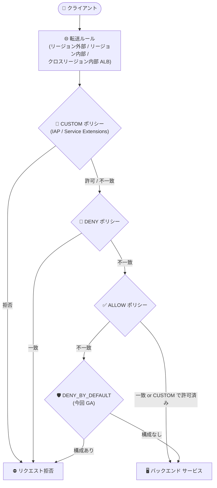

# Cloud Load Balancing: 認可ポリシーの DENY_BY_DEFAULT アクションが GA

**リリース日**: 2026-11-19

**サービス**: Cloud Load Balancing

**機能**: 認可ポリシー (Authorization Policy) の DENY_BY_DEFAULT アクション

**ステータス**: GA (一般提供)

📊 [このアップデートのインフォグラフィックを見る](https://takech9203.github.io/google-cloud-news-summary/20261119-cloud-load-balancing-deny-by-default-ga.html)

## 概要

Application Load Balancer の認可ポリシー (Authorization Policy) における **DENY_BY_DEFAULT アクション**が一般提供 (GA) になりました。対象はリージョン外部 Application Load Balancer、リージョン内部 Application Load Balancer、クロスリージョン内部 Application Load Balancer です。

DENY_BY_DEFAULT ポリシーをロードバランサーの転送ルール (forwarding rule) にアタッチすると、「デフォルト拒否」のセキュリティベースラインが確立されます。別途定義した ALLOW ポリシーまたは CUSTOM ポリシーで明示的に許可されない限り、すべてのリクエストがブロックされます。これはゼロトラストの基本原則である「明示的に許可されたものだけを通す」考え方をロードバランサーレイヤーで実現するもので、セキュリティ要件の厳しいエンタープライズ環境のネットワーク管理者・セキュリティ担当者にとって重要なアップデートです。

**アップデート前の課題**

認可ポリシーが構成されていない場合、または ALLOW ポリシーが存在しない場合、リクエストはデフォルトで許可される動作でした。

- ALLOW ポリシーが 1 つも構成されていない状態では、リクエストがデフォルトで許可されてしまい、「デフォルト拒否」のベースラインを認可ポリシーだけで確立できなかった
- IAP や Service Extensions などの CUSTOM ポリシーのみに依存する構成では、CUSTOM ポリシーにマッチしないトラフィックが素通りするリスクがあった
- ポリシーのメンテナンス中に ALLOW ポリシーを一時的に削除・更新すると、その間リソースが無防備になる可能性があった

**アップデート後の改善**

- 転送ルールに DENY_BY_DEFAULT ポリシーをアタッチするだけで、ALLOW / CUSTOM ポリシーで明示的に許可されないすべてのリクエストをブロックする「デフォルト拒否」ベースラインを確立できるようになった
- ALLOW ポリシーの更新・削除中でも、DENY_BY_DEFAULT により保護が維持されるようになった
- CUSTOM ポリシー (IAP、Service Extensions) のみに依存する構成でも、許可判定を通過しなかったトラフィックを確実に遮断できるようになった

## アーキテクチャ図



認可ポリシーの評価順序 (CUSTOM → DENY → ALLOW → DENY_BY_DEFAULT) を示しています。DENY_BY_DEFAULT を構成すると、ALLOW または CUSTOM ポリシーで明示的に許可されなかったリクエストが最終段階で確実にブロックされます。

## サービスアップデートの詳細

### 主要機能

1. **デフォルト拒否のセキュリティベースライン**
   - DENY_BY_DEFAULT ポリシーを転送ルールにアタッチすると、ALLOW または CUSTOM ポリシーで明示的に許可されないすべてのリクエストをブロック
   - ALLOW ポリシーが未構成の場合や、メンテナンスで一時的に削除された場合でもリソースを保護

2. **明確な評価順序**
   - 認可ポリシーは CUSTOM → DENY → ALLOW → DENY_BY_DEFAULT の順で評価される
   - DENY_BY_DEFAULT はリクエストがそれ以前の段階 (ALLOW ポリシー、または REQUEST_AUTHZ / CONTENT_AUTHZ ステージで評価された CUSTOM ポリシー) で明示的に許可されなかった場合にのみ拒否を実行

3. **Cloud Logging との統合**
   - DENY_BY_DEFAULT で拒否されたリクエストはログに `details: "denied_by_default"` として記録される
   - ALLOW ポリシーも構成されている場合、ALLOW に一致しなかった拒否は `details: "denied_as_no_allow_policies_matched_request"` として記録される
   - ログベースのアラートを構成して拒否イベントを監視可能

## 技術仕様

### 対応ロードバランサー

| ロードバランサー | DENY_BY_DEFAULT 対応 |
|------|------|
| リージョン外部 Application Load Balancer | 対応 (GA) |
| リージョン内部 Application Load Balancer | 対応 (GA) |
| クロスリージョン内部 Application Load Balancer | 対応 (GA) |
| グローバル外部 Application Load Balancer | 非対応 |
| Secure Web Proxy | 対応 |

### ポリシーの制約

| 項目 | 詳細 |
|------|------|
| アタッチ先 | ロードバランサーの転送ルール (forwarding rule) |
| アタッチ可能数 | 1 つの転送ルールに DENY_BY_DEFAULT ポリシーは 1 つのみ |
| HTTP ルール (httpRules) | 構成不可 (全トラフィックに適用されるため)。細かな制御は別の ALLOW / DENY / CUSTOM ポリシーと組み合わせる |
| デフォルト動作 | DENY_BY_DEFAULT 未構成かつ ALLOW 未構成の場合、リクエストはデフォルトで許可 |

### ポリシー定義例 (YAML)

```yaml
name: my-authz-policy-deny-by-default
target:
  loadBalancingScheme: EXTERNAL_MANAGED
  resources:
  - "https://www.googleapis.com/compute/v1/projects/PROJECT_ID/regions/LOCATION/forwardingRules/LB_FORWARDING_RULE"
action: DENY_BY_DEFAULT
```

## 設定方法

### 前提条件

1. リージョン外部 / リージョン内部 / クロスリージョン内部 Application Load Balancer が構成済みであること
2. ポリシーのターゲットとなる転送ルールの名前を確認していること

### 手順

#### ステップ 1: DENY_BY_DEFAULT ポリシーを YAML で定義

```bash
cat >authz-policy-deny-by-default.yaml <<EOF
name: my-authz-policy-deny-by-default
target:
  loadBalancingScheme: EXTERNAL_MANAGED
  resources:
  - "https://www.googleapis.com/compute/v1/projects/PROJECT_ID/regions/LOCATION/forwardingRules/LB_FORWARDING_RULE"
action: DENY_BY_DEFAULT
EOF
```

`loadBalancingScheme` はリージョン外部 ALB では `EXTERNAL_MANAGED`、リージョン内部 / クロスリージョン内部 ALB では `INTERNAL_MANAGED` を指定します。クロスリージョン内部 ALB の場合、`resources` のパスは `global/forwardingRules/...` 形式になります。

#### ステップ 2: ポリシーをインポートして作成

```bash
# リージョンの場合
gcloud network-security authz-policies import my-authz-policy-deny-by-default \
    --source=authz-policy-deny-by-default.yaml \
    --location=LOCATION

# クロスリージョン内部 ALB の場合
gcloud network-security authz-policies import my-authz-policy-deny-by-default \
    --source=authz-policy-deny-by-default.yaml \
    --location=global
```

#### ステップ 3: 許可したいトラフィックを ALLOW / CUSTOM ポリシーで定義

DENY_BY_DEFAULT はすべてのトラフィックに適用されるため、通過させたいトラフィックは別途 ALLOW ポリシー (IP レンジ、パス、サービスアカウント、セキュアタグなどの条件) や CUSTOM ポリシー (IAP、認可拡張機能) で明示的に許可します。

#### ステップ 4 (推奨): 拒否イベントのログアラートを構成

```
logName: "projects/PROJECT_ID/logs/loadbalancing.googleapis.com%2Fexternal_regional_requests"
resource.type="http_external_regional_lb_rule"
(jsonPayload.authzPolicyInfo.policies.details="denied_by_default" OR
 jsonPayload.authzPolicyInfo.policies.details="denied_as_no_allow_policies_matched_request")
```

上記のクエリでログベースのアラートを構成すると、ALLOW ポリシーの有無にかかわらず、拒否されたトラフィックをすべて捕捉できます。

## メリット

### ビジネス面

- **セキュリティ ポスチャの向上**: 「明示的に許可されたものだけを通す」ゼロトラスト原則をロードバランサーレイヤーで強制でき、コンプライアンス要件への対応が容易になる
- **運用リスクの低減**: ポリシーのメンテナンス中 (ALLOW ポリシーの一時的な削除・更新時) でもリソースが無防備になることを防げる

### 技術面

- **シンプルな構成**: YAML 数行 + `gcloud` コマンド 1 回でベースラインを確立でき、アプリケーションやバックエンドの変更は不要
- **段階的な評価モデルとの統合**: CUSTOM → DENY → ALLOW → DENY_BY_DEFAULT という明確な評価順序に組み込まれるため、既存の認可ポリシーと矛盾なく共存できる
- **可観測性**: 拒否理由 (`denied_by_default` など) がログに記録され、ログベースのアラートで監視できる

## デメリット・制約事項

### 制限事項

- グローバル外部 Application Load Balancer では DENY_BY_DEFAULT はサポートされない
- 1 つの転送ルールにアタッチできる DENY_BY_DEFAULT ポリシーは 1 つのみ
- DENY_BY_DEFAULT ポリシーには HTTP ルール (httpRules) を構成できない (全トラフィックに適用されるため)

### 考慮すべき点

- DENY_BY_DEFAULT を適用すると、ALLOW / CUSTOM ポリシーで明示的に許可されていないトラフィックはすべて遮断されるため、適用前に必要な ALLOW ポリシーを漏れなく定義しておく必要がある
- 正当なトラフィックの遮断を検知できるよう、ログベースのアラートの併用が推奨される

## ユースケース

### ユースケース 1: CUSTOM ポリシー (IAP) のみに依存する構成の保護

**シナリオ**: 社内向け Web アプリケーションをリージョン内部 Application Load Balancer で公開し、IAP (CUSTOM ポリシー) で認証・認可を行っている。IAP のルールにマッチしないトラフィックが素通りするリスクを排除したい。

**実装例**:
```yaml
# IAP に委譲する CUSTOM ポリシーに加えて、DENY_BY_DEFAULT を併用
name: my-authz-policy-deny-by-default
target:
  loadBalancingScheme: INTERNAL_MANAGED
  resources:
  - "https://www.googleapis.com/compute/v1/projects/PROJECT_ID/regions/LOCATION/forwardingRules/LB_FORWARDING_RULE"
action: DENY_BY_DEFAULT
```

**効果**: CUSTOM ポリシーで明示的に許可されなかったリクエストは DENY_BY_DEFAULT により確実にブロックされ、認可の抜け漏れを防げる。

### ユースケース 2: ポリシーメンテナンス中のフェイルセーフ

**シナリオ**: ALLOW ポリシーの条件 (許可 IP レンジやパス) を定期的に更新しており、更新作業中に一時的に ALLOW ポリシーを削除・再作成することがある。

**効果**: DENY_BY_DEFAULT がベースラインとして常に有効なため、ALLOW ポリシーが存在しない瞬間があってもリクエストはデフォルトで拒否され、意図しない全開放状態を回避できる。

## 料金

認可ポリシー (DENY_BY_DEFAULT) 自体の追加料金に関する公式情報は Release Notes には記載されていません。Cloud Load Balancing の料金の詳細は公式の料金ページを参照してください。

- [Cloud Load Balancing の料金](https://cloud.google.com/vpc/network-pricing)

## 利用可能リージョン

リージョン外部 Application Load Balancer、リージョン内部 Application Load Balancer、クロスリージョン内部 Application Load Balancer が利用可能なリージョンで使用できます。クロスリージョン内部 ALB 向けポリシーは `--location=global` で作成します。

## 関連サービス・機能

- **Identity-Aware Proxy (IAP)**: CUSTOM ポリシーの認可プロバイダとして委譲可能。DENY_BY_DEFAULT と組み合わせることで、IAP で許可されなかったトラフィックを確実に遮断できる
- **Service Extensions (認可拡張機能)**: ext_authz プロトコル対応の独自認可サービスへ認可判断を委譲する CUSTOM ポリシーを構成可能
- **Cloud Logging**: 認可ポリシーの評価結果 (`authzPolicyInfo`) がリクエストログに記録され、ログベースのアラートを構成できる
- **Google Cloud Armor**: バックエンド サービスに適用する WAF・DDoS 対策。転送ルールに適用する認可ポリシーとはレイヤーが異なり、併用できる

## 参考リンク

- 📊 [インフォグラフィック](https://takech9203.github.io/google-cloud-news-summary/20261119-cloud-load-balancing-deny-by-default-ga.html)
- [公式リリースノート](https://docs.cloud.google.com/release-notes#November_19_2026)
- [認可ポリシーの概要](https://docs.cloud.google.com/load-balancing/docs/auth-policy/auth-policy-overview)
- [Application Load Balancer 向け認可ポリシーの設定](https://docs.cloud.google.com/load-balancing/docs/auth-policy/set-up-auth-policy-app-lb)
- [料金ページ](https://cloud.google.com/vpc/network-pricing)

## まとめ

DENY_BY_DEFAULT アクションの GA により、リージョン外部 / リージョン内部 / クロスリージョン内部 Application Load Balancer で「デフォルト拒否」のセキュリティベースラインを宣言的に確立できるようになりました。IAP や Service Extensions のみに依存する構成や、ALLOW ポリシーのメンテナンスが頻繁な環境では、認可の抜け漏れを防ぐフェイルセーフとして導入を検討することを推奨します。導入時は必要な ALLOW / CUSTOM ポリシーを事前に整備し、ログベースのアラートで拒否トラフィックを監視してください。

---

**タグ**: #CloudLoadBalancing #AuthorizationPolicy #DenyByDefault #ZeroTrust #NetworkSecurity #GA
