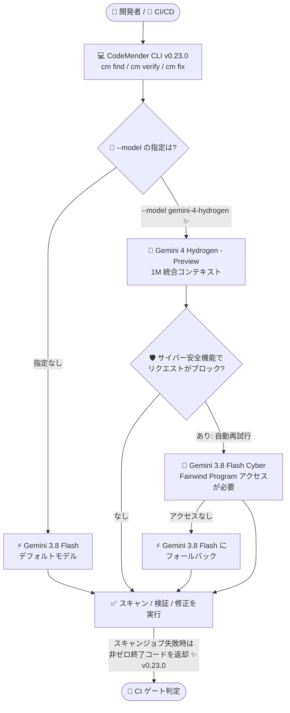

# Gemini Enterprise Agent Platform: CodeMender が Gemini 4 Hydrogen をサポート (Preview) + v0.23.0 アップデート

**リリース日**: 2026-11-19

**サービス**: Gemini Enterprise Agent Platform (CodeMender)

**機能**: CodeMender での Gemini 4 Hydrogen サポート (Preview)、CodeMender v0.23.0 - `cm find --diff` のスキャンジョブ失敗時の終了コード修正

**ステータス**: Feature (Preview) + Fixed (v0.23.0 アップデート)

📊 [このアップデートのインフォグラフィックを見る](https://takech9203.github.io/google-cloud-news-summary/20261119-codemender-gemini-4-hydrogen-v0-23-0.html)

## 概要

Gemini Enterprise Agent Platform の AI コードセキュリティエージェント「CodeMender」が、最新世代モデル **Gemini 4 Hydrogen** (`gemini-4-hydrogen`) をサポートした (Preview)。`cm find` (スキャン)、`cm verify` (検証)、`cm fix` (修正) の各コマンドに `--model gemini-4-hydrogen` を渡すことで利用できる。デフォルトモデルは引き続き Gemini 3.8 Flash である。Gemini 4 Hydrogen は「日常的なコーディングとエージェンティックワークフロー向けの速度と効率」を特徴とするモデルで、入力・思考・出力を合わせた 1,048,576 トークンの統合コンテキストウィンドウを持つ。料金面では、**2027 年 1 月 12 日から Gemini 4 Hydrogen 上の CodeMender セッションでキャッシュ書き込み (cache writes) も課金対象になる**点に注意が必要である。

あわせて CodeMender v0.23.0 がリリースされ、CI/CD 運用に直結する重要なバグ修正が含まれる。従来、`cm find --diff` はスキャンジョブが失敗した場合でも終了コード 0 で終了することがあり、CI 環境では「不完全なスキャン」が「クリーンなスキャン」として扱われるリスクがあった。v0.23.0 では、不完全な実行に対して非ゼロの終了コードが CI 環境へ確実に返されるようになった。

対象ユーザーは、CodeMender を PR ゲートや定期スキャンとして CI/CD に組み込んでいる DevSecOps チームと、スキャン・検証・修正の精度や速度をモデル選択で最適化したいセキュリティチームである。

**アップデート前の課題**

- CodeMender で利用できる最上位世代のモデルは Gemini 4 Carbon / Gemini 4 Argon などで、Gemini 4 Hydrogen は選択できなかった
- `cm find --diff` でスキャンジョブが失敗しても終了コード 0 で終了することがあり、CI パイプラインが不完全なスキャンを「成功 (クリーン)」と誤認してマージをすり抜ける可能性があった

**アップデート後の改善**

- `--model gemini-4-hydrogen` を `cm find` / `cm verify` / `cm fix` に渡すだけで、1M 統合コンテキストウィンドウを持つ Gemini 4 Hydrogen を CodeMender で利用できるようになった (Preview)
- スキャンジョブが失敗した不完全な実行では `cm find --diff` が非ゼロの終了コードを返すようになり、CI ゲートとしての信頼性が向上した

## アーキテクチャ図



`--model gemini-4-hydrogen` によるモデル選択フローと、安全機能ブロック時の自動フォールバックチェーン (Gemini 3.8 Flash Cyber → Gemini 3.8 Flash) を示す。v0.23.0 ではスキャンジョブ失敗時に非ゼロ終了コードが CI に返るようになった。

## サービスアップデートの詳細

### 主要機能

1. **Gemini 4 Hydrogen のサポート (Preview)**
   - `cm find`、`cm verify`、`cm fix` に `--model gemini-4-hydrogen` を渡すことで利用可能
   - デフォルトモデルは引き続き Gemini 3.8 Flash
   - Gemini 4 Hydrogen は入力・思考・出力を共有する 1,048,576 トークンの統合コンテキストウィンドウを持ち、Thinking、Function calling、Code execution、Implicit context caching などに対応
   - Gemini 4 系モデル (Hydrogen / Carbon / Argon) には組み込みのサイバー安全機能があり、エクスプロイト生成や脆弱性検証を伴うリクエストをブロックする場合がある。ブロック時は Gemini 3.8 Flash Cyber (`gemini-3.8-flash-cyber`) で自動再試行され、プロジェクトに Gemini 3.8 Flash Cyber へのアクセス (Fairwind Program) がない場合は Gemini 3.8 Flash にフォールバックする

2. **Gemini 4 Hydrogen のキャッシュ書き込み課金 (2027 年 1 月 12 日開始)**
   - 2027 年 1 月 12 日から、Gemini 4 Hydrogen 上の CodeMender セッションではキャッシュ書き込み (cache writes) も課金対象となる
   - コンテキストキャッシュのドキュメントによると、Gemini 4 Hydrogen 以降のモデルでは同日から TTL 設定付きのキャッシュ制御機能がサポートされ、キャッシュ書き込みはデフォルトで標準入力トークン価格の 1.25 倍、保持期間が長いほど高くなる

3. **v0.23.0 バグ修正: `cm find --diff` の終了コード**
   - スキャンジョブが失敗した場合に `cm find --diff` が終了コード 0 で終了する問題を修正
   - 不完全な実行に対して非ゼロの終了コードが CI 環境に確実に返されるようになり、不完全なスキャンが「クリーン」と誤判定されてマージをすり抜けるリスクが解消された

## 技術仕様

### CodeMender がサポートするモデル (2026-11-19 時点)

| モデル | `--model` 識別子 | 備考 |
|--------|------------------|------|
| Gemini 3.8 Flash | `gemini-3.8-flash` | デフォルト |
| **Gemini 4 Hydrogen** | `gemini-4-hydrogen` | ✨ 今回追加 (Preview) |
| Gemini 4 Carbon | `gemini-4-carbon` | - |
| Gemini 4 Argon | `gemini-4-argon` | - |
| Gemini 3.7 Flash | `gemini-3.7-flash` | 2027-01-28 に廃止予定 |
| Gemini 3.6 Flash | `gemini-3.6-flash` | 非推奨。2026-11-19 に廃止 |
| Gemini 3.5 Flash | `gemini-3.5-flash` | - |
| Gemini 3.1 Pro Preview | `gemini-3.1-pro-preview` | Preview |
| Gemini 3.8 Flash Cyber | `gemini-3.8-flash-cyber` | Fairwind Program アクセスが必要 |
| Gemini 4 Argon Cyber Permissive | `gemini-4-argon-cyber-permissive` | 同上 |
| Gemini 4 Carbon for cyber | `gemini-4-carbon-cyber-permissive` | 同上 |

`--model` フラグは `cm find` / `cm verify` / `cm fix` でサポートされる。非推奨モデルは廃止日まで動作し、使用時に CLI が警告を表示する。廃止後はリクエストが失敗する。なお、`cm verify` はサイバー系モデルとの組み合わせで最も効果を発揮する。

### Gemini 4 Hydrogen のモデル仕様 (抜粋)

| 項目 | 詳細 |
|------|------|
| モデル ID | `gemini-4-hydrogen` |
| コンテキストウィンドウ | 1,048,576 トークン (入力・思考・出力の統合) |
| 最大出力トークン | 最大 1,048,576 (long decode 利用時) |
| Thinking | サポート |
| コンテキストキャッシュ | Implicit context caching をサポート (Explicit caching は非サポート) |
| Function calling / Code execution | サポート |
| Tuning / RAG Engine | 非サポート |

## 設定方法

### 前提条件

1. CodeMender へのアクセス権を持つ Google Cloud プロジェクト (CodeMender は Preview)
2. CodeMender CLI のインストールと Application Default Credentials (ADC) の設定
3. Gemini 3.8 Flash Cyber などのサイバー系モデルを明示的に利用する場合は Fairwind Program によるアクセス

### 手順

#### ステップ 1: CLI を v0.23.0 に更新

```bash
cm update
```

v0.23.0 に更新することで、`cm find --diff` の終了コード修正が適用される。

#### ステップ 2: Gemini 4 Hydrogen を指定して実行

```bash
# スキャンを Gemini 4 Hydrogen で実行
cm find ./src --model gemini-4-hydrogen

# 検証・修正にも同じフラグを指定可能
cm verify FINDING_ID --model gemini-4-hydrogen
cm fix FINDING_ID --model gemini-4-hydrogen
```

`--model` を省略した場合はデフォルトの Gemini 3.8 Flash が使用される。

#### ステップ 3: CI/CD での diff スキャン (v0.23.0 の修正を反映)

```bash
cm find . --diff=origin/main --fail-on=CRITICAL,HIGH --model gemini-4-hydrogen
status=$?
if [ "$status" -ne 0 ]; then
  echo "CI ゲート失敗、実行エラー、またはスキャンジョブ失敗 (exit=$status)"
  exit 1
fi
```

v0.23.0 以降、スキャンジョブが失敗した不完全な実行では非ゼロの終了コードが返るため、終了コード 0 を「スキャン完了かつクリーン」として安全に扱える。

## メリット

### ビジネス面

- **モデル選択によるコスト・性能の最適化**: デフォルトの Gemini 3.8 Flash に加えて最新世代の Gemini 4 Hydrogen を選択でき、スキャン品質・速度・コストの要件に応じてワークロードごとにモデルを使い分けられる
- **CI ゲートの信頼性向上によるリスク低減**: 不完全なスキャンが「成功」と誤判定されなくなり、スキャン失敗を見逃して脆弱な変更がマージされるリスクが解消される

### 技術面

- **1M 統合コンテキストウィンドウ**: Gemini 4 Hydrogen は入力・思考・出力を共有する 1,048,576 トークンのコンテキストを持ち、大きなコードコンテキストを扱うエージェンティックワークフローに適する
- **安全機能ブロック時の自動フォールバック**: Gemini 4 Hydrogen でサイバー安全機能によるブロックが発生しても、Gemini 3.8 Flash Cyber → Gemini 3.8 Flash の順で自動的に再試行・フォールバックされるため、セッションが途中で止まりにくい
- **終了コードの一貫性**: v0.22.0 で整理された終了コード体系 (1 = CI ゲート失敗、2 = 一般失敗、50 = 時間上限) に加え、v0.23.0 でスキャンジョブ失敗時の非ゼロ終了コードが保証され、パイプラインの分岐処理をより正確に設計できる

## デメリット・制約事項

### 制限事項

- CodeMender の Gemini 4 Hydrogen サポートは Preview であり、Pre-GA Offerings Terms が適用される
- Gemini 4 Hydrogen を含む Gemini 4 系モデルの組み込みサイバー安全機能により、エクスプロイト生成や脆弱性検証を伴うリクエストがブロックされる場合がある。Fairwind Program へのアクセスがないプロジェクトでは、ブロック時に Gemini 3.8 Flash へフォールバックするため、指定したモデルで全処理が実行されるとは限らない
- `cm verify` はサイバー系モデルで最も効果を発揮するため、Gemini 4 Hydrogen 単体では検証品質が最適でない可能性がある

### 考慮すべき点

- **2027 年 1 月 12 日からのキャッシュ書き込み課金**: Gemini 4 Hydrogen 上の CodeMender セッションはキャッシュ書き込みも課金されるようになる。キャッシュ書き込みはデフォルトで標準入力トークン価格の 1.25 倍であり、長時間・大規模なスキャンではコスト見積もりの再確認が必要
- v0.23.0 の修正により、これまで終了コード 0 で「成功」と扱われていた不完全なスキャンが CI で失敗として検出されるようになる。パイプラインが新たに失敗し始めた場合は、スキャンジョブ自体の失敗原因 (権限、ネットワーク、リソースなど) を調査すること
- 同日 (2026-11-19) に Gemini 3.6 Flash が廃止された。`--model gemini-3.6-flash` を使っているワークフローはリクエストが失敗するため、Gemini 3.8 Flash 以降への移行が必要

## ユースケース

### ユースケース 1: 大規模コードベースの deep スキャンを Gemini 4 Hydrogen で実行

**シナリオ**: 多数のパッケージを含むモノレポに対して夜間の deep スキャンを実行しており、より大きなコンテキストを扱える最新世代モデルでスキャン品質を高めたい。

**実装例**:
```bash
cm find . --deep-workers=8 --model gemini-4-hydrogen --duration 60m
```

**効果**: 1M 統合コンテキストウィンドウを持つ Gemini 4 Hydrogen でスキャンを実行できる。`--duration` (v0.22.0) と組み合わせれば実行時間とトークン消費も時間ボックス化できる。

### ユースケース 2: PR ゲートでのスキャン失敗の確実な検出

**シナリオ**: `cm find --diff` を PR ゲートとして運用しているが、スキャンジョブが失敗した場合でも exit 0 が返り、不完全なスキャンのまま PR がマージされる事象を懸念している。

**実装例**:
```bash
cm update   # v0.23.0 に更新
cm find . --diff=origin/main --fail-on=CRITICAL,HIGH
```

**効果**: v0.23.0 以降、スキャンジョブが失敗した不完全な実行では非ゼロの終了コードが返るため、CI は「スキャン完了かつクリーン」な場合のみパスする。スキャンの失敗を黙って見逃すことがなくなる。

### ユースケース 3: モデル使い分けによるコスト・品質バランスの調整

**シナリオ**: 日常の diff スキャンはデフォルトの Gemini 3.8 Flash で高速・低コストに回し、リリース前の重要なスキャン・修正だけ最新世代モデルを使いたい。

**実装例**:
```bash
# 日常の PR ゲート (デフォルトモデル)
cm find . --diff=origin/main --fail-on=CRITICAL,HIGH

# リリース前の重点スキャンと修正 (Gemini 4 Hydrogen)
cm find ./src --model gemini-4-hydrogen
cm fix FINDING_ID --model gemini-4-hydrogen
```

**効果**: コマンド単位で `--model` を切り替えるだけで、コストと品質のバランスをワークフローごとに最適化できる。

## 料金

CodeMender の利用はセッションのトークン使用量に基づいて課金される。今回のアップデートに伴う料金面のポイントは以下のとおり。

- **2027 年 1 月 12 日から、Gemini 4 Hydrogen 上の CodeMender セッションではキャッシュ書き込み (cache writes) も課金対象になる**
- コンテキストキャッシュのドキュメントによると、Gemini 4 Hydrogen 以降のモデルではキャッシュ書き込みがデフォルトで標準入力トークン価格の 1.25 倍で課金され、保持期間 (TTL) が長いほど高くなる
- 具体的な単価は CodeMender の料金ページを参照

<!-- 料金リンク -->
- [CodeMender 料金](https://cloud.google.com/model-garden/pricing#codemender)

## 利用可能リージョン

CodeMender はグローバルに利用可能。

## 関連サービス・機能

- **Gemini 4 Hydrogen (Gemini Enterprise Agent Platform)**: 今回 CodeMender で利用可能になったモデル。1M 統合コンテキストウィンドウと Implicit context caching を持つ
- **Gemini 3.8 Flash / Gemini 3.8 Flash Cyber**: CodeMender のデフォルトモデルと、安全機能ブロック時の自動再試行先。サイバー系モデルは Fairwind Program でのアクセスが必要
- **Cloud Build / GitHub Actions**: CodeMender の CI/CD 統合先。v0.23.0 の終了コード修正により、スキャンジョブ失敗をパイプラインで確実に検出できる
- **Cloud Billing**: Gemini 4 Hydrogen のキャッシュ書き込み課金開始 (2027-01-12) 後のコスト推移の確認に、課金レポートを活用できる

## 参考リンク

- 📊 [インフォグラフィック](https://takech9203.github.io/google-cloud-news-summary/20261119-codemender-gemini-4-hydrogen-v0-23-0.html)
- [公式リリースノート](https://docs.cloud.google.com/release-notes#November_19_2026)
- [CodeMender ドキュメント (Specifying the model / Supported models)](https://docs.cloud.google.com/gemini-enterprise-agent-platform/agents/codemender)
- [Gemini 4 Hydrogen モデルページ](https://docs.cloud.google.com/gemini-enterprise-agent-platform/models/gemini/4-hydrogen)
- [コンテキストキャッシュの概要 (キャッシュ書き込み課金)](https://docs.cloud.google.com/gemini-enterprise-agent-platform/models/context-cache/context-cache-overview)
- [スキャンモード (find-modes)](https://docs.cloud.google.com/gemini-enterprise-agent-platform/agents/codemender/find-modes)
- [CodeMender 料金](https://cloud.google.com/model-garden/pricing#codemender)
- [Google Cloud Blog: Find and fix software vulnerabilities with CodeMender](https://cloud.google.com/blog/products/identity-security/find-and-fix-software-vulnerabilities-with-codemender)

## まとめ

今回のアップデートにより、CodeMender で最新世代の Gemini 4 Hydrogen を `--model gemini-4-hydrogen` で選択できるようになり (Preview)、スキャン・検証・修正のモデル選択の幅が広がった。同時にリリースされた v0.23.0 では、`cm find --diff` がスキャンジョブ失敗時に非ゼロ終了コードを返すようになり、CI ゲートとしての安全性が本質的に向上したため、`cm update` での早期アップデートを推奨する。Gemini 4 Hydrogen を採用する場合は、2027 年 1 月 12 日からキャッシュ書き込みが課金対象になる点を踏まえてコスト影響を事前に評価しておきたい。

---

**タグ**: #GeminiEnterpriseAgentPlatform #CodeMender #Gemini4Hydrogen #CICD #DevSecOps #セキュリティ #AIエージェント #Preview
