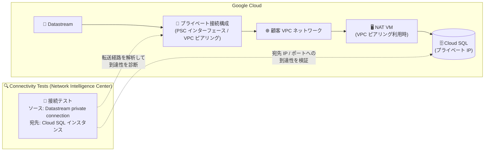

# Network Intelligence Center: Connectivity Tests が Datastream プライベート接続から Cloud SQL への接続テストに対応

**リリース日**: 2026-11-19

**サービス**: Network Intelligence Center (Connectivity Tests)

**機能**: Datastream プライベート接続から Cloud SQL インスタンスへの接続テスト

**ステータス**: GA (一般提供)

📊 [このアップデートのインフォグラフィックを見る](https://takech9203.github.io/google-cloud-news-summary/20261119-connectivity-tests-datastream-cloud-sql.html)

## 概要

Network Intelligence Center の Connectivity Tests が、**Datastream のプライベート接続 (private connection) をソースエンドポイントとして指定し、Cloud SQL インスタンスへの接続性をテストする機能**をサポートしました。公式ドキュメントでは、Database Migration Service (DMS) のプライベート接続または Datastream のプライベート接続から、宛先の Cloud SQL インスタンスへの接続テスト手順が案内されています。

Connectivity Tests はネットワークエンドポイント間の接続性を診断するツールで、VPC ネットワーク構成を解析してパケットの想定転送経路をシミュレートし、構成ミスや到達性の問題を特定できます。Datastream はプライベート接続構成 (Private Service Connect インターフェースまたは VPC ピアリング) を通じてソースデータベースと通信しますが、特に VPC ピアリングを使う場合は推移的ピアリングが非サポートのため、Cloud SQL のようなフルマネージドデータベースへの接続には NAT VM が必要になるなど、ネットワーク構成が複雑になりがちです。今回のアップデートにより、こうした Datastream から Cloud SQL への経路を Connectivity Tests で直接検証できるようになり、CDC パイプラインやデータレプリケーション構築時のネットワークトラブルシューティングが容易になります。

このアップデートは、Datastream で Cloud SQL をソースとする CDC / レプリケーションパイプラインを構築するデータエンジニアや、プライベート接続構成の疎通問題を調査するネットワーク管理者にとって有用です。

**アップデート前の課題**

- Connectivity Tests のソースエンドポイントとして Datastream のプライベート接続を指定して Cloud SQL への接続をテストすることができなかった
- Datastream のプライベート接続 (特に VPC ピアリング利用時は推移的ピアリング非サポートのため NAT VM が必要) から Cloud SQL への経路で疎通問題が発生した場合、ファイアウォールルールやルート、NAT VM の構成を手動で個別に確認する必要があった
- 構成のどこに問題があるか (Datastream 側か、VPC 側か、Cloud SQL 側か) の切り分けに手間がかかった

**アップデート後の改善**

- Google Cloud コンソール、gcloud CLI (`--source-datastream-private-connection` フラグ)、Network Management API (`datastreamPrivateConnection` パラメータ) で、Datastream プライベート接続をソースとした Cloud SQL インスタンスへの接続テストを作成できるようになった
- Connectivity Tests の構成解析により、Datastream から Cloud SQL までの想定転送経路を可視化し、到達性の問題箇所を特定できるようになった
- Datastream パイプラインの構築前・構築後のネットワーク検証を、他の Connectivity Tests シナリオと同じワークフローで実施できるようになった

## アーキテクチャ図



Datastream はプライベート接続構成 (Private Service Connect インターフェースまたは VPC ピアリング) を介して Cloud SQL と通信します。今回のアップデートで、Connectivity Tests がこの経路全体をソース (Datastream プライベート接続) から宛先 (Cloud SQL インスタンス) まで解析できるようになりました。

## サービスアップデートの詳細

### 主要機能

1. **Datastream プライベート接続をソースエンドポイントに指定**
   - コンソールの「ソースエンドポイント」で「Datastream private connection」を選択し、テスト対象のプライベート接続を指定
   - プライベート接続が属する Google Cloud プロジェクトを選択可能 (プロジェクトをまたぐテストに対応)

2. **Cloud SQL インスタンスを宛先エンドポイントに指定**
   - 宛先として Cloud SQL インスタンスとそのエンドポイント (テストしたい宛先 IP アドレス) を選択
   - TCP / UDP プロトコル選択時は宛先ポートを指定 (例: MySQL は 3306)

3. **コンソール / gcloud / API の 3 つのインターフェースに対応**
   - gcloud では `--source-datastream-private-connection` フラグを使用
   - Network Management API では `source.datastreamPrivateConnection` パラメータを使用
   - 同じドキュメントで DMS プライベート接続 (`--source-dms-private-connection` / `dmsPrivateConnection`) からのテストも案内されている

## 技術仕様

### テストの指定項目

| 項目 | 詳細 |
|------|------|
| ソースエンドポイント | Datastream private connection の URI (例: `projects/my-project/locations/us-central1/privateConnections/my-private-connection`) |
| 宛先エンドポイント | Cloud SQL インスタンスの URI (例: `projects/my-project/instances/my-cloud-sql-instance`) |
| 宛先 IP アドレス | テストしたい宛先 IP アドレス |
| 宛先ポート | TCP / UDP テスト作成時に指定 |
| プロトコル | Connectivity Tests がサポートするプロトコル (デフォルト: TCP) |
| API | Network Management API (`projects.locations.global.connectivityTests.create`) |

### API リクエスト例

```json
POST https://networkmanagement.googleapis.com/v1/projects/PROJECT_ID/locations/global/connectivityTests?testId=TEST_ID
{
  "source": {
    "datastreamPrivateConnection": "SOURCE_PRIVATE_CONNECTION"
  },
  "destination": {
    "cloudSqlInstance": "DESTINATION_CLOUD_SQL_INSTANCE",
    "ipAddress": "DESTINATION_IP_ADDRESS",
    "port": DESTINATION_PORT
  },
  "protocol": "PROTOCOL",
  "roundTrip": true
}
```

## 設定方法

### 前提条件

1. テスト対象の Datastream プライベート接続構成が作成済みであること
2. 宛先の Cloud SQL インスタンスが存在すること

### 手順

#### ステップ 1: gcloud で接続テストを作成

```bash
gcloud network-management connectivity-tests create NAME \
    --source-datastream-private-connection=SOURCE_PRIVATE_CONNECTION \
    --destination-cloud-sql-instance=DESTINATION_CLOUD_SQL_INSTANCE \
    --destination-ip-address=DESTINATION_IP_ADDRESS \
    --destination-port=DESTINATION_PORT \
    --protocol=PROTOCOL \
    --round-trip
```

`SOURCE_PRIVATE_CONNECTION` には Datastream プライベート接続の URI、`DESTINATION_CLOUD_SQL_INSTANCE` には Cloud SQL インスタンスの URI を指定します。

#### ステップ 2: テスト結果を確認

```bash
gcloud network-management connectivity-tests describe NAME
```

テスト完了後、Connectivity Tests が構成解析の結果 (到達性と経路上の各ホップの判定) を表示します。コンソールの場合は「接続テスト」ページから結果を確認できます。

コンソールから作成する場合は、「接続テスト」ページで「接続テストを作成」をクリックし、ソースエンドポイントに「Datastream private connection」、宛先エンドポイントに「Cloud SQL インスタンス」を選択します。

## メリット

### ビジネス面

- **データパイプライン構築の迅速化**: Datastream のストリーム作成前にネットワーク経路を検証でき、疎通問題による構築の手戻りを削減できる
- **障害対応時間の短縮**: レプリケーション停止時にネットワーク起因かどうかを素早く切り分けられる

### 技術面

- **複雑なプライベート接続経路の可視化**: PSC インターフェースや VPC ピアリング + NAT VM を含む経路の構成問題 (ファイアウォール、ルートなど) を特定できる
- **統一されたトラブルシューティング体験**: VM、GKE、ロードバランサーなど他のエンドポイントと同じ Connectivity Tests のワークフローで Datastream 経路を診断できる
- **プロジェクト横断のテスト**: ソースと宛先でそれぞれプロジェクトを指定でき、プロジェクトをまたぐ構成にも対応

## デメリット・制約事項

### 考慮すべき点

- Connectivity Tests の結果取得には、VPC ネットワーク構成の規模に応じて 30 秒〜最大 10 分程度かかる場合がある
- Datastream で VPC ピアリングによるプライベート接続を使用する場合、推移的ピアリングはサポートされないため、Cloud SQL などのフルマネージドデータベースへの接続には NAT VM が必要 (これは Datastream 側の既存の制約であり、Connectivity Tests はその経路の検証を支援する)
- テストはテスト実行時点のネットワーク構成のスナップショットに基づくため、構成変更後は再実行が必要 (再実行すると前回の結果は上書きされる)

## ユースケース

### ユースケース 1: Datastream CDC パイプライン構築前のネットワーク検証

**シナリオ**: Cloud SQL for MySQL をソースとして Datastream で BigQuery への CDC レプリケーションを構築する。VPC ピアリングによるプライベート接続構成と NAT VM をセットアップしたが、ストリーム作成前に経路が正しいか確認したい。

**実装例**:
```bash
gcloud network-management connectivity-tests create datastream-to-cloudsql-test \
    --source-datastream-private-connection=projects/my-project/locations/us-central1/privateConnections/my-private-connection \
    --destination-cloud-sql-instance=projects/my-project/instances/my-mysql-instance \
    --destination-ip-address=10.1.2.3 \
    --destination-port=3306 \
    --protocol=tcp \
    --round-trip
```

**効果**: ストリーム作成前にファイアウォールルールや NAT VM 構成の不備を検出でき、パイプライン構築の手戻りを防げる。

### ユースケース 2: レプリケーション障害時のネットワーク切り分け

**シナリオ**: 稼働中の Datastream ストリームが Cloud SQL ソースへ接続できなくなった。最近 VPC のファイアウォールルールを変更しており、ネットワーク起因かどうかを切り分けたい。

**効果**: Connectivity Tests を実行して経路上のどのステップで到達性が失われているかを特定し、ネットワーク構成起因の問題を迅速に特定・修正できる。構成変更後はテストを再実行して修正を検証できる。

## 料金

Network Intelligence Center の料金はモジュールごとに異なります。Connectivity Tests の最新の料金は公式の料金ページを参照してください。

- [Network Intelligence Center 料金ページ](https://cloud.google.com/products/network-intelligence-center/pricing)

## 関連サービス・機能

- **Datastream**: サーバーレスの CDC / レプリケーションサービス。プライベート接続構成 (PSC インターフェースまたは VPC ピアリング) で Cloud SQL などのソースと接続する。今回のテストのソースエンドポイント
- **Cloud SQL**: フルマネージドのリレーショナルデータベース。今回のテストの宛先エンドポイント。Cloud SQL コンソールの「接続テスト」タブからも Connectivity Tests を管理できる
- **Database Migration Service**: データベース移行サービス。同じドキュメントで DMS プライベート接続から Cloud SQL への接続テストも案内されている
- **Network Management API**: Connectivity Tests のバックエンド API。`connectivityTests.create` メソッドでテストを作成する

## 参考リンク

- 📊 [インフォグラフィック](https://takech9203.github.io/google-cloud-news-summary/20261119-connectivity-tests-datastream-cloud-sql.html)
- [公式リリースノート](https://docs.cloud.google.com/release-notes#November_19_2026)
- [ドキュメント: Test from a Database Migration Service or Datastream private connection to a Cloud SQL instance](https://docs.cloud.google.com/network-intelligence-center/docs/connectivity-tests/how-to/running-connectivity-tests#testing-dms-private-connection)
- [Connectivity Tests の概要](https://docs.cloud.google.com/network-intelligence-center/docs/connectivity-tests/concepts/overview)
- [Datastream のプライベート接続構成の作成](https://docs.cloud.google.com/datastream/docs/create-a-private-connectivity-configuration)
- [料金ページ](https://cloud.google.com/products/network-intelligence-center/pricing)

## まとめ

Connectivity Tests が Datastream プライベート接続から Cloud SQL インスタンスへの接続テストに対応し、CDC / レプリケーションパイプラインのネットワーク検証とトラブルシューティングが大幅に容易になりました。Datastream で Cloud SQL をソースとするパイプラインを運用・構築しているチームは、ストリーム作成前の事前検証や障害時の切り分けに本機能の活用を推奨します。

---

**タグ**: Network Intelligence Center, Connectivity Tests, Datastream, Cloud SQL, ネットワーク診断, プライベート接続, CDC
