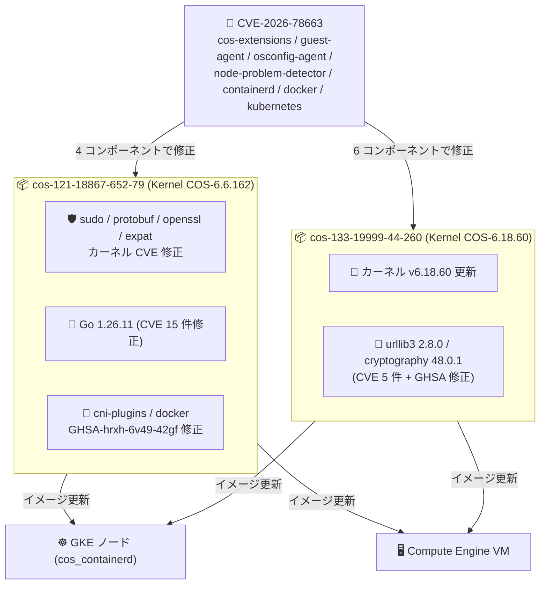

# Container-Optimized OS: cos-121 / cos-133 セキュリティリリース (CVE-2026-78663 を複数エージェントで修正)

**リリース日**: 2026-11-19

**サービス**: Container-Optimized OS

**機能**: cos-121-18867-652-79 / cos-133-19999-44-260 リリース (LTS Milestone 121 / 133)

**ステータス**: GA (LTS リリース)

📊 [このアップデートのインフォグラフィックを見る](https://takech9203.github.io/google-cloud-news-summary/20261119-container-optimized-os-cos-121-cos-133-security-updates.html)

## 概要

2026 年 11 月 19 日、Container-Optimized OS (COS) の 2 つの LTS マイルストーンで新しいイメージがリリースされました。LTS Milestone 121 系の `cos-121-18867-652-79` (Kernel COS-6.6.162、Docker v27.5.1、Containerd v2.0.10) と、LTS Milestone 133 系の `cos-133-19999-44-260` (Kernel COS-6.18.60、Docker v29.4.3、Containerd v2.4.1) です。いずれもセキュリティ修正が中心のメンテナンスリリースです。

本リリースで特に注目すべきは **CVE-2026-78663 が両イメージの多数のコンポーネントにまたがって修正されている**点です。cos-121 では cos-extensions、google-guest-agent、google-osconfig-agent、node-problem-detector の 4 コンポーネント、cos-133 では containerd、docker、google-guest-agent、guest-agent、kubernetes、node-problem-detector の 6 コンポーネントで修正されており、ノード上に常駐するエージェント類とコンテナランタイムの広範囲に影響する脆弱性であったことがうかがえます。なお、同 CVE は直近のリリース (11/16 の cos-133-19999-44-242 では cos-extensions、11/17 の cos-133-19999-44-250 では google-osconfig-agent) でも段階的に修正されてきており、今回のリリースで対象コンポーネントがさらに拡大しています。

Container-Optimized OS は Google Kubernetes Engine (GKE) のノードイメージ (`cos_containerd`) や Compute Engine のコンテナワークロードで使用される、コンテナ実行に最適化されたセキュリティ重視の OS です。GKE Autopilot クラスタは常にこのイメージを使用するため、COS のセキュリティ修正は GKE 利用者全体に影響する重要なアップデートです。

**アップデート前の課題**

- cos-121 では sudo (CVE-2026-35535)、protobuf (CVE-2026-6409)、openssl (CVE-2026-75805 / CVE-2026-84782)、expat (CVE-2026-77214)、Linux カーネル (CVE-2026-99270 / CVE-2026-99288)、cni-plugins / docker (GHSA-hrxh-6v49-42gf) に既知の脆弱性が残存していた
- CVE-2026-78663 が COS イメージ内の多数の Google Cloud エージェント・ランタイムコンポーネント (cos-extensions、google-guest-agent、google-osconfig-agent、node-problem-detector、containerd、docker、kubernetes、guest-agent) に未修正のまま残っていた
- cos-121 の Go ツールチェーンが古く、Go 起因の 15 件の CVE が未修正だった
- cos-133 の urllib3 / cryptography などの Python ライブラリに既知の脆弱性 (CVE-2025-66418 ほか) が残存していた

**アップデート後の改善**

- cos-121 で OS 基盤パッケージ、カーネル、コンテナ関連コンポーネントの CVE / GHSA が修正され、Go 1.26.11 へのアップグレードにより Go 起因の 15 件の CVE も解消された
- CVE-2026-78663 が両イメージ合わせて 10 コンポーネント (重複を除き 8 種類) で修正され、ノード常駐エージェントとコンテナランタイム全体の脆弱性リスクが低減された
- cos-133 で Linux カーネルが v6.18.60 に更新され、urllib3 2.8.0 / cryptography 48.0.1 へのアップグレードにより Python ライブラリの脆弱性 6 件 (CVE 5 件 + GHSA 1 件) が解消された
- 両イメージで cos-gpu-installer が v2.8.0 に更新された (セキュリティ更新)

## アーキテクチャ図



2 つの LTS マイルストーンのリリース内容と、両イメージを横断して修正された CVE-2026-78663、および GKE ノード / Compute Engine VM への適用経路を示しています。

## サービスアップデートの詳細

### 主要機能

1. **cos-121-18867-652-79 (LTS Milestone 121)**
   - Kernel: COS-6.6.162、Docker: v27.5.1、Containerd: v2.0.10
   - OS 基盤パッケージの CVE 修正: CVE-2026-35535 (app-admin/sudo)、CVE-2026-6409 (dev-libs/protobuf)、CVE-2026-75805 / CVE-2026-84782 (dev-libs/openssl)、CVE-2026-77214 (dev-libs/expat)
   - Linux カーネルの CVE 修正: CVE-2026-99270、CVE-2026-99288
   - CVE-2026-78663 の修正: cos-extensions、google-guest-agent、google-osconfig-agent、node-problem-detector の 4 コンポーネント
   - GHSA-hrxh-6v49-42gf の修正: cni-plugins、docker
   - dev-lang/go を 1.26.11 にアップグレードし、CVE-2026-56857、CVE-2026-94448、CVE-2026-97030、CVE-2026-97033〜97043、CVE-2026-97054 の計 15 件を修正
   - node-problem-detector 内の github.com/prometheus/prometheus を v0.305.3 にアップグレードし、CVE-2026-42154 を修正
   - cos-gpu-installer を v2.8.0 に更新 (セキュリティ更新)
   - Runtime sysctl 変更: `net.ipv4.tcp_mem` / `net.ipv4.udp_mem` の値を微調整

2. **cos-133-19999-44-260 (LTS Milestone 133)**
   - Kernel: COS-6.18.60 (前リリース cos-133-19999-44-250 の COS-6.18.59 から更新)、Docker: v29.4.3、Containerd: v2.4.1
   - CVE-2026-78663 の修正: containerd、docker、google-guest-agent、guest-agent、kubernetes、node-problem-detector の 6 コンポーネント
   - dev-python/cryptography を 48.0.1 にアップグレードし、GHSA-537c を修正
   - dev-python/urllib3 を 2.8.0 に更新し、CVE-2025-66418、CVE-2025-66471、CVE-2026-21441、CVE-2026-97687、CVE-2026-97689 の 5 件を修正
   - cos-gpu-installer を v2.8.0 に更新 (セキュリティ更新)

3. **CVE-2026-78663 の横断的な修正 (ハイライト)**
   - 両イメージ合計 10 箇所 (8 種類のコンポーネント) で同一 CVE を修正
   - 対象はコンテナランタイム (containerd、docker)、Kubernetes コンポーネント、ゲストエージェント (google-guest-agent、guest-agent)、運用エージェント (google-osconfig-agent、node-problem-detector)、拡張機能基盤 (cos-extensions) と、ノード運用の中核コンポーネントに広く及ぶ
   - 11/16・11/17 のリリースから段階的に修正が進められており、今回で対象範囲が大きく拡大した

## 技術仕様

### リリース構成

| 項目 | cos-121-18867-652-79 | cos-133-19999-44-260 |
|------|---------------------|---------------------|
| マイルストーン | 121 (LTS、サポート終了: 2027 年 3 月) | 133 (LTS、サポート終了: 2028 年 11 月) |
| Kernel | COS-6.6.162 | COS-6.18.60 |
| Docker | v27.5.1 | v29.4.3 |
| Containerd | v2.0.10 | v2.4.1 |
| イメージファミリー | cos-121-lts / cos-arm64-121-lts | cos-133-lts / cos-arm64-133-lts |
| GPU ドライバ | [See List](https://storage.googleapis.com/cos-tools/18867.652.79/lakitu/gpu_driver_versions.textproto) | [See List](https://storage.googleapis.com/cos-tools/19999.44.260/lakitu/gpu_driver_versions.textproto) |

### セキュリティ修正の一覧 (cos-121-18867-652-79)

| 脆弱性 | 対象コンポーネント | 修正方法 |
|-----|-------------------|---------|
| CVE-2026-35535 | app-admin/sudo | 修正適用 |
| CVE-2026-6409 | dev-libs/protobuf | 修正適用 |
| CVE-2026-75805 / CVE-2026-84782 | dev-libs/openssl | 修正適用 |
| CVE-2026-77214 | dev-libs/expat | 修正適用 |
| CVE-2026-78663 | cos-extensions / google-guest-agent / google-osconfig-agent / node-problem-detector | 各コンポーネントに修正適用 |
| CVE-2026-99270 / CVE-2026-99288 | Linux kernel | 修正適用 |
| GHSA-hrxh-6v49-42gf | cni-plugins / docker | 修正適用 |
| Go 起因の CVE 15 件 | dev-lang/go | Go 1.26.11 にアップグレード |
| CVE-2026-42154 | node-problem-detector | prometheus を v0.305.3 にアップグレード |

### セキュリティ修正の一覧 (cos-133-19999-44-260)

| 脆弱性 | 対象コンポーネント | 修正方法 |
|-----|-------------------|---------|
| CVE-2026-78663 | containerd / docker / google-guest-agent / guest-agent / kubernetes / node-problem-detector | 各コンポーネントに修正適用 |
| GHSA-537c | dev-python/cryptography | 48.0.1 にアップグレード |
| CVE-2025-66418 / CVE-2025-66471 / CVE-2026-21441 / CVE-2026-97687 / CVE-2026-97689 | dev-python/urllib3 | 2.8.0 に更新 |

### Runtime sysctl 変更 (cos-121 のみ)

| パラメータ | 変更前 | 変更後 |
|-----------|--------|--------|
| net.ipv4.tcp_mem | 94041 125391 188082 | 94044 125392 188088 |
| net.ipv4.udp_mem | 188085 250783 376170 | 188088 250784 376176 |

## 設定方法

### 前提条件

1. Container-Optimized OS を GKE ノードイメージまたは Compute Engine VM イメージとして使用していること
2. LTS Milestone 121 (cos-121) または 133 (cos-133) 系のイメージを利用していること

### 手順

#### ステップ 1: 現在のイメージバージョンの確認

```bash
# Compute Engine インスタンスの OS バージョン確認 (インスタンス内で実行)
cat /etc/os-release

# GKE ノードプールのノードイメージ確認
gcloud container node-pools describe NODE_POOL_NAME \
  --cluster=CLUSTER_NAME \
  --location=LOCATION \
  --format="value(config.imageType)"
```

#### ステップ 2: 新リリースの適用

```bash
# Compute Engine: 新しい COS イメージの確認
gcloud compute images list --project cos-cloud \
  --filter="family:(cos-121-lts OR cos-133-lts)"

# Compute Engine: 自動更新を有効化する場合 (Milestone 117 以降はデフォルト無効)
gcloud compute instances add-metadata INSTANCE_NAME \
  --metadata cos-update-strategy=update_enabled
```

COS の自動更新はアクティブ/パッシブのルートパーティション方式で OS イメージ全体を更新します。更新はパッシブパーティションにインストールされ、再起動後に有効になります。GKE ノードでは COS の自動更新機能は無効化されており、GKE のノード自動アップグレード機能で更新されます。GKE パッチバージョンと COS ノードイメージの対応は [マッピング JSON](https://www.gstatic.com/gke-image-maps/gke-to-cos.json) で公開されています。

## メリット

### ビジネス面

- **セキュリティリスクの低減**: sudo、openssl、expat、protobuf、Linux カーネルといった基盤コンポーネントから、Go ツールチェーン起因の 15 件まで、多数の CVE が一括で修正され、コンテナ実行基盤の脆弱性リスクが大幅に低減される
- **コンプライアンス対応**: 定期的な脆弱性修正の適用により、脆弱性管理ポリシーやセキュリティ監査への対応が容易になる

### 技術面

- **CVE-2026-78663 の広範囲な修正**: コンテナランタイム (containerd / docker)、kubernetes、ゲストエージェント、運用エージェントの計 8 種類のコンポーネントで同一 CVE が修正され、ノード運用の中核コンポーネント全体が保護される
- **2 つの LTS マイルストーンで同時提供**: cos-121 と cos-133 の両系統で修正が提供されるため、マイルストーン移行前のユーザーも最新の修正を適用できる
- **GPU 環境の更新**: 両イメージで cos-gpu-installer が v2.8.0 に更新され、GPU ワークロード環境のセキュリティも維持される

## デメリット・制約事項

### 制限事項

- COS の自動更新は再起動するまで有効にならない (自動更新機能は強制再起動を行わない)
- Milestone 117 以降、COS イメージの自動更新機能はデフォルトで無効のため、スタンドアロン利用時は `cos-update-strategy` メタデータの設定またはイメージの差し替えが必要

### 考慮すべき点

- GKE ノードは GKE のノード自動アップグレードで更新されるため、新リリースが反映されるタイミングは GKE のリリースチャネルに依存する
- cos-133 ではカーネルが COS-6.18.59 から COS-6.18.60 に更新されているため、カーネルアップグレードに敏感な本番ワークロードでは事前検証を推奨
- cos-121 では `net.ipv4.tcp_mem` / `net.ipv4.udp_mem` の sysctl 既定値が微調整されているため、ネットワークバッファのチューニングを行っている場合は確認を推奨
- COS 121 LTS のサポート終了は 2027 年 3 月のため、cos-121 利用者は新しいマイルストーン (125 / 129 / 133) への移行計画も併せて検討するとよい

## ユースケース

### ユースケース 1: GKE ノードの脆弱性管理

**シナリオ**: セキュリティポリシーで既知 CVE の修正適用期限が定められている組織で、GKE ノード (cos_containerd) 上の containerd / docker / kubernetes / node-problem-detector に残る CVE-2026-78663 などの脆弱性を解消したい。

**実装例**:
```bash
# GKE → COS イメージのマッピングを確認し、
# cos-121-18867-652-79 / cos-133-19999-44-260 を含む
# GKE パッチバージョンへアップグレード
gcloud container clusters upgrade CLUSTER_NAME \
  --location=LOCATION \
  --node-pool=NODE_POOL_NAME \
  --cluster-version=GKE_PATCH_VERSION
```

**効果**: ノード上のコンテナランタイム・エージェント類の脆弱性が解消され、脆弱性スキャンの指摘事項を低減できる。

### ユースケース 2: cos-121 を使う Compute Engine VM の定期パッチ適用

**シナリオ**: Compute Engine 上で cos-121-lts イメージファミリーの COS VM を運用しており、sudo や openssl などの OS 基盤パッケージの CVE を解消したい。

**効果**: イメージを cos-121-18867-652-79 に差し替える (または自動更新を有効化する) ことで、OS 基盤パッケージ、カーネル、Go 起因の CVE を含む多数の脆弱性が一括で解消される。

## 料金

Container-Optimized OS 自体のイメージ更新に伴う追加料金はありません。料金は実行する Compute Engine / GKE のリソースに依存します。

- [Compute Engine 料金](https://cloud.google.com/compute/pricing)
- [GKE 料金](https://cloud.google.com/kubernetes-engine/pricing)

## 関連サービス・機能

- **Google Kubernetes Engine (GKE)**: COS は GKE のデフォルトノードイメージ (`cos_containerd`)。Autopilot クラスタは常にこのイメージを使用し、ノード自動アップグレードで新リリースが適用される
- **Compute Engine**: コンテナ実行用 VM イメージとして COS を利用可能。guest-agent (ゲスト環境) が本リリースの修正対象
- **OS Config (google-osconfig-agent)**: VM のパッチ・構成管理エージェント。cos-121 で CVE-2026-78663 が修正された
- **Node Problem Detector**: ノードの問題検出エージェント。両イメージで CVE-2026-78663 が、cos-121 では Prometheus ライブラリ起因の CVE-2026-42154 も修正された
- **GPU ワークロード**: cos-gpu-installer v2.8.0 への更新により、COS 上で GPU ドライバをインストールする環境にも影響する

## 参考リンク

- 📊 [インフォグラフィック](https://takech9203.github.io/google-cloud-news-summary/20261119-container-optimized-os-cos-121-cos-133-security-updates.html)
- [公式リリースノート (Google Cloud)](https://docs.cloud.google.com/release-notes#November_19_2026)
- [COS Milestone 121 リリースノート](https://docs.cloud.google.com/container-optimized-os/docs/release-notes/m121)
- [COS Milestone 133 リリースノート](https://docs.cloud.google.com/container-optimized-os/docs/release-notes/m133)
- [Container-Optimized OS ドキュメント](https://docs.cloud.google.com/container-optimized-os/docs)
- [COS 自動更新の仕組み](https://docs.cloud.google.com/container-optimized-os/docs/concepts/auto-update)
- [GKE ノードイメージ](https://docs.cloud.google.com/kubernetes-engine/docs/concepts/node-images)

## まとめ

本リリースは、cos-121 と cos-133 の 2 つの LTS マイルストーンにまたがるセキュリティ中心のメンテナンスリリースで、特に CVE-2026-78663 がコンテナランタイム・kubernetes・各種エージェントの計 8 種類のコンポーネントで横断的に修正された点が重要です。GKE ノードや COS ベースの VM を運用している場合は、ノード自動アップグレードやイメージ更新を通じて本リリースを適用し、脆弱性を解消することを推奨します。

---

**タグ**: Container-Optimized OS, GKE, Compute Engine, セキュリティ, CVE, LTS, containerd, Docker
