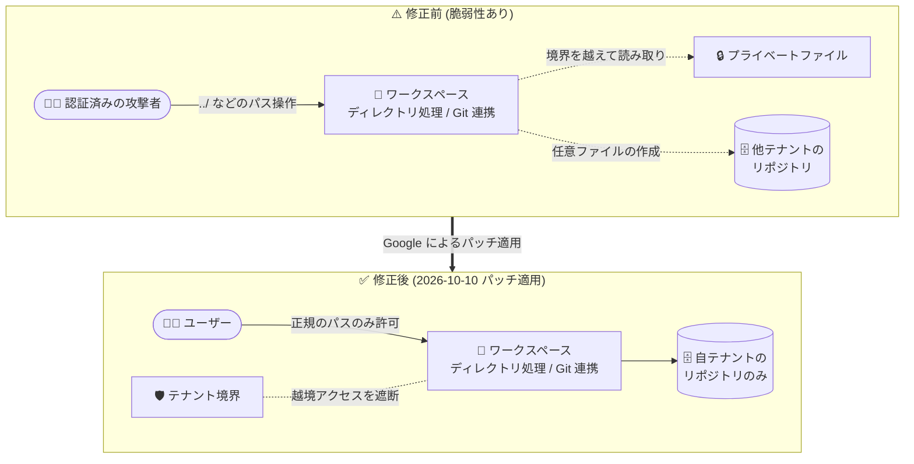

# Dataform / BigQuery: ワークスペースと Git 連携におけるパストラバーサル脆弱性 (GCP-2026-084)

**リリース日**: 2026-11-19

**サービス**: Dataform / BigQuery (BigQuery Studio) / Colab Enterprise

**機能**: セキュリティ情報 (パストラバーサル脆弱性の修正)

**ステータス**: 修正済み (Severity: Critical / 2026 年 10 月 10 日にパッチ適用済み)

📊 [このアップデートのインフォグラフィックを見る](https://takech9203.github.io/google-cloud-news-summary/20261119-dataform-path-traversal-vulnerability.html)

## 概要

2026 年 11 月 19 日、Google Cloud はセキュリティ情報 **GCP-2026-084** を公開しました。Dataform、BigQuery Studio、Colab Enterprise のワークスペースディレクトリ処理および Git 連携において、**パストラバーサル (path traversal) の脆弱性**が発見されたことを公表するものです。この脆弱性は **CVE-2026-126054** として採番されており、深刻度は **Critical** と評価されています。

セキュリティ情報によると、この脆弱性により、**認証されたリモートの攻撃者がプライベートなファイルを読み取り、テナントをまたいでリポジトリに任意のファイルを作成できる**可能性がありました。Dataform と BigQuery の両方のリリースノートで同一の脆弱性として告知されています。

重要な点として、**この脆弱性は 2026 年 10 月 10 日にすでにパッチが適用されており、利用者側の対応は不要**です。Dataform、BigQuery Studio、Colab Enterprise はいずれもフルマネージドサービスであり、修正は Google 側で完了しています。

**アップデート前の課題 (脆弱性の内容)**

- ワークスペースのディレクトリ処理と Git 連携にパストラバーサルの脆弱性が存在していた
- 認証されたリモートの攻撃者が、本来アクセスできないプライベートファイルを読み取れる可能性があった
- テナント境界を越えて、他のテナントのリポジトリに任意のファイルを作成できる可能性があった

**アップデート後の改善 (修正内容)**

- 2026 年 10 月 10 日に Google 側でパッチが適用され、脆弱性は修正済み
- 利用者側での対応 (アップグレードや設定変更) は一切不要
- 2026 年 11 月 19 日にセキュリティ情報 GCP-2026-084 として詳細が公開され、CVE-2026-126054 が採番された

## アーキテクチャ図

修正前はワークスペースのパス処理の不備によりテナント境界を越えたファイルの読み取り・作成が可能でしたが、パッチ適用後はテナント境界が正しく強制されます。

## サービスアップデートの詳細

### セキュリティ情報の要点

1. **脆弱性の種類: パストラバーサル**
   - ワークスペースのディレクトリ処理と Git 連携に存在
   - Dataform、BigQuery Studio、Colab Enterprise が対象

2. **想定される影響**
   - 認証されたリモートの攻撃者によるプライベートファイルの読み取り
   - テナントをまたいだリポジトリへの任意ファイルの作成

3. **対応状況**
   - 2026 年 10 月 10 日にパッチ適用済み
   - 利用者側の対応は不要 (No customer action is required)

## 技術仕様

### セキュリティ情報の概要

| 項目 | 詳細 |
|------|------|
| セキュリティ情報 ID | GCP-2026-084 |
| CVE | [CVE-2026-126054](https://www.cve.org/CVERecord?id=CVE-2026-126054) |
| 公開日 | 2026-11-19 |
| パッチ適用日 | 2026-10-10 |
| 深刻度 | Critical |
| 脆弱性の種類 | パストラバーサル (ワークスペースディレクトリ処理・Git 連携) |
| 影響サービス | Dataform、BigQuery Studio、Colab Enterprise |
| 必要な利用者対応 | なし (Google 側で修正済み) |

### 影響を受けたコンポーネントの背景

Dataform は Git リポジトリと連携してデータ変換パイプラインのコードを管理するサービスであり、開発用ワークスペース内でファイルの作成・編集・コミット・プッシュを行います。BigQuery Studio と Colab Enterprise も同様に、リポジトリ / ワークスペースによるファイル管理と Git 連携機能を備えています。今回の脆弱性は、これらのワークスペースにおけるディレクトリ (パス) の取り扱いに起因するものです。

## 推奨されるアクション

利用者側で必須の対応はありませんが、Solutions Architect の観点では以下を推奨します。

1. **セキュリティ情報の購読**: [Google Cloud セキュリティ情報の XML フィード](https://cloud.google.com/feeds/google-cloud-security-bulletins.xml) を購読し、GCP-2026-084 のような告知を早期に把握する
2. **監査ログの確認 (任意)**: Dataform / BigQuery のリポジトリに対する想定外の操作がないか、Cloud Audit Logs を確認する
3. **類似事例の把握**: Dataform / BigQuery 関連ではこれまでにも GCP-2026-047 (リポジトリの認可不備)、GCP-2025-045 (Dataform API の脆弱性) が公開されており、リポジトリ機能周辺のセキュリティ情報は継続的に確認する

## 考慮すべき点

- セキュリティ情報には、実際に悪用が確認されたかどうかについての記載はない
- 公開されている情報は、脆弱性の種類・影響・対応状況の概要のみであり、技術的な詳細 (具体的な攻撃手法など) は開示されていない
- パッチ適用日 (2026-10-10) と公開日 (2026-11-19) に約 1 か月の差があるのは、修正完了後に情報公開する一般的な脆弱性開示プロセスに沿ったもの

## 関連サービス・機能

- **Dataform**: Git ベースでデータ変換パイプラインを管理するサービス。ワークスペースと Git 連携が今回の脆弱性の対象
- **BigQuery Studio**: SQL スクリプトやノートブックをリポジトリで管理できる BigQuery の統合開発環境
- **Colab Enterprise**: マネージドなノートブック環境。リポジトリ / ワークスペース機能が影響対象に含まれる
- **Cloud Audit Logs**: リポジトリやワークスペースに対する操作の監査に利用可能
- **Security Command Center**: Google Cloud 環境全体の脆弱性・脅威の可視化に利用可能

## 参考リンク

- 📊 [インフォグラフィック](https://takech9203.github.io/google-cloud-news-summary/20261119-dataform-path-traversal-vulnerability.html)
- [公式リリースノート (2026-11-19)](https://docs.cloud.google.com/release-notes#November_19_2026)
- [Dataform セキュリティ情報 GCP-2026-084](https://docs.cloud.google.com/dataform/docs/security-bulletins#gcp-2026-084)
- [BigQuery セキュリティ情報 GCP-2026-084](https://docs.cloud.google.com/bigquery/docs/security-bulletins#gcp-2026-084)
- [Google Cloud セキュリティ情報一覧](https://cloud.google.com/support/bulletins)
- [CVE-2026-126054](https://www.cve.org/CVERecord?id=CVE-2026-126054)
- [Dataform ドキュメント](https://docs.cloud.google.com/dataform/docs)

## まとめ

Dataform、BigQuery Studio、Colab Enterprise のワークスペース・Git 連携に Critical 深刻度のパストラバーサル脆弱性 (CVE-2026-126054) が存在しましたが、2026 年 10 月 10 日に Google 側でパッチ適用済みであり、利用者側の対応は不要です。マネージドサービスであっても脆弱性は発生し得るため、セキュリティ情報フィードの購読と、必要に応じた監査ログの確認を推奨します。

---

**タグ**: #Dataform #BigQuery #ColabEnterprise #Security #CVE #パストラバーサル #セキュリティ情報
