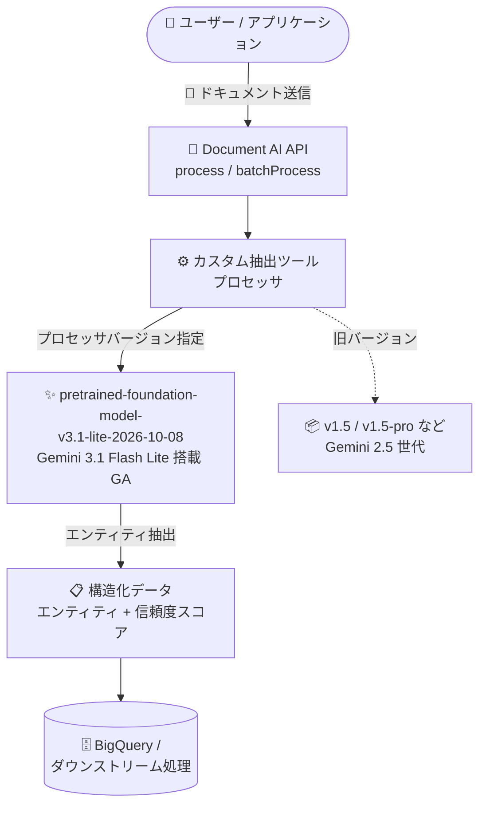

# Document AI: カスタム抽出ツールの新モデル pretrained-foundation-model-v3.1-lite (Gemini 3.1 Flash Lite 搭載) が GA

**リリース日**: 2026-11-19

**サービス**: Document AI

**機能**: カスタム抽出ツール (Custom Extractor) モデル pretrained-foundation-model-v3.1-lite-2026-10-08

**ステータス**: GA (一般提供)

📊 [このアップデートのインフォグラフィックを見る](https://takech9203.github.io/google-cloud-news-summary/20261119-document-ai-foundation-model-v3-1-lite.html)

## 概要

Document AI のカスタム抽出ツール (Custom Extractor) で、Gemini 3.1 Flash Lite LLM を基盤とする新しいモデルバージョン `pretrained-foundation-model-v3.1-lite-2026-10-08` が一般提供 (GA) になりました。カスタム抽出ツールは、事前学習済みプロセッサが存在しないドキュメントタイプから、生成 AI を活用してエンティティ (構造化データ) を抽出するためのプロセッサです。

今回 GA となった v3.1-lite は「Lite」系の軽量な基盤モデルであり、請求書、契約書、銀行取引明細といった多様なレイアウトのドキュメントからのデータ抽出を、最新の Gemini 3.1 世代のモデルで本番ワークロードとして利用できるようになります。なお、このプロセッサバージョンはファインチューニングをサポートしていない点に注意が必要です。

対象ユーザーは、Document AI でドキュメント処理パイプラインを構築しているすべてのユーザー、特に旧世代モデル (Gemini 2.x ベースの v1.4/v1.5 系など) からの移行や、最新世代モデルの本番利用を検討しているユーザーです。

**アップデート前の課題**

- Gemini 3.1 Flash Lite ベースの v3.1-lite モデルは、Preview 版 (`pretrained-foundation-model-v3.1-lite-2026-07-15`) としてのみ提供されており、本番ワークロードでの利用 (GA ステータス) ができなかった
- Gemini 3 世代のモデル (v1.6 / v1.6-pro) は Preview (Release Candidate) であり、Vertex AI Gemini のグローバルエンドポイントを使用するためデータレジデンシー (DRZ) 標準に準拠していないという制約があった

**アップデート後の改善**

- Gemini 3.1 Flash Lite を搭載した `pretrained-foundation-model-v3.1-lite-2026-10-08` が GA となり、本番ワークロードで利用可能になった
- カスタム抽出ツールの既存プロセッサに対して、最新世代の基盤モデルへのバージョン切り替え (プロセッサバージョン管理) で移行できる

## アーキテクチャ図



カスタム抽出ツールのプロセッサで新バージョン v3.1-lite-2026-10-08 を指定することで、Gemini 3.1 Flash Lite によるエンティティ抽出を本番利用できます。既存バージョンからはプロセッサバージョン管理機能で切り替えます。

## サービスアップデートの詳細

### 主要機能

1. **Gemini 3.1 Flash Lite 搭載モデルの GA**
   - カスタム抽出ツールのモデルバージョン `pretrained-foundation-model-v3.1-lite-2026-10-08` が一般提供 (GA) となり、本番ワークロードで利用可能
   - Gemini 3.1 Flash Lite LLM を基盤とした軽量 (Lite) モデル

2. **ファインチューニング非サポート**
   - この GA バージョンはファインチューニングをサポートしない
   - なお、先行の Preview 版 `pretrained-foundation-model-v3.1-lite-2026-07-15` はファインチューニングをサポートしていたため、ファインチューニングが必要なワークロードではバージョン選定に注意が必要

3. **プロセッサバージョン管理による移行**
   - 既存のカスタム抽出ツールプロセッサは、[プロセッサバージョンの管理](https://docs.cloud.google.com/document-ai/docs/manage-processor-versions) 機能で新バージョンへ切り替え可能
   - 利用可能なモデル一覧は [Custom extractor model versions](https://docs.cloud.google.com/document-ai/docs/ce-with-genai#models) を参照

## 技術仕様

### カスタム抽出ツールの主なモデルバージョン (公式ドキュメントより)

| モデルバージョン | 基盤 LLM | リリースチャネル | ファインチューニング |
|------|------|------|------|
| pretrained-foundation-model-v1.5-2025-05-05 | Gemini 2.5 Flash | Stable (GA) | US / EU で可 |
| pretrained-foundation-model-v1.5-pro-2025-06-20 | Gemini 2.5 Pro | Stable (GA) | 不可 |
| pretrained-foundation-model-v1.6-pro-2025-12-01 | Gemini 3 Pro | Release Candidate | 不可 |
| pretrained-foundation-model-v1.6-2026-01-13 | Gemini 3 Flash | Release Candidate | 不可 |
| pretrained-foundation-model-v3.1-lite-2026-07-15 | Gemini 3.1 Flash Lite | Preview | 可 (US / EU マルチリージョン、CMEK は一部制限・要許可リスト) |
| **pretrained-foundation-model-v3.1-lite-2026-10-08** | **Gemini 3.1 Flash Lite** | **GA (今回)** | **不可** |

### バージョン指定方法

プロセッサバージョンはリソース名で指定します。

```text
projects/{PROJECT_ID}/locations/{LOCATION}/processors/{PROCESSOR_ID}/processorVersions/pretrained-foundation-model-v3.1-lite-2026-10-08
```

## 設定方法

### 前提条件

1. Google Cloud プロジェクトで課金が有効化され、[Document AI API が有効](https://docs.cloud.google.com/document-ai/docs/setup) になっていること
2. カスタム抽出ツール (Custom Extractor) のプロセッサが作成済みであること

### 手順

#### ステップ 1: 利用可能なプロセッサバージョンの確認

```bash
curl -X GET \
  -H "Authorization: Bearer $(gcloud auth print-access-token)" \
  "https://{LOCATION}-documentai.googleapis.com/v1/projects/{PROJECT_ID}/locations/{LOCATION}/processors/{PROCESSOR_ID}/processorVersions"
```

プロセッサで利用できるバージョンの一覧を取得し、`pretrained-foundation-model-v3.1-lite-2026-10-08` が含まれることを確認します。

#### ステップ 2: 新バージョンを指定してドキュメントを処理

```bash
curl -X POST \
  -H "Authorization: Bearer $(gcloud auth print-access-token)" \
  -H "Content-Type: application/json" \
  "https://{LOCATION}-documentai.googleapis.com/v1/projects/{PROJECT_ID}/locations/{LOCATION}/processors/{PROCESSOR_ID}/processorVersions/pretrained-foundation-model-v3.1-lite-2026-10-08:process" \
  -d '{
    "rawDocument": {
      "content": "{BASE64_ENCODED_DOCUMENT}",
      "mimeType": "application/pdf"
    }
  }'
```

プロセッサバージョンを明示的に指定して処理をリクエストします。デフォルトバージョンの切り替え手順は [プロセッサバージョンの管理](https://docs.cloud.google.com/document-ai/docs/manage-processor-versions) を参照してください。

## メリット

### ビジネス面

- **最新世代モデルの本番利用**: Gemini 3.1 世代の基盤モデルを GA ステータス (本番サポート対象) でドキュメント抽出に利用できる
- **開発工数の削減**: カスタム抽出ツールは生成 AI によりラベル付きデータセットの大量準備なしで多様なドキュメントに対応でき、最新モデルでその精度向上が期待できる

### 技術面

- **プロセッサバージョンの切り替えのみで移行可能**: 既存のカスタム抽出ツールのパイプラインを変更せず、バージョン指定の変更だけで新モデルを利用できる
- **軽量 (Lite) モデルの選択肢**: Pro 系・Flash 系と並び、Lite 系モデルという選択肢が GA で追加され、ワークロード特性に応じたモデル選定が可能になった

## デメリット・制約事項

### 制限事項

- この GA バージョン (`v3.1-lite-2026-10-08`) は**ファインチューニングをサポートしない**
- Preview 版 (`v3.1-lite-2026-07-15`) でファインチューニングを利用していた場合、GA 版への移行でファインチューニングが利用できなくなる点に注意

### 考慮すべき点

- ファインチューニングが必須のワークロードでは、ファインチューニングをサポートする他バージョン (例: `pretrained-foundation-model-v1.5-2025-05-05`) の利用を検討する
- 利用可能なリージョンやクォータはバージョンごとに異なるため、[リージョン対応状況](https://docs.cloud.google.com/document-ai/docs/regions) と [クォータ](https://docs.cloud.google.com/document-ai/quotas) を事前に確認する
- モデルバージョンには非推奨化・提供終了のライフサイクルがあるため (過去に v1.2/v1.3/v1.4 などが段階的に終了)、定期的なバージョン移行計画が必要

## ユースケース

### ユースケース 1: 請求書・契約書処理パイプラインのモデル更新

**シナリオ**: 既存のカスタム抽出ツールで請求書や契約書からエンティティを抽出しているが、旧世代モデル (Gemini 2.x ベース) を使用している。最新世代モデルで本番運用したい。

**実装例**:
```text
1. 評価用データセットで v3.1-lite-2026-10-08 の抽出精度を既存バージョンと比較 (Document AI の評価機能を使用)
2. 問題なければプロセッサのデフォルトバージョンを v3.1-lite-2026-10-08 に切り替え
```

**効果**: パイプラインのコード変更なしで、GA サポート対象の最新世代モデルに移行できる。

### ユースケース 2: ファインチューニング不要なドキュメント抽出の新規構築

**シナリオ**: 事前学習済みプロセッサが存在しない独自フォーマットのドキュメントから構造化データを抽出したい。学習データの準備コストは最小限にしたい。

**効果**: 生成 AI ベースのカスタム抽出ツールをアウトオブボックスで利用でき、Gemini 3.1 Flash Lite 搭載の GA モデルで本番運用を開始できる。

## 料金

Document AI の料金は処理ページ数に基づく従量課金です。カスタム抽出ツールの料金は以下のとおりです (公式料金ページより)。

### 料金例

| 項目 | 料金 |
|--------|-----------------|
| カスタム抽出ツール (Custom Extractor) | $30 / 1,000 ページ (月間 1 〜 1,000,000 ページ) |

最新の詳細は [Document AI 料金ページ](https://cloud.google.com/document-ai/pricing) を参照してください。

## 利用可能リージョン

このバージョンの提供リージョンの詳細は公式ドキュメントで確認してください: [Regional and multi-regional support](https://docs.cloud.google.com/document-ai/docs/regions)

## 関連サービス・機能

- **Vertex AI (Gemini)**: カスタム抽出ツールの基盤モデルとして Gemini 系 LLM が使用されており、本バージョンは Gemini 3.1 Flash Lite を搭載
- **Enterprise Document OCR**: ドキュメントのテキスト・レイアウト抽出を行う Document AI のプロセッサで、カスタム抽出ツールと組み合わせたパイプラインで利用される
- **BigQuery**: 抽出した構造化データの格納・分析先として連携可能

## 参考リンク

- 📊 [インフォグラフィック](https://takech9203.github.io/google-cloud-news-summary/20261119-document-ai-foundation-model-v3-1-lite.html)
- [公式リリースノート](https://docs.cloud.google.com/release-notes#November_19_2026)
- [Custom extractor model versions (公式ドキュメント)](https://docs.cloud.google.com/document-ai/docs/ce-with-genai#models)
- [カスタム抽出ツールの概要](https://docs.cloud.google.com/document-ai/docs/custom-extractor-overview)
- [プロセッサバージョンの管理](https://docs.cloud.google.com/document-ai/docs/manage-processor-versions)
- [料金ページ](https://cloud.google.com/document-ai/pricing)

## まとめ

Gemini 3.1 Flash Lite を搭載したカスタム抽出ツールの新モデル `pretrained-foundation-model-v3.1-lite-2026-10-08` が GA となり、最新世代の基盤モデルを本番ワークロードで利用できるようになりました。ただしこの GA 版はファインチューニングをサポートしないため、既存のファインチューニング済みワークロードを持つユーザーはバージョン選定を慎重に行い、評価機能で精度を比較したうえで移行を計画することを推奨します。

---

**タグ**: Document AI, Custom Extractor, Gemini 3.1 Flash Lite, GA, 生成AI, ドキュメント処理, エンティティ抽出
