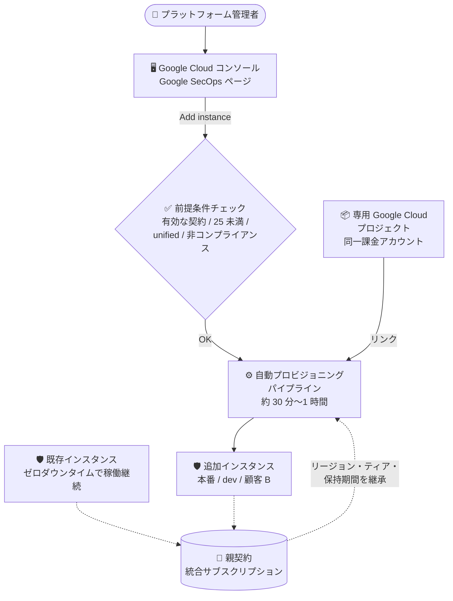

# Google SecOps: セルフサービスによる追加インスタンスプロビジョニングが GA

**リリース日**: 2026-11-19

**サービス**: Google SecOps

**機能**: セルフサービスによる追加インスタンスのプロビジョニング

**ステータス**: GA (一般提供)

📊 [このアップデートのインフォグラフィックを見る](https://takech9203.github.io/google-cloud-news-summary/20261119-google-secops-self-service-instance-provisioning.html)

## 概要

Google SecOps の追加インスタンスをセルフサービスでプロビジョニングする機能が一般提供 (GA) になりました。有効な Google SecOps 統合サブスクリプション (unified subscription) を持つ顧客は、Google Cloud コンソールから直接、追加の Google SecOps インスタンスをデプロイできるようになります。

この機能は、プラットフォーム管理者やセキュリティエンジニアが、既存の統合サブスクリプション配下に新しいインスタンスをプロビジョニングし、リンクするためのセルフサービスワークフローを提供します。これにより、事業部門、子会社、あるいはマネージドサービスの顧客ごとにマルチテナントのセキュリティ運用を、サポートによる手動対応を待つことなくスケールさせることができます。プロビジョニング中も既存のアクティブなインスタンスはダウンタイムなしで稼働し続けます。

**アップデート前の課題**

- 追加インスタンスのプロビジョニングには、手動のサポート対応 (Google 担当者やサポートへの依頼) が必要で、環境の払い出しに時間がかかっていた
- MSSP (マネージドセキュリティサービスプロバイダー) が新規顧客をオンボーディングする際、顧客ごとのテナント分離に手動エスカレーションが必要だった
- 開発・ステージング・本番といった環境分離や事業部門ごとのデータ境界の実現に、都度 Google 側での作業を待つ必要があった

**アップデート後の改善**

- Google Cloud コンソールの「Add instance」操作だけで、追加インスタンスのデプロイが完結するようになった
- 自動プロビジョニングパイプラインにより、プロジェクトの契約へのリンク、データストレージ構成、サービスインフラのセットアップ、インスタンスの有効化が自動実行される (所要時間は通常 30 分〜1 時間)
- プロビジョニング中も既存インスタンスはゼロダウンタイムで稼働し、セッションのロックアウトも発生しない
- 1 つの契約 (課金) の下で複数テナントを統合管理しつつ、厳格なデータ境界と独立したアクセス制御を実現できる

## アーキテクチャ図

管理者が Google Cloud コンソールからプロビジョニングを開始すると、自動パイプラインが専用プロジェクトを親契約にリンクし、リージョン・パッケージティア・データ保持期間を継承した追加インスタンスをデプロイします。既存インスタンスは影響を受けません。

## サービスアップデートの詳細

### 主要機能

1. **コンソールからのセルフサービスデプロイ**
   - Google Cloud コンソールの Google SecOps ページから「Add instance」をクリックするだけで追加インスタンスのデプロイを開始できる
   - Instances テーブルで課金アカウントに紐づく全インスタンスを一覧・管理できる
   - デプロイ完了後、新しいインスタンスは「Active」ステータスで Instances テーブルに表示される

2. **親契約からの設定自動継承**
   - リージョン (地理的データレジデンシー)、パッケージティア、データ保持期間は親サブスクリプション契約から自動継承され、デプロイ時に変更不可 (ロック)
   - 課金は 1 つのサブスクリプションに統合されたまま、テナントごとの分離を実現

3. **ガイド付きセットアップフロー**
   - ターゲットプロジェクトの選択 (課金アカウント不一致や既存インスタンスとの重複がある場合は警告表示)
   - Essential Contacts の登録 (Technical / Security / Legal / Billing の 4 カテゴリが必須)
   - SSO 構成 (Google Cloud Identity または Workforce Identity Federation による第三者 IdP)
   - 利用規約への同意後、「Start setup」で自動プロビジョニング開始

## 技術仕様

### 主要な用語と仕様

| 項目 | 詳細 |
|------|------|
| Unified instance | SIEM と SOAR を単一環境に統合した Google SecOps テナント。Google Cloud プロジェクトにリンクされる |
| 親契約 (Parent contract) | Cloud Billing アカウントに紐づくサブスクリプション契約。リージョン、パッケージティア、データ保持期間を全インスタンスに適用 |
| 管理用プロジェクト | 各インスタンスにリンクされる専用 Google Cloud プロジェクト。IAM、API、リソース設定を制御 (1 プロジェクト = 1 インスタンス) |
| プロビジョニング所要時間 | 通常 30 分〜1 時間 (インフラ割り当て、ストレージリンク、テナント有効化) |
| 最大インスタンス数 | 課金アカウント・契約あたり 25 未満 (25 以上では Add instance ボタンが無効化) |
| SSO | Google Cloud Identity (Cloud Identity / Google Workspace) または Workforce Identity Federation (Okta、Microsoft Entra ID など) |

### 必要な IAM ロール

| スコープ | 必要なロール / 権限 |
|------|------|
| Cloud Billing アカウント | `billing.resourceAssociations.list` 権限、または Billing Account User (`roles/billing.user`) |
| ターゲットプロジェクト | Project IAM Admin (`roles/resourcemanager.projectIamAdmin`)、Editor (`roles/editor`)、Service Usage Admin (`roles/serviceusage.serviceUsageAdmin`)、Chronicle Service Admin (`roles/chroniclesm.admin`) |
| 組織レベル (第三者 IdP 使用時) | IAM Workforce Pool Admin (`roles/iam.workforcePoolAdmin`) |

## 設定方法

### 前提条件

1. 有効な Google SecOps 統合サブスクリプション契約 (Standard / Enterprise / Enterprise Plus ティア) があること
2. 既にオンボーディング済みでアクティブな初期インスタンスが 1 つ以上存在すること
3. 新インスタンス用の専用 Google Cloud プロジェクトを用意し、サブスクリプション契約と同一の Cloud Billing アカウントを使用していること (各プロジェクトがホストできるインスタンスは 1 つのみ)
4. 上記「必要な IAM ロール」を保有していること
5. (任意) VPC Service Controls を使用している場合は、Google SecOps 用の ingress/egress ルールを構成しておくこと

### 手順

#### ステップ 1: Google SecOps ページを開く

Google Cloud コンソールで Google SecOps ページに移動し、Instances テーブルで既存インスタンスを確認して「Add instance」をクリックします。ボタンが無効な場合は、課金権限・初期インスタンスの有無・インスタンス数上限 (25)・コンプライアンス制御の有無を確認します。

#### ステップ 2: ターゲットプロジェクトを選択

「Link SecOps to a project」ページで組織を選択し、準備した Google Cloud プロジェクトを選択します。選択不可のプロジェクトには警告アイコンが表示され、ポインタを合わせると制約理由 (課金アカウント不一致、権限不足、既存インスタンスとの関連付けなど) を確認できます。

#### ステップ 3: Essential Contacts を登録

Technical、Security、Legal、Billing の必須 4 カテゴリすべてに少なくとも 1 件の連絡先メールアドレスを登録します。未登録のカテゴリがあると「Next」ボタンは無効のままです。

#### ステップ 4: デプロイ詳細の確認と SSO 構成

親契約から継承されたリージョン、パッケージティア、データ保持期間を確認し、システムが作成するサービスアカウントの詳細を確認します。その後、Google Cloud Identity または Workforce Identity Federation (第三者 IdP) を選択して SSO を構成し、利用規約に同意します。IdP の設定が有効であることを事前に確認してください。設定ミスがあるとデプロイ完了後にユーザーがサインインできなくなります。

#### ステップ 5: セットアップを開始

「Start setup」をクリックすると、自動プロビジョニングパイプラインがプロジェクトの契約リンク、データストレージ構成、サービスインフラのセットアップ、インスタンスの有効化を実行します。完了まで 30 分〜1 時間程度かかります。この間、セットアップページの再読み込みや重複したセットアップリクエストの送信は避けてください。完了後、Instances テーブルで「Active」ステータスを確認し、構成した IdP でサインインして検証します。デプロイが失敗した場合は、ターゲットプロジェクトで `chronicle.googleapis.com` が有効になっているか確認します。

## メリット

### ビジネス面

- **オンボーディングの高速化**: MSSP の顧客追加や新規事業部門の環境払い出しが、手動のサポートエスカレーションなしで 30 分〜1 時間程度で完了する
- **課金の一元化**: 複数のテナント環境を 1 つのサブスクリプション契約の下に統合し、課金管理をシンプルに保てる

### 技術面

- **厳格なテナント分離**: インスタンスごとに専用の Google Cloud プロジェクトと独立した IAM・アクセス制御を持ち、データ境界を強制できる
- **ゼロダウンタイム**: プロビジョニング中も既存インスタンスはダウンタイムやセッションロックアウトなしで稼働し続ける
- **設定の一貫性**: リージョン、パッケージティア、データ保持期間が親契約から自動継承されるため、インスタンス間で設定の不整合が発生しない

## デメリット・制約事項

### 制限事項

- 既存のアクティブなインスタンスが 1 つ以上必要 (初回オンボーディングには使用不可)
- 課金アカウント・契約にリンクされたインスタンス数が 25 以上の場合は利用不可
- サブスクリプションが Standard / Enterprise / Enterprise Plus のいずれかのパッケージである必要がある
- 契約配下のすべての既存インスタンスが unified instance (SIEM + SOAR 統合) である必要がある。SIEM 専用インスタンスが 1 つでもあると利用不可
- コンプライアンス制御環境 (FedRAMP、IL4/IL5/IL6、CMEK、DRZ_Advanced など) では利用不可。この場合は従来どおり Google 担当者またはサポート経由での手動プロビジョニングが必要
- 追加インスタンスのリージョンは初期インスタンスと同一の地理的リージョン (例: `us`、`europe`) に固定され、変更できない
- データ保持期間は親契約から自動継承され、個別に変更できない

### 考慮すべき点

- 新インスタンスごとに専用の Google Cloud プロジェクトが必要 (サブスクリプションと同一の課金アカウントを使用)
- 契約のオンボーディングトークンは 30 日間有効。期限切れの場合は Google 担当者またはサポートへの連絡が必要
- SSO (特に Workforce Identity Pool) の設定ミスは、デプロイ完了後のサインイン不能につながるため、事前検証が重要

## ユースケース

### ユースケース 1: 事業部門・子会社・環境ごとの分離

**シナリオ**: 複数の事業部門や子会社を持つ企業、あるいは開発・ステージング・本番の環境分離が必要な組織が、単一契約の下で専用インスタンスをデプロイする。

**効果**: 厳格なデータ境界と独立したアクセス制御を実現しつつ、課金は 1 つのサブスクリプションに統合できる。

### ユースケース 2: MSSP による顧客オンボーディング

**シナリオ**: MSSP が有効なサブスクリプションの下で、マネージド顧客ごとに個別の Google SecOps インスタンスをプロビジョニングする。

**効果**: 手動のサポートエスカレーションなしで顧客オンボーディングを加速し、テナント分離を維持できる。

## 料金

Google SecOps はサブスクリプションベースのサービスです。追加インスタンスは既存の統合サブスクリプション契約 (親契約) の下にリンクされ、課金は 1 つのサブスクリプションに統合されます。詳細な料金は以下のページを参照してください。

- [Google Security Operations の料金](https://cloud.google.com/security/products/security-operations)

## 利用可能リージョン

追加インスタンスは、初期インスタンスと同一の地理的リージョン (例: `us`、`europe`) にデプロイされます。リージョンは親契約に合わせてロックされ、変更できません。

## 関連サービス・機能

- **Cloud Billing**: サブスクリプション契約と各インスタンスの専用プロジェクトは同一の Cloud Billing アカウントを使用する必要がある
- **IAM / Workforce Identity Federation**: 各インスタンスのアクセス制御と SSO を担う。Okta や Microsoft Entra ID などの第三者 IdP と連携可能
- **Essential Contacts**: 技術・セキュリティ・法務・課金に関する重要通知の宛先として、インスタンスごとに必須登録
- **VPC Service Controls**: 組織で使用している場合、Google SecOps 用の ingress/egress ルール構成が必要
- **Chronicle API** (`chronicle.googleapis.com`): ターゲットプロジェクトで有効化が必要

## 参考リンク

- 📊 [インフォグラフィック](https://takech9203.github.io/google-cloud-news-summary/20261119-google-secops-self-service-instance-provisioning.html)
- [公式リリースノート](https://docs.cloud.google.com/release-notes#November_19_2026)
- [ドキュメント: Deploy an additional instance](https://docs.cloud.google.com/chronicle/docs/onboard/provision-additional-instance)
- [ドキュメント: Link an instance to Google Cloud](https://docs.cloud.google.com/chronicle/docs/onboard/link-chronicle-cloud)
- [ドキュメント: Configure VPC Service Controls for Google SecOps](https://docs.cloud.google.com/chronicle/docs/secops/vpcsc-for-secops)

## まとめ

Google SecOps の追加インスタンスプロビジョニングがセルフサービス化されたことで、これまでサポートへの依頼が必要だったマルチテナント環境の拡張が、コンソール操作だけで 30 分〜1 時間程度で完結するようになりました。事業部門・環境ごとの分離や MSSP の顧客オンボーディングを計画している組織は、インスタンス数上限 (25) や unified instance 要件、コンプライアンス制御環境の除外などの制約を確認した上で、専用プロジェクトの準備と IAM ロールの付与から着手することを推奨します。

---

**タグ**: Google SecOps, SIEM, SOAR, セキュリティ運用, マルチテナント, プロビジョニング, MSSP, GA
