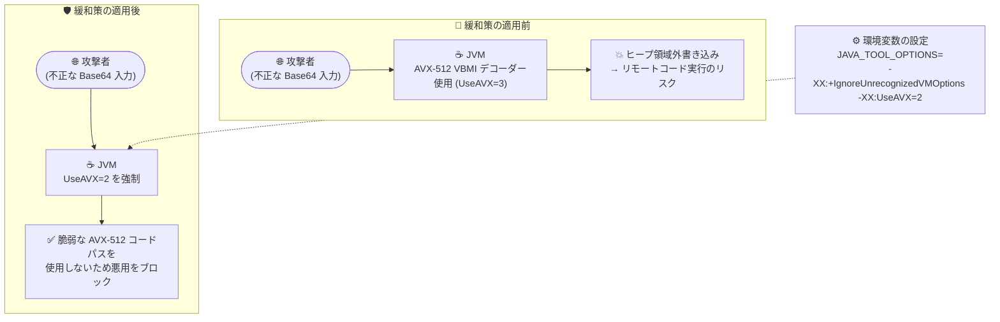

# Managed Service for Apache Airflow: CVE-2026-114938 への対応 (修正準備と暫定緩和策)

**リリース日**: 2026-11-19

**サービス**: Managed Service for Apache Airflow (旧 Cloud Composer)

**機能**: CVE-2026-114938 脆弱性への対応 (修正版の準備と暫定緩和策の案内)

**ステータス**: Security (修正版は準備中、全ユーザーに暫定緩和策の適用を要請)

📊 [このアップデートのインフォグラフィックを見る](https://takech9203.github.io/google-cloud-news-summary/20261119-managed-airflow-cve-2026-114938-mitigation.html)

## 概要

Managed Service for Apache Airflow (旧 Cloud Composer) は、脆弱性 **CVE-2026-114938** に対する修正を準備中であることを発表しました。修正は今後リリースされる Managed Airflow バージョンで公開され、さらに **2024 年から 2026 年の間にリリースされた過去の Managed Airflow バージョンにもバックポート**される予定です。修正が本番環境にデプロイされた後、悪用を防止するためにユーザーが実施すべき手順の詳細が改めて案内されます。

CVE-2026-114938 は、Google Cloud のセキュリティ速報によると、**OpenJDK HotSpot の AVX-512 VBMI Base64 デコーダー組み込み関数 (intrinsic) における整数アンダーフロー**に起因する脆弱性です。`UseAVX=3` が有効な状態で不正な形式の Base64 入力 (`Base64.getDecoder()` または `Base64.getUrlDecoder()`) をデコードするとヒープ領域外書き込みが発生し、C2 JIT コンパイラが該当のデコードパスをコンパイルした後は、信頼できない Base64 入力を送り込める**認証不要のリモート攻撃者が JVM プロセス内で任意コードを実行できる**可能性があります。深刻度は **Critical** と評価されています。

修正版の提供までの間、**すべての Managed Airflow ユーザー**は、環境に以下の環境変数を設定することが要請されています。この設定により CVE-2026-114938 の悪用を効果的にブロックできます。

```
JAVA_TOOL_OPTIONS=-XX:+IgnoreUnrecognizedVMOptions -XX:UseAVX=2
```

**アップデート前の課題**

- CVE-2026-114938 は OpenJDK 17.0.6 以降 (21.x、25.x、27.x を含む) が AVX-512 VBMI をサポートする x86-64 プロセッサ上で動作する場合に影響し、未修正の JVM を含むワークロードが悪用のリスクにさらされていた
- Managed Airflow 環境向けの修正版はまだ公開されておらず、ユーザー側で脆弱性に対処する手段の案内がなかった

**アップデート後の改善**

- 修正が今後の Managed Airflow バージョンで公開され、2024〜2026 年にリリースされた過去バージョンにもバックポートされる方針が明示された
- 修正版の提供までの間に悪用をブロックできる具体的な暫定緩和策 (環境変数 `JAVA_TOOL_OPTIONS` の設定) が全ユーザーに案内された
- 修正のデプロイ後には、悪用防止のためにユーザーが実施すべき手順の詳細が提供されることが予告された

## アーキテクチャ図



緩和策として環境変数 `JAVA_TOOL_OPTIONS` で `UseAVX=2` を強制することで、JVM が脆弱性の原因となる AVX-512 VBMI の Base64 デコーダーコードパスを使用しなくなり、修正版の提供前でも CVE-2026-114938 の悪用をブロックできます。

## サービスアップデートの詳細

### 主要なポイント

1. **修正版の準備とバックポート**
   - CVE-2026-114938 の修正は、今後リリースされる Managed Airflow バージョンで公開される
   - 2024 年から 2026 年の間にリリースされた過去の Managed Airflow バージョンにもバックポートされる

2. **修正デプロイ後の追加手順の案内**
   - 修正が本番環境にデプロイされた後、CVE-2026-114938 の悪用の可能性を防ぐためにユーザーが実施すべき手順の詳細が Managed Airflow から提供される予定

3. **暫定緩和策 (全ユーザーへの要請)**
   - それまでの間、すべてのユーザーは Managed Airflow 環境に環境変数 `JAVA_TOOL_OPTIONS=-XX:+IgnoreUnrecognizedVMOptions -XX:UseAVX=2` を設定することが要請されている
   - この設定により CVE-2026-114938 の悪用を効果的にブロックできる

## 技術仕様

### CVE-2026-114938 の概要 (Google Cloud セキュリティ速報より)

| 項目 | 詳細 |
|------|------|
| 脆弱性 | OpenJDK HotSpot の AVX-512 VBMI Base64 デコーダー組み込み関数における整数アンダーフロー |
| 影響 | 不正な形式の Base64 入力のデコード時にヒープ領域外書き込みが発生。C2 JIT がデコードパスをコンパイル後、認証不要のリモート攻撃者が JVM プロセス内で任意コード実行の可能性 |
| 深刻度 | Critical |
| 影響を受けるバージョン | OpenJDK 17.0.6 以降 (17.0.6+、21.x、25.x、27.x。Eclipse Temurin などのディストリビューションを含む)。AVX-512 VBMI をサポートする x86-64 プロセッサ上で影響 |
| 影響を受けないバージョン | OpenJDK 8、11、および 17.0.0〜17.0.5 |
| インフラへの影響 | Google Cloud のハイパーバイザーおよび顧客 VM / コンテナ間のハードウェア分離境界は影響を受けない |

### 緩和策の環境変数

| 設定項目 | 値 |
|----------|-----|
| 変数名 | `JAVA_TOOL_OPTIONS` |
| 値 | `-XX:+IgnoreUnrecognizedVMOptions -XX:UseAVX=2` |

- `-XX:UseAVX=2`: JVM が使用する AVX 命令のレベルを 2 に制限し、脆弱性の条件である `UseAVX=3` (AVX-512) のコードパスを回避する
- `-XX:+IgnoreUnrecognizedVMOptions`: JVM が認識できないオプションを無視するようにし、`UseAVX` フラグをサポートしない JVM で起動エラーが発生することを防ぐ

## 設定方法

### 前提条件

1. Managed Airflow (Cloud Composer) 環境を運用していること
2. 環境を更新できる IAM 権限 (例: `roles/composer.admin` などの環境更新権限) を持っていること

### 手順

#### ステップ 1: Google Cloud コンソールで設定する場合

1. Google Cloud コンソールで「Environments」ページに移動する
2. 対象の環境名をクリックし、「環境の変数」(Environment variables) タブを開いて「編集」をクリックする
3. 「名前」フィールドに `JAVA_TOOL_OPTIONS`、「値」フィールドに `-XX:+IgnoreUnrecognizedVMOptions -XX:UseAVX=2` を指定して保存する

#### ステップ 2: gcloud CLI で設定する場合

```bash
gcloud composer environments update ENVIRONMENT_NAME \
  --location LOCATION \
  --update-env-variables="JAVA_TOOL_OPTIONS=-XX:+IgnoreUnrecognizedVMOptions -XX:UseAVX=2"
```

`ENVIRONMENT_NAME` は環境名、`LOCATION` は環境のリージョンに置き換えます。値にスペースが含まれるため、`NAME=VALUE` 全体を引用符で囲みます。

#### ステップ 3: Terraform で設定する場合

```hcl
resource "google_composer_environment" "example" {
  name   = "ENVIRONMENT_NAME"
  region = "LOCATION"
  config {
    software_config {
      env_variables = {
        JAVA_TOOL_OPTIONS = "-XX:+IgnoreUnrecognizedVMOptions -XX:UseAVX=2"
      }
    }
  }
}
```

環境変数は Airflow のスケジューラ、ワーカー、ウェブサーバーの各プロセスに提供されます。設定方法の詳細は[公式ドキュメント](https://docs.cloud.google.com/composer/docs/composer-3/set-environment-variables)を参照してください。

## メリット

### ビジネス面

- **Critical 脆弱性への即時対応**: 修正版を待たずに、環境変数の設定のみで悪用をブロックでき、リモートコード実行のリスクを低減できる
- **既存バージョンの救済**: 2024〜2026 年リリースの過去バージョンにもバックポートされるため、すぐにバージョンアップできない環境でも修正を受けられる

### 技術面

- **シンプルな緩和策**: コード変更や環境の再作成は不要で、環境変数 1 つの設定で緩和できる
- **安全なフラグ設計**: `-XX:+IgnoreUnrecognizedVMOptions` の併用により、`UseAVX` フラグを認識しない JVM でも起動エラーを起こさない

## デメリット・制約事項

### 制限事項

- 環境変数の設定はあくまで暫定的な緩和策であり、恒久対応には今後公開される修正版の適用と、修正デプロイ後に案内される手順の実施が必要
- 修正版の具体的なリリース時期は本リリースノートでは明示されていない

### 考慮すべき点

- 環境変数の更新は環境の更新オペレーションとして実行されるため、適用のタイミング (実行中の DAG への影響など) を考慮する
- 既に `JAVA_TOOL_OPTIONS` を独自に設定している環境では、既存の値を上書きしないよう、要請されたフラグを既存の値に追記する形で設定する
- 修正デプロイ後に Managed Airflow から提供される追加手順の案内 (リリースノートや既知の問題ページ) を継続的に確認する

## ユースケース

### ユースケース 1: 全 Managed Airflow 環境への一括緩和策適用

**シナリオ**: 組織内で複数の Managed Airflow 環境を運用しており、修正版の提供前に全環境で CVE-2026-114938 の悪用をブロックしたい。

**実装例**:
```bash
# プロジェクト内の環境を一覧化し、各環境に環境変数を適用
gcloud composer environments list --locations=us-central1

gcloud composer environments update example-environment \
  --location us-central1 \
  --update-env-variables="JAVA_TOOL_OPTIONS=-XX:+IgnoreUnrecognizedVMOptions -XX:UseAVX=2"
```

**効果**: 修正版のリリースを待たずに、全環境で脆弱な AVX-512 コードパスの使用を回避し、悪用をブロックできる。

### ユースケース 2: Terraform 管理環境への IaC による緩和策適用

**シナリオ**: Managed Airflow 環境を Terraform で管理しており、構成ドリフトを発生させずに緩和策を適用したい。

**効果**: `software_config.env_variables` に `JAVA_TOOL_OPTIONS` を追加してコードレビューを経て適用することで、監査可能な形で全環境に緩和策を展開できる。

## 関連サービス・機能

- **Google Cloud セキュリティ速報 (Security Bulletins)**: CVE-2026-114938 の詳細、影響を受ける OpenJDK バージョン、Google Cloud 各サービス (GKE、Cloud Run、Dataproc、Dataflow、Apigee など) での対応状況が公開されている
- **Security Command Center / Artifact Analysis**: 脆弱性フィードの更新に伴い、CVE-2026-114938 に関する通知を受け取れる
- **Cloud Composer 環境変数設定**: 今回の緩和策の適用に使用する機能。コンソール、gcloud、API、Terraform から設定可能

## 参考リンク

- 📊 [インフォグラフィック](https://takech9203.github.io/google-cloud-news-summary/20261119-managed-airflow-cve-2026-114938-mitigation.html)
- [公式リリースノート](https://docs.cloud.google.com/release-notes#November_19_2026)
- [Managed Service for Apache Airflow リリースノート](https://docs.cloud.google.com/composer/docs/release-notes)
- [Google Cloud セキュリティ速報](https://docs.cloud.google.com/support/bulletins)
- [環境変数の設定ドキュメント](https://docs.cloud.google.com/composer/docs/composer-3/set-environment-variables)

## まとめ

CVE-2026-114938 は、OpenJDK の Base64 デコード処理に起因する Critical 評価のリモートコード実行脆弱性であり、Managed Airflow では修正版の公開と過去バージョン (2024〜2026 年リリース) へのバックポートが準備されています。修正版の提供までの間、すべてのユーザーは環境変数 `JAVA_TOOL_OPTIONS=-XX:+IgnoreUnrecognizedVMOptions -XX:UseAVX=2` を環境に設定し、悪用をブロックすることが要請されています。速やかに全環境へ緩和策を適用した上で、修正デプロイ後に案内される追加手順に備えてリリースノートを継続的に確認してください。

---

**タグ**: Managed Service for Apache Airflow, Cloud Composer, セキュリティ, CVE-2026-114938, OpenJDK, 脆弱性対応
