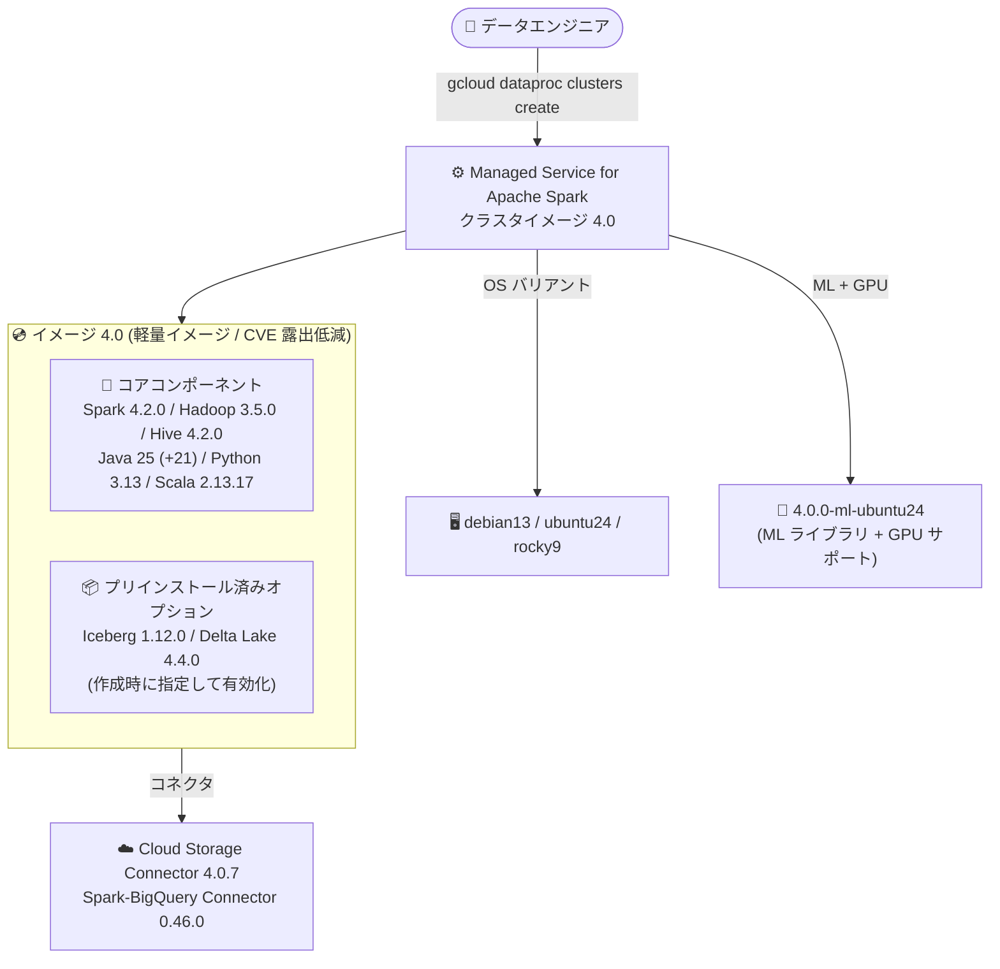

# Managed Service for Apache Spark: クラスタイメージバージョン 4.0 が GA

**リリース日**: 2026-11-19

**サービス**: Managed Service for Apache Spark (旧 Dataproc on Compute Engine)

**機能**: クラスタイメージバージョン 4.0

**ステータス**: GA (一般提供)

📊 [このアップデートのインフォグラフィックを見る](https://takech9203.github.io/google-cloud-news-summary/20261119-managed-spark-cluster-image-4-0-ga.html)

## 概要

Managed Service for Apache Spark (旧 Dataproc on Compute Engine) のクラスタイメージバージョン 4.0 が一般提供 (GA) になりました。提供されるイメージは `4.0.0-debian13`、`4.0.0-ml-ubuntu24`、`4.0.0-rocky9`、`4.0.0-ubuntu24` の 4 種類で、`4.0.0-ml-ubuntu24` は 4.0 ベースイメージを機械学習ライブラリと GPU サポートで拡張したものです。

イメージ 4.0 はコアコンポーネントのみを含む軽量 (lightweight) イメージとして設計されており、CVE (共通脆弱性識別子) への露出を低減します。Apache Spark 4.2.0、Apache Hadoop 3.5.0、Apache Hive 4.2.0 などの最新 OSS スタックに加え、Spark ワークロード用の Java 25 (後方互換用に Java 21 も同梱)、Python 3.13、Scala 2.13.17、R 4.5 を搭載しています。Apache Iceberg 1.12.0 と Delta Lake 4.4.0 はプリインストール済みオプションコンポーネントとして含まれており、クラスタ作成時に指定するだけで有効化できます。

最新の OSS バージョンでクラスタを運用したいデータエンジニアリングチームや、セキュリティコンプライアンス要件の厳しい組織が主な対象です。なお、公式リリースノートでは「セキュリティコンプライアンス要件を満たすため、クラスタ作成時にはイメージバージョン 2.3 以降を使用すること」が推奨されています。

**アップデート前の課題**

- 最新 GA イメージは 3.0 (2026 年 7 月 GA) であり、Spark 4.2.0 / Hadoop 3.5.0 / Hive 4.2.0 / Java 25 といった最新コンポーネントの組み合わせを GA サポート付きで利用できなかった
- イメージ 3.0 では Iceberg や Delta Lake はオプションコンポーネントとしてクラスタ作成時にダウンロード・インストールされるため、クラスタ起動時間が延びる可能性があった (回避にはカスタムイメージの作成が必要だった)

**アップデート後の改善**

- Spark 4.2.0 を含む最新 OSS スタックを GA サポート付き (サポート期限 2028/11/30、利用可能期限 2030/11/30) で利用可能になった
- Apache Iceberg 1.12.0 と Delta Lake 4.4.0 がイメージにプリインストールされ、クラスタ作成時に指定するだけで即座に有効化できるようになった
- 軽量イメージ設計により同梱コンポーネントが絞り込まれ、CVE への露出がさらに低減された
- マシンタイプ未指定時に N4、N2、E2 などのランク付けされた柔軟な VM マシンタイプ (Flexible VM) からリソース可用性に最適化して選択されるようになった

## アーキテクチャ図



イメージ 4.0 はコアコンポーネントのみを同梱する軽量イメージで、Iceberg / Delta Lake はプリインストール済みオプションとしてクラスタ作成時に有効化します。GPU を使うクラスタでは `4.0.0-ml-ubuntu24` イメージを使用します。

## サービスアップデートの詳細

### 主要機能

1. **最新 OSS スタックを同梱した軽量イメージ**
   - Apache Spark 4.2.0、Apache Hadoop 3.5.0、Apache Hive 4.2.0、Apache Tez 0.10.5、Apache Gluten 1.6 を搭載
   - コアコンポーネントのみを含む軽量設計により、CVE への露出を低減
   - Spark ワークロードには Java 25 を使用し、後方互換性のために Java 21 も同梱

2. **プリインストール済みオプションコンポーネント (Iceberg / Delta Lake)**
   - Apache Iceberg 1.12.0 と Delta Lake 4.4.0 がイメージにプリインストール済み
   - クラスタ作成時に `--optional-components` で指定すると有効化される
   - 標準の 4.0 クラスタで Iceberg コンポーネントを指定しなかった場合、Iceberg のセッション拡張とデフォルトカタログは `spark-defaults.conf` から自動的に除外される

3. **4 種類の OS バリアントと ML イメージ**
   - `4.0.0-debian13`、`4.0.0-ubuntu24`、`4.0.0-rocky9`、`4.0.0-ml-ubuntu24` を提供
   - `4.0.0-ml-ubuntu24` は機械学習ライブラリと GPU サポートを追加した拡張イメージ
   - `4.0-ml-ubuntu` 以外の 4.0 イメージは cgroups V2 が有効なため、YARN の GPU 検出が利用できず、GPU クラスタには `4.0-ml-ubuntu` イメージの使用が必須

4. **Flexible VM マシンタイプと YARN リソース計算の変更**
   - マシンタイプ未指定時は、N4、N2、E2 系などのランク付けリストからリソース可用性に最適化した VM が選択される
   - YARN のデフォルトリソース計算が `DefaultResourceCalculator` から `DominantResourceCalculator` に変更され、メモリと CPU のドミナントリソースに基づいて割り当てが決定される (オートスケーラーの動作にも影響)

## 技術仕様

### イメージ 4.0 の主な同梱コンポーネント

| コンポーネント | バージョン |
|------|------|
| Apache Spark | 4.2.0 |
| Apache Hadoop | 3.5.0 |
| Apache Hive | 4.2.0 |
| Apache Tez | 0.10.5 |
| Apache Gluten | 1.6 |
| Apache Iceberg (プリインストール済みオプション) | 1.12.0 |
| Delta Lake (プリインストール済みオプション) | 4.4.0 |
| Cloud Storage Connector | 4.0.7 |
| Spark-BigQuery Connector | 0.46.0 |
| Conscrypt | 2.6 |
| Java | 25 (後方互換用に 21 も同梱) |
| Python | 3.13 (Pixi 0.76.0) |
| R | 4.5 |
| Scala | 2.13.17 |

### 追加インストール可能な主なオプションコンポーネント

| コンポーネント | バージョン |
|------|------|
| Apache Flink | 2.2.0 |
| Apache Zeppelin Notebook | 0.12.0 |
| Apache Zookeeper | 3.9.5 |
| Apache Ranger | 2.8.0 |
| Apache Solr | 9.10.1 |
| Apache Pig | 0.18.0 |
| Trino | 480 |
| JupyterLab Notebook | 4.6.6 |
| Docker | 28.1 |

### サポートライフサイクル

| 項目 | 日付 |
|------|------|
| リリース日 | 2026/11/19 |
| サポート期限 | 2028/11/30 |
| 利用可能期限 | 2030/11/30 |

公式ドキュメントのイメージバージョン一覧では、4.0 は「General availability release (Lightning Engine feature is preview)」と記載されています。

## 設定方法

### 前提条件

1. Google Cloud プロジェクトで Dataproc API が有効化されていること
2. 最新イメージのロールアウトには最大 1 週間かかる場合があるため、利用リージョンで 4.0 イメージが利用可能になっていること

### 手順

#### ステップ 1: イメージ 4.0 でクラスタを作成

```bash
gcloud dataproc clusters create my-spark-cluster \
    --region=us-central1 \
    --image-version=4.0-debian13
```

Debian ベースのイメージは OS サフィックスを省略して `--image-version=4.0` と指定することもできます。Ubuntu や Rocky Linux を使う場合は `4.0-ubuntu24` のように OS サフィックスが必要です。

#### ステップ 2: Iceberg / Delta Lake などのオプションコンポーネントを有効化

```bash
gcloud dataproc clusters create my-lakehouse-cluster \
    --region=us-central1 \
    --image-version=4.0-debian13 \
    --optional-components=ICEBERG,DELTA
```

Iceberg と Delta Lake は 4.0 イメージにプリインストール済みのため、クラスタ作成時に指定するだけで有効化されます。オプションコンポーネントはクラスタ作成時に指定する必要があります。

#### ステップ 3: GPU を使用する場合は ML イメージを選択

```bash
gcloud dataproc clusters create my-ml-cluster \
    --region=us-central1 \
    --image-version=4.0-ml-ubuntu24
```

`4.0-ml-ubuntu` 以外の 4.0 イメージでは cgroups V2 が有効で YARN の GPU 検出がサポートされないため、GPU クラスタには `4.0-ml-ubuntu` イメージを使用する必要があります。

## メリット

### ビジネス面

- **長期サポートの確保**: サポート期限 2028/11/30、利用可能期限 2030/11/30 と、2.x 系イメージ (1.x / 2.0 は 2026/8/25 に作成不可) からの移行先として長期的な計画が立てられる
- **セキュリティリスクの低減**: コアコンポーネントのみの軽量イメージにより CVE への露出を減らし、セキュリティコンプライアンス対応を容易にする

### 技術面

- **最新 Spark 4.2.0 の活用**: Java 25、Python 3.13、Scala 2.13.17 を含む最新スタックで新しい言語機能・性能改善を利用できる
- **オープンレイクハウス対応**: Iceberg 1.12.0 / Delta Lake 4.4.0 がプリインストール済みで、クラスタ起動時の追加ダウンロードなしにレイクハウス構成を開始できる
- **リソース配置の最適化**: Flexible VM マシンタイプと DominantResourceCalculator により、リソース可用性と利用効率を考慮した割り当てが行われる

## デメリット・制約事項

### 制限事項

- **Apache Hudi 非サポート**: イメージバージョン 4.0 では Apache Hudi はサポートされない
- **Hive 4.2 とメタストアの制約**: BigQuery Metastore、BigLake Metastore、Dataproc Metastore を使った Hive 4.2 の直接クエリはサポートされない
- **Delta Lake と Hive の制約**: 同梱の Delta Lake 4.x は Hive をサポートせず、Delta Lake 4.4 テーブルへの Hive クエリは実行できない
- **GPU クラスタのイメージ制約**: GPU を使用するクラスタは `4.0-ml-ubuntu` イメージが必須 (他の 4.0 イメージは cgroups V2 有効のため YARN の GPU 検出が不可)

### 考慮すべき点

- **Lightning Engine は Preview**: 4.0 イメージ自体は GA だが、Lightning Engine 機能は Preview 段階
- **オートスケーラーへの影響**: YARN のリソース計算が DominantResourceCalculator に変更されたため、オートスケーリングはクラスタのドミナントリソース使用量に基づいて動作する。既存の 2.x 系からの移行時はスケーリング挙動の検証が必要
- **ロールアウト期間**: 最新イメージの全リージョンへのロールアウトには最大 1 週間かかる場合があり、リージョンによってはすぐに利用できない可能性がある
- **Java のメジャーバージョンアップ**: Spark ワークロードのデフォルトが Java 25 になるため、既存ジョブの依存ライブラリ互換性の確認が必要 (後方互換用に Java 21 も同梱)

## ユースケース

### ユースケース 1: Iceberg ベースのオープンレイクハウス基盤の構築

**シナリオ**: Cloud Storage 上のデータレイクに対して、Apache Iceberg 形式でテーブルを管理し、Spark 4.2.0 で ETL と分析を行いたい。

**実装例**:
```bash
gcloud dataproc clusters create lakehouse-cluster \
    --region=us-central1 \
    --image-version=4.0-debian13 \
    --optional-components=ICEBERG
```

**効果**: Iceberg 1.12.0 がプリインストール済みのため、クラスタ作成時に有効化を指定するだけで追加ダウンロードなしに Iceberg テーブルを利用開始できる。Spark-BigQuery Connector 0.46.0 により BigQuery との連携も可能。

### ユースケース 2: GPU を使った ML ワークロードの実行

**シナリオ**: Spark 上で機械学習の前処理・学習ジョブを GPU で高速化したい。

**実装例**:
```bash
gcloud dataproc clusters create ml-gpu-cluster \
    --region=us-central1 \
    --image-version=4.0-ml-ubuntu24
```

**効果**: ML ライブラリと GPU サポートが組み込まれた `4.0.0-ml-ubuntu24` イメージにより、環境構築の手間なく GPU 対応の Spark クラスタを起動できる。

### ユースケース 3: セキュリティコンプライアンス要件への対応

**シナリオ**: 社内のセキュリティポリシーで、既知の CVE への露出を最小化したクラスタ構成が求められている。

**効果**: コアコンポーネントのみを含む軽量イメージ設計により CVE への露出を低減。必要なコンポーネントのみをオプションとしてオンデマンドで追加する運用が可能になる。

## 料金

イメージバージョン 4.0 の利用自体による追加料金はありません。Managed Service for Apache Spark のクラスタモードは、クラスタの稼働時間に対して基盤となる Compute Engine リソース料金に加え、クラスタ内の vCPU 数に基づく管理料金 (1 vCPU あたり 1 時間 $0.01 から) が課金されます。課金は秒単位 (最低 1 分) で、マシンタイプに関わらず vCPU 数に応じた定額です。

| 項目 | 料金 |
|--------|-----------------|
| クラスタ管理料金 | $0.01 / vCPU 時間 から |
| Lightning Engine アドオン (Preview) | $0.0025 / vCPU 時間 から |
| Compute Engine リソース | 使用した VM / ディスクに応じて別途課金 |

詳細は [料金ページ](https://cloud.google.com/products/managed-service-for-apache-spark/pricing) を参照してください。

## 利用可能リージョン

Managed Service for Apache Spark は Google Cloud の全リージョンで利用可能です。ただし、最新イメージの全リージョンへのロールアウトには最大 1 週間かかる場合があり、ロールアウト完了までは一部リージョンで 4.0 イメージが利用できない可能性があります。

## 関連サービス・機能

- **Cloud Storage**: Cloud Storage Connector 4.0.7 を同梱し、データレイクのストレージ層として連携
- **BigQuery**: Spark-BigQuery Connector 0.46.0 を同梱し、Spark からの BigQuery 読み書きに対応
- **Google Cloud Serverless for Apache Spark**: クラスタ管理不要のサーバーレス実行モード。ジョブ単位の課金 (DCU ベース) で、クラスタモードと使い分けが可能
- **Cloud Logging / Cloud Monitoring**: クラスタとジョブのログ・メトリクスの収集に標準で統合

## 参考リンク

- 📊 [インフォグラフィック](https://takech9203.github.io/google-cloud-news-summary/20261119-managed-spark-cluster-image-4-0-ga.html)
- [公式リリースノート](https://docs.cloud.google.com/release-notes#November_19_2026)
- [4.0.x リリースバージョン (公式ドキュメント)](https://docs.cloud.google.com/managed-spark/docs/concepts/versioning/image-release-4.0)
- [サポートされるイメージバージョン一覧](https://docs.cloud.google.com/managed-spark/docs/concepts/versioning/image-version-lists)
- [オプションコンポーネントの追加](https://docs.cloud.google.com/managed-spark/docs/concepts/components/overview)
- [料金ページ](https://cloud.google.com/products/managed-service-for-apache-spark/pricing)

## まとめ

Managed Service for Apache Spark のクラスタイメージ 4.0 が GA となり、Spark 4.2.0 / Hadoop 3.5.0 / Java 25 を含む最新 OSS スタックを長期サポート付きで利用できるようになりました。Iceberg と Delta Lake のプリインストールにより、オープンレイクハウス構成の立ち上げも容易になっています。Hudi 非サポートや Hive 4.2 のメタストア制約、GPU クラスタのイメージ要件を確認のうえ、新規クラスタや 2.x 系からの移行先として評価を始めることを推奨します。

---

**タグ**: #ManagedServiceForApacheSpark #Dataproc #ApacheSpark #GA #イメージバージョン #Iceberg #DeltaLake #データ分析
